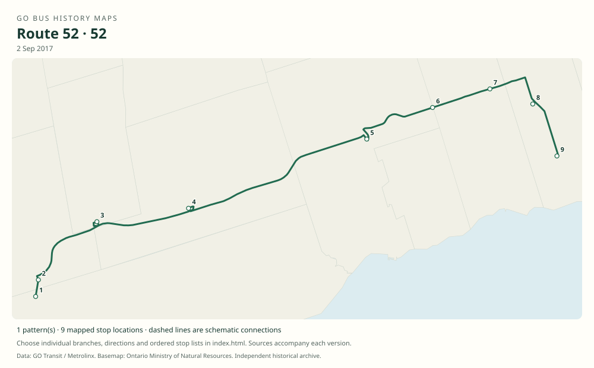

# GO Bus History Maps

A source-backed archive of GO bus routes, organized numerically. Each route folder contains its documented history, maps by date, ordered stops, original-source links and open research questions.

**Research edition: 23 October 2026.** This includes active and discontinued routes, branch letters, seasonal service, number reuse and bus substitutions found in the original operating data.

## Browse the archive

- **[Download the illustrated PDF guide](pdfs/GO-Bus-History-Guide.pdf)** — map examples, reading instructions and an index of all route PDFs.
- **[Route index](#routes-in-numerical-order)** — open a route to read its history and view the SVG maps directly on GitHub.
- **[Coverage by route](docs/COVERAGE.md)** — see which dates, versions and historical locations are established.
- **[Methodology](docs/METHODOLOGY.md)** · **[Sources and attribution](docs/SOURCES.md)** · **[Validation](docs/VALIDATION.md)**.
- **[Named legacy services](legacy/README.md)** — Bayview and Yonge C, kept separate from later route numbers.
- **[Route 52](routes/52/README.md)** includes the twenty documentary corridor reconstructions from the original route-history project, as well as four original GTFS snapshots.

Each route and named legacy corridor also has a PDF for reading or printing, with its sourced history, dated maps, numbered stop lists and navigation bookmarks. Use the **PDF** column in the route index below. Older versions preserve the original timing-point or major-stop limits; a PDF does not add undocumented roadside stops.

## What is included

| Material | This edition |
|---|---:|
| Numbered route families | 60 |
| Dated history entries for numbered routes | 282 |
| Original GTFS directional service patterns | 1,231 |
| Manually established historical patterns | 197 |
| Total numbered-route patterns | 1,428 |
| Ordered stop occurrences for numbered routes | 25,329 |
| Additional named legacy corridors | 2 |
| Additional legacy patterns / stop occurrences | 5 / 37 |
| Illustrated PDFs | 63: 60 numbered routes, 2 legacy corridors, 1 reader's guide |
| Downloadable SVG maps and stop-order diagrams | 357 |
| Original timetable links in the discovery catalog | 2,128 |

The four original GTFS captures are **11 January 2016, 8 March 2022, 5 May 2023 and 23 October 2026**. The importer preserves the source branch labels, direction IDs, headsigns, complete ordered stop sequences, boarding restrictions and scheduled dates. A pattern count includes directional and operational variants; it is not a count of permanently distinct road alignments.

**Coverage is documentary, not exhaustive.** Every route family verified in the collected sources is represented, but not every intermediate timetable, temporary diversion or unprinted roadside stop has been recovered. Older manual maps usually show timetable timing points or major stops. Archive links are discovery records, not a claim that all linked documents have been read. Each route lists its remaining gaps.

## Maps and stops



*Example: the documented 2017 route 52 corridor. Historical corridor reconstructions and schematic stop connections are labeled separately from geometry supplied by original GO feeds.*

| In each `routes/NN/` folder | Contents |
|---|---|
| `README.md` | Sourced chronology, map links, historical major-stop sequences and coverage gaps |
| `route-NN-history.pdf` | History, dated maps and numbered stop lists in a bookmarked document for reading or printing |
| `maps/*.svg` | Maps by snapshot and manual version; stop-order diagrams when geography is unresolved |
| `index.html` | Interactive map with date, branch and direction selection, zoom and numbered stops |
| `stops.csv` | Every documented ordered stop occurrence, with coordinates and evidence |
| `maps.geojson` | Route geometry and evidence metadata for GIS software |
| `history.json` / `historical-patterns.json` | Machine-readable history and manual reconstructions |
| `snapshots/YYYY-MM-DD.json` | Patterns and service dates from each original GTFS capture |
| `archive-sources.json` | Related original timetable archive links |

Unknown historical locations remain in their correct stop sequence with blank coordinates. A reference station or junction coordinate does not establish an exact historical bus bay. Solid source geometry, reconstructed corridors and dashed schematic connections have distinct labels. Modern municipal boundaries are supplied as geographic context.

## Open the interactive maps

GitHub renders the README pages, CSV tables and SVG files directly. To use the interactive HTML viewer, download or clone the repository, open a terminal in its folder, and run:

```sh
python -m http.server 8000
```

Open **http://localhost:8000** in your browser. Choose a route, an evidence date, and a branch/direction. The ordered stop list follows the chosen pattern. Opening the HTML directly with `file://` can prevent the browser from loading its JSON data.

The viewer needs no package installation, external map tiles, API keys or JavaScript framework. This contribution does not configure public website hosting.

## Routes in numerical order

“Current” means present in the 23 October 2026 source feed. “Special” includes the UP Express replacement bus family. Neither label guarantees a departure on every day; use each pattern’s recorded service dates. Branch letters are stored within their numeric family. A reused number can have unrelated services in different eras.

| Route | Service family / eras | Status | Patterns | PDF | Stops |
|---|---|---|---:|---|---|
| [11](routes/11/README.md) | Brock University; formerly Niagara-on-the-Lake seasonal shuttle | current | 3 | [PDF](routes/11/route-11-history.pdf) | [CSV](routes/11/stops.csv) |
| [12](routes/12/README.md) | Niagara Falls / Burlington | current | 33 | [PDF](routes/12/route-12-history.pdf) | [CSV](routes/12/stops.csv) |
| [15](routes/15/README.md) | Brantford / Aldershot; formerly McMaster / Burlington | current | 18 | [PDF](routes/15/route-15-history.pdf) | [CSV](routes/15/stops.csv) |
| [16](routes/16/README.md) | Hamilton / Toronto Express | current | 14 | [PDF](routes/16/route-16-history.pdf) | [CSV](routes/16/stops.csv) |
| [17](routes/17/README.md) | Waterloo / Hamilton | current | 6 | [PDF](routes/17/route-17-history.pdf) | [CSV](routes/17/stops.csv) |
| [18](routes/18/README.md) | Lakeshore West | current | 86 | [PDF](routes/18/route-18-history.pdf) | [CSV](routes/18/stops.csv) |
| [19](routes/19/README.md) | Mississauga / North York | current | 37 | [PDF](routes/19/route-19-history.pdf) | [CSV](routes/19/stops.csv) |
| [20](routes/20/README.md) | Milton / Oakville | discontinued | 6 | [PDF](routes/20/route-20-history.pdf) | [CSV](routes/20/stops.csv) |
| [21](routes/21/README.md) | Milton | current | 101 | [PDF](routes/21/route-21-history.pdf) | [CSV](routes/21/stops.csv) |
| [22](routes/22/README.md) | Milton / Oakville; formerly Hamilton / Meadowvale Business Park | current | 4 | [PDF](routes/22/route-22-history.pdf) | [CSV](routes/22/stops.csv) |
| [24](routes/24/README.md) | Cambridge / Milton | discontinued | 1 | [PDF](routes/24/route-24-history.pdf) | [CSV](routes/24/stops.csv) |
| [25](routes/25/README.md) | Waterloo / Mississauga | current | 40 | [PDF](routes/25/route-25-history.pdf) | [CSV](routes/25/stops.csv) |
| [27](routes/27/README.md) | Milton / North York | current | 44 | [PDF](routes/27/route-27-history.pdf) | [CSV](routes/27/stops.csv) |
| [29](routes/29/README.md) | Guelph / Mississauga | current | 19 | [PDF](routes/29/route-29-history.pdf) | [CSV](routes/29/stops.csv) |
| [30](routes/30/README.md) | Kitchener / Vaughan; formerly Kitchener / Bramalea | current | 26 | [PDF](routes/30/route-30-history.pdf) | [CSV](routes/30/stops.csv) |
| [31](routes/31/README.md) | Guelph / Toronto | current | 94 | [PDF](routes/31/route-31-history.pdf) | [CSV](routes/31/stops.csv) |
| [32](routes/32/README.md) | Brampton Trinity Common / North York | current | 27 | [PDF](routes/32/route-32-history.pdf) | [CSV](routes/32/stops.csv) |
| [33](routes/33/README.md) | Guelph / North York | current | 69 | [PDF](routes/33/route-33-history.pdf) | [CSV](routes/33/stops.csv) |
| [34](routes/34/README.md) | Pearson Airport / North York; formerly Brampton local | discontinued | 9 | [PDF](routes/34/route-34-history.pdf) | [CSV](routes/34/stops.csv) |
| [35](routes/35/README.md) | Union Pearson Express replacement; formerly Brampton / Highway 27 | special | 3 | [PDF](routes/35/route-35-history.pdf) | [CSV](routes/35/stops.csv) |
| [36](routes/36/README.md) | Brampton / North York Express | current | 19 | [PDF](routes/36/route-36-history.pdf) | [CSV](routes/36/stops.csv) |
| [37](routes/37/README.md) | Orangeville / Brampton | current | 24 | [PDF](routes/37/route-37-history.pdf) | [CSV](routes/37/stops.csv) |
| [38](routes/38/README.md) | Bolton / Malton; formerly Highway 27 / North York | current | 18 | [PDF](routes/38/route-38-history.pdf) | [CSV](routes/38/stops.csv) |
| [39](routes/39/README.md) | Guelph / Aberfoyle / Bramalea | discontinued | 1 | [PDF](routes/39/route-39-history.pdf) | [CSV](routes/39/stops.csv) |
| [40](routes/40/README.md) | Hamilton / Richmond Hill (formerly Pearson Airport Express) | current | 26 | [PDF](routes/40/route-40-history.pdf) | [CSV](routes/40/stops.csv) |
| [41](routes/41/README.md) | Hamilton / Pickering; earlier Orangeville route number | current | 22 | [PDF](routes/41/route-41-history.pdf) | [CSV](routes/41/stops.csv) |
| [42](routes/42/README.md) | Bolton (renumbered 38 in 2008) | discontinued | 1 | [PDF](routes/42/route-42-history.pdf) | [CSV](routes/42/stops.csv) |
| [43](routes/43/README.md) | Mount Pleasant / McMaster University; earlier Wonderland route number | current | 4 | [PDF](routes/43/route-43-history.pdf) | [CSV](routes/43/stops.csv) |
| [45](routes/45/README.md) | Streetsville / York University; later Mississauga / Markham | discontinued | 18 | [PDF](routes/45/route-45-history.pdf) | [CSV](routes/45/stops.csv) |
| [46](routes/46/README.md) | Oakville / York University; later Oakville / Highway 407 | discontinued | 12 | [PDF](routes/46/route-46-history.pdf) | [CSV](routes/46/stops.csv) |
| [47](routes/47/README.md) | Hamilton / Highway 407 (formerly York University and Yorkdale) | current | 74 | [PDF](routes/47/route-47-history.pdf) | [CSV](routes/47/stops.csv) |
| [48](routes/48/README.md) | Guelph / Highway 407 (formerly Meadowvale / York University) | current | 28 | [PDF](routes/48/route-48-history.pdf) | [CSV](routes/48/stops.csv) |
| [50](routes/50/README.md) | Unionville / Centennial College / University of Toronto Scarborough | discontinued | 1 | [PDF](routes/50/route-50-history.pdf) | [CSV](routes/50/stops.csv) |
| [51](routes/51/README.md) | Pickering / York University; later Pickering / Highway 407 | discontinued | 28 | [PDF](routes/51/route-51-history.pdf) | [CSV](routes/51/stops.csv) |
| [52](routes/52/README.md) | Oshawa / Highway 407 (formerly Oshawa / York University) | current | 40 | [PDF](routes/52/route-52-history.pdf) | [CSV](routes/52/stops.csv) |
| [54](routes/54/README.md) | Mount Joy / York University; later Mount Joy / Highway 407 | discontinued | 24 | [PDF](routes/54/route-54-history.pdf) | [CSV](routes/54/stops.csv) |
| [56](routes/56/README.md) | Oshawa / Oakville | current | 15 | [PDF](routes/56/route-56-history.pdf) | [CSV](routes/56/stops.csv) |
| [60](routes/60/README.md) | Canada’s Wonderland | discontinued | 2 | [PDF](routes/60/route-60-history.pdf) | [CSV](routes/60/stops.csv) |
| [61](routes/61/README.md) | Richmond Hill | current | 21 | [PDF](routes/61/route-61-history.pdf) | [CSV](routes/61/stops.csv) |
| [62](routes/62/README.md) | Newmarket B / Yonge Street | discontinued | 2 | [PDF](routes/62/route-62-history.pdf) | [CSV](routes/62/stops.csv) |
| [63](routes/63/README.md) | King City–Toronto | discontinued | 9 | [PDF](routes/63/route-63-history.pdf) | [CSV](routes/63/stops.csv) |
| [64](routes/64/README.md) | Newmarket–York University | discontinued | 1 | [PDF](routes/64/route-64-history.pdf) | [CSV](routes/64/stops.csv) |
| [65](routes/65/README.md) | Newmarket–Toronto / Barrie corridor | current | 71 | [PDF](routes/65/route-65-history.pdf) | [CSV](routes/65/stops.csv) |
| [66](routes/66/README.md) | Newmarket Highway 400 / East Gwillimbury Express | discontinued | 22 | [PDF](routes/66/route-66-history.pdf) | [CSV](routes/66/stops.csv) |
| [67](routes/67/README.md) | Keswick–North York / earlier Newmarket Highway 404 | current | 16 | [PDF](routes/67/route-67-history.pdf) | [CSV](routes/67/stops.csv) |
| [68](routes/68/README.md) | Barrie–Newmarket / Barrie corridor | current | 41 | [PDF](routes/68/route-68-history.pdf) | [CSV](routes/68/stops.csv) |
| [69](routes/69/README.md) | Sutton–Newmarket; later Aurora–Newmarket | discontinued | 5 | [PDF](routes/69/route-69-history.pdf) | [CSV](routes/69/stops.csv) |
| [70](routes/70/README.md) | Uxbridge–Stouffville rail connections | current | 32 | [PDF](routes/70/route-70-history.pdf) | [CSV](routes/70/stops.csv) |
| [71](routes/71/README.md) | Stouffville–Toronto | current | 56 | [PDF](routes/71/route-71-history.pdf) | [CSV](routes/71/stops.csv) |
| [80](routes/80/README.md) | Pefferlaw–Beaverton | discontinued | 1 | [PDF](routes/80/route-80-history.pdf) | [CSV](routes/80/stops.csv) |
| [81](routes/81/README.md) | Port Perry–Whitby / Beaverton | discontinued | 13 | [PDF](routes/81/route-81-history.pdf) | [CSV](routes/81/stops.csv) |
| [88](routes/88/README.md) | Peterborough–Oshawa | current | 25 | [PDF](routes/88/route-88-history.pdf) | [CSV](routes/88/stops.csv) |
| [90](routes/90/README.md) | Lakeshore East / former Newcastle–Oshawa local | current | 32 | [PDF](routes/90/route-90-history.pdf) | [CSV](routes/90/stops.csv) |
| [91](routes/91/README.md) | Newcastle–Oshawa express | discontinued | 5 | [PDF](routes/91/route-91-history.pdf) | [CSV](routes/91/stops.csv) |
| [92](routes/92/README.md) | Oshawa–Yorkdale | current | 27 | [PDF](routes/92/route-92-history.pdf) | [CSV](routes/92/stops.csv) |
| [93](routes/93/README.md) | Durham College / UOIT–Scarborough Centre | discontinued | 6 | [PDF](routes/93/route-93-history.pdf) | [CSV](routes/93/stops.csv) |
| [94](routes/94/README.md) | Oshawa Highway 2; reused Pickering–Mississauga | current | 11 | [PDF](routes/94/route-94-history.pdf) | [CSV](routes/94/stops.csv) |
| [95](routes/95/README.md) | Oshawa Highway 2 Express–Finch | discontinued | 1 | [PDF](routes/95/route-95-history.pdf) | [CSV](routes/95/stops.csv) |
| [96](routes/96/README.md) | Oshawa–Finch Express | current | 32 | [PDF](routes/96/route-96-history.pdf) | [CSV](routes/96/stops.csv) |
| [98](routes/98/README.md) | Pickering–Finch Express | discontinued | 2 | [PDF](routes/98/route-98-history.pdf) | [CSV](routes/98/stops.csv) |

## Rebuild or extend the archive

The data and web-viewer scripts require Python 3.10 or newer. PDF generation also uses the packages in `scripts/requirements-pdf.txt`. The original source ZIPs are downloaded separately using the checksummed manifest; they are not duplicated in Git.

```sh
python scripts/download_feeds.py --directory .cache/feeds
python scripts/import_gtfs.py --manifest data/feed-manifest.json --feed-dir .cache/feeds
python scripts/build_archive.py
python scripts/validate_archive.py
```

To regenerate the route PDFs and illustrated guide after rebuilding the archive:

```sh
python -m pip install -r scripts/requirements-pdf.txt
python scripts/build_pdfs.py
python scripts/build_pdf_guide.py
```

Read the [contribution guide](docs/CONTRIBUTING.md) before adding an era or changing a stop. Preserve the date printed in the original document, the operating route/branch, stop order and source URL. A timetable table number alone is not proof of a route number.

## Attribution

This is an independent historical project. Operating data is from GO Transit / Metrolinx; original timetable documents are linked through their public archives. Basemap data is from the Ontario Ministry of Natural Resources under the Open Government Licence – Ontario. Selected reference geography is derived from OpenStreetMap contributors under ODbL 1.0. Full terms and source links are in [SOURCES.md](docs/SOURCES.md).

Data used in this product or service is provided with the permission of Metrolinx. Metrolinx makes no representations or warranties of any kind, express or implied, with respect to the Data and assumes no responsibility for the accuracy or currency of the data used in this product or service.
