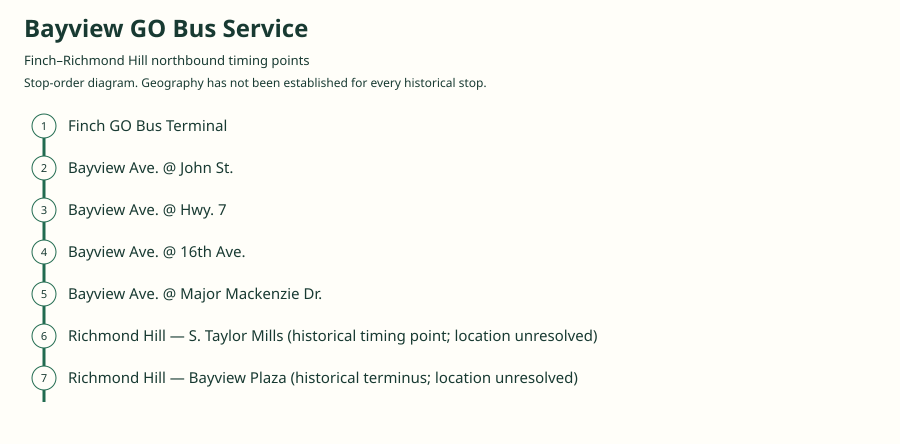
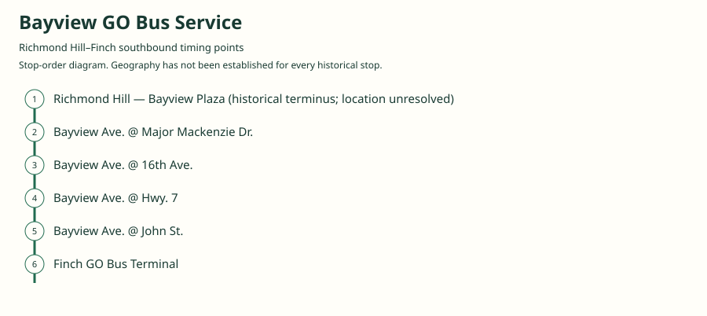

# Bayview GO Bus Service

A local GO corridor along Bayview Avenue between Toronto and Richmond Hill, initially operated under contract by Travelways and later directly by GO. The surviving 2003 timetable calls it Bayview GO Bus Service and labels the sheet Table 58; that table number is not asserted as a modern public GO route number. It had a separate local fare and transfer arrangement from most GO commuter routes.

[Download history PDF](bayview-history.pdf) · [Interactive map](index.html) · [Ordered stops CSV](stops.csv) · [GeoJSON](maps.geojson)

The PDF includes the sourced history, dated maps, numbered stop lists and navigation bookmarks. Older versions retain the timetable timing-point or major-stop limits described below.

## History

### 1972-01

The Richmond Hill–Toronto corridor via Bayview begins under Travelways operation for GO. Early service also reaches downtown Toronto.

[Source 1](https://transittoronto.ca/regional/2115.shtml)

### 1974

Bayview service gains the regional terminal at Finch subway station as a Toronto connection.

[Source 1](https://transittoronto.ca/regional/2115.shtml)

### 1984-01-28

GO takes direct operation of the former Travelways Bayview and Uxbridge corridors and hires its first bus drivers.

[Source 1](https://transittoronto.ca/regional/2115.shtml)

### by 2003-06-28

The original local schedule links Finch and Richmond Hill via Bayview, John, Highway 7, 16th Avenue and Major Mackenzie. The northbound sheet also times S. Taylor Mills before Bayview Plaza; the southbound sheet does not.

[Source 1](https://go-schedule-archive.s3.us-east-1.amazonaws.com/bayview/2003-06-28-table-58-bayview-dir1-day1-page1.html) · [Source 2](https://go-schedule-archive.s3.us-east-1.amazonaws.com/bayview/2003-06-28-table-58-bayview-dir0-day6-page1.html)

### 2003-08-30

GO’s Bayview and Yonge C services transfer to York Region Transit. The TTS retrospective gives August 30 and says initial routing and service levels were retained; the Bayview successor is YRT 91.

[Source 1](https://transittoronto.ca/regional/2115.shtml) · [Source 2](https://transittoronto.ca/regional/2702.shtml)

## Documented maps and stop sequences

### 2003-06-28 — Finch–Richmond Hill northbound timing points

Finch GO Bus Terminal → Bayview Ave. @ John St. → Bayview Ave. @ Hwy. 7 → Bayview Ave. @ 16th Ave. → Bayview Ave. @ Major Mackenzie Dr. → Richmond Hill — S. Taylor Mills (historical timing point; location unresolved) → Richmond Hill — Bayview Plaza (historical terminus; location unresolved)

Schematic straight connections between established stop areas, not a street-by-street reconstruction. This is the exact order of the published timing rows, including both northern arrival points. The historical Taylor Mills point and Bayview Plaza have not been assigned coordinates. Intermediate local stops are not exhaustively listed. 2 stop locations remain unestablished; the full ordered sequence is preserved in the list.

[Original source 1](https://go-schedule-archive.s3.us-east-1.amazonaws.com/bayview/2003-06-28-table-58-bayview-dir1-day1-page1.html)

### 2003-06-28 — Richmond Hill–Finch southbound timing points

Richmond Hill — Bayview Plaza (historical terminus; location unresolved) → Bayview Ave. @ Major Mackenzie Dr. → Bayview Ave. @ 16th Ave. → Bayview Ave. @ Hwy. 7 → Bayview Ave. @ John St. → Finch GO Bus Terminal

Schematic straight connections between established stop areas, not a street-by-street reconstruction. Saturday/Canada Day and Sunday originals have the same timing-point sequence. The Saturday service is generally half-hourly in the displayed portion; Sunday is generally hourly. S. Taylor Mills is not a timing row in these southbound sheets. Map as a schematic, not a surveyed historic road trace. 1 stop locations remain unestablished; the full ordered sequence is preserved in the list.

[Original source 1](https://go-schedule-archive.s3.us-east-1.amazonaws.com/bayview/2003-06-28-table-58-bayview-dir0-day6-page1.html) · [Original source 2](https://go-schedule-archive.s3.us-east-1.amazonaws.com/bayview/2003-06-28-table-58-bayview-dir0-day7-page1.html)

## Coverage and unresolved questions

- No original early-1970s timetable has been recovered here, so the downtown-era all-stop pattern is not reconstructed.
- The exact historical Bayview Plaza and S. Taylor Mills bus-stop locations remain unresolved; do not substitute a modern business with the same name.
- The August 30, 2003 takeover day is from a detailed secondary retrospective; the original 2003 schedule directly establishes the service shortly before transfer.
- Table 58 is a source identifier, not evidence that this should be filed as contemporary GO route 58.

## Sources

- [Original GO Bayview Table 58, effective June 28, 2003, weekday northbound](https://go-schedule-archive.s3.us-east-1.amazonaws.com/bayview/2003-06-28-table-58-bayview-dir1-day1-page1.html)
- [Original GO Bayview Table 58, effective June 28, 2003, Saturday/Canada Day southbound](https://go-schedule-archive.s3.us-east-1.amazonaws.com/bayview/2003-06-28-table-58-bayview-dir0-day6-page1.html)
- [Original GO Bayview Table 58, effective June 28, 2003, Sunday southbound](https://go-schedule-archive.s3.us-east-1.amazonaws.com/bayview/2003-06-28-table-58-bayview-dir0-day7-page1.html)
- [Toronto Transportation Society / Transit Toronto: 50 Years of GO Transit Bus Operations](https://transittoronto.ca/regional/2115.shtml)
- [Transit Toronto: A Brief History of Public Transit in York Region](https://transittoronto.ca/regional/2702.shtml)

Data used in this product or service is provided with the permission of Metrolinx. Metrolinx makes no representations or warranties of any kind, express or implied, with respect to the Data and assumes no responsibility for the accuracy or currency of the data used in this product or service.
