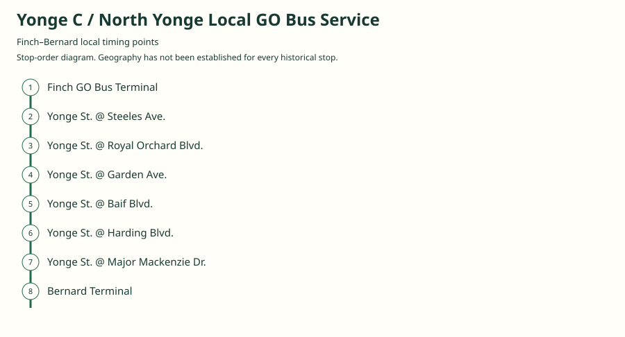
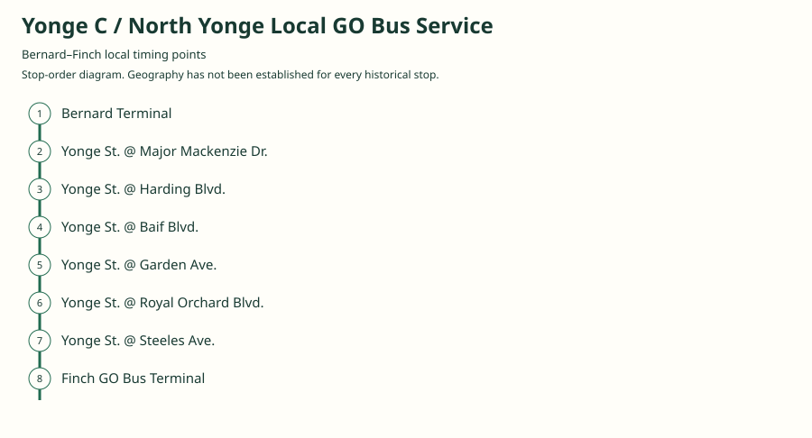
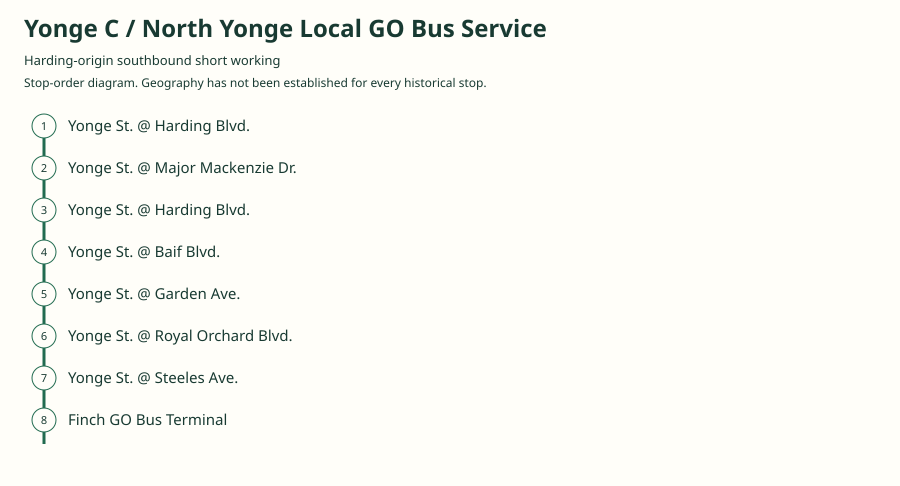

# Yonge C / North Yonge Local GO Bus Service

GO’s local Yonge Street service between Finch and Richmond Hill, descended from the TTC’s North Yonge route. Its surviving 2003 schedule is Table 52 and is unrelated to the later Oshawa/York University route 52. It used local fares and accepted local-transit transfers, while prohibiting journeys entirely at or south of Steeles.

[Download history PDF](yonge-c-history.pdf) · [Interactive map](index.html) · [Ordered stops CSV](stops.csv) · [GeoJSON](maps.geojson)

The PDF includes the sourced history, dated maps, numbered stop lists and navigation bookmarks. Older versions retain the timetable timing-point or major-stop limits described below.

## History

### 1976-11-28

GO replaces the TTC’s North Yonge service with local Yonge C from Finch to Richmond Heights Plaza. The detailed TTC history gives November 27, 1976 as its final operating day; the GO retrospective gives November 28 for the transfer.

[Source 1](https://transittoronto.ca/bus/routes/59-north-yonge-.shtml) · [Source 2](https://transittoronto.ca/regional/2115.shtml)

### by 2003-01-04

The original northbound timetable shows Finch–Steeles–Royal Orchard–Garden–Baif–Harding–Major Mackenzie–Bernard Terminal. Table 52 here is Yonge C, not the later Highway 407 East table.

[Source 1](https://go-schedule-archive.s3.us-east-1.amazonaws.com/oshawa-oakville/2003-01-04-table-52-oshawa-oakville-dir1-day1-page1.html)

### by 2003-06-28

Southbound weekday service includes both Bernard Terminal departures and extra Harding starters. The latter are timed at Harding, then Major Mackenzie, then Harding again before continuing south.

[Source 1](https://go-schedule-archive.s3.us-east-1.amazonaws.com/oshawa-oakville/2003-06-28-table-52-oshawa-oakville-dir0-day1-page1.html)

### 2003-08-30

The Yonge C local operation transfers from GO to York Region Transit along with Bayview; the local Yonge successor is associated with YRT 99. The separate Newmarket B service remains GO-operated at this point.

[Source 1](https://transittoronto.ca/regional/2115.shtml) · [Source 2](https://transittoronto.ca/regional/2702.shtml)

## Documented maps and stop sequences

### 2003-01-04 — Finch–Bernard local timing points

Finch GO Bus Terminal → Yonge St. @ Steeles Ave. → Yonge St. @ Royal Orchard Blvd. → Yonge St. @ Garden Ave. → Yonge St. @ Baif Blvd. → Yonge St. @ Harding Blvd. → Yonge St. @ Major Mackenzie Dr. → Bernard Terminal

Schematic straight connections between established stop areas, not a street-by-street reconstruction. Ordered major timing points from the original. This was local service and made intermediate stops not individually printed in the timetable. 2 stop locations remain unestablished; the full ordered sequence is preserved in the list.

[Original source 1](https://go-schedule-archive.s3.us-east-1.amazonaws.com/oshawa-oakville/2003-01-04-table-52-oshawa-oakville-dir1-day1-page1.html)

### 2003-06-28 — Bernard–Finch local timing points

Bernard Terminal → Yonge St. @ Major Mackenzie Dr. → Yonge St. @ Harding Blvd. → Yonge St. @ Baif Blvd. → Yonge St. @ Garden Ave. → Yonge St. @ Royal Orchard Blvd. → Yonge St. @ Steeles Ave. → Finch GO Bus Terminal

Schematic straight connections between established stop areas, not a street-by-street reconstruction. Bernard-origin columns pass through the initial special Harding row; their first Harding stop follows Major Mackenzie. 2 stop locations remain unestablished; the full ordered sequence is preserved in the list.

[Original source 1](https://go-schedule-archive.s3.us-east-1.amazonaws.com/oshawa-oakville/2003-06-28-table-52-oshawa-oakville-dir0-day1-page1.html)

### 2003-06-28 — Harding-origin southbound short working

Yonge St. @ Harding Blvd. → Yonge St. @ Major Mackenzie Dr. → Yonge St. @ Harding Blvd. → Yonge St. @ Baif Blvd. → Yonge St. @ Garden Ave. → Yonge St. @ Royal Orchard Blvd. → Yonge St. @ Steeles Ave. → Finch GO Bus Terminal

Schematic straight connections between established stop areas, not a street-by-street reconstruction. The original explicitly times a starter at Harding (e.g. 06:25), Major Mackenzie (06:27), then Harding again (06:28). The duplicate stop is intentional and documents the printed sequence; the precise loop streets are not established and must not be invented. 1 stop locations remain unestablished; the full ordered sequence is preserved in the list.

[Original source 1](https://go-schedule-archive.s3.us-east-1.amazonaws.com/oshawa-oakville/2003-06-28-table-52-oshawa-oakville-dir0-day1-page1.html)

## Coverage and unresolved questions

- The move from Richmond Heights Plaza to Bernard Terminal is bounded by the original 2003 snapshot but its exact date has not been established here.
- The precise streets used by the Harding starter loop are not mapped; only its printed timing-point sequence is retained.
- Some secondary page headings or summary bullets say 1977, but their detailed dated entry and the dedicated GO history agree on November 27/28, 1976; the detailed entries are used.
- This is a named legacy corridor, not a predecessor geography of modern GO route 52. Newmarket B and its eventual route62 designation are documented separately.

## Sources

- [Original GO Yonge C Table 52, effective January 4, 2003, weekday northbound](https://go-schedule-archive.s3.us-east-1.amazonaws.com/oshawa-oakville/2003-01-04-table-52-oshawa-oakville-dir1-day1-page1.html)
- [Original GO Yonge C Table 52, effective June 28, 2003, weekday southbound including Harding starters](https://go-schedule-archive.s3.us-east-1.amazonaws.com/oshawa-oakville/2003-06-28-table-52-oshawa-oakville-dir0-day1-page1.html)
- [Transit Toronto: 59 North Yonge detailed history (last TTC operating date November 27, 1976)](https://transittoronto.ca/bus/routes/59-north-yonge-.shtml)
- [Toronto Transportation Society / Transit Toronto: 50 Years of GO Transit Bus Operations](https://transittoronto.ca/regional/2115.shtml)
- [Transit Toronto: A Brief History of Public Transit in York Region](https://transittoronto.ca/regional/2702.shtml)

Data used in this product or service is provided with the permission of Metrolinx. Metrolinx makes no representations or warranties of any kind, express or implied, with respect to the Data and assumes no responsibility for the accuracy or currency of the data used in this product or service.
