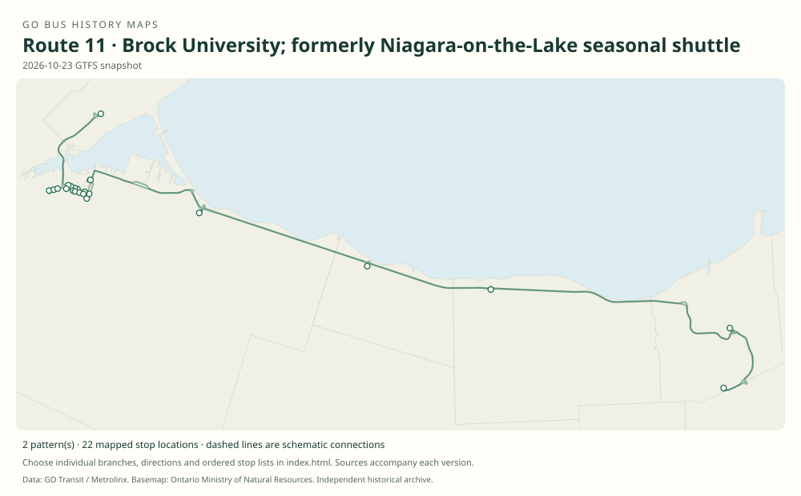

# GO route 11 — Brock University; formerly Niagara-on-the-Lake seasonal shuttle

The number has two distinct documented uses: a seasonal St. Catharines–Niagara-on-the-Lake train shuttle in the 2010 s, and the Brock University corridor renumbered from 18K in 2024.

**Status:** current. **Documented patterns:** 3. **Research date:** 23 October 2026.

[Download history PDF](route-11-history.pdf) · [Interactive map](index.html) · [All ordered stops (CSV)](stops.csv) · [All mapped versions (GeoJSON)](maps.geojson) · [History data](history.json) · [Timetable archive links](archive-sources.json)

The PDF includes the sourced history, dated maps, numbered stop lists and navigation bookmarks. Older versions retain the timetable timing-point or major-stop limits described below.

Open `index.html` through the repository's local web server to use the map. SVG maps below display directly on GitHub.

## History

### 2012-06-23

The new St. Catharines rail station–Niagara-on-the-Lake shuttle began its first summer season, running through 3 September.

[Source 1](https://www.newswire.ca/news-releases/take-the-go-train-to-niagara-this-victoria-day-weekend-510184221.html)

### 2012-09-04

GO identified the seasonal Niagara-on-the-Lake shuttle as route 11 when announcing the end of its 2012 season.

[Source 1](https://www.newswire.ca/fr/news-releases/reprise-du-service-dautobus-go-transit-de-luniversite-mcmaster-fin-du-service-de-train-de-niagara-pour-la-saison-estivale-510584911.html)

### 2016

Seasonal route 11 Niagara-on-the-Lake train-meet service remained documented.

[Source 1](https://stevemunro.ca/wp-content/uploads/2017/03/ridership-report-september2016.pdf)

### 2021-09-07

Predecessor 18K began weekday service to Brock University from the Hamilton corridor.

[Source 1](https://brocku.ca/brock-news/2021/08/go-transit-bus-service-coming-to-brock/)

### 2024-04-27

Brock University branch 18K was renumbered 11 in the April reorganization.

[Source 1](https://seanmarshall.ca/2024/04/15/a-review-of-metrolinxs-april-2024-service-changes/)

### 2024-08-31

The original Lakeshore West booklet confirms the new route 11 number.

[Source 1](https://go-schedule-archive.s3.us-east-1.amazonaws.com/lakeshore-west/2024-08-31-table-01-lakeshore-west.pdf)

## Maps by documented version

Feed maps combine the patterns present in that dated file. The interactive viewer separates every branch and direction. A feed snapshot can include future or temporary service; its filename is not a route-change date.

| Date / evidence | Map | Patterns |
|---|---|---:|
| 2026-10-23 GTFS snapshot | [SVG map](maps/2026-10-23.svg) | 2 |
| 2012-06-23 | [SVG map](maps/history-11-2012-notl.svg) | 1 |

## Historical major-stop sequences

These are timetable timing points / major stops, not necessarily every roadside stop. Full GTFS sequences are in `stops.csv` and the snapshot files.

### 2012-06-23 — 11: Original seasonal Niagara-on-the-Lake shuttle

St. Catharines VIA / GO rail station → Niagara-on-the-Lake

Schematic straight connections between established stop areas, not a street-by-street reconstruction. Selected published timepoints or named stops, not an exhaustive curb-stop list. Connectors are schematic and do not establish the roads taken. Endpoint-only reconstruction. The exact Niagara-on-the-Lake curb location and intermediate stops are unverified. 1 stop locations remain unestablished; the full ordered sequence is preserved in the list.

[Original source 1](https://www.newswire.ca/news-releases/take-the-go-train-to-niagara-this-victoria-day-weekend-510184221.html) · [Original source 2](https://www.newswire.ca/fr/news-releases/reprise-du-service-dautobus-go-transit-de-luniversite-mcmaster-fin-du-service-de-train-de-niagara-pour-la-saison-estivale-510584911.html)

## Coverage and unresolved questions

- The last season and withdrawal date of the old Niagara-on-the-Lake shuttle are unknown.
- The old shuttle and the later Brock route are separate eras, not one continuous alignment.
- The April 2024 renumbering date is from a contemporary secondary account; the new number is independently confirmed in the original August timetable.
- GTFS dates identify captured feeds, not necessarily the first or last day of a route. Open a pattern to see its exact scheduled service dates. Temporary rail replacement and special-service patterns are included when present in the source.
- Manually reconstructed versions generally contain published timetable timing points / major stops. They must not be read as complete roadside stop inventories.

## Sources

- [GO Transit release: Take the GO Train to Niagara this Victoria Day weekend, 4 May 2012](https://www.newswire.ca/news-releases/take-the-go-train-to-niagara-this-victoria-day-weekend-510184221.html) — official
- [GO Transit release: McMaster service resumes and summer Niagara service ends, August 2012](https://www.newswire.ca/fr/news-releases/reprise-du-service-dautobus-go-transit-de-luniversite-mcmaster-fin-du-service-de-train-de-niagara-pour-la-saison-estivale-510584911.html) — official
- [Metrolinx GO Transit Ridership Report, September 2016 (original report, archived by Steve Munro)](https://stevemunro.ca/wp-content/uploads/2017/03/ridership-report-september2016.pdf) — official
- [Brock University: GO Transit bus service coming to Brock, August 2021](https://brocku.ca/brock-news/2021/08/go-transit-bus-service-coming-to-brock/) — official
- [Sean Marshall: A review of Metrolinx’s April 2024 service changes](https://seanmarshall.ca/2024/04/15/a-review-of-metrolinxs-april-2024-service-changes/) — secondary
- [GO Lakeshore West table 01, effective 31 August 2024, including route 11](https://go-schedule-archive.s3.us-east-1.amazonaws.com/lakeshore-west/2024-08-31-table-01-lakeshore-west.pdf) — original-timetable
- [GO Transit original GTFS snapshot 2026-10-23](https://assets.metrolinx.com/raw/upload/Documents/Metrolinx/Open%20Data/GO-GTFS.zip) — original-gtfs

## Data attribution

Data used in this product or service is provided with the permission of Metrolinx. Metrolinx makes no representations or warranties of any kind, express or implied, with respect to the Data and assumes no responsibility for the accuracy or currency of the data used in this product or service.

Basemap: Ontario Ministry of Natural Resources, Open Government Licence – Ontario. See [methodology](../../docs/METHODOLOGY.md) for geometry and date limitations.
