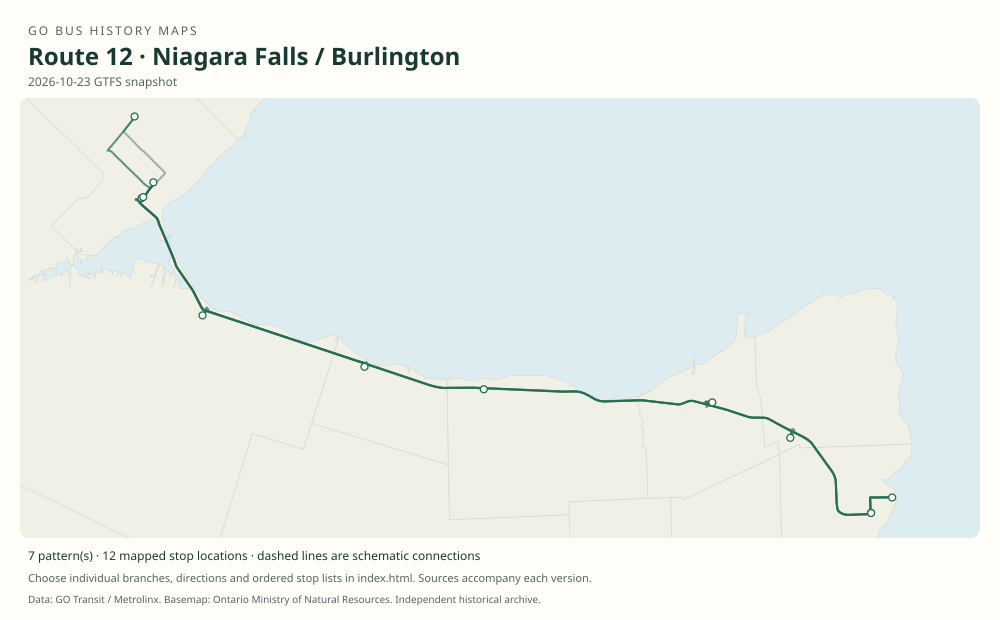

# GO route 12 — Niagara Falls / Burlington

A Niagara–Lakeshore rail feeder developed from Burlington–Stoney Creek service, subsequently extended to Niagara Falls with express and short-turn variants.

**Status:** current. **Documented patterns:** 33. **Research date:** 23 October 2026.

[Download history PDF](route-12-history.pdf) · [Interactive map](index.html) · [All ordered stops (CSV)](stops.csv) · [All mapped versions (GeoJSON)](maps.geojson) · [History data](history.json) · [Timetable archive links](archive-sources.json)

The PDF includes the sourced history, dated maps, numbered stop lists and navigation bookmarks. Older versions retain the timetable timing-point or major-stop limits described below.

Open `index.html` through the repository's local web server to use the map. SVG maps below display directly on GitHub.

## History

### 2008-06-28

Route 12 began between Burlington GO and Stoney Creek; Ontario later confirmed the June 2008 launch.

[Source 1](https://transittoronto.ca/regional/2115.shtml) · [Source 2](https://news.ontario.ca/m/5355)

### 2009-09-05

Year-round Niagara Falls–Burlington service began via St. Catharines, Grimsby and Stoney Creek.

[Source 1](https://www.newswire.ca/news-releases/go-looks-at-new-niagara-rail-service-expansion-538999061.html)

### 2009-10-31

The original table shows the full Niagara Falls VIA–Burlington route via Fairview Mall and Nash / Barton.

[Source 1](https://go-schedule-archive.s3.us-east-1.amazonaws.com/niagara-falls-toronto/2010-01-02-table-12-niagara-falls-toronto.pdf)

### 2011-09-03

The timetable documents Friday express 12B toward Niagara Falls and 12D from St. Catharines toward Burlington.

[Source 1](https://go-schedule-archive.s3.us-east-1.amazonaws.com/niagara-falls-toronto/2012-06-03-table-12-niagara-falls-toronto.pdf)

### 2023-04-08

The table serves Niagara College’s Niagara-on-the-Lake campus, Beamsville and Confederation GO; 12C trips were also increased.

[Source 1](https://go-schedule-archive.s3.us-east-1.amazonaws.com/niagara-falls-toronto/2023-04-08-table-12-niagara-falls-toronto.pdf) · [Source 2](https://www.gotransit.com/en/blog/april-service-changes)

## Maps by documented version

Feed maps combine the patterns present in that dated file. The interactive viewer separates every branch and direction. A feed snapshot can include future or temporary service; its filename is not a route-change date.

| Date / evidence | Map | Patterns |
|---|---|---:|
| 2016-01-11 GTFS snapshot | [SVG map](maps/2016-01-11.svg) | 9 |
| 2022-03-08 GTFS snapshot | [SVG map](maps/2022-03-08.svg) | 7 |
| 2023-05-05 GTFS snapshot | [SVG map](maps/2023-05-05.svg) | 7 |
| 2026-10-23 GTFS snapshot | [SVG map](maps/2026-10-23.svg) | 7 |
| 2009-10-31 | [SVG map](maps/history-12-2009-main.svg) | 1 |
| 2011-09-03 | [SVG map](maps/history-12-2011-express.svg) | 1 |
| 2011-09-03 | [SVG map](maps/history-12-2011-stc-express.svg) | 1 |

## Historical major-stop sequences

These are timetable timing points / major stops, not necessarily every roadside stop. Full GTFS sequences are in `stops.csv` and the snapshot files.

### 2009-10-31 — 12: Niagara Falls–Burlington via Fairview Mall

Niagara Falls VIA station, Bridge / Erie → Niagara Falls, Stanley / Highway 420 → St. Catharines Fairview Mall, YMCA Drive → Grimsby Park & Ride → Stoney Creek, Nash / Barton → Burlington GO

Schematic straight connections between established stop areas, not a street-by-street reconstruction. Selected published timepoints or named stops, not an exhaustive curb-stop list. Connectors are schematic and do not establish the roads taken.

[Original source 1](https://go-schedule-archive.s3.us-east-1.amazonaws.com/niagara-falls-toronto/2010-01-02-table-12-niagara-falls-toronto.pdf)

### 2011-09-03 — 12B: Friday Niagara Falls express

Burlington GO → Niagara Falls, Stanley / Highway 420 → Niagara Falls VIA station, Bridge / Erie

Schematic straight connections between established stop areas, not a street-by-street reconstruction. Selected published timepoints or named stops, not an exhaustive curb-stop list. Connectors are schematic and do not establish the roads taken. This snapshot establishes the pattern, not its introduction date.

[Original source 1](https://go-schedule-archive.s3.us-east-1.amazonaws.com/niagara-falls-toronto/2012-06-03-table-12-niagara-falls-toronto.pdf)

### 2011-09-03 — 12D: Friday St. Catharines express

St. Catharines Fairview Mall, YMCA Drive → Burlington GO

Schematic straight connections between established stop areas, not a street-by-street reconstruction. Selected published timepoints or named stops, not an exhaustive curb-stop list. Connectors are schematic and do not establish the roads taken.

[Original source 1](https://go-schedule-archive.s3.us-east-1.amazonaws.com/niagara-falls-toronto/2012-06-03-table-12-niagara-falls-toronto.pdf)

## Coverage and unresolved questions

- The archive’s 2011 table 13 Niagara Falls / Toronto document is train-only, not evidence of a separate bus route 13.
- Dates of every park-and-ride relocation and lettered-branch introduction remain incomplete.
- GTFS dates identify captured feeds, not necessarily the first or last day of a route. Open a pattern to see its exact scheduled service dates. Temporary rail replacement and special-service patterns are included when present in the source.
- Manually reconstructed versions generally contain published timetable timing points / major stops. They must not be read as complete roadside stop inventories.

## Sources

- [50 Years of GO Transit Bus Operations — historical chronology by Adam Zhelka / Toronto Transportation Society](https://transittoronto.ca/regional/2115.shtml) — secondary
- [Ontario: GO Transit service expansions, 3 April 2009; records June 2008 Stoney Creek bus launch](https://news.ontario.ca/m/5355) — official
- [GO Transit release: GO looks at new Niagara rail service expansion, 17 December 2009](https://www.newswire.ca/news-releases/go-looks-at-new-niagara-rail-service-expansion-538999061.html) — official
- [GO table 12, printed effective 31 October 2009 (filename dated 2 January 2010)](https://go-schedule-archive.s3.us-east-1.amazonaws.com/niagara-falls-toronto/2010-01-02-table-12-niagara-falls-toronto.pdf) — original-timetable
- [GO table 12, printed effective 3 September 2011 (filename dated 3 June 2012)](https://go-schedule-archive.s3.us-east-1.amazonaws.com/niagara-falls-toronto/2012-06-03-table-12-niagara-falls-toronto.pdf) — original-timetable
- [GO Niagara Falls / Toronto table 12, effective 8 April 2023](https://go-schedule-archive.s3.us-east-1.amazonaws.com/niagara-falls-toronto/2023-04-08-table-12-niagara-falls-toronto.pdf) — original-timetable
- [GO Transit: April service changes, published 14 April 2023](https://www.gotransit.com/en/blog/april-service-changes) — official
- [GO Transit original GTFS snapshot 2016-01-11](https://openmobilitydata-data.s3.us-west-1.amazonaws.com/public/feeds/go-transit/32/20160111/gtfs.zip) — original-gtfs
- [GO Transit original GTFS snapshot 2022-03-08](https://web.archive.org/web/20220308054107id_/https://www.gotransit.com/static_files/gotransit/assets/Files/GO_GTFS.zip) — original-gtfs
- [GO Transit original GTFS snapshot 2023-05-05](https://openmobilitydata-data.s3.us-west-1.amazonaws.com/public/feeds/go-transit/32/20230505/gtfs.zip) — original-gtfs
- [GO Transit original GTFS snapshot 2026-10-23](https://assets.metrolinx.com/raw/upload/Documents/Metrolinx/Open%20Data/GO-GTFS.zip) — original-gtfs

## Data attribution

Data used in this product or service is provided with the permission of Metrolinx. Metrolinx makes no representations or warranties of any kind, express or implied, with respect to the Data and assumes no responsibility for the accuracy or currency of the data used in this product or service.

Basemap: Ontario Ministry of Natural Resources, Open Government Licence – Ontario. See [methodology](../../docs/METHODOLOGY.md) for geometry and date limitations.
