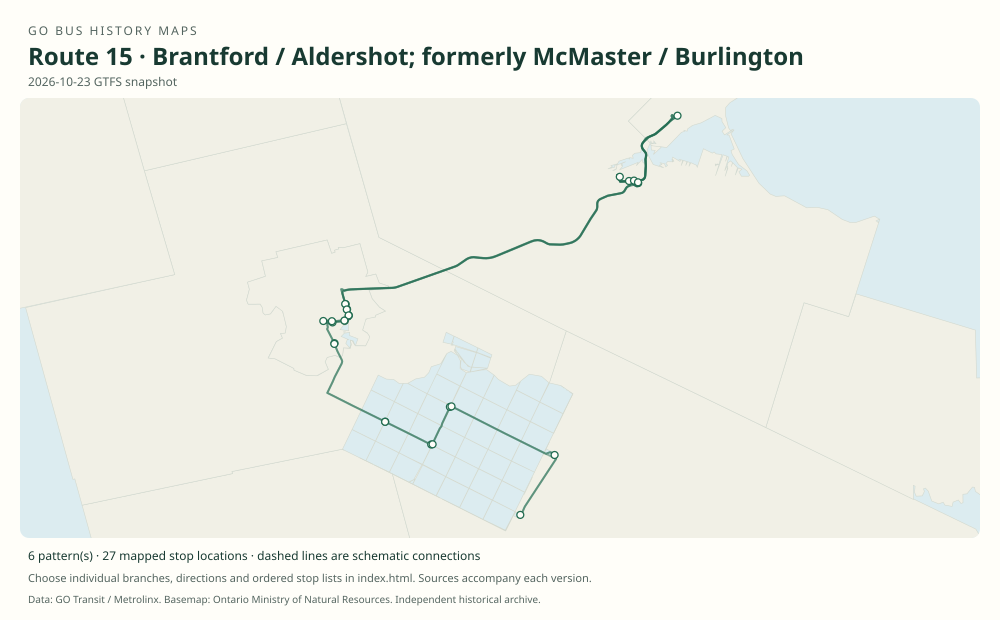

# GO route 15 — Brantford / Aldershot; formerly McMaster / Burlington

The McMaster–Lakeshore rail feeder evolved into the Brantford corridor and later gained a Six Nations and Mississaugas of the Credit extension.

**Status:** current. **Documented patterns:** 18. **Research date:** 23 October 2026.

[Download history PDF](route-15-history.pdf) · [Interactive map](index.html) · [All ordered stops (CSV)](stops.csv) · [All mapped versions (GeoJSON)](maps.geojson) · [History data](history.json) · [Timetable archive links](archive-sources.json)

The PDF includes the sourced history, dated maps, numbered stop lists and navigation bookmarks. Older versions retain the timetable timing-point or major-stop limits described below.

Open `index.html` through the repository's local web server to use the map. SVG maps below display directly on GitHub.

## History

### 2006-12-30

Route-15 trip series directly connect McMaster University with Burlington GO in the original Lakeshore table.

[Source 1](https://go-schedule-archive.s3.us-east-1.amazonaws.com/lakeshore-west/2007-05-13-table-01-lakeshore-west.pdf)

### 2013-04-06

The booklet explicitly identifies routes 15 and 18, preserving the McMaster feeder identity.

[Source 1](https://go-schedule-archive.s3.us-east-1.amazonaws.com/lakeshore-west/2013-04-06-table-01-lakeshore-west.pdf)

### 2016-09-03

Route 15 was extended west from McMaster to Brantford.

[Source 1](https://stevemunro.ca/wp-content/uploads/2017/03/ridership-report-september2016.pdf)

### 2016

The Brantford launch plan provided weekday and weekend service to Aldershot GO via McMaster.

[Source 1](https://news.ontario.ca/opo/en/2016/04/ontario-expanding-go-bus-service-to-brantford.html)

### by 2020-07-19

The archived table includes Brantford Bus Terminal, Wayne Gretzky / Henry, McMaster Innovation Park, McMaster and Aldershot.

[Source 1](https://go-schedule-archive.s3.us-east-1.amazonaws.com/brantford-burlington/2020-07-19-table-15-brantford-burlington.pdf)

### 2025-04-05

Branch 15B began serving Six Nations and Mississaugas of the Credit, with three daily trips each way.

[Source 1](https://www.metrolinx.com/en/news/new-go-bus-connection-for-first-nations)

## Maps by documented version

Feed maps combine the patterns present in that dated file. The interactive viewer separates every branch and direction. A feed snapshot can include future or temporary service; its filename is not a route-change date.

| Date / evidence | Map | Patterns |
|---|---|---:|
| 2016-01-11 GTFS snapshot | [SVG map](maps/2016-01-11.svg) | 4 |
| 2022-03-08 GTFS snapshot | [SVG map](maps/2022-03-08.svg) | 4 |
| 2023-05-05 GTFS snapshot | [SVG map](maps/2023-05-05.svg) | 2 |
| 2026-10-23 GTFS snapshot | [SVG map](maps/2026-10-23.svg) | 6 |
| 2006-12-30 | [SVG map](maps/history-15-2006-mcmaster.svg) | 1 |
| by 2020-07-19 | [SVG map](maps/history-15-2020-brantford.svg) | 1 |

## Historical major-stop sequences

These are timetable timing points / major stops, not necessarily every roadside stop. Full GTFS sequences are in `stops.csv` and the snapshot files.

### 2006-12-30 — 15: McMaster–Burlington feeder

McMaster University → Burlington GO

Schematic straight connections between established stop areas, not a street-by-street reconstruction. Selected published timepoints or named stops, not an exhaustive curb-stop list. Connectors are schematic and do not establish the roads taken. The old Burlington endpoint must not be silently replaced by Aldershot.

[Original source 1](https://go-schedule-archive.s3.us-east-1.amazonaws.com/lakeshore-west/2007-05-13-table-01-lakeshore-west.pdf)

### by 2020-07-19 — 15: Brantford–Aldershot corridor

Brantford Bus Terminal → Brantford, Wayne Gretzky Parkway / Henry Street → McMaster Innovation Park → McMaster University → Aldershot GO

Schematic straight connections between established stop areas, not a street-by-street reconstruction. Selected published timepoints or named stops, not an exhaustive curb-stop list. Connectors are schematic and do not establish the roads taken. Archive snapshot date used because the extracted copy does not establish a printed effective cover date.

[Original source 1](https://go-schedule-archive.s3.us-east-1.amazonaws.com/brantford-burlington/2020-07-19-table-15-brantford-burlington.pdf)

## Coverage and unresolved questions

- The date when the eastern terminus changed from Burlington to Aldershot remains unverified.
- Use a dated GTFS extraction for the full 15B curb-stop sequence; the launch article names places but is not a complete ordered stop table.
- GTFS dates identify captured feeds, not necessarily the first or last day of a route. Open a pattern to see its exact scheduled service dates. Temporary rail replacement and special-service patterns are included when present in the source.
- Manually reconstructed versions generally contain published timetable timing points / major stops. They must not be read as complete roadside stop inventories.

## Sources

- [GO Lakeshore West table 01, printed effective 30 December 2006 (filename dated 13 May 2007)](https://go-schedule-archive.s3.us-east-1.amazonaws.com/lakeshore-west/2007-05-13-table-01-lakeshore-west.pdf) — original-timetable
- [GO Lakeshore West table 01, effective 6 April 2013, routes 15 and 18](https://go-schedule-archive.s3.us-east-1.amazonaws.com/lakeshore-west/2013-04-06-table-01-lakeshore-west.pdf) — original-timetable
- [Metrolinx GO Transit Ridership Report, September 2016 (original report, archived by Steve Munro)](https://stevemunro.ca/wp-content/uploads/2017/03/ridership-report-september2016.pdf) — official
- [Ontario expanding GO bus service to Brantford, 27 April 2016](https://news.ontario.ca/opo/en/2016/04/ontario-expanding-go-bus-service-to-brantford.html) — official
- [GO Brantford / Burlington table 15, archive snapshot dated 19 July 2020](https://go-schedule-archive.s3.us-east-1.amazonaws.com/brantford-burlington/2020-07-19-table-15-brantford-burlington.pdf) — original-timetable
- [Metrolinx: New GO bus connection for First Nations, 17 March 2025](https://www.metrolinx.com/en/news/new-go-bus-connection-for-first-nations) — official
- [GO Transit original GTFS snapshot 2016-01-11](https://openmobilitydata-data.s3.us-west-1.amazonaws.com/public/feeds/go-transit/32/20160111/gtfs.zip) — original-gtfs
- [GO Transit original GTFS snapshot 2022-03-08](https://web.archive.org/web/20220308054107id_/https://www.gotransit.com/static_files/gotransit/assets/Files/GO_GTFS.zip) — original-gtfs
- [GO Transit original GTFS snapshot 2023-05-05](https://openmobilitydata-data.s3.us-west-1.amazonaws.com/public/feeds/go-transit/32/20230505/gtfs.zip) — original-gtfs
- [GO Transit original GTFS snapshot 2026-10-23](https://assets.metrolinx.com/raw/upload/Documents/Metrolinx/Open%20Data/GO-GTFS.zip) — original-gtfs

## Data attribution

Data used in this product or service is provided with the permission of Metrolinx. Metrolinx makes no representations or warranties of any kind, express or implied, with respect to the Data and assumes no responsibility for the accuracy or currency of the data used in this product or service.

Basemap: Ontario Ministry of Natural Resources, Open Government Licence – Ontario. See [methodology](../../docs/METHODOLOGY.md) for geometry and date limitations.
