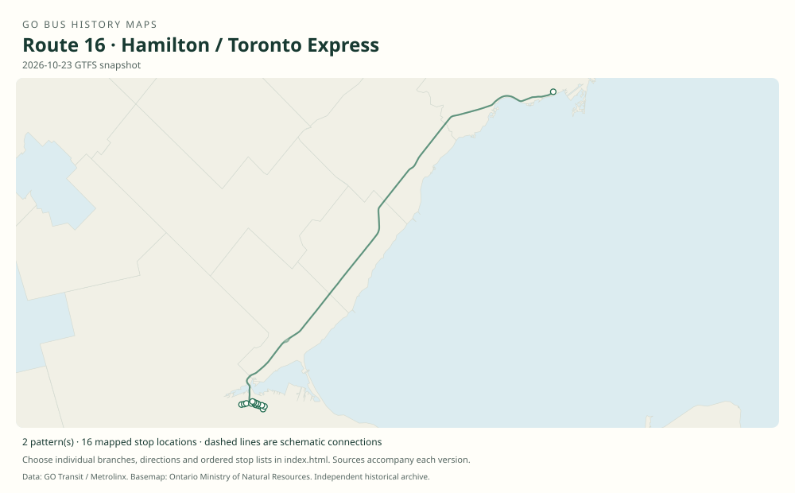

# GO route 16 — Hamilton / Toronto Express

The Hamilton–Union express has QEW bus predecessors; numbered route 16 is firmly documented in original early-2000 s schedules.

**Status:** current. **Documented patterns:** 14. **Research date:** 23 October 2026.

[Download history PDF](route-16-history.pdf) · [Interactive map](index.html) · [All ordered stops (CSV)](stops.csv) · [All mapped versions (GeoJSON)](maps.geojson) · [History data](history.json) · [Timetable archive links](archive-sources.json)

The PDF includes the sourced history, dated maps, numbered stop lists and navigation bookmarks. Older versions retain the timetable timing-point or major-stop limits described below.

Open `index.html` through the repository's local web server to use the map. SVG maps below display directly on GitHub.

## History

### 1970–1971

Hamilton–Toronto highway express operation transitioned from Gray Coach into GO during GO’s first bus-service year.

[Source 1](https://transittoronto.ca/regional/2115.shtml)

### 1979

The Hamilton express adopted a Gardiner / University Avenue downtown approach.

[Source 1](https://transittoronto.ca/regional/2115.shtml)

### 1996-04-27

Hamilton bus service moved into the new Hamilton GO Centre.

[Source 1](https://transittoronto.ca/regional/2115.shtml)

### 2004-09-04

Route 16 is documented between Hamilton GO Centre and Union with direction-specific Hamilton street stops.

[Source 1](https://go-schedule-archive.s3.us-east-1.amazonaws.com/hamilton-toronto-express/2007-05-13-table-16-hamilton-toronto-express.pdf)

### 2019-01-05

The timetable retains Hamilton GO Centre and Union as the express terminal pair.

[Source 1](https://go-schedule-archive.s3.us-east-1.amazonaws.com/hamilton-toronto-express/2019-01-05-table-16-hamilton-toronto-express.pdf)

## Maps by documented version

Feed maps combine the patterns present in that dated file. The interactive viewer separates every branch and direction. A feed snapshot can include future or temporary service; its filename is not a route-change date.

| Date / evidence | Map | Patterns |
|---|---|---:|
| 2016-01-11 GTFS snapshot | [SVG map](maps/2016-01-11.svg) | 4 |
| 2022-03-08 GTFS snapshot | [SVG map](maps/2022-03-08.svg) | 4 |
| 2023-05-05 GTFS snapshot | [SVG map](maps/2023-05-05.svg) | 2 |
| 2026-10-23 GTFS snapshot | [SVG map](maps/2026-10-23.svg) | 2 |
| 2004-09-04 | [SVG map](maps/history-16-2004-east.svg) | 1 |
| 2004-09-04 | [SVG map](maps/history-16-2004-west.svg) | 1 |

## Historical major-stop sequences

These are timetable timing points / major stops, not necessarily every roadside stop. Full GTFS sequences are in `stops.csv` and the snapshot files.

### 2004-09-04 — 16: Hamilton–Union express eastbound

Hamilton GO Centre → Hamilton, King / Dundurn → Union Station bus terminal

Schematic straight connections between established stop areas, not a street-by-street reconstruction. Selected published timepoints or named stops, not an exhaustive curb-stop list. Connectors are schematic and do not establish the roads taken.

[Original source 1](https://go-schedule-archive.s3.us-east-1.amazonaws.com/hamilton-toronto-express/2007-05-13-table-16-hamilton-toronto-express.pdf)

### 2004-09-04 — 16: Hamilton–Union express westbound

Union Station bus terminal → Hamilton, Main / Longwood → Hamilton GO Centre

Schematic straight connections between established stop areas, not a street-by-street reconstruction. Selected published timepoints or named stops, not an exhaustive curb-stop list. Connectors are schematic and do not establish the roads taken. King / Dundurn and Main / Longwood are direction-specific timepoints.

[Original source 1](https://go-schedule-archive.s3.us-east-1.amazonaws.com/hamilton-toronto-express/2007-05-13-table-16-hamilton-toronto-express.pdf)

## Coverage and unresolved questions

- The first use of number 16 is unknown; the 1970 s entries describe the corridor rather than prove that number.
- Union’s historical and current bus terminals need date-specific coordinates.
- GTFS dates identify captured feeds, not necessarily the first or last day of a route. Open a pattern to see its exact scheduled service dates. Temporary rail replacement and special-service patterns are included when present in the source.
- Manually reconstructed versions generally contain published timetable timing points / major stops. They must not be read as complete roadside stop inventories.

## Sources

- [50 Years of GO Transit Bus Operations — historical chronology by Adam Zhelka / Toronto Transportation Society](https://transittoronto.ca/regional/2115.shtml) — secondary
- [GO table 16, pages dated 4 September 2004 and 30 April 2005 (filename dated 13 May 2007)](https://go-schedule-archive.s3.us-east-1.amazonaws.com/hamilton-toronto-express/2007-05-13-table-16-hamilton-toronto-express.pdf) — original-timetable
- [GO Hamilton / Toronto Express table 16, effective 5 January 2019](https://go-schedule-archive.s3.us-east-1.amazonaws.com/hamilton-toronto-express/2019-01-05-table-16-hamilton-toronto-express.pdf) — original-timetable
- [GO Transit original GTFS snapshot 2016-01-11](https://openmobilitydata-data.s3.us-west-1.amazonaws.com/public/feeds/go-transit/32/20160111/gtfs.zip) — original-gtfs
- [GO Transit original GTFS snapshot 2022-03-08](https://web.archive.org/web/20220308054107id_/https://www.gotransit.com/static_files/gotransit/assets/Files/GO_GTFS.zip) — original-gtfs
- [GO Transit original GTFS snapshot 2023-05-05](https://openmobilitydata-data.s3.us-west-1.amazonaws.com/public/feeds/go-transit/32/20230505/gtfs.zip) — original-gtfs
- [GO Transit original GTFS snapshot 2026-10-23](https://assets.metrolinx.com/raw/upload/Documents/Metrolinx/Open%20Data/GO-GTFS.zip) — original-gtfs

## Data attribution

Data used in this product or service is provided with the permission of Metrolinx. Metrolinx makes no representations or warranties of any kind, express or implied, with respect to the Data and assumes no responsibility for the accuracy or currency of the data used in this product or service.

Basemap: Ontario Ministry of Natural Resources, Open Government Licence – Ontario. See [methodology](../../docs/METHODOLOGY.md) for geometry and date limitations.
