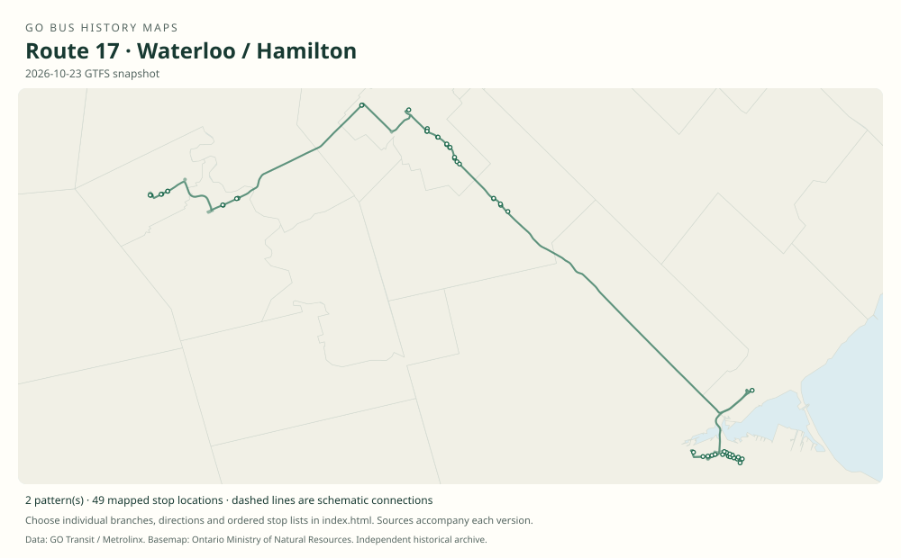

# GO route 17 — Waterloo / Hamilton

A Waterloo–Kitchener–Guelph–Hamilton connection with a later seasonal Burlington branch.

**Status:** current. **Documented patterns:** 6. **Research date:** 23 October 2026.

[Download history PDF](route-17-history.pdf) · [Interactive map](index.html) · [All ordered stops (CSV)](stops.csv) · [All mapped versions (GeoJSON)](maps.geojson) · [History data](history.json) · [Timetable archive links](archive-sources.json)

The PDF includes the sourced history, dated maps, numbered stop lists and navigation bookmarks. Older versions retain the timetable timing-point or major-stop limits described below.

Open `index.html` through the repository's local web server to use the map. SVG maps below display directly on GitHub.

## History

### 2023-04-08

The launch timetable took effect, with weekday service beginning the following Monday.

[Source 1](https://go-schedule-archive.s3.us-east-1.amazonaws.com/waterloo-hamilton/2023-04-08-table-17-waterloo-hamilton.pdf)

### 2023-04-10

The new hourly weekday Waterloo–Hamilton route began.

[Source 1](https://www.gotransit.com/en/blog/april-service-changes) · [Source 2](https://www.metrolinx.com/en/discover/new-waterloo-to-hamilton-route-among-april-go-bus-service-changes-)

### 2025-04-05

Seasonal weekend branch 17B began Waterloo–Burlington service for Niagara connections; its announced season ended 24 August.

[Source 1](https://www.metrolinx.com/en/news/april-go-service-changes-to-include-new-kitchener-line-trips)

## Maps by documented version

Feed maps combine the patterns present in that dated file. The interactive viewer separates every branch and direction. A feed snapshot can include future or temporary service; its filename is not a route-change date.

| Date / evidence | Map | Patterns |
|---|---|---:|
| 2023-05-05 GTFS snapshot | [SVG map](maps/2023-05-05.svg) | 2 |
| 2026-10-23 GTFS snapshot | [SVG map](maps/2026-10-23.svg) | 2 |
| 2023-04-10 | [SVG map](maps/history-17-2023-main.svg) | 1 |
| 2025-04-05 to 2025-08-24 | [SVG map](maps/history-17-2025-summer.svg) | 1 |

## Historical major-stop sequences

These are timetable timing points / major stops, not necessarily every roadside stop. Full GTFS sequences are in `stops.csv` and the snapshot files.

### 2023-04-10 — 17: Original Waterloo–Hamilton route

University of Waterloo Terminal → Wilfrid Laurier University → Kitchener, Victoria / Frederick → Guelph Central GO → University of Guelph → Guelph, Gordon / Stone → Aberfoyle, Brock / McLean → Aldershot GO → McMaster University → Hamilton GO Centre

Schematic straight connections between established stop areas, not a street-by-street reconstruction. Selected published timepoints or named stops, not an exhaustive curb-stop list. Connectors are schematic and do not establish the roads taken. The original Kitchener timepoint is Victoria / Frederick, not a stop inside Kitchener GO.

[Original source 1](https://go-schedule-archive.s3.us-east-1.amazonaws.com/waterloo-hamilton/2023-04-08-table-17-waterloo-hamilton.pdf)

### 2025-04-05 to 2025-08-24 — 17B: Seasonal Waterloo–Burlington branch

University of Waterloo Terminal → Wilfrid Laurier University → Kitchener GO → Burlington GO

Schematic straight connections between established stop areas, not a street-by-street reconstruction. Selected published timepoints or named stops, not an exhaustive curb-stop list. Connectors are schematic and do not establish the roads taken. Weekend seasonal branch; named announcement stops. It does not follow the main Guelph–Hamilton corridor.

[Original source 1](https://www.metrolinx.com/en/news/april-go-service-changes-to-include-new-kitchener-line-trips)

## Coverage and unresolved questions

- Summer 17B may be absent from autumn GTFS snapshots.
- Any later seasonal revival requires independent dates.
- GTFS dates identify captured feeds, not necessarily the first or last day of a route. Open a pattern to see its exact scheduled service dates. Temporary rail replacement and special-service patterns are included when present in the source.
- Manually reconstructed versions generally contain published timetable timing points / major stops. They must not be read as complete roadside stop inventories.

## Sources

- [GO Waterloo / Hamilton table 17, effective 8 April 2023; weekday service began 10 April](https://go-schedule-archive.s3.us-east-1.amazonaws.com/waterloo-hamilton/2023-04-08-table-17-waterloo-hamilton.pdf) — original-timetable
- [GO Transit: April service changes, published 14 April 2023](https://www.gotransit.com/en/blog/april-service-changes) — official
- [Metrolinx: New Waterloo to Hamilton route among April GO bus service changes](https://www.metrolinx.com/en/discover/new-waterloo-to-hamilton-route-among-april-go-bus-service-changes-) — official
- [Metrolinx: April GO service changes to include new Kitchener line trips, March 2025](https://www.metrolinx.com/en/news/april-go-service-changes-to-include-new-kitchener-line-trips) — official
- [GO Transit original GTFS snapshot 2023-05-05](https://openmobilitydata-data.s3.us-west-1.amazonaws.com/public/feeds/go-transit/32/20230505/gtfs.zip) — original-gtfs
- [GO Transit original GTFS snapshot 2026-10-23](https://assets.metrolinx.com/raw/upload/Documents/Metrolinx/Open%20Data/GO-GTFS.zip) — original-gtfs

## Data attribution

Data used in this product or service is provided with the permission of Metrolinx. Metrolinx makes no representations or warranties of any kind, express or implied, with respect to the Data and assumes no responsibility for the accuracy or currency of the data used in this product or service.

Basemap: Ontario Ministry of Natural Resources, Open Government Licence – Ontario. See [methodology](../../docs/METHODOLOGY.md) for geometry and date limitations.
