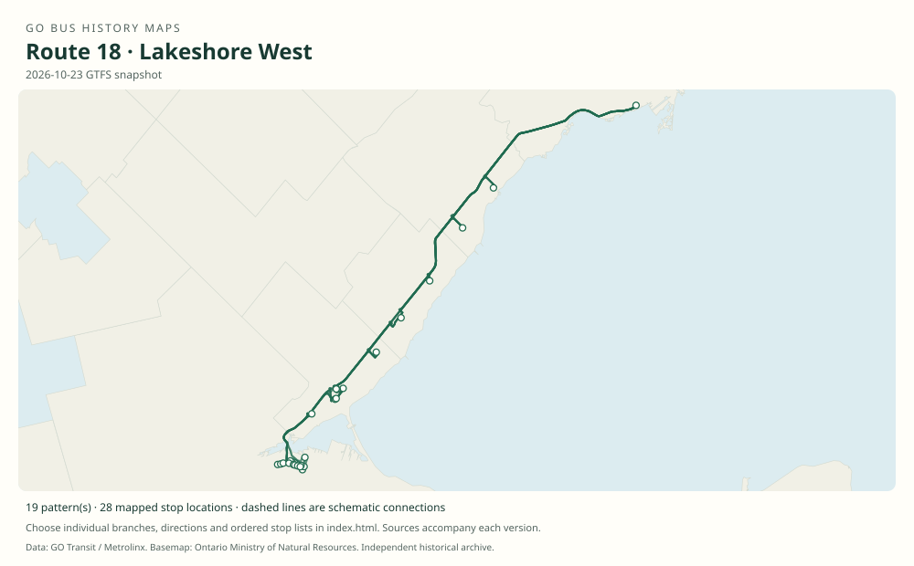

# GO route 18 — Lakeshore West

A Lakeshore train-connection and rail-replacement family, including Hamilton–Aldershot–Burlington feeders and selected through trips to Union. Former Brock branch 18K became route 11.

**Status:** current. **Documented patterns:** 86. **Research date:** 23 October 2026.

[Download history PDF](route-18-history.pdf) · [Interactive map](index.html) · [All ordered stops (CSV)](stops.csv) · [All mapped versions (GeoJSON)](maps.geojson) · [History data](history.json) · [Timetable archive links](archive-sources.json)

The PDF includes the sourced history, dated maps, numbered stop lists and navigation bookmarks. Older versions retain the timetable timing-point or major-stop limits described below.

Open `index.html` through the repository's local web server to use the map. SVG maps below display directly on GitHub.

## History

### 1970-09-08

GO’s first Lakeshore West feeder connected Oakville and Hamilton via Burlington.

[Source 1](https://transittoronto.ca/regional/2115.shtml)

### 2006-12-30

The original table documents Hamilton feeders and early route-18 trip series through to Union.

[Source 1](https://go-schedule-archive.s3.us-east-1.amazonaws.com/lakeshore-west/2007-05-13-table-01-lakeshore-west.pdf)

### 2013-04-06

Routes 15 and 18 are explicitly identified in the Lakeshore West booklet.

[Source 1](https://go-schedule-archive.s3.us-east-1.amazonaws.com/lakeshore-west/2013-04-06-table-01-lakeshore-west.pdf)

### 2021-09-07

Weekday 18K extended the Hamilton corridor to Brock University via Niagara communities.

[Source 1](https://brocku.ca/brock-news/2021/08/go-transit-bus-service-coming-to-brock/) · [Source 2](https://www.metrolinx.com/en/discover/metrolinx-announces-increased-weekday-service-across-go-network)

### 2024-04-27

Brock branch 18K was renumbered 11.

[Source 1](https://seanmarshall.ca/2024/04/15/a-review-of-metrolinxs-april-2024-service-changes/)

## Maps by documented version

Feed maps combine the patterns present in that dated file. The interactive viewer separates every branch and direction. A feed snapshot can include future or temporary service; its filename is not a route-change date.

| Date / evidence | Map | Patterns |
|---|---|---:|
| 2016-01-11 GTFS snapshot | [SVG map](maps/2016-01-11.svg) | 21 |
| 2022-03-08 GTFS snapshot | [SVG map](maps/2022-03-08.svg) | 27 |
| 2023-05-05 GTFS snapshot | [SVG map](maps/2023-05-05.svg) | 16 |
| 2026-10-23 GTFS snapshot | [SVG map](maps/2026-10-23.svg) | 19 |
| 2006-12-30 | [SVG map](maps/history-18-2006-feeder.svg) | 1 |
| 2006-12-30 | [SVG map](maps/history-18-2006-early.svg) | 1 |
| by 2022-03-08 | [SVG map](maps/history-18-2022-brock.svg) | 1 |

## Historical major-stop sequences

These are timetable timing points / major stops, not necessarily every roadside stop. Full GTFS sequences are in `stops.csv` and the snapshot files.

### 2006-12-30 — 18: Hamilton–Burlington train connection

Hamilton GO Centre → Hamilton, King / Dundurn → Aldershot GO → Burlington GO

Schematic straight connections between established stop areas, not a street-by-street reconstruction. Selected published timepoints or named stops, not an exhaustive curb-stop list. Connectors are schematic and do not establish the roads taken.

[Original source 1](https://go-schedule-archive.s3.us-east-1.amazonaws.com/lakeshore-west/2007-05-13-table-01-lakeshore-west.pdf)

### 2006-12-30 — 18: Early through bus to Union

Hamilton GO Centre → Hamilton, King / Dundurn → Aldershot GO → Burlington GO → Oakville GO → Clarkson GO → Port Credit GO → Union Station bus terminal

Schematic straight connections between established stop areas, not a street-by-street reconstruction. Selected published timepoints or named stops, not an exhaustive curb-stop list. Connectors are schematic and do not establish the roads taken. Selected trip 18020. Do not generalize this stopping pattern to every route-18 trip.

[Original source 1](https://go-schedule-archive.s3.us-east-1.amazonaws.com/lakeshore-west/2007-05-13-table-01-lakeshore-west.pdf)

### by 2022-03-08 — 18K: Brock branch before route 11 renumbering

Aldershot GO → Hamilton GO Centre → West Harbour GO → Centennial Parkway North / QEW Park & Ride → Grimsby Park & Ride → Beamsville → St. Catharines GO → Brock University

Schematic straight connections between established stop areas, not a street-by-street reconstruction. Selected major stops from the 2022 archived GTFS; not an exhaustive curb-stop list. Schematic geometry. The feed covers 27 January–1 April 2022. The separate launch event is September 2021; do not silently backdate every 2022 stop to opening day.

[Original source 1](https://web.archive.org/web/20220308054107id_/https://www.gotransit.com/static_files/gotransit/assets/Files/GO_GTFS.zip)

## Coverage and unresolved questions

- The 1970 table code 1 is not evidence that the bus was then numbered 18.
- Temporary construction variants are not all captured by these selected documents.
- GTFS dates identify captured feeds, not necessarily the first or last day of a route. Open a pattern to see its exact scheduled service dates. Temporary rail replacement and special-service patterns are included when present in the source.
- Manually reconstructed versions generally contain published timetable timing points / major stops. They must not be read as complete roadside stop inventories.

## Sources

- [50 Years of GO Transit Bus Operations — historical chronology by Adam Zhelka / Toronto Transportation Society](https://transittoronto.ca/regional/2115.shtml) — secondary
- [GO Lakeshore West table 01, printed effective 30 December 2006 (filename dated 13 May 2007)](https://go-schedule-archive.s3.us-east-1.amazonaws.com/lakeshore-west/2007-05-13-table-01-lakeshore-west.pdf) — original-timetable
- [GO Lakeshore West table 01, effective 6 April 2013, routes 15 and 18](https://go-schedule-archive.s3.us-east-1.amazonaws.com/lakeshore-west/2013-04-06-table-01-lakeshore-west.pdf) — original-timetable
- [Brock University: GO Transit bus service coming to Brock, August 2021](https://brocku.ca/brock-news/2021/08/go-transit-bus-service-coming-to-brock/) — official
- [Metrolinx announces increased weekday service across GO network, 26 August 2021](https://www.metrolinx.com/en/discover/metrolinx-announces-increased-weekday-service-across-go-network) — official
- [Sean Marshall: A review of Metrolinx’s April 2024 service changes](https://seanmarshall.ca/2024/04/15/a-review-of-metrolinxs-april-2024-service-changes/) — secondary
- [GO Transit GTFS archived 8 March 2022; feed valid 27 January–1 April 2022](https://web.archive.org/web/20220308054107id_/https://www.gotransit.com/static_files/gotransit/assets/Files/GO_GTFS.zip) — official
- [GO Transit original GTFS snapshot 2016-01-11](https://openmobilitydata-data.s3.us-west-1.amazonaws.com/public/feeds/go-transit/32/20160111/gtfs.zip) — original-gtfs
- [GO Transit original GTFS snapshot 2023-05-05](https://openmobilitydata-data.s3.us-west-1.amazonaws.com/public/feeds/go-transit/32/20230505/gtfs.zip) — original-gtfs
- [GO Transit original GTFS snapshot 2026-10-23](https://assets.metrolinx.com/raw/upload/Documents/Metrolinx/Open%20Data/GO-GTFS.zip) — original-gtfs

## Data attribution

Data used in this product or service is provided with the permission of Metrolinx. Metrolinx makes no representations or warranties of any kind, express or implied, with respect to the Data and assumes no responsibility for the accuracy or currency of the data used in this product or service.

Basemap: Ontario Ministry of Natural Resources, Open Government Licence – Ontario. See [methodology](../../docs/METHODOLOGY.md) for geometry and date limitations.
