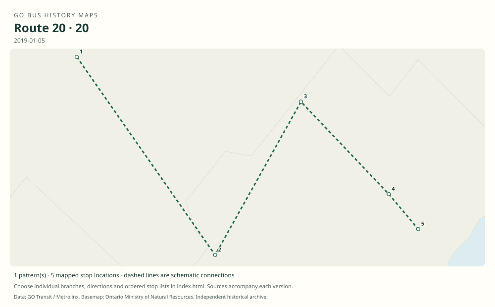

# GO route 20 — Milton / Oakville

A former weekday Milton–Oakville Lakeshore connection, distinct from the old Hamilton route 22 and the route 22 introduced in 2024.

**Status:** discontinued. **Documented patterns:** 6. **Research date:** 23 October 2026.

[Download history PDF](route-20-history.pdf) · [Interactive map](index.html) · [All ordered stops (CSV)](stops.csv) · [All mapped versions (GeoJSON)](maps.geojson) · [History data](history.json) · [Timetable archive links](archive-sources.json)

The PDF includes the sourced history, dated maps, numbered stop lists and navigation bookmarks. Older versions retain the timetable timing-point or major-stop limits described below.

Open `index.html` through the repository's local web server to use the map. SVG maps below display directly on GitHub.

## History

### 2008-06-28

GO introduced a Milton–Bronte GO connection, an earlier corridor configuration.

[Source 1](https://transittoronto.ca/regional/2115.shtml)

### 2009-09-05

Route 20 connects Milton GO with Oakville GO via Bronte Road / Highway 407 and Sheridan College.

[Source 1](https://go-schedule-archive.s3.us-east-1.amazonaws.com/milton-oakville/2010-02-05-table-20-milton-oakville.pdf)

### 2019-01-05

The table also includes Trafalgar Road / Highway 407 and lists ten weekday trips each way.

[Source 1](https://go-schedule-archive.s3.us-east-1.amazonaws.com/milton-oakville/2019-01-05-table-20-milton-oakville.pdf)

### 2019-06-29

Route 20 was withdrawn in the June changes.

[Source 1](https://www.ontariondp.ca/news/ontario-ndp-transit-critic-condemns-cuts-go-bus-service)

## Maps by documented version

Feed maps combine the patterns present in that dated file. The interactive viewer separates every branch and direction. A feed snapshot can include future or temporary service; its filename is not a route-change date.

| Date / evidence | Map | Patterns |
|---|---|---:|
| 2016-01-11 GTFS snapshot | [SVG map](maps/2016-01-11.svg) | 4 |
| 2009-09-05 | [SVG map](maps/history-20-2009.svg) | 1 |
| 2019-01-05 | [SVG map](maps/history-20-2019.svg) | 1 |

## Historical major-stop sequences

These are timetable timing points / major stops, not necessarily every roadside stop. Full GTFS sequences are in `stops.csv` and the snapshot files.

### 2009-09-05 — 20: Milton–Oakville via Bronte Road

Milton GO → Bronte Road / Highway 407 Park & Ride → Sheridan College, Oakville → Oakville GO

Schematic straight connections between established stop areas, not a street-by-street reconstruction. Selected published timepoints or named stops, not an exhaustive curb-stop list. Connectors are schematic and do not establish the roads taken.

[Original source 1](https://go-schedule-archive.s3.us-east-1.amazonaws.com/milton-oakville/2010-02-05-table-20-milton-oakville.pdf)

### 2019-01-05 — 20: Milton–Oakville with Trafalgar park-and-ride

Milton GO → Bronte Road / Highway 407 Park & Ride → Trafalgar Road / Highway 407 Park & Ride → Sheridan College, Oakville → Oakville GO

Schematic straight connections between established stop areas, not a street-by-street reconstruction. Selected published timepoints or named stops, not an exhaustive curb-stop list. Connectors are schematic and do not establish the roads taken. The bus rows are weekday-only; a generic Daily cover is not proof of weekend route 20 service.

[Original source 1](https://go-schedule-archive.s3.us-east-1.amazonaws.com/milton-oakville/2019-01-05-table-20-milton-oakville.pdf)

## Coverage and unresolved questions

- The number used at the June 2008 Milton–Bronte launch is not established.
- The June 2019 withdrawal date is from contemporary secondary reporting; an archived original GO notice would improve the record.
- GTFS dates identify captured feeds, not necessarily the first or last day of a route. Open a pattern to see its exact scheduled service dates. Temporary rail replacement and special-service patterns are included when present in the source.
- Manually reconstructed versions generally contain published timetable timing points / major stops. They must not be read as complete roadside stop inventories.

## Sources

- [50 Years of GO Transit Bus Operations — historical chronology by Adam Zhelka / Toronto Transportation Society](https://transittoronto.ca/regional/2115.shtml) — secondary
- [GO table 20, printed effective 5 September 2009 (filename dated 5 February 2010)](https://go-schedule-archive.s3.us-east-1.amazonaws.com/milton-oakville/2010-02-05-table-20-milton-oakville.pdf) — original-timetable
- [GO Milton / Oakville table 20, effective 5 January 2019](https://go-schedule-archive.s3.us-east-1.amazonaws.com/milton-oakville/2019-01-05-table-20-milton-oakville.pdf) — original-timetable
- [Ontario NDP statement reproducing June 2019 route-withdrawal information; used only for service dates](https://www.ontariondp.ca/news/ontario-ndp-transit-critic-condemns-cuts-go-bus-service) — secondary
- [GO Transit original GTFS snapshot 2016-01-11](https://openmobilitydata-data.s3.us-west-1.amazonaws.com/public/feeds/go-transit/32/20160111/gtfs.zip) — original-gtfs

## Data attribution

Data used in this product or service is provided with the permission of Metrolinx. Metrolinx makes no representations or warranties of any kind, express or implied, with respect to the Data and assumes no responsibility for the accuracy or currency of the data used in this product or service.

Basemap: Ontario Ministry of Natural Resources, Open Government Licence – Ontario. See [methodology](../../docs/METHODOLOGY.md) for geometry and date limitations.
