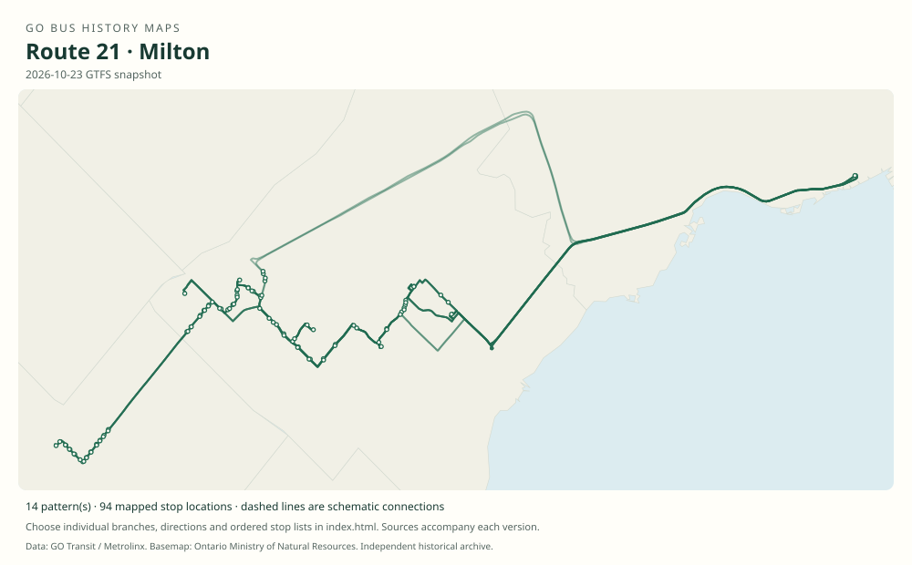

# GO route 21 — Milton

The Milton rail corridor’s bus family has included local and express Union services, many short turns, and a 2023–2024 daytime network connecting to Lakeshore trains.

**Status:** current. **Documented patterns:** 101. **Research date:** 23 October 2026.

[Download history PDF](route-21-history.pdf) · [Interactive map](index.html) · [All ordered stops (CSV)](stops.csv) · [All mapped versions (GeoJSON)](maps.geojson) · [History data](history.json) · [Timetable archive links](archive-sources.json)

The PDF includes the sourced history, dated maps, numbered stop lists and navigation bookmarks. Older versions retain the timetable timing-point or major-stop limits described below.

Open `index.html` through the repository's local web server to use the map. SVG maps below display directly on GitHub.

## History

### 1976-02-15

GO took over the Milton–Streetsville–Union corridor from Gray Coach.

[Source 1](https://transittoronto.ca/regional/2115.shtml)

### 1981-10-26

Milton trains began, changing the role of parallel buses.

[Source 1](https://transittoronto.ca/regional/2115.shtml)

### 2007-09-01

The route-21 series includes both local Milton–Union buses and faster Meadowvale–Union patterns.

[Source 1](https://go-schedule-archive.s3.us-east-1.amazonaws.com/milton/2007-09-11-table-21-milton.pdf)

### 2014-04-05

The map documents branches 21A/B/C/D/E/F/G/H/J/K/L/M/N/P/R/T/V.

[Source 1](https://go-schedule-archive.s3.us-east-1.amazonaws.com/milton/2014-04-05-table-21-milton.pdf)

### 2023-04-08

Daytime 21A/B/C were reorganized toward Oakville, Clarkson and Port Credit; some early and late route 21 buses still served Union.

[Source 1](https://go-schedule-archive.s3.us-east-1.amazonaws.com/milton/2023-04-08-table-21-milton.pdf) · [Source 2](https://www.metrolinx.com/en/discover/new-waterloo-to-hamilton-route-among-april-go-bus-service-changes-)

### 2024-04-27

Regular Union service returned; the Milton–Oakville branch became route 22.

[Source 1](https://www.gotransit.com/en/service-updates/route-21-service-updates) · [Source 2](https://go-schedule-archive.s3.us-east-1.amazonaws.com/milton/2024-04-27-table-21-milton.pdf) · [Source 3](https://go-schedule-archive.s3.us-east-1.amazonaws.com/milton-oakville/2024-04-22-table-22-milton-oakville.pdf)

## Maps by documented version

Feed maps combine the patterns present in that dated file. The interactive viewer separates every branch and direction. A feed snapshot can include future or temporary service; its filename is not a route-change date.

| Date / evidence | Map | Patterns |
|---|---|---:|
| 2016-01-11 GTFS snapshot | [SVG map](maps/2016-01-11.svg) | 47 |
| 2022-03-08 GTFS snapshot | [SVG map](maps/2022-03-08.svg) | 29 |
| 2023-05-05 GTFS snapshot | [SVG map](maps/2023-05-05.svg) | 8 |
| 2026-10-23 GTFS snapshot | [SVG map](maps/2026-10-23.svg) | 14 |
| 2007-09-01 | [SVG map](maps/history-21-2007-local.svg) | 1 |
| 2007-09-01 | [SVG map](maps/history-21-2007-express.svg) | 1 |
| 2023-04-08 | [SVG map](maps/history-21-2023-oakville.svg) | 1 |

## Historical major-stop sequences

These are timetable timing points / major stops, not necessarily every roadside stop. Full GTFS sequences are in `stops.csv` and the snapshot files.

### 2007-09-01 — 21: Milton–Union local pattern

Milton, Main / Martin → Milton GO → Derry / Winston Churchill → Meadowvale Town Centre → Meadowvale GO → Streetsville GO → Erindale GO → Square One → Cooksville GO → Dixie GO → Union Station bus terminal

Schematic straight connections between established stop areas, not a street-by-street reconstruction. Selected published timepoints or named stops, not an exhaustive curb-stop list. Connectors are schematic and do not establish the roads taken. Selected trip 21930. Lisgar and Kipling are table columns but are not served by this trip. 1 stop locations remain unestablished; the full ordered sequence is preserved in the list.

[Original source 1](https://go-schedule-archive.s3.us-east-1.amazonaws.com/milton/2007-09-11-table-21-milton.pdf)

### 2007-09-01 — 21: Milton–Meadowvale–Union express

Milton, Main / Martin → Milton GO → Derry / Winston Churchill → Meadowvale Town Centre → Meadowvale GO → Union Station bus terminal

Schematic straight connections between established stop areas, not a street-by-street reconstruction. Selected published timepoints or named stops, not an exhaustive curb-stop list. Connectors are schematic and do not establish the roads taken. Selected trip 21320; this table prints no branch letter. 1 stop locations remain unestablished; the full ordered sequence is preserved in the list.

[Original source 1](https://go-schedule-archive.s3.us-east-1.amazonaws.com/milton/2007-09-11-table-21-milton.pdf)

### 2023-04-08 — 21A: Daytime Milton–Oakville connection

Milton GO → Trafalgar Road / Highway 407 Park & Ride → Sheridan College, Oakville → Oakville GO

Schematic straight connections between established stop areas, not a street-by-street reconstruction. Selected published timepoints or named stops, not an exhaustive curb-stop list. Connectors are schematic and do not establish the roads taken. Replaced by route 22 in April 2024. Direct Union buses elsewhere in this booklet are separate patterns.

[Original source 1](https://go-schedule-archive.s3.us-east-1.amazonaws.com/milton/2023-04-08-table-21-milton.pdf)

## Coverage and unresolved questions

- The 1976 takeover does not establish when number 21 was adopted.
- A map must not combine every short turn into one imagined through trip.
- Dates for all intervening branch introductions and withdrawals are not established.
- GTFS dates identify captured feeds, not necessarily the first or last day of a route. Open a pattern to see its exact scheduled service dates. Temporary rail replacement and special-service patterns are included when present in the source.
- Manually reconstructed versions generally contain published timetable timing points / major stops. They must not be read as complete roadside stop inventories.

## Sources

- [50 Years of GO Transit Bus Operations — historical chronology by Adam Zhelka / Toronto Transportation Society](https://transittoronto.ca/regional/2115.shtml) — secondary
- [GO Milton table 21, printed effective 1 September 2007 (filename dated 11 September)](https://go-schedule-archive.s3.us-east-1.amazonaws.com/milton/2007-09-11-table-21-milton.pdf) — original-timetable
- [GO Milton table 21, effective 5 April 2014](https://go-schedule-archive.s3.us-east-1.amazonaws.com/milton/2014-04-05-table-21-milton.pdf) — original-timetable
- [GO Milton table 21, effective 8 April 2023](https://go-schedule-archive.s3.us-east-1.amazonaws.com/milton/2023-04-08-table-21-milton.pdf) — original-timetable
- [Metrolinx: New Waterloo to Hamilton route among April GO bus service changes](https://www.metrolinx.com/en/discover/new-waterloo-to-hamilton-route-among-april-go-bus-service-changes-) — official
- [GO Transit: Route 21 service updates — return to Union and introduction of route 22](https://www.gotransit.com/en/service-updates/route-21-service-updates) — official
- [GO Milton table 21, effective 27 April 2024](https://go-schedule-archive.s3.us-east-1.amazonaws.com/milton/2024-04-27-table-21-milton.pdf) — original-timetable
- [GO table 22, printed effective 27 and 28 April 2024 (filename dated 22 April)](https://go-schedule-archive.s3.us-east-1.amazonaws.com/milton-oakville/2024-04-22-table-22-milton-oakville.pdf) — original-timetable
- [GO Transit original GTFS snapshot 2016-01-11](https://openmobilitydata-data.s3.us-west-1.amazonaws.com/public/feeds/go-transit/32/20160111/gtfs.zip) — original-gtfs
- [GO Transit original GTFS snapshot 2022-03-08](https://web.archive.org/web/20220308054107id_/https://www.gotransit.com/static_files/gotransit/assets/Files/GO_GTFS.zip) — original-gtfs
- [GO Transit original GTFS snapshot 2023-05-05](https://openmobilitydata-data.s3.us-west-1.amazonaws.com/public/feeds/go-transit/32/20230505/gtfs.zip) — original-gtfs
- [GO Transit original GTFS snapshot 2026-10-23](https://assets.metrolinx.com/raw/upload/Documents/Metrolinx/Open%20Data/GO-GTFS.zip) — original-gtfs

## Data attribution

Data used in this product or service is provided with the permission of Metrolinx. Metrolinx makes no representations or warranties of any kind, express or implied, with respect to the Data and assumes no responsibility for the accuracy or currency of the data used in this product or service.

Basemap: Ontario Ministry of Natural Resources, Open Government Licence – Ontario. See [methodology](../../docs/METHODOLOGY.md) for geometry and date limitations.
