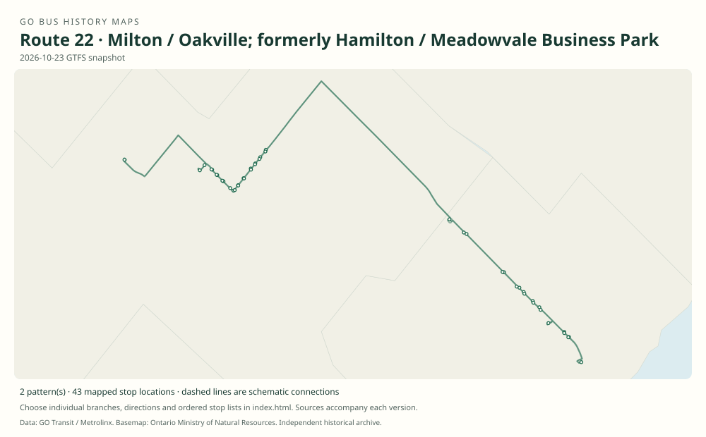

# GO route 22 — Milton / Oakville; formerly Hamilton / Meadowvale Business Park

Two unrelated uses are documented: a Hamilton–Meadowvale commuter bus in 2009 and the Milton–Oakville service introduced in 2024 from 21A.

**Status:** current. **Documented patterns:** 4. **Research date:** 23 October 2026.

[Download history PDF](route-22-history.pdf) · [Interactive map](index.html) · [All ordered stops (CSV)](stops.csv) · [All mapped versions (GeoJSON)](maps.geojson) · [History data](history.json) · [Timetable archive links](archive-sources.json)

The PDF includes the sourced history, dated maps, numbered stop lists and navigation bookmarks. Older versions retain the timetable timing-point or major-stop limits described below.

Open `index.html` through the repository's local web server to use the map. SVG maps below display directly on GitHub.

## History

### 2009-01-03

Route 22 links Hamilton GO with Meadowvale Business Park via Aldershot and Burlington’s Dundas / Highway 407 lot, one weekday trip each way.

[Source 1](https://go-schedule-archive.s3.us-east-1.amazonaws.com/milton-oakville/2009-02-19-table-22-milton-oakville.pdf)

### 2024-04-27

Number 22 was introduced for the Milton–Oakville corridor formerly 21A.

[Source 1](https://www.gotransit.com/en/service-updates/route-21-service-updates) · [Source 2](https://go-schedule-archive.s3.us-east-1.amazonaws.com/milton-oakville/2024-04-22-table-22-milton-oakville.pdf)

### 2024-04-29

The new timetable’s first weekday lists seven trips each way, generally two-hourly outside the morning.

[Source 1](https://go-schedule-archive.s3.us-east-1.amazonaws.com/milton-oakville/2024-04-22-table-22-milton-oakville.pdf)

## Maps by documented version

Feed maps combine the patterns present in that dated file. The interactive viewer separates every branch and direction. A feed snapshot can include future or temporary service; its filename is not a route-change date.

| Date / evidence | Map | Patterns |
|---|---|---:|
| 2026-10-23 GTFS snapshot | [SVG map](maps/2026-10-23.svg) | 2 |
| 2009-01-03 | [SVG map](maps/history-22-2009-hamilton.svg) | 1 |
| 2024-04-27 | [SVG map](maps/history-22-2024-milton.svg) | 1 |

## Historical major-stop sequences

These are timetable timing points / major stops, not necessarily every roadside stop. Full GTFS sequences are in `stops.csv` and the snapshot files.

### 2009-01-03 — 22: Earlier route 22: Hamilton–Meadowvale

Hamilton GO Centre → Hamilton, King / Dundurn → Aldershot GO → Dundas Street / Highway 407 Park & Ride, Burlington → Meadowvale Business Park, Syntex / Financial

Schematic straight connections between established stop areas, not a street-by-street reconstruction. Selected published timepoints or named stops, not an exhaustive curb-stop list. Connectors are schematic and do not establish the roads taken. Reverse service uses Hamilton Main / Longwood. The archive filename incorrectly labels this document Milton–Oakville.

[Original source 1](https://go-schedule-archive.s3.us-east-1.amazonaws.com/milton-oakville/2009-02-19-table-22-milton-oakville.pdf)

### 2024-04-27 — 22: Reused route 22: Milton–Oakville

Milton GO → Trafalgar Road / Highway 407 Park & Ride → Sheridan College, Oakville → Oakville GO

Schematic straight connections between established stop areas, not a street-by-street reconstruction. Selected published timepoints or named stops, not an exhaustive curb-stop list. Connectors are schematic and do not establish the roads taken. Cover effective April 27/28; the bus table is weekday-only, so Monday April 29 was its first scheduled operating day in this issue.

[Original source 1](https://go-schedule-archive.s3.us-east-1.amazonaws.com/milton-oakville/2024-04-22-table-22-milton-oakville.pdf)

## Coverage and unresolved questions

- The old Hamilton–Meadowvale route’s introduction and withdrawal dates are unknown.
- Numerical reuse is not evidence of continuous service.
- The later extension to Regional Road 25 / Highway 401 needs a contemporary date.
- GTFS dates identify captured feeds, not necessarily the first or last day of a route. Open a pattern to see its exact scheduled service dates. Temporary rail replacement and special-service patterns are included when present in the source.
- Manually reconstructed versions generally contain published timetable timing points / major stops. They must not be read as complete roadside stop inventories.

## Sources

- [GO routes 22 Hamilton / Meadowvale Business Park and 29 Guelph / Mississauga; 22 printed effective 3 January 2009 (archive filename mislabels family and date)](https://go-schedule-archive.s3.us-east-1.amazonaws.com/milton-oakville/2009-02-19-table-22-milton-oakville.pdf) — original-timetable
- [GO Transit: Route 21 service updates — return to Union and introduction of route 22](https://www.gotransit.com/en/service-updates/route-21-service-updates) — official
- [GO table 22, printed effective 27 and 28 April 2024 (filename dated 22 April)](https://go-schedule-archive.s3.us-east-1.amazonaws.com/milton-oakville/2024-04-22-table-22-milton-oakville.pdf) — original-timetable
- [GO Transit original GTFS snapshot 2026-10-23](https://assets.metrolinx.com/raw/upload/Documents/Metrolinx/Open%20Data/GO-GTFS.zip) — original-gtfs

## Data attribution

Data used in this product or service is provided with the permission of Metrolinx. Metrolinx makes no representations or warranties of any kind, express or implied, with respect to the Data and assumes no responsibility for the accuracy or currency of the data used in this product or service.

Basemap: Ontario Ministry of Natural Resources, Open Government Licence – Ontario. See [methodology](../../docs/METHODOLOGY.md) for geometry and date limitations.
