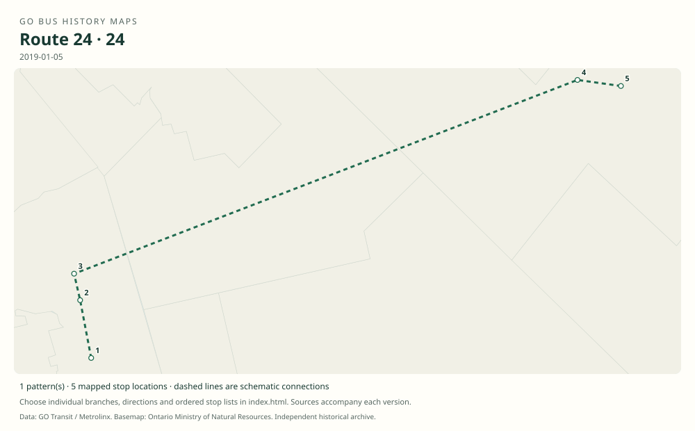

# GO route 24 — Cambridge / Milton

A commuter Cambridge–Milton route designed around Milton GO train connections.

**Status:** discontinued. **Documented patterns:** 1. **Research date:** 23 October 2026.

[Download history PDF](route-24-history.pdf) · [Interactive map](index.html) · [All ordered stops (CSV)](stops.csv) · [All mapped versions (GeoJSON)](maps.geojson) · [History data](history.json) · [Timetable archive links](archive-sources.json)

The PDF includes the sourced history, dated maps, numbered stop lists and navigation bookmarks. Older versions retain the timetable timing-point or major-stop limits described below.

Open `index.html` through the repository's local web server to use the map. SVG maps below display directly on GitHub.

## History

### 2016-04-29

Ontario announced twelve weekday trips: four morning trips toward Milton and eight afternoon/evening returns.

[Source 1](https://news.ontario.ca/en/release/36715/ontario-adding-twelve-weekday-go-bus-trips-between-cambridge-and-milton)

### 2016-09-06

Route 24 began operation.

[Source 1](https://stevemunro.ca/wp-content/uploads/2017/03/ridership-report-september2016.pdf)

### 2019-01-05

The table lists Ainslie and Cambridge Centre terminals, the Hespeler corridor, Regional Road 25 / Highway 401 and Milton GO.

[Source 1](https://go-schedule-archive.s3.us-east-1.amazonaws.com/cambridge-milton/2019-01-05-table-24-cambridge-milton.pdf)

### 2019-06-29

Route 24 was withdrawn.

[Source 1](https://www.ontariondp.ca/news/ontario-ndp-transit-critic-condemns-cuts-go-bus-service)

## Maps by documented version

Feed maps combine the patterns present in that dated file. The interactive viewer separates every branch and direction. A feed snapshot can include future or temporary service; its filename is not a route-change date.

| Date / evidence | Map | Patterns |
|---|---|---:|
| 2019-01-05 | [SVG map](maps/history-24-2019-east.svg) | 1 |

## Historical major-stop sequences

These are timetable timing points / major stops, not necessarily every roadside stop. Full GTFS sequences are in `stops.csv` and the snapshot files.

### 2019-01-05 — 24: Cambridge–Milton train connection

Cambridge Bus Terminal, Ainslie Street → Cambridge Centre Bus Terminal → Cambridge, Hespeler / Pinebush → Regional Road 25 / Highway 401 Park & Ride → Milton GO

Schematic straight connections between established stop areas, not a street-by-street reconstruction. Selected published timepoints or named stops, not an exhaustive curb-stop list. Connectors are schematic and do not establish the roads taken. The westbound Hespeler timepoint is at Eagle Street. Union is a separate train connection, not part of this bus route.

[Original source 1](https://go-schedule-archive.s3.us-east-1.amazonaws.com/cambridge-milton/2019-01-05-table-24-cambridge-milton.pdf)

## Coverage and unresolved questions

- Opening-day stops may differ from the 2019 snapshot.
- The June 2019 withdrawal date relies on contemporary secondary reporting pending an original GO notice.
- Manually reconstructed versions generally contain published timetable timing points / major stops. They must not be read as complete roadside stop inventories.

## Sources

- [Ontario adding twelve weekday GO bus trips between Cambridge and Milton, 29 April 2016](https://news.ontario.ca/en/release/36715/ontario-adding-twelve-weekday-go-bus-trips-between-cambridge-and-milton) — official
- [Metrolinx GO Transit Ridership Report, September 2016 (original report, archived by Steve Munro)](https://stevemunro.ca/wp-content/uploads/2017/03/ridership-report-september2016.pdf) — official
- [GO Cambridge / Milton table 24, effective 5 January 2019](https://go-schedule-archive.s3.us-east-1.amazonaws.com/cambridge-milton/2019-01-05-table-24-cambridge-milton.pdf) — original-timetable
- [Ontario NDP statement reproducing June 2019 route-withdrawal information; used only for service dates](https://www.ontariondp.ca/news/ontario-ndp-transit-critic-condemns-cuts-go-bus-service) — secondary

## Data attribution

Data used in this product or service is provided with the permission of Metrolinx. Metrolinx makes no representations or warranties of any kind, express or implied, with respect to the Data and assumes no responsibility for the accuracy or currency of the data used in this product or service.

Basemap: Ontario Ministry of Natural Resources, Open Government Licence – Ontario. See [methodology](../../docs/METHODOLOGY.md) for geometry and date limitations.
