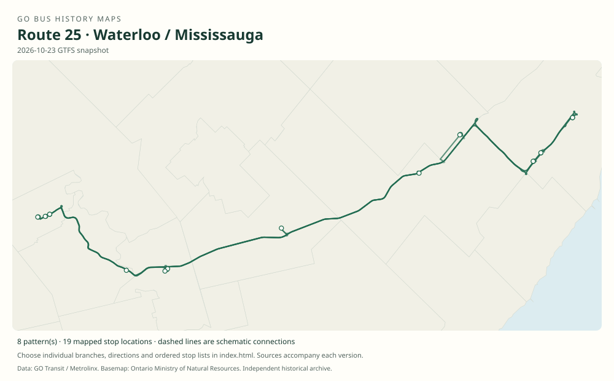

# GO route 25 — Waterloo / Mississauga

The Waterloo–Kitchener–Cambridge corridor launched with Square One and Milton connections and later gained campus express, transitway and seasonal shopping variants.

**Status:** current. **Documented patterns:** 40. **Research date:** 23 October 2026.

[Download history PDF](route-25-history.pdf) · [Interactive map](index.html) · [All ordered stops (CSV)](stops.csv) · [All mapped versions (GeoJSON)](maps.geojson) · [History data](history.json) · [Timetable archive links](archive-sources.json)

The PDF includes the sourced history, dated maps, numbered stop lists and navigation bookmarks. Older versions retain the timetable timing-point or major-stop limits described below.

Open `index.html` through the repository's local web server to use the map. SVG maps below display directly on GitHub.

## History

### 2009-10-31

GO began Waterloo / Kitchener / Cambridge service to Square One with a Milton train-connection branch.

[Source 1](https://news.ontario.ca/mto/en/2009/10/go-bus-service-coming-to-kitchener-waterloo-and-cambridge.html) · [Source 2](https://news.ontario.ca/en/release/9607/go-buses-arrive-in-kitchener-waterloo-and-cambridge)

### 2009-10-31

The launch table identifies route 25 and Milton-bound 25A.

[Source 1](https://go-schedule-archive.s3.us-east-1.amazonaws.com/waterloo-mississauga/2009-11-22-table-25-waterloo-mississauga.pdf)

### 2019-04-06

The published family includes 25B,25C,25D and 25F as well as 25.

[Source 1](https://go-schedule-archive.s3.us-east-1.amazonaws.com/waterloo-mississauga/2019-04-06-table-25-waterloo-mississauga.pdf)

### 2023-04-08

Seasonal weekend/holiday outlet-shopping service on 25L returned.

[Source 1](https://www.gotransit.com/en/blog/april-service-changes)

### 2025-04-05

Seasonal weekend 25K began Toronto Premium Outlets–Kipling service via Square One, Dixie and Renforth, through 24 August.

[Source 1](https://www.metrolinx.com/en/news/april-go-service-changes-to-include-new-kitchener-line-trips)

## Maps by documented version

Feed maps combine the patterns present in that dated file. The interactive viewer separates every branch and direction. A feed snapshot can include future or temporary service; its filename is not a route-change date.

| Date / evidence | Map | Patterns |
|---|---|---:|
| 2016-01-11 GTFS snapshot | [SVG map](maps/2016-01-11.svg) | 17 |
| 2022-03-08 GTFS snapshot | [SVG map](maps/2022-03-08.svg) | 6 |
| 2023-05-05 GTFS snapshot | [SVG map](maps/2023-05-05.svg) | 6 |
| 2026-10-23 GTFS snapshot | [SVG map](maps/2026-10-23.svg) | 8 |
| 2009-10-31 | [SVG map](maps/history-25-2009-main.svg) | 1 |
| 2009-10-31 | [SVG map](maps/history-25-2009-milton.svg) | 1 |
| 2025-04-05 to 2025-08-24 | [SVG map](maps/history-25-2025-seasonal-kipling.svg) | 1 |

## Historical major-stop sequences

These are timetable timing points / major stops, not necessarily every roadside stop. Full GTFS sequences are in `stops.csv` and the snapshot files.

### 2009-10-31 — 25: Launch route to Square One

University of Waterloo, Davis Centre → Wilfrid Laurier University, University / Hazel → Kitchener Bus Terminal, Charles / Ontario → Cambridge SmartCentres, Hespeler / Highway 401 → Aberfoyle Park & Ride, Brock / Highway 401 → Regional Road 25 / Highway 401 Park & Ride → Square One

Schematic straight connections between established stop areas, not a street-by-street reconstruction. Selected published timepoints or named stops, not an exhaustive curb-stop list. Connectors are schematic and do not establish the roads taken.

[Original source 1](https://go-schedule-archive.s3.us-east-1.amazonaws.com/waterloo-mississauga/2009-11-22-table-25-waterloo-mississauga.pdf)

### 2009-10-31 — 25A: Launch Milton train connection

University of Waterloo, Davis Centre → Wilfrid Laurier University, University / Hazel → Kitchener Bus Terminal, Charles / Ontario → Cambridge SmartCentres, Hespeler / Highway 401 → Aberfoyle Park & Ride, Brock / Highway 401 → Regional Road 25 / Highway 401 Park & Ride → Milton GO

Schematic straight connections between established stop areas, not a street-by-street reconstruction. Selected published timepoints or named stops, not an exhaustive curb-stop list. Connectors are schematic and do not establish the roads taken.

[Original source 1](https://go-schedule-archive.s3.us-east-1.amazonaws.com/waterloo-mississauga/2009-11-22-table-25-waterloo-mississauga.pdf)

### 2025-04-05 to 2025-08-24 — 25K: Seasonal shopping branch to Kipling

Toronto Premium Outlets → Square One → Dixie Transitway Station → Renforth Transitway Station → Kipling GO

Schematic straight connections between established stop areas, not a street-by-street reconstruction. Selected published timepoints or named stops, not an exhaustive curb-stop list. Connectors are schematic and do not establish the roads taken. Seasonal weekend operation, not a Waterloo through trip without separate evidence.

[Original source 1](https://www.metrolinx.com/en/news/april-go-service-changes-to-include-new-kitchener-line-trips)

## Coverage and unresolved questions

- Complete branch introduction dates remain unverified.
- Davis Centre, Charles Street and Cambridge SmartCentres are historical stop locations and should not be moved to newer terminals.
- Seasonal variants may be absent from autumn GTFS.
- GTFS dates identify captured feeds, not necessarily the first or last day of a route. Open a pattern to see its exact scheduled service dates. Temporary rail replacement and special-service patterns are included when present in the source.
- Manually reconstructed versions generally contain published timetable timing points / major stops. They must not be read as complete roadside stop inventories.

## Sources

- [Ontario: GO bus service coming to Kitchener-Waterloo and Cambridge, 8 October 2009](https://news.ontario.ca/mto/en/2009/10/go-bus-service-coming-to-kitchener-waterloo-and-cambridge.html) — official
- [Ontario: GO buses arrive in Kitchener-Waterloo and Cambridge, 30 October 2009](https://news.ontario.ca/en/release/9607/go-buses-arrive-in-kitchener-waterloo-and-cambridge) — official
- [GO table 25, printed effective 31 October 2009 (filename dated 22 November)](https://go-schedule-archive.s3.us-east-1.amazonaws.com/waterloo-mississauga/2009-11-22-table-25-waterloo-mississauga.pdf) — original-timetable
- [GO Waterloo / Mississauga table 25, effective 6 April 2019](https://go-schedule-archive.s3.us-east-1.amazonaws.com/waterloo-mississauga/2019-04-06-table-25-waterloo-mississauga.pdf) — original-timetable
- [GO Transit: April service changes, published 14 April 2023](https://www.gotransit.com/en/blog/april-service-changes) — official
- [Metrolinx: April GO service changes to include new Kitchener line trips, March 2025](https://www.metrolinx.com/en/news/april-go-service-changes-to-include-new-kitchener-line-trips) — official
- [GO Transit original GTFS snapshot 2016-01-11](https://openmobilitydata-data.s3.us-west-1.amazonaws.com/public/feeds/go-transit/32/20160111/gtfs.zip) — original-gtfs
- [GO Transit original GTFS snapshot 2022-03-08](https://web.archive.org/web/20220308054107id_/https://www.gotransit.com/static_files/gotransit/assets/Files/GO_GTFS.zip) — original-gtfs
- [GO Transit original GTFS snapshot 2023-05-05](https://openmobilitydata-data.s3.us-west-1.amazonaws.com/public/feeds/go-transit/32/20230505/gtfs.zip) — original-gtfs
- [GO Transit original GTFS snapshot 2026-10-23](https://assets.metrolinx.com/raw/upload/Documents/Metrolinx/Open%20Data/GO-GTFS.zip) — original-gtfs

## Data attribution

Data used in this product or service is provided with the permission of Metrolinx. Metrolinx makes no representations or warranties of any kind, express or implied, with respect to the Data and assumes no responsibility for the accuracy or currency of the data used in this product or service.

Basemap: Ontario Ministry of Natural Resources, Open Government Licence – Ontario. See [methodology](../../docs/METHODOLOGY.md) for geometry and date limitations.
