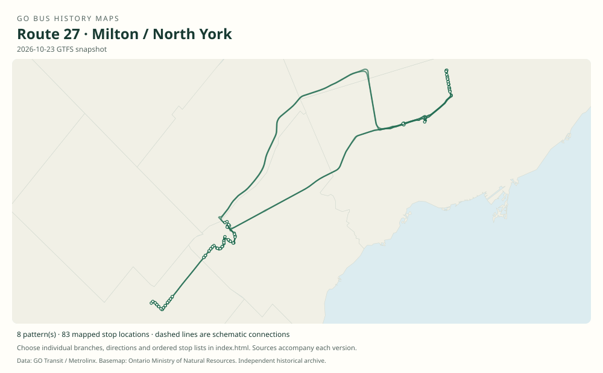

# GO route 27 — Milton / North York

A Milton/Meadowvale–North York family with historical Finch and York Mills variants and selected Meadowvale Business Park trips.

**Status:** current. **Documented patterns:** 44. **Research date:** 23 October 2026.

[Download history PDF](route-27-history.pdf) · [Interactive map](index.html) · [All ordered stops (CSV)](stops.csv) · [All mapped versions (GeoJSON)](maps.geojson) · [History data](history.json) · [Timetable archive links](archive-sources.json)

The PDF includes the sourced history, dated maps, numbered stop lists and navigation bookmarks. Older versions retain the timetable timing-point or major-stop limits described below.

Open `index.html` through the repository's local web server to use the map. SVG maps below display directly on GitHub.

## History

### 1977-01-05

GO added a Milton / Streetsville–York Mills service, an early corridor predecessor.

[Source 1](https://transittoronto.ca/regional/2115.shtml)

### 2008-06-28

The table documents 27 and 27A/B/D/E/F serving distinct Finch, York Mills and Meadowvale patterns.

[Source 1](https://go-schedule-archive.s3.us-east-1.amazonaws.com/milton-north-york/2008-12-03-table-27-milton-north-york.pdf)

### 2016-04-02

Weekend service was added.

[Source 1](https://stevemunro.ca/wp-content/uploads/2017/03/ridership-report-september2016.pdf)

### 2019-01-05

The table uses Milton GO and Derry / Ninth Line in place of the older Main / Martin and Derry / Winston Churchill timepoints.

[Source 1](https://go-schedule-archive.s3.us-east-1.amazonaws.com/milton-north-york/2019-01-05-table-27-milton-north-york.pdf)

## Maps by documented version

Feed maps combine the patterns present in that dated file. The interactive viewer separates every branch and direction. A feed snapshot can include future or temporary service; its filename is not a route-change date.

| Date / evidence | Map | Patterns |
|---|---|---:|
| 2016-01-11 GTFS snapshot | [SVG map](maps/2016-01-11.svg) | 17 |
| 2022-03-08 GTFS snapshot | [SVG map](maps/2022-03-08.svg) | 12 |
| 2023-05-05 GTFS snapshot | [SVG map](maps/2023-05-05.svg) | 5 |
| 2026-10-23 GTFS snapshot | [SVG map](maps/2026-10-23.svg) | 8 |
| 2008-06-28 | [SVG map](maps/history-27-2008-finch.svg) | 1 |
| 2008-06-28 | [SVG map](maps/history-27-2008-york-mills.svg) | 1 |

## Historical major-stop sequences

These are timetable timing points / major stops, not necessarily every roadside stop. Full GTFS sequences are in `stops.csv` and the snapshot files.

### 2008-06-28 — 27: Milton–Finch main branch

Milton, Main / Martin → Milton GO → Milton, Thompson / Derry → Meadowvale, Derry / Winston Churchill → Meadowvale Town Centre, Aquitaine → Meadowvale GO → Erin Mills Parkway / Mississauga Road → Toronto, Keele / Highway 401 → Yorkdale GO Bus Terminal → Yonge / Sheppard → Finch GO Bus Terminal

Schematic straight connections between established stop areas, not a street-by-street reconstruction. Selected published timepoints or named stops, not an exhaustive curb-stop list. Connectors are schematic and do not establish the roads taken.  1 stop locations remain unestablished; the full ordered sequence is preserved in the list.

[Original source 1](https://go-schedule-archive.s3.us-east-1.amazonaws.com/milton-north-york/2008-12-03-table-27-milton-north-york.pdf)

### 2008-06-28 — 27B: Milton–York Mills branch

Milton, Main / Martin → Milton GO → Milton, Thompson / Derry → Meadowvale, Derry / Winston Churchill → Meadowvale Town Centre, Aquitaine → Meadowvale GO → Erin Mills Parkway / Mississauga Road → York Mills GO Bus Terminal

Schematic straight connections between established stop areas, not a street-by-street reconstruction. Selected published timepoints or named stops, not an exhaustive curb-stop list. Connectors are schematic and do not establish the roads taken. This branch skips Keele, Yorkdale, Sheppard and Finch; their columns must not be inserted into its stop list. 1 stop locations remain unestablished; the full ordered sequence is preserved in the list.

[Original source 1](https://go-schedule-archive.s3.us-east-1.amazonaws.com/milton-north-york/2008-12-03-table-27-milton-north-york.pdf)

## Coverage and unresolved questions

- The number 27 adoption date is unknown.
- The 2008 business-park variants 27A/E/F are documented but not individually reconstructed here; dated GTFS can supplement them.
- GTFS dates identify captured feeds, not necessarily the first or last day of a route. Open a pattern to see its exact scheduled service dates. Temporary rail replacement and special-service patterns are included when present in the source.
- Manually reconstructed versions generally contain published timetable timing points / major stops. They must not be read as complete roadside stop inventories.

## Sources

- [50 Years of GO Transit Bus Operations — historical chronology by Adam Zhelka / Toronto Transportation Society](https://transittoronto.ca/regional/2115.shtml) — secondary
- [GO table 27, printed effective 28 June 2008 (filename dated 3 December)](https://go-schedule-archive.s3.us-east-1.amazonaws.com/milton-north-york/2008-12-03-table-27-milton-north-york.pdf) — original-timetable
- [Metrolinx GO Transit Ridership Report, September 2016 (original report, archived by Steve Munro)](https://stevemunro.ca/wp-content/uploads/2017/03/ridership-report-september2016.pdf) — official
- [GO Milton / North York table 27, effective 5 January 2019](https://go-schedule-archive.s3.us-east-1.amazonaws.com/milton-north-york/2019-01-05-table-27-milton-north-york.pdf) — original-timetable
- [GO Transit original GTFS snapshot 2016-01-11](https://openmobilitydata-data.s3.us-west-1.amazonaws.com/public/feeds/go-transit/32/20160111/gtfs.zip) — original-gtfs
- [GO Transit original GTFS snapshot 2022-03-08](https://web.archive.org/web/20220308054107id_/https://www.gotransit.com/static_files/gotransit/assets/Files/GO_GTFS.zip) — original-gtfs
- [GO Transit original GTFS snapshot 2023-05-05](https://openmobilitydata-data.s3.us-west-1.amazonaws.com/public/feeds/go-transit/32/20230505/gtfs.zip) — original-gtfs
- [GO Transit original GTFS snapshot 2026-10-23](https://assets.metrolinx.com/raw/upload/Documents/Metrolinx/Open%20Data/GO-GTFS.zip) — original-gtfs

## Data attribution

Data used in this product or service is provided with the permission of Metrolinx. Metrolinx makes no representations or warranties of any kind, express or implied, with respect to the Data and assumes no responsibility for the accuracy or currency of the data used in this product or service.

Basemap: Ontario Ministry of Natural Resources, Open Government Licence – Ontario. See [methodology](../../docs/METHODOLOGY.md) for geometry and date limitations.
