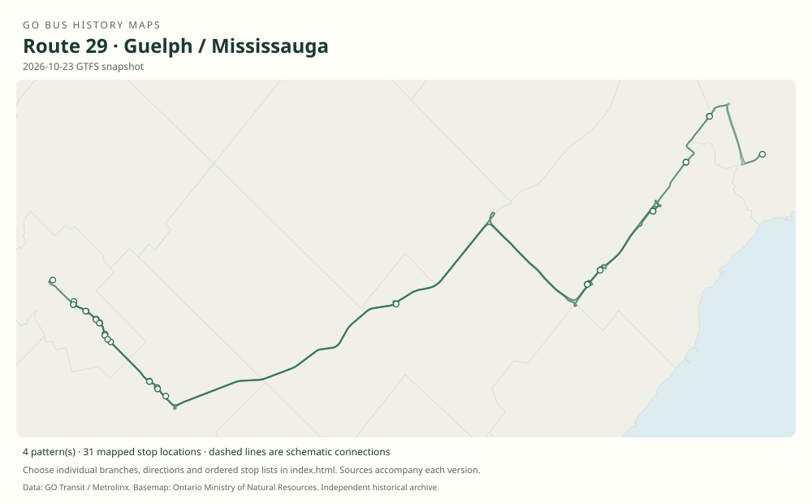

# GO route 29 — Guelph / Mississauga

A Guelph–Highway 401–Mississauga corridor formerly reaching Cooksville, later centered on Square One and extended to Kipling.

**Status:** current. **Documented patterns:** 19. **Research date:** 23 October 2026.

[Download history PDF](route-29-history.pdf) · [Interactive map](index.html) · [All ordered stops (CSV)](stops.csv) · [All mapped versions (GeoJSON)](maps.geojson) · [History data](history.json) · [Timetable archive links](archive-sources.json)

The PDF includes the sourced history, dated maps, numbered stop lists and navigation bookmarks. Older versions retain the timetable timing-point or major-stop limits described below.

Open `index.html` through the repository's local web server to use the map. SVG maps below display directly on GitHub.

## History

### 2007-09-03

The federal/provincial launch release announced University of Guelph–Aberfoyle–Square One–Cooksville service for 3 September. The route 29 number is independently documented by 2008.

[Source 1](https://www.canada.ca/en/news/archive/2007/08/go-transit-expands-bus-service-university-guelph.html)

### 2008-04-28

Additional weekday trips increased the University of Guelph–Cooksville route toward hourly service.

[Source 1](https://transittoronto.ca/archives/weblog/2008/04/22-go_transit.shtml)

### 2009-09-05

The original table retains Cooksville GO as the Mississauga endpoint.

[Source 1](https://go-schedule-archive.s3.us-east-1.amazonaws.com/guelph-mississauga/2010-01-02-table-29-guelph-mississauga.pdf)

### 2019-01-05

The table runs Guelph Central–University–Aberfoyle–Square One with Regional Road 25 and Transitway timepoints.

[Source 1](https://go-schedule-archive.s3.us-east-1.amazonaws.com/guelph-mississauga/2019-01-05-table-29-guelph-mississauga.pdf)

### 2021-09-04

Route 29 extended to Renforth/Kipling; a university–Square One Friday/Sunday express pilot was announced.

[Source 1](https://www.metrolinx.com/en/discover/metrolinx-announces-increased-weekday-service-across-go-network)

### 2024-08-31

Branch 29A added an express University of Guelph–Square One connection.

[Source 1](https://www.metrolinx.com/en/news/go-bus-schedule-changes-coming-aug-31)

## Maps by documented version

Feed maps combine the patterns present in that dated file. The interactive viewer separates every branch and direction. A feed snapshot can include future or temporary service; its filename is not a route-change date.

| Date / evidence | Map | Patterns |
|---|---|---:|
| 2016-01-11 GTFS snapshot | [SVG map](maps/2016-01-11.svg) | 7 |
| 2022-03-08 GTFS snapshot | [SVG map](maps/2022-03-08.svg) | 4 |
| 2023-05-05 GTFS snapshot | [SVG map](maps/2023-05-05.svg) | 2 |
| 2026-10-23 GTFS snapshot | [SVG map](maps/2026-10-23.svg) | 4 |
| 2009-09-05 | [SVG map](maps/history-29-2009-cooksville.svg) | 1 |
| 2019-01-05 | [SVG map](maps/history-29-2019-transitway.svg) | 1 |

## Historical major-stop sequences

These are timetable timing points / major stops, not necessarily every roadside stop. Full GTFS sequences are in `stops.csv` and the snapshot files.

### 2009-09-05 — 29: University of Guelph–Cooksville

University of Guelph → Aberfoyle Park & Ride → Square One → Cooksville GO

Schematic straight connections between established stop areas, not a street-by-street reconstruction. Selected published timepoints or named stops, not an exhaustive curb-stop list. Connectors are schematic and do not establish the roads taken.

[Original source 1](https://go-schedule-archive.s3.us-east-1.amazonaws.com/guelph-mississauga/2010-01-02-table-29-guelph-mississauga.pdf)

### 2019-01-05 — 29: Guelph Central–Square One via Transitway

Guelph Central GO → University of Guelph → Aberfoyle, Brock / McLean → Regional Road 25 / Highway 401 Park & Ride → Winston Churchill Transitway Station → Erin Mills Transitway Station → Square One

Schematic straight connections between established stop areas, not a street-by-street reconstruction. Selected published timepoints or named stops, not an exhaustive curb-stop list. Connectors are schematic and do not establish the roads taken.

[Original source 1](https://go-schedule-archive.s3.us-east-1.amazonaws.com/guelph-mississauga/2019-01-05-table-29-guelph-mississauga.pdf)

## Coverage and unresolved questions

- The launch release describes the corridor without a route number; the number 29 is independently documented by the April 2008 service-change notice.
- Dates when Cooksville was removed and Guelph Central added need intervening timetables.
- GTFS dates identify captured feeds, not necessarily the first or last day of a route. Open a pattern to see its exact scheduled service dates. Temporary rail replacement and special-service patterns are included when present in the source.
- Manually reconstructed versions generally contain published timetable timing points / major stops. They must not be read as complete roadside stop inventories.

## Sources

- [Transport Canada: GO Transit expands bus service to the University of Guelph, 29 August 2007](https://www.canada.ca/en/news/archive/2007/08/go-transit-expands-bus-service-university-guelph.html) — official
- [Transit Toronto: GO Transit changes start April 26, published 22 April 2008](https://transittoronto.ca/archives/weblog/2008/04/22-go_transit.shtml) — secondary
- [GO table 29, printed effective 5 September 2009 (filename dated 2 January 2010)](https://go-schedule-archive.s3.us-east-1.amazonaws.com/guelph-mississauga/2010-01-02-table-29-guelph-mississauga.pdf) — original-timetable
- [GO Guelph / Mississauga table 29, effective 5 January 2019](https://go-schedule-archive.s3.us-east-1.amazonaws.com/guelph-mississauga/2019-01-05-table-29-guelph-mississauga.pdf) — original-timetable
- [Metrolinx announces increased weekday service across GO network, 26 August 2021](https://www.metrolinx.com/en/discover/metrolinx-announces-increased-weekday-service-across-go-network) — official
- [Metrolinx: GO bus schedule changes coming Aug. 31, 2024](https://www.metrolinx.com/en/news/go-bus-schedule-changes-coming-aug-31) — official
- [GO Transit original GTFS snapshot 2016-01-11](https://openmobilitydata-data.s3.us-west-1.amazonaws.com/public/feeds/go-transit/32/20160111/gtfs.zip) — original-gtfs
- [GO Transit original GTFS snapshot 2022-03-08](https://web.archive.org/web/20220308054107id_/https://www.gotransit.com/static_files/gotransit/assets/Files/GO_GTFS.zip) — original-gtfs
- [GO Transit original GTFS snapshot 2023-05-05](https://openmobilitydata-data.s3.us-west-1.amazonaws.com/public/feeds/go-transit/32/20230505/gtfs.zip) — original-gtfs
- [GO Transit original GTFS snapshot 2026-10-23](https://assets.metrolinx.com/raw/upload/Documents/Metrolinx/Open%20Data/GO-GTFS.zip) — original-gtfs

## Data attribution

Data used in this product or service is provided with the permission of Metrolinx. Metrolinx makes no representations or warranties of any kind, express or implied, with respect to the Data and assumes no responsibility for the accuracy or currency of the data used in this product or service.

Basemap: Ontario Ministry of Natural Resources, Open Government Licence – Ontario. See [methodology](../../docs/METHODOLOGY.md) for geometry and date limitations.
