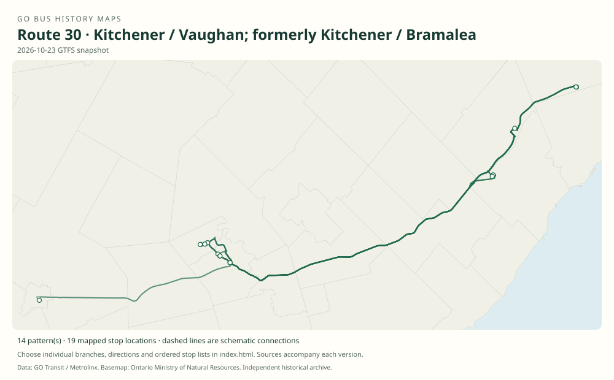

# GO route 30 — Kitchener / Vaughan; formerly Kitchener / Bramalea

A Kitchener–Bramalea train-connection express that gained all-day/weekend service and Waterloo university connections.

**Status:** current. **Documented patterns:** 26. **Research date:** 23 October 2026.

[Download history PDF](route-30-history.pdf) · [Interactive map](index.html) · [All ordered stops (CSV)](stops.csv) · [All mapped versions (GeoJSON)](maps.geojson) · [History data](history.json) · [Timetable archive links](archive-sources.json)

The PDF includes the sourced history, dated maps, numbered stop lists and navigation bookmarks. Older versions retain the timetable timing-point or major-stop limits described below.

Open `index.html` through the repository's local web server to use the map. SVG maps below display directly on GitHub.

## History

### by 2013-04-06

Route 30 already appears with one weekday morning eastbound trip and three westbound train meets.

[Source 1](https://go-schedule-archive.s3.us-east-1.amazonaws.com/kitchener/2013-04-06-table-31-kitchener.pdf)

### 2016-09-06

Weekday counter-peak and off-peak service was added.

[Source 1](https://stevemunro.ca/wp-content/uploads/2017/03/ridership-report-september2016.pdf)

### 2016-09-26

Ontario described expanded all-day Kitchener–Bramalea express service alongside Highway 401 bus-shoulder improvements.

[Source 1](https://news.ontario.ca/mto/en/2016/09/ontario-adding-go-bus-by-pass-shoulders-on-highway-401.html)

### 2021-09-04

The route extended from Kitchener GO to Waterloo and Laurier universities.

[Source 1](https://www.metrolinx.com/en/discover/metrolinx-announces-increased-weekday-service-across-go-network)

### 2023-04-08

Weekend service was added for connections to new weekend Kitchener-line trains.

[Source 1](https://www.gotransit.com/en/blog/april-service-changes)

## Maps by documented version

Feed maps combine the patterns present in that dated file. The interactive viewer separates every branch and direction. A feed snapshot can include future or temporary service; its filename is not a route-change date.

| Date / evidence | Map | Patterns |
|---|---|---:|
| 2016-01-11 GTFS snapshot | [SVG map](maps/2016-01-11.svg) | 4 |
| 2022-03-08 GTFS snapshot | [SVG map](maps/2022-03-08.svg) | 4 |
| 2023-05-05 GTFS snapshot | [SVG map](maps/2023-05-05.svg) | 3 |
| 2026-10-23 GTFS snapshot | [SVG map](maps/2026-10-23.svg) | 14 |
| 2013-04-06 | [SVG map](maps/history-30-2013-west.svg) | 1 |

## Historical major-stop sequences

These are timetable timing points / major stops, not necessarily every roadside stop. Full GTFS sequences are in `stops.csv` and the snapshot files.

### 2013-04-06 — 30: Early Bramalea–Kitchener train connection

Bramalea GO → Kitchener GO, Weber / Victoria → Kitchener Bus Terminal, Charles / Ontario

Schematic straight connections between established stop areas, not a street-by-street reconstruction. Selected published timepoints or named stops, not an exhaustive curb-stop list. Connectors are schematic and do not establish the roads taken. Visually verified westbound sequence: Bramalea 15:00, Kitchener GO16:10, Charles Street 16:15. The morning eastbound trip starts at Kitchener GO; do not infer a Charles Street pickup.

[Original source 1](https://go-schedule-archive.s3.us-east-1.amazonaws.com/kitchener/2013-04-06-table-31-kitchener.pdf)

## Coverage and unresolved questions

- Route 30 existed by 2013; the 2016 expansion was not its launch.
- Initial introduction and later Highway 407-terminal extension dates need primary notices.
- Kitchener GO and Charles Street terminal are distinct places.
- GTFS dates identify captured feeds, not necessarily the first or last day of a route. Open a pattern to see its exact scheduled service dates. Temporary rail replacement and special-service patterns are included when present in the source.
- Manually reconstructed versions generally contain published timetable timing points / major stops. They must not be read as complete roadside stop inventories.

## Sources

- [GO Kitchener table 31, effective 6 April 2013, routes 30 / 31 / 33 / 39](https://go-schedule-archive.s3.us-east-1.amazonaws.com/kitchener/2013-04-06-table-31-kitchener.pdf) — original-timetable
- [Metrolinx GO Transit Ridership Report, September 2016 (original report, archived by Steve Munro)](https://stevemunro.ca/wp-content/uploads/2017/03/ridership-report-september2016.pdf) — official
- [Ontario adding GO bus by-pass shoulders on Highway 401, 26 September 2016](https://news.ontario.ca/mto/en/2016/09/ontario-adding-go-bus-by-pass-shoulders-on-highway-401.html) — official
- [Metrolinx announces increased weekday service across GO network, 26 August 2021](https://www.metrolinx.com/en/discover/metrolinx-announces-increased-weekday-service-across-go-network) — official
- [GO Transit: April service changes, published 14 April 2023](https://www.gotransit.com/en/blog/april-service-changes) — official
- [GO Transit original GTFS snapshot 2016-01-11](https://openmobilitydata-data.s3.us-west-1.amazonaws.com/public/feeds/go-transit/32/20160111/gtfs.zip) — original-gtfs
- [GO Transit original GTFS snapshot 2022-03-08](https://web.archive.org/web/20220308054107id_/https://www.gotransit.com/static_files/gotransit/assets/Files/GO_GTFS.zip) — original-gtfs
- [GO Transit original GTFS snapshot 2023-05-05](https://openmobilitydata-data.s3.us-west-1.amazonaws.com/public/feeds/go-transit/32/20230505/gtfs.zip) — original-gtfs
- [GO Transit original GTFS snapshot 2026-10-23](https://assets.metrolinx.com/raw/upload/Documents/Metrolinx/Open%20Data/GO-GTFS.zip) — original-gtfs

## Data attribution

Data used in this product or service is provided with the permission of Metrolinx. Metrolinx makes no representations or warranties of any kind, express or implied, with respect to the Data and assumes no responsibility for the accuracy or currency of the data used in this product or service.

Basemap: Ontario Ministry of Natural Resources, Open Government Licence – Ontario. See [methodology](../../docs/METHODOLOGY.md) for geometry and date limitations.
