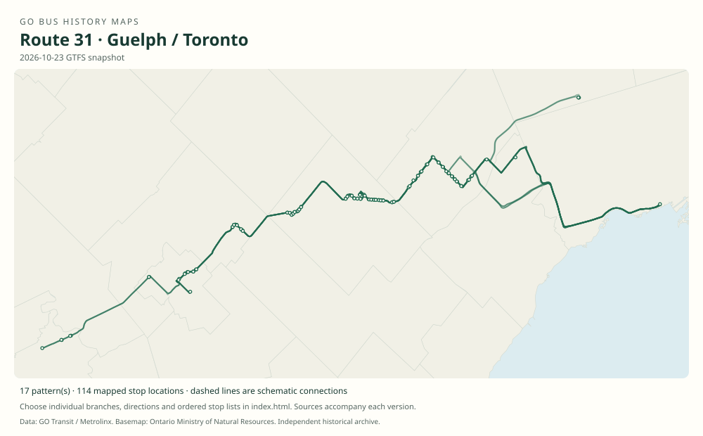

# GO route 31 — Guelph / Toronto

The Georgetown/Kitchener corridor’s Union bus family combines multiple local/express lengths, with coverage changing as trains expanded.

**Status:** current. **Documented patterns:** 94. **Research date:** 23 October 2026.

[Download history PDF](route-31-history.pdf) · [Interactive map](index.html) · [All ordered stops (CSV)](stops.csv) · [All mapped versions (GeoJSON)](maps.geojson) · [History data](history.json) · [Timetable archive links](archive-sources.json)

The PDF includes the sourced history, dated maps, numbered stop lists and navigation bookmarks. Older versions retain the timetable timing-point or major-stop limits described below.

Open `index.html` through the repository's local web server to use the map. SVG maps below display directly on GitHub.

## History

### 2007-09-01

Route 31 trip series link Union, Brampton, Georgetown, Acton, Rockwood and Guelph in several patterns.

[Source 1](https://go-schedule-archive.s3.us-east-1.amazonaws.com/kitchener/2007-11-07-table-31-kitchener.pdf)

### 2013-04-06

The Kitchener booklet separates 30/31/33/39 and documents many 31 variants.

[Source 1](https://go-schedule-archive.s3.us-east-1.amazonaws.com/kitchener/2013-04-06-table-31-kitchener.pdf)

### 2015-09-05

Midday 31 train-bus service was removed as Kitchener midday trains expanded.

[Source 1](https://stevemunro.ca/wp-content/uploads/2017/03/ridership-report-september2016.pdf)

### 2023-04-08

Weekend 31 service was replaced by trains and local bus connections on other routes.

[Source 1](https://www.gotransit.com/en/blog/april-service-changes)

## Maps by documented version

Feed maps combine the patterns present in that dated file. The interactive viewer separates every branch and direction. A feed snapshot can include future or temporary service; its filename is not a route-change date.

| Date / evidence | Map | Patterns |
|---|---|---:|
| 2016-01-11 GTFS snapshot | [SVG map](maps/2016-01-11.svg) | 29 |
| 2022-03-08 GTFS snapshot | [SVG map](maps/2022-03-08.svg) | 30 |
| 2023-05-05 GTFS snapshot | [SVG map](maps/2023-05-05.svg) | 16 |
| 2026-10-23 GTFS snapshot | [SVG map](maps/2026-10-23.svg) | 17 |
| 2013-04-06 | [SVG map](maps/history-31-2013-brampton.svg) | 1 |
| 2007-04-28 | [SVG map](maps/history-31-2007-corridor.svg) | 1 |

## Historical major-stop sequences

These are timetable timing points / major stops, not necessarily every roadside stop. Full GTFS sequences are in `stops.csv` and the snapshot files.

### 2013-04-06 — 31H: Union–Brampton local branch

Union Station bus terminal → Malton GO → Bramalea GO → Brampton, Steeles / Rutherford → Shoppers World, Hurontario / Bartley Bull → Brampton GO

Schematic straight connections between established stop areas, not a street-by-street reconstruction. Selected published timepoints or named stops, not an exhaustive curb-stop list. Connectors are schematic and do not establish the roads taken. Example trip 31061. Bloor, Weston and EtobicokeNorth are rail columns skipped by this bus. 1 stop locations remain unestablished; the full ordered sequence is preserved in the list.

[Original source 1](https://go-schedule-archive.s3.us-east-1.amazonaws.com/kitchener/2013-04-06-table-31-kitchener.pdf)

### 2007-04-28 — 31: Union–Guelph evening through bus

Union Station bus terminal → Brampton, Steeles / Rutherford → Shoppers World, Hurontario / Bartley Bull → Brampton GO → Brampton, Hurontario / Bovaird → Mount Pleasant GO → Norval → Georgetown Market → Georgetown GO → Georgetown, Main / Wesleyan → Acton, Main / Mill → Rockwood, Alma / Main → Guelph Bus Terminal, Macdonell / Carden

Schematic straight connections between established stop areas, not a street-by-street reconstruction. Selected published timepoints, not an exhaustive curb-stop list. Schematic connectors do not establish roads taken. Actual weekday trip 31831 departed Union at 20:30 and reached Guelph at 22:25; it skipped Malton and Bramalea. Printed westbound page effective 28 April 2007. 3 stop locations remain unestablished; the full ordered sequence is preserved in the list.

[Original source 1](https://go-schedule-archive.s3.us-east-1.amazonaws.com/kitchener/2007-11-07-table-31-kitchener.pdf)

## Coverage and unresolved questions

- Number 31’s initial adoption date is unknown.
- Train-connection columns must not be treated as bus stops.
- A schedule-effective Saturday may differ from the first weekday of replacement trains.
- GTFS dates identify captured feeds, not necessarily the first or last day of a route. Open a pattern to see its exact scheduled service dates. Temporary rail replacement and special-service patterns are included when present in the source.
- Manually reconstructed versions generally contain published timetable timing points / major stops. They must not be read as complete roadside stop inventories.

## Sources

- [GO Georgetown table 31, routes 31 / 33, pages dated 28 April and 1 September 2007 (archive family later renamed Kitchener)](https://go-schedule-archive.s3.us-east-1.amazonaws.com/kitchener/2007-11-07-table-31-kitchener.pdf) — original-timetable
- [GO Kitchener table 31, effective 6 April 2013, routes 30 / 31 / 33 / 39](https://go-schedule-archive.s3.us-east-1.amazonaws.com/kitchener/2013-04-06-table-31-kitchener.pdf) — original-timetable
- [Metrolinx GO Transit Ridership Report, September 2016 (original report, archived by Steve Munro)](https://stevemunro.ca/wp-content/uploads/2017/03/ridership-report-september2016.pdf) — official
- [GO Transit: April service changes, published 14 April 2023](https://www.gotransit.com/en/blog/april-service-changes) — official
- [GO Transit original GTFS snapshot 2016-01-11](https://openmobilitydata-data.s3.us-west-1.amazonaws.com/public/feeds/go-transit/32/20160111/gtfs.zip) — original-gtfs
- [GO Transit original GTFS snapshot 2022-03-08](https://web.archive.org/web/20220308054107id_/https://www.gotransit.com/static_files/gotransit/assets/Files/GO_GTFS.zip) — original-gtfs
- [GO Transit original GTFS snapshot 2023-05-05](https://openmobilitydata-data.s3.us-west-1.amazonaws.com/public/feeds/go-transit/32/20230505/gtfs.zip) — original-gtfs
- [GO Transit original GTFS snapshot 2026-10-23](https://assets.metrolinx.com/raw/upload/Documents/Metrolinx/Open%20Data/GO-GTFS.zip) — original-gtfs

## Data attribution

Data used in this product or service is provided with the permission of Metrolinx. Metrolinx makes no representations or warranties of any kind, express or implied, with respect to the Data and assumes no responsibility for the accuracy or currency of the data used in this product or service.

Basemap: Ontario Ministry of Natural Resources, Open Government Licence – Ontario. See [methodology](../../docs/METHODOLOGY.md) for geometry and date limitations.
