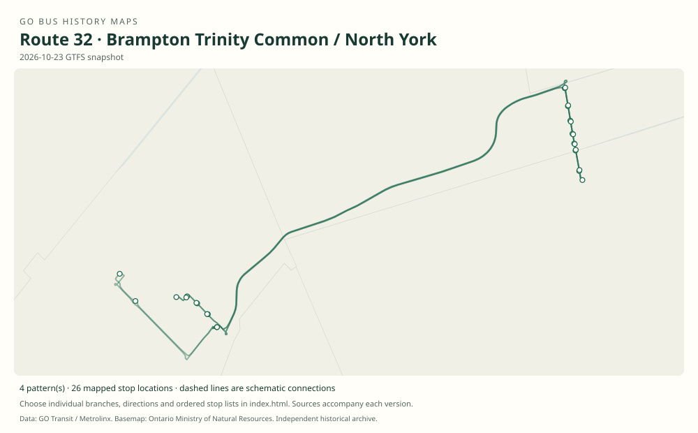

# GO route 32 — Brampton Trinity Common / North York

The Trinity Common–North York family joined Brampton terminals to the Yonge Street corridor using Highway 407. Its Richmond Hill-area stop was Langstaff / Yonge, not Richmond Hill Centre.

**Status:** current. **Documented patterns:** 27. **Research date:** 23 October 2026.

[Download history PDF](route-32-history.pdf) · [Interactive map](index.html) · [All ordered stops (CSV)](stops.csv) · [All mapped versions (GeoJSON)](maps.geojson) · [History data](history.json) · [Timetable archive links](archive-sources.json)

The PDF includes the sourced history, dated maps, numbered stop lists and navigation bookmarks. Older versions retain the timetable timing-point or major-stop limits described below.

Open `index.html` through the repository's local web server to use the map. SVG maps below display directly on GitHub.

## History

### 2006-10-28

The table connects Hurontario / Bovaird and Trinity Common through Bramalea to Langstaff / Yonge, Finch and Sheppard.

[Source 1](https://go-schedule-archive.s3.us-east-1.amazonaws.com/brampton-trinity-common-north-york/2008-02-05-table-32-brampton-trinity-common-north-york.pdf)

### 2015-09-05

Service moved from Dixie Road to Highway 410, removing the local Dixie stops.

[Source 1](https://stevemunro.ca/wp-content/uploads/2017/03/ridership-report-september2016.pdf)

### 2019-01-05

The table includes Williams Parkway/Highway 410 and York Mills, plus a Bramalea Transit Terminal branch.

[Source 1](https://go-schedule-archive.s3.us-east-1.amazonaws.com/brampton-trinity-common-north-york/2019-01-05-table-32-brampton-trinity-common-north-york.pdf)

## Maps by documented version

Feed maps combine the patterns present in that dated file. The interactive viewer separates every branch and direction. A feed snapshot can include future or temporary service; its filename is not a route-change date.

| Date / evidence | Map | Patterns |
|---|---|---:|
| 2016-01-11 GTFS snapshot | [SVG map](maps/2016-01-11.svg) | 10 |
| 2022-03-08 GTFS snapshot | [SVG map](maps/2022-03-08.svg) | 8 |
| 2023-05-05 GTFS snapshot | [SVG map](maps/2023-05-05.svg) | 4 |
| 2026-10-23 GTFS snapshot | [SVG map](maps/2026-10-23.svg) | 4 |
| 2006-10-28 | [SVG map](maps/history-32-2006.svg) | 1 |

## Historical major-stop sequences

These are timetable timing points / major stops, not necessarily every roadside stop. Full GTFS sequences are in `stops.csv` and the snapshot files.

### 2006-10-28 — 32: Trinity Common–North York via Bramalea

Brampton, Hurontario / Bovaird → Trinity Common Terminal → Bramalea City Centre Terminal, Clark Boulevard → Bramalea GO → Langstaff Road / Yonge Street → Finch GO Bus Terminal → Yonge / Sheppard

Schematic straight connections between established stop areas, not a street-by-street reconstruction. Selected published timepoints or named stops, not an exhaustive curb-stop list. Connectors are schematic and do not establish the roads taken. The older Clark Boulevard and newer Central Park terminals need distinct historical coordinates. Langstaff / Yonge is an on-street stop, not Richmond Hill Centre. 1 stop locations remain unestablished; the full ordered sequence is preserved in the list.

[Original source 1](https://go-schedule-archive.s3.us-east-1.amazonaws.com/brampton-trinity-common-north-york/2008-02-05-table-32-brampton-trinity-common-north-york.pdf)

## Coverage and unresolved questions

- The initial launch date is unknown.
- Dates when York Mills was added and later removed need contemporary notices.
- The 2019 cover’s Highway 401 typo must not relocate the actual Williams Parkway/Highway 410 interchange.
- GTFS dates identify captured feeds, not necessarily the first or last day of a route. Open a pattern to see its exact scheduled service dates. Temporary rail replacement and special-service patterns are included when present in the source.
- Manually reconstructed versions generally contain published timetable timing points / major stops. They must not be read as complete roadside stop inventories.

## Sources

- [GO table 32, printed effective 28 October 2006 (filename dated 5 February 2008)](https://go-schedule-archive.s3.us-east-1.amazonaws.com/brampton-trinity-common-north-york/2008-02-05-table-32-brampton-trinity-common-north-york.pdf) — original-timetable
- [Metrolinx GO Transit Ridership Report, September 2016 (original report, archived by Steve Munro)](https://stevemunro.ca/wp-content/uploads/2017/03/ridership-report-september2016.pdf) — official
- [GO Brampton Trinity Common / North York table 32, effective 5 January 2019](https://go-schedule-archive.s3.us-east-1.amazonaws.com/brampton-trinity-common-north-york/2019-01-05-table-32-brampton-trinity-common-north-york.pdf) — original-timetable
- [GO Transit original GTFS snapshot 2016-01-11](https://openmobilitydata-data.s3.us-west-1.amazonaws.com/public/feeds/go-transit/32/20160111/gtfs.zip) — original-gtfs
- [GO Transit original GTFS snapshot 2022-03-08](https://web.archive.org/web/20220308054107id_/https://www.gotransit.com/static_files/gotransit/assets/Files/GO_GTFS.zip) — original-gtfs
- [GO Transit original GTFS snapshot 2023-05-05](https://openmobilitydata-data.s3.us-west-1.amazonaws.com/public/feeds/go-transit/32/20230505/gtfs.zip) — original-gtfs
- [GO Transit original GTFS snapshot 2026-10-23](https://assets.metrolinx.com/raw/upload/Documents/Metrolinx/Open%20Data/GO-GTFS.zip) — original-gtfs

## Data attribution

Data used in this product or service is provided with the permission of Metrolinx. Metrolinx makes no representations or warranties of any kind, express or implied, with respect to the Data and assumes no responsibility for the accuracy or currency of the data used in this product or service.

Basemap: Ontario Ministry of Natural Resources, Open Government Licence – Ontario. See [methodology](../../docs/METHODOLOGY.md) for geometry and date limitations.
