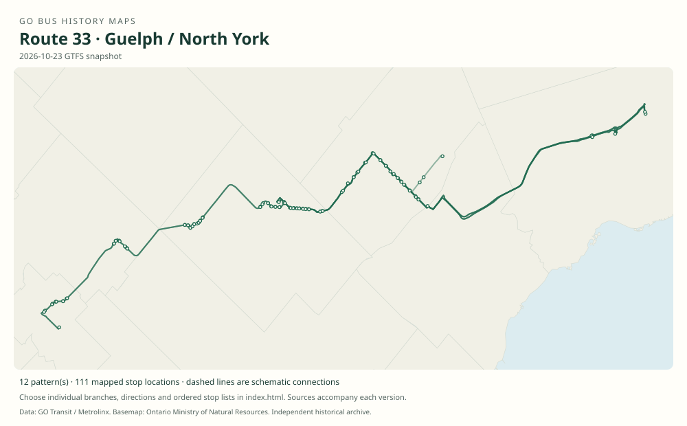

# GO route 33 — Guelph / North York

A Guelph–Georgetown–Brampton–North York local corridor, historically terminating at York Mills and sharing portions with 31.

**Status:** current. **Documented patterns:** 69. **Research date:** 23 October 2026.

[Download history PDF](route-33-history.pdf) · [Interactive map](index.html) · [All ordered stops (CSV)](stops.csv) · [All mapped versions (GeoJSON)](maps.geojson) · [History data](history.json) · [Timetable archive links](archive-sources.json)

The PDF includes the sourced history, dated maps, numbered stop lists and navigation bookmarks. Older versions retain the timetable timing-point or major-stop limits described below.

Open `index.html` through the repository's local web server to use the map. SVG maps below display directly on GitHub.

## History

### 1976-02-15

GO introduced a Georgetown–Brampton–Malton–York Mills corridor, a predecessor of later numbered routes.

[Source 1](https://transittoronto.ca/regional/2115.shtml)

### 2007-09-01

Route 33 trip series link Guelph and Georgetown with Yorkdale/York Mills.

[Source 1](https://go-schedule-archive.s3.us-east-1.amazonaws.com/kitchener/2007-11-07-table-31-kitchener.pdf)

### 2013-04-06

The family includes Guelph Central, the University of Guelph and Acton GO.

[Source 1](https://go-schedule-archive.s3.us-east-1.amazonaws.com/kitchener/2013-04-06-table-31-kitchener.pdf)

### 2015-09-05

Hourly weekday off-peak service was added.

[Source 1](https://stevemunro.ca/wp-content/uploads/2017/03/ridership-report-september2016.pdf)

### 2023-04-08

Weekend service was added for train connections at Mount Pleasant.

[Source 1](https://www.gotransit.com/en/blog/april-service-changes)

## Maps by documented version

Feed maps combine the patterns present in that dated file. The interactive viewer separates every branch and direction. A feed snapshot can include future or temporary service; its filename is not a route-change date.

| Date / evidence | Map | Patterns |
|---|---|---:|
| 2016-01-11 GTFS snapshot | [SVG map](maps/2016-01-11.svg) | 20 |
| 2022-03-08 GTFS snapshot | [SVG map](maps/2022-03-08.svg) | 24 |
| 2023-05-05 GTFS snapshot | [SVG map](maps/2023-05-05.svg) | 12 |
| 2026-10-23 GTFS snapshot | [SVG map](maps/2026-10-23.svg) | 12 |
| 2007-09-01 | [SVG map](maps/history-33-2007.svg) | 1 |

## Historical major-stop sequences

These are timetable timing points / major stops, not necessarily every roadside stop. Full GTFS sequences are in `stops.csv` and the snapshot files.

### 2007-09-01 — 33: Guelph–York Mills via Georgetown

Guelph Bus Terminal, Macdonell / Carden → Rockwood, Alma / Main → Acton, Main / Mill → Georgetown GO → Georgetown Market → Norval → Mount Pleasant GO → Brampton GO → Shoppers World → Brampton, Steeles / Rutherford → Yorkdale GO Bus Terminal → York Mills GO Bus Terminal

Schematic straight connections between established stop areas, not a street-by-street reconstruction. Selected published timepoints or named stops, not an exhaustive curb-stop list. Connectors are schematic and do not establish the roads taken. Major timepoints only; university extensions and short turns are separate patterns. 1 stop locations remain unestablished; the full ordered sequence is preserved in the list.

[Original source 1](https://go-schedule-archive.s3.us-east-1.amazonaws.com/kitchener/2007-11-07-table-31-kitchener.pdf)

## Coverage and unresolved questions

- The 1976 predecessor does not prove the 33 number was then used.
- Guelph/Acton terminal-relocation dates need primary notices.
- Weekend short turns should be taken from dated GTFS, not inferred from the full weekday route.
- GTFS dates identify captured feeds, not necessarily the first or last day of a route. Open a pattern to see its exact scheduled service dates. Temporary rail replacement and special-service patterns are included when present in the source.
- Manually reconstructed versions generally contain published timetable timing points / major stops. They must not be read as complete roadside stop inventories.

## Sources

- [50 Years of GO Transit Bus Operations — historical chronology by Adam Zhelka / Toronto Transportation Society](https://transittoronto.ca/regional/2115.shtml) — secondary
- [GO Georgetown table 31, routes 31 / 33, pages dated 28 April and 1 September 2007 (archive family later renamed Kitchener)](https://go-schedule-archive.s3.us-east-1.amazonaws.com/kitchener/2007-11-07-table-31-kitchener.pdf) — original-timetable
- [GO Kitchener table 31, effective 6 April 2013, routes 30 / 31 / 33 / 39](https://go-schedule-archive.s3.us-east-1.amazonaws.com/kitchener/2013-04-06-table-31-kitchener.pdf) — original-timetable
- [Metrolinx GO Transit Ridership Report, September 2016 (original report, archived by Steve Munro)](https://stevemunro.ca/wp-content/uploads/2017/03/ridership-report-september2016.pdf) — official
- [GO Transit: April service changes, published 14 April 2023](https://www.gotransit.com/en/blog/april-service-changes) — official
- [GO Transit original GTFS snapshot 2016-01-11](https://openmobilitydata-data.s3.us-west-1.amazonaws.com/public/feeds/go-transit/32/20160111/gtfs.zip) — original-gtfs
- [GO Transit original GTFS snapshot 2022-03-08](https://web.archive.org/web/20220308054107id_/https://www.gotransit.com/static_files/gotransit/assets/Files/GO_GTFS.zip) — original-gtfs
- [GO Transit original GTFS snapshot 2023-05-05](https://openmobilitydata-data.s3.us-west-1.amazonaws.com/public/feeds/go-transit/32/20230505/gtfs.zip) — original-gtfs
- [GO Transit original GTFS snapshot 2026-10-23](https://assets.metrolinx.com/raw/upload/Documents/Metrolinx/Open%20Data/GO-GTFS.zip) — original-gtfs

## Data attribution

Data used in this product or service is provided with the permission of Metrolinx. Metrolinx makes no representations or warranties of any kind, express or implied, with respect to the Data and assumes no responsibility for the accuracy or currency of the data used in this product or service.

Basemap: Ontario Ministry of Natural Resources, Open Government Licence – Ontario. See [methodology](../../docs/METHODOLOGY.md) for geometry and date limitations.
