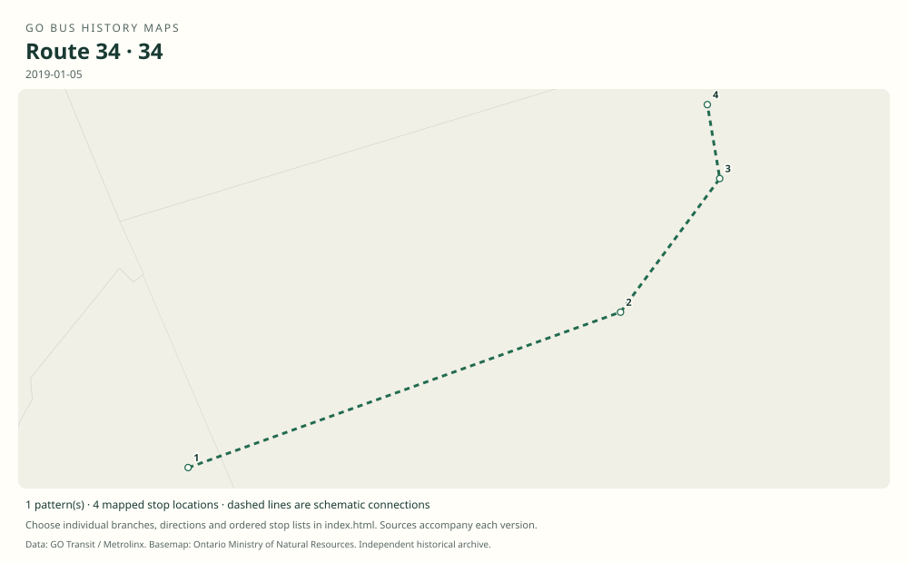

# GO route 34 — Pearson Airport / North York; formerly Brampton local

Before 2015,34 joined Brampton, Malton and Pearson with North York. It became Pearson–Finch before being absorbed into 94.

**Status:** discontinued. **Documented patterns:** 9. **Research date:** 23 October 2026.

[Download history PDF](route-34-history.pdf) · [Interactive map](index.html) · [All ordered stops (CSV)](stops.csv) · [All mapped versions (GeoJSON)](maps.geojson) · [History data](history.json) · [Timetable archive links](archive-sources.json)

The PDF includes the sourced history, dated maps, numbered stop lists and navigation bookmarks. Older versions retain the timetable timing-point or major-stop limits described below.

Open `index.html` through the repository's local web server to use the map. SVG maps below display directly on GitHub.

## History

### 2012-09-01

The combined timetable identifies 34 as Brampton–Bramalea–Malton–Pearson–North York.

[Source 1](https://go-schedule-archive.s3.us-east-1.amazonaws.com/brampton-local-hwy-27-and-hwy-427-express/2012-09-01-table-34-brampton-local-hwy-27-and-hwy-427-express.pdf)

### 2015-09-05

34 became Pearson–Yorkdale–Finch, dropping Brampton, Malton and York Mills.

[Source 1](https://stevemunro.ca/wp-content/uploads/2017/03/ridership-report-september2016.pdf)

### 2019-01-05

The original 34 table confirms its Pearson–Finch configuration.

[Source 1](https://go-schedule-archive.s3.us-east-1.amazonaws.com/brampton-local-hwy-27-and-hwy-427-express/2019-01-05-table-34-brampton-local-hwy-27-and-hwy-427-express.pdf)

### 2023-04-08

34 and 94 merged into expanded 94, ending the separate 34 number.

[Source 1](https://www.metrolinx.com/en/discover/new-waterloo-to-hamilton-route-among-april-go-bus-service-changes-) · [Source 2](https://www.gotransit.com/en/blog/april-service-changes)

## Maps by documented version

Feed maps combine the patterns present in that dated file. The interactive viewer separates every branch and direction. A feed snapshot can include future or temporary service; its filename is not a route-change date.

| Date / evidence | Map | Patterns |
|---|---|---:|
| 2016-01-11 GTFS snapshot | [SVG map](maps/2016-01-11.svg) | 3 |
| 2022-03-08 GTFS snapshot | [SVG map](maps/2022-03-08.svg) | 4 |
| 2012-09-01 | [SVG map](maps/history-34-2012-brampton.svg) | 1 |
| 2019-01-05 | [SVG map](maps/history-34-2019-finch.svg) | 1 |

## Historical major-stop sequences

These are timetable timing points / major stops, not necessarily every roadside stop. Full GTFS sequences are in `stops.csv` and the snapshot files.

### 2012-09-01 — 34: Brampton–Pearson–York Mills local

Brampton GO → Bramalea Transit Terminal, Central Park Drive → Bramalea GO → Malton, Airport / Derry → Pearson Airport Terminal 1 → Toronto, Dixon / Martin Grove → Yorkdale GO Bus Terminal → York Mills GO Bus Terminal

Schematic straight connections between established stop areas, not a street-by-street reconstruction. Selected published timepoints or named stops, not an exhaustive curb-stop list. Connectors are schematic and do not establish the roads taken. Selected main-route timepoints, not every short turn. 2 stop locations remain unestablished; the full ordered sequence is preserved in the list.

[Original source 1](https://go-schedule-archive.s3.us-east-1.amazonaws.com/brampton-local-hwy-27-and-hwy-427-express/2012-09-01-table-34-brampton-local-hwy-27-and-hwy-427-express.pdf)

### 2019-01-05 — 34: Pearson–Finch after 2015

Pearson Airport Terminal 1 → Yorkdale GO Bus Terminal → Yonge / Sheppard → Finch GO Bus Terminal

Schematic straight connections between established stop areas, not a street-by-street reconstruction. Selected published timepoints or named stops, not an exhaustive curb-stop list. Connectors are schematic and do not establish the roads taken.

[Original source 1](https://go-schedule-archive.s3.us-east-1.amazonaws.com/brampton-local-hwy-27-and-hwy-427-express/2019-01-05-table-34-brampton-local-hwy-27-and-hwy-427-express.pdf)

## Coverage and unresolved questions

- The initial 34 launch date is unknown.
- The 2015 change removed the Brampton section; it was not merely a name change.
- Use full original tables or GTFS for minor/direction-specific stops.
- GTFS dates identify captured feeds, not necessarily the first or last day of a route. Open a pattern to see its exact scheduled service dates. Temporary rail replacement and special-service patterns are included when present in the source.
- Manually reconstructed versions generally contain published timetable timing points / major stops. They must not be read as complete roadside stop inventories.

## Sources

- [GO Brampton Local / Highway 27 and Highway 427 Express table 34, effective 1 September 2012, routes 34 / 35 / 36](https://go-schedule-archive.s3.us-east-1.amazonaws.com/brampton-local-hwy-27-and-hwy-427-express/2012-09-01-table-34-brampton-local-hwy-27-and-hwy-427-express.pdf) — original-timetable
- [Metrolinx GO Transit Ridership Report, September 2016 (original report, archived by Steve Munro)](https://stevemunro.ca/wp-content/uploads/2017/03/ridership-report-september2016.pdf) — official
- [GO Pearson Airport / North York table 34, effective 5 January 2019](https://go-schedule-archive.s3.us-east-1.amazonaws.com/brampton-local-hwy-27-and-hwy-427-express/2019-01-05-table-34-brampton-local-hwy-27-and-hwy-427-express.pdf) — original-timetable
- [Metrolinx: New Waterloo to Hamilton route among April GO bus service changes](https://www.metrolinx.com/en/discover/new-waterloo-to-hamilton-route-among-april-go-bus-service-changes-) — official
- [GO Transit: April service changes, published 14 April 2023](https://www.gotransit.com/en/blog/april-service-changes) — official
- [GO Transit original GTFS snapshot 2016-01-11](https://openmobilitydata-data.s3.us-west-1.amazonaws.com/public/feeds/go-transit/32/20160111/gtfs.zip) — original-gtfs
- [GO Transit original GTFS snapshot 2022-03-08](https://web.archive.org/web/20220308054107id_/https://www.gotransit.com/static_files/gotransit/assets/Files/GO_GTFS.zip) — original-gtfs

## Data attribution

Data used in this product or service is provided with the permission of Metrolinx. Metrolinx makes no representations or warranties of any kind, express or implied, with respect to the Data and assumes no responsibility for the accuracy or currency of the data used in this product or service.

Basemap: Ontario Ministry of Natural Resources, Open Government Licence – Ontario. See [methodology](../../docs/METHODOLOGY.md) for geometry and date limitations.
