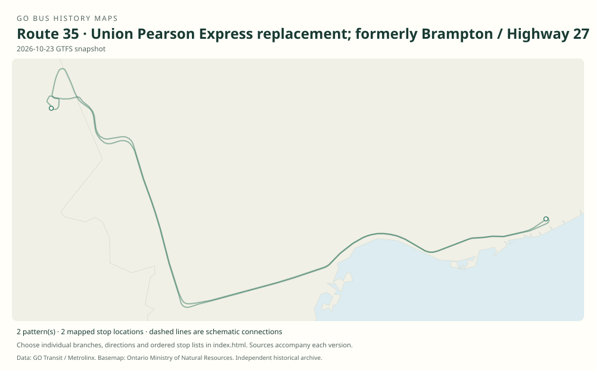

# GO route 35 — Union Pearson Express replacement; formerly Brampton / Highway 27

The old regular 35 ran Brampton–Humber College–North York until 2015. Contemporary 35B/35C feed entries are UP Express replacement services, a separate reuse.

**Status:** special. **Documented patterns:** 3. **Research date:** 23 October 2026.

[Download history PDF](route-35-history.pdf) · [Interactive map](index.html) · [All ordered stops (CSV)](stops.csv) · [All mapped versions (GeoJSON)](maps.geojson) · [History data](history.json) · [Timetable archive links](archive-sources.json)

The PDF includes the sourced history, dated maps, numbered stop lists and navigation bookmarks. Older versions retain the timetable timing-point or major-stop limits described below.

Open `index.html` through the repository's local web server to use the map. SVG maps below display directly on GitHub.

## History

### 2012-09-01

The Brampton table identifies 35 via Humber College toward North York.

[Source 1](https://go-schedule-archive.s3.us-east-1.amazonaws.com/brampton-local-hwy-27-and-hwy-427-express/2012-09-01-table-34-brampton-local-hwy-27-and-hwy-427-express.pdf)

### 2015-09-05

The regular Brampton/Highway 27 route 35 was discontinued.

[Source 1](https://stevemunro.ca/wp-content/uploads/2017/03/ridership-report-september2016.pdf)

## Maps by documented version

Feed maps combine the patterns present in that dated file. The interactive viewer separates every branch and direction. A feed snapshot can include future or temporary service; its filename is not a route-change date.

| Date / evidence | Map | Patterns |
|---|---|---:|
| 2026-10-23 GTFS snapshot | [SVG map](maps/2026-10-23.svg) | 2 |
| 2012-09-01 | [SVG map](maps/history-35-2012-humber.svg) | 1 |

## Historical major-stop sequences

These are timetable timing points / major stops, not necessarily every roadside stop. Full GTFS sequences are in `stops.csv` and the snapshot files.

### 2012-09-01 — 35: Former Brampton–Humber College–North York

Brampton GO → Bramalea Transit Terminal, Central Park Drive → Bramalea GO → Mississauga, Finch / Darcel → Humber College Boulevard, west of Highway 27 → Highway 27 / Rexdale → Yorkdale GO Bus Terminal → York Mills GO Bus Terminal

Schematic straight connections between established stop areas, not a street-by-street reconstruction. Selected published timepoints or named stops, not an exhaustive curb-stop list. Connectors are schematic and do not establish the roads taken. This old route is unrelated to the later UP Express replacement patterns.

[Original source 1](https://go-schedule-archive.s3.us-east-1.amazonaws.com/brampton-local-hwy-27-and-hwy-427-express/2012-09-01-table-34-brampton-local-hwy-27-and-hwy-427-express.pdf)

## Coverage and unresolved questions

- The old 35 introduction date is unknown.
- Modern 35B/35C patterns belong to dated GTFS; their presence does not establish a permanent conventional daily route.
- The first date of number 35’s modern reuse remains unverified.
- GTFS dates identify captured feeds, not necessarily the first or last day of a route. Open a pattern to see its exact scheduled service dates. Temporary rail replacement and special-service patterns are included when present in the source.
- Manually reconstructed versions generally contain published timetable timing points / major stops. They must not be read as complete roadside stop inventories.

## Sources

- [GO Brampton Local / Highway 27 and Highway 427 Express table 34, effective 1 September 2012, routes 34 / 35 / 36](https://go-schedule-archive.s3.us-east-1.amazonaws.com/brampton-local-hwy-27-and-hwy-427-express/2012-09-01-table-34-brampton-local-hwy-27-and-hwy-427-express.pdf) — original-timetable
- [Metrolinx GO Transit Ridership Report, September 2016 (original report, archived by Steve Munro)](https://stevemunro.ca/wp-content/uploads/2017/03/ridership-report-september2016.pdf) — official
- [GO Transit original GTFS snapshot 2026-10-23](https://assets.metrolinx.com/raw/upload/Documents/Metrolinx/Open%20Data/GO-GTFS.zip) — original-gtfs

## Data attribution

Data used in this product or service is provided with the permission of Metrolinx. Metrolinx makes no representations or warranties of any kind, express or implied, with respect to the Data and assumes no responsibility for the accuracy or currency of the data used in this product or service.

Basemap: Ontario Ministry of Natural Resources, Open Government Licence – Ontario. See [methodology](../../docs/METHODOLOGY.md) for geometry and date limitations.
