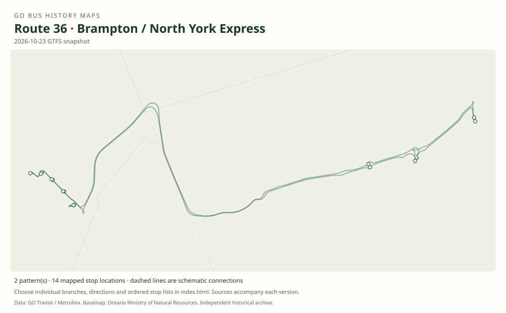

# GO route 36 — Brampton / North York Express

The express member of the former combined 34/35/36 Brampton family, expanded to all-day, seven-day service in 2015.

**Status:** current. **Documented patterns:** 19. **Research date:** 23 October 2026.

[Download history PDF](route-36-history.pdf) · [Interactive map](index.html) · [All ordered stops (CSV)](stops.csv) · [All mapped versions (GeoJSON)](maps.geojson) · [History data](history.json) · [Timetable archive links](archive-sources.json)

The PDF includes the sourced history, dated maps, numbered stop lists and navigation bookmarks. Older versions retain the timetable timing-point or major-stop limits described below.

Open `index.html` through the repository's local web server to use the map. SVG maps below display directly on GitHub.

## History

### 2012-09-01

The Brampton table identifies 36 and Bramalea express short turns.

[Source 1](https://go-schedule-archive.s3.us-east-1.amazonaws.com/brampton-local-hwy-27-and-hwy-427-express/2012-09-01-table-34-brampton-local-hwy-27-and-hwy-427-express.pdf)

### 2015-09-05

36 expanded from peak-only to all-day bidirectional service, seven days weekly.

[Source 1](https://stevemunro.ca/wp-content/uploads/2017/03/ridership-report-september2016.pdf)

### 2019-01-05

A standalone Brampton/North York booklet documents the reorganized 36 family.

[Source 1](https://go-schedule-archive.s3.us-east-1.amazonaws.com/brampton-north-york/2019-01-05-table-36-brampton-north-york.pdf)

## Maps by documented version

Feed maps combine the patterns present in that dated file. The interactive viewer separates every branch and direction. A feed snapshot can include future or temporary service; its filename is not a route-change date.

| Date / evidence | Map | Patterns |
|---|---|---:|
| 2016-01-11 GTFS snapshot | [SVG map](maps/2016-01-11.svg) | 8 |
| 2022-03-08 GTFS snapshot | [SVG map](maps/2022-03-08.svg) | 6 |
| 2023-05-05 GTFS snapshot | [SVG map](maps/2023-05-05.svg) | 2 |
| 2026-10-23 GTFS snapshot | [SVG map](maps/2026-10-23.svg) | 2 |
| 2012-09-01 | [SVG map](maps/history-36-2012-bramalea-express.svg) | 1 |

## Historical major-stop sequences

These are timetable timing points / major stops, not necessarily every roadside stop. Full GTFS sequences are in `stops.csv` and the snapshot files.

### 2012-09-01 — 36B: Bramalea–North York express short turn

Bramalea Transit Terminal, Central Park Drive → Bramalea GO → Yorkdale GO Bus Terminal → York Mills GO Bus Terminal

Schematic straight connections between established stop areas, not a street-by-street reconstruction. Selected published timepoints or named stops, not an exhaustive curb-stop list. Connectors are schematic and do not establish the roads taken. Do not extend this 36B trip to Brampton GO simply because that terminal occurs in other rows.

[Original source 1](https://go-schedule-archive.s3.us-east-1.amazonaws.com/brampton-local-hwy-27-and-hwy-427-express/2012-09-01-table-34-brampton-local-hwy-27-and-hwy-427-express.pdf)

## Coverage and unresolved questions

- Initial launch and all later short-turn change dates are unverified.
- The shared booklet’s table 34 title does not make these buses route 34.
- GTFS dates identify captured feeds, not necessarily the first or last day of a route. Open a pattern to see its exact scheduled service dates. Temporary rail replacement and special-service patterns are included when present in the source.
- Manually reconstructed versions generally contain published timetable timing points / major stops. They must not be read as complete roadside stop inventories.

## Sources

- [GO Brampton Local / Highway 27 and Highway 427 Express table 34, effective 1 September 2012, routes 34 / 35 / 36](https://go-schedule-archive.s3.us-east-1.amazonaws.com/brampton-local-hwy-27-and-hwy-427-express/2012-09-01-table-34-brampton-local-hwy-27-and-hwy-427-express.pdf) — original-timetable
- [Metrolinx GO Transit Ridership Report, September 2016 (original report, archived by Steve Munro)](https://stevemunro.ca/wp-content/uploads/2017/03/ridership-report-september2016.pdf) — official
- [GO Brampton / North York table 36, effective 5 January 2019](https://go-schedule-archive.s3.us-east-1.amazonaws.com/brampton-north-york/2019-01-05-table-36-brampton-north-york.pdf) — original-timetable
- [GO Transit original GTFS snapshot 2016-01-11](https://openmobilitydata-data.s3.us-west-1.amazonaws.com/public/feeds/go-transit/32/20160111/gtfs.zip) — original-gtfs
- [GO Transit original GTFS snapshot 2022-03-08](https://web.archive.org/web/20220308054107id_/https://www.gotransit.com/static_files/gotransit/assets/Files/GO_GTFS.zip) — original-gtfs
- [GO Transit original GTFS snapshot 2023-05-05](https://openmobilitydata-data.s3.us-west-1.amazonaws.com/public/feeds/go-transit/32/20230505/gtfs.zip) — original-gtfs
- [GO Transit original GTFS snapshot 2026-10-23](https://assets.metrolinx.com/raw/upload/Documents/Metrolinx/Open%20Data/GO-GTFS.zip) — original-gtfs

## Data attribution

Data used in this product or service is provided with the permission of Metrolinx. Metrolinx makes no representations or warranties of any kind, express or implied, with respect to the Data and assumes no responsibility for the accuracy or currency of the data used in this product or service.

Basemap: Ontario Ministry of Natural Resources, Open Government Licence – Ontario. See [methodology](../../docs/METHODOLOGY.md) for geometry and date limitations.
