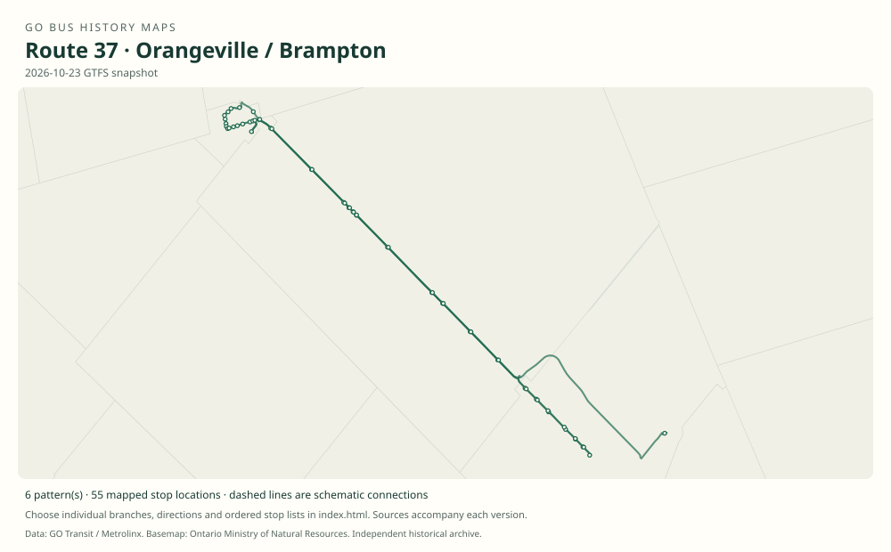

# GO route 37 — Orangeville / Brampton

A Highway 10/Hurontario train-feeder corridor, originally numbered 41, with a former midday Bramalea branch.

**Status:** current. **Documented patterns:** 24. **Research date:** 23 October 2026.

[Download history PDF](route-37-history.pdf) · [Interactive map](index.html) · [All ordered stops (CSV)](stops.csv) · [All mapped versions (GeoJSON)](maps.geojson) · [History data](history.json) · [Timetable archive links](archive-sources.json)

The PDF includes the sourced history, dated maps, numbered stop lists and navigation bookmarks. Older versions retain the timetable timing-point or major-stop limits described below.

Open `index.html` through the repository's local web server to use the map. SVG maps below display directly on GitHub.

## History

### 1999-01-04

GO introduced Orangeville–Caledon–Victoria–Snelgrove–Brampton train connections.

[Source 1](https://transittoronto.ca/regional/2115.shtml)

### 2008-04-28

Former 41 Orangeville was renumbered 37; an additional weekday trip each way was also introduced.

[Source 1](https://transittoronto.ca/archives/weblog/2008/04/22-go_transit.shtml)

### 2009-10-31

37 mainline serves Brampton GO; midday 37A serves Trinity Common and Bramalea.

[Source 1](https://go-schedule-archive.s3.us-east-1.amazonaws.com/orangeville-brampton/2010-01-02-table-37-orangeville-brampton.pdf)

### 2011-12-31

All six weekday trips each way in this issue use Brampton GO; the earlier Bramalea branch is absent.

[Source 1](https://go-schedule-archive.s3.us-east-1.amazonaws.com/orangeville-brampton/2012-08-25-table-37-orangeville-brampton.pdf)

## Maps by documented version

Feed maps combine the patterns present in that dated file. The interactive viewer separates every branch and direction. A feed snapshot can include future or temporary service; its filename is not a route-change date.

| Date / evidence | Map | Patterns |
|---|---|---:|
| 2016-01-11 GTFS snapshot | [SVG map](maps/2016-01-11.svg) | 4 |
| 2022-03-08 GTFS snapshot | [SVG map](maps/2022-03-08.svg) | 8 |
| 2023-05-05 GTFS snapshot | [SVG map](maps/2023-05-05.svg) | 4 |
| 2026-10-23 GTFS snapshot | [SVG map](maps/2026-10-23.svg) | 6 |
| 2009-10-31 | [SVG map](maps/history-37-2009-main.svg) | 1 |
| 2009-10-31 | [SVG map](maps/history-37-2009-bramalea.svg) | 1 |

## Historical major-stop sequences

These are timetable timing points / major stops, not necessarily every roadside stop. Full GTFS sequences are in `stops.csv` and the snapshot files.

### 2009-10-31 — 37: Orangeville–Brampton GO

Orangeville Mall → Orangeville, Broadway / Blind Line → Orangeville Park & Ride, Townline / Green → Orangeville Carpool Lot, Broadway / Highway 10 → Caledon, Highway 10 / Charleston Sideroad → Victoria, Highway 10 / King Street → Snelgrove, Hurontario / Mayfield → Brampton GO

Schematic straight connections between established stop areas, not a street-by-street reconstruction. Selected published timepoints or named stops, not an exhaustive curb-stop list. Connectors are schematic and do not establish the roads taken.  2 stop locations remain unestablished; the full ordered sequence is preserved in the list.

[Original source 1](https://go-schedule-archive.s3.us-east-1.amazonaws.com/orangeville-brampton/2010-01-02-table-37-orangeville-brampton.pdf)

### 2009-10-31 — 37A: Former midday Bramalea branch

Orangeville Mall → Orangeville, Broadway / Blind Line → Orangeville Park & Ride, Townline / Green → Orangeville Carpool Lot, Broadway / Highway 10 → Caledon, Highway 10 / Charleston Sideroad → Victoria, Highway 10 / King Street → Snelgrove, Hurontario / Mayfield → Trinity Common Terminal → Bramalea City Centre Terminal → Bramalea GO

Schematic straight connections between established stop areas, not a street-by-street reconstruction. Selected published timepoints or named stops, not an exhaustive curb-stop list. Connectors are schematic and do not establish the roads taken. One midday trip each way is shown. Do not backdate these exact 2009 stops to the old 41 without another source. 3 stop locations remain unestablished; the full ordered sequence is preserved in the list.

[Original source 1](https://go-schedule-archive.s3.us-east-1.amazonaws.com/orangeville-brampton/2010-01-02-table-37-orangeville-brampton.pdf)

## Coverage and unresolved questions

- See the separate 41 entry for the former number.
- The old 37A withdrawal falls between the 2009 and December 2011 snapshots; the precise date is unverified.
- Later weekend/local-branch chronology requires additional timetables.
- GTFS dates identify captured feeds, not necessarily the first or last day of a route. Open a pattern to see its exact scheduled service dates. Temporary rail replacement and special-service patterns are included when present in the source.
- Manually reconstructed versions generally contain published timetable timing points / major stops. They must not be read as complete roadside stop inventories.

## Sources

- [50 Years of GO Transit Bus Operations — historical chronology by Adam Zhelka / Toronto Transportation Society](https://transittoronto.ca/regional/2115.shtml) — secondary
- [Transit Toronto: GO Transit changes start April 26, published 22 April 2008](https://transittoronto.ca/archives/weblog/2008/04/22-go_transit.shtml) — secondary
- [GO table 37, printed effective 31 October 2009 (filename dated 2 January 2010)](https://go-schedule-archive.s3.us-east-1.amazonaws.com/orangeville-brampton/2010-01-02-table-37-orangeville-brampton.pdf) — original-timetable
- [GO table 37, printed effective 31 December 2011 (filename dated 25 August 2012)](https://go-schedule-archive.s3.us-east-1.amazonaws.com/orangeville-brampton/2012-08-25-table-37-orangeville-brampton.pdf) — original-timetable
- [GO Transit original GTFS snapshot 2016-01-11](https://openmobilitydata-data.s3.us-west-1.amazonaws.com/public/feeds/go-transit/32/20160111/gtfs.zip) — original-gtfs
- [GO Transit original GTFS snapshot 2022-03-08](https://web.archive.org/web/20220308054107id_/https://www.gotransit.com/static_files/gotransit/assets/Files/GO_GTFS.zip) — original-gtfs
- [GO Transit original GTFS snapshot 2023-05-05](https://openmobilitydata-data.s3.us-west-1.amazonaws.com/public/feeds/go-transit/32/20230505/gtfs.zip) — original-gtfs
- [GO Transit original GTFS snapshot 2026-10-23](https://assets.metrolinx.com/raw/upload/Documents/Metrolinx/Open%20Data/GO-GTFS.zip) — original-gtfs

## Data attribution

Data used in this product or service is provided with the permission of Metrolinx. Metrolinx makes no representations or warranties of any kind, express or implied, with respect to the Data and assumes no responsibility for the accuracy or currency of the data used in this product or service.

Basemap: Ontario Ministry of Natural Resources, Open Government Licence – Ontario. See [methodology](../../docs/METHODOLOGY.md) for geometry and date limitations.
