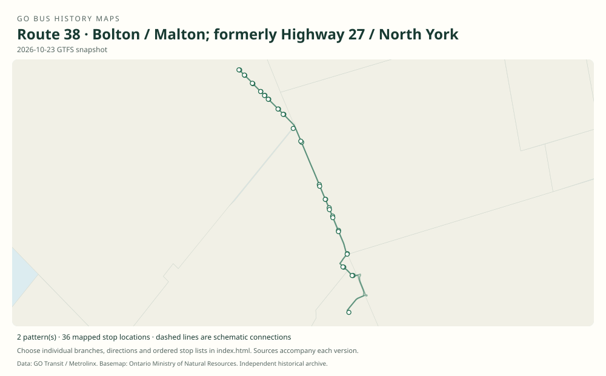

# GO route 38 — Bolton / Malton; formerly Highway 27 / North York

The former 42 Bolton family had separate Highway 50–Malton and Highway 27–North York branches. The latter ended in 2019; a proposed total cancellation was revised to retain reduced Malton service.

**Status:** current. **Documented patterns:** 18. **Research date:** 23 October 2026.

[Download history PDF](route-38-history.pdf) · [Interactive map](index.html) · [All ordered stops (CSV)](stops.csv) · [All mapped versions (GeoJSON)](maps.geojson) · [History data](history.json) · [Timetable archive links](archive-sources.json)

The PDF includes the sourced history, dated maps, numbered stop lists and navigation bookmarks. Older versions retain the timetable timing-point or major-stop limits described below.

Open `index.html` through the repository's local web server to use the map. SVG maps below display directly on GitHub.

## History

### 1999-01-04

GO introduced a Bolton–Nobleton–Kleinburg–Humber College–North York corridor.

[Source 1](https://transittoronto.ca/regional/2115.shtml)

### 2008-04-28

Former 42 Bolton was renumbered 38.

[Source 1](https://transittoronto.ca/archives/weblog/2008/04/22-go_transit.shtml)

### 2008-08-30

The original 38A table shows the Highway 27 branch, two peak-direction trips each way.

[Source 1](https://go-schedule-archive.s3.us-east-1.amazonaws.com/bolton-malton/2008-12-03-table-38-bolton-malton.pdf)

### 2008-12-01

A separately dated table documents 38 via Highway 50 to Malton GO.

[Source 1](https://go-schedule-archive.s3.us-east-1.amazonaws.com/bolton-malton/2008-12-03-table-38-bolton-malton.pdf)

### 2018-09-01

Both 38 and 38A remain in the published booklet.

[Source 1](https://go-schedule-archive.s3.us-east-1.amazonaws.com/bolton-malton/2018-09-01-table-38-bolton-malton.pdf)

### 2019-06-29

38A was eliminated. The planned total 38 cancellation was revised.

[Source 1](https://pub-caledon.escribemeetings.com/filestream.ashx?DocumentId=6648)

### 2019-07-02

Reduced 38 retained two morning and two afternoon/evening trips, initially as an interim arrangement.

[Source 1](https://pub-caledon.escribemeetings.com/filestream.ashx?DocumentId=6648)

## Maps by documented version

Feed maps combine the patterns present in that dated file. The interactive viewer separates every branch and direction. A feed snapshot can include future or temporary service; its filename is not a route-change date.

| Date / evidence | Map | Patterns |
|---|---|---:|
| 2016-01-11 GTFS snapshot | [SVG map](maps/2016-01-11.svg) | 8 |
| 2022-03-08 GTFS snapshot | [SVG map](maps/2022-03-08.svg) | 4 |
| 2023-05-05 GTFS snapshot | [SVG map](maps/2023-05-05.svg) | 2 |
| 2026-10-23 GTFS snapshot | [SVG map](maps/2026-10-23.svg) | 2 |
| 2008-08-30 | [SVG map](maps/history-38-2008-highway27.svg) | 1 |
| 2008-12-01 | [SVG map](maps/history-38-2008-highway50.svg) | 1 |

## Historical major-stop sequences

These are timetable timing points / major stops, not necessarily every roadside stop. Full GTFS sequences are in `stops.csv` and the snapshot files.

### 2008-08-30 — 38A: Bolton–North York via Highway 27

Bolton, Albion Vaughan / Industrial → Bolton, Queen / Allan → Bolton, King / Humber Lea → Nobleton, King / Highway 27 → Kleinburg, Islington / Nashville → Woodbridge, Rutherford / Vaughan Mills → Highway 27 / Humber College Boulevard → Etobicoke North GO → Yorkdale GO Bus Terminal → York Mills GO Bus Terminal

Schematic straight connections between established stop areas, not a street-by-street reconstruction. Selected published timepoints or named stops, not an exhaustive curb-stop list. Connectors are schematic and do not establish the roads taken.  1 stop locations remain unestablished; the full ordered sequence is preserved in the list.

[Original source 1](https://go-schedule-archive.s3.us-east-1.amazonaws.com/bolton-malton/2008-12-03-table-38-bolton-malton.pdf)

### 2008-12-01 — 38: Bolton–Malton via Highway 50

Bolton, Highway 50 / Columbia Way → Bolton, Highway 50 / Wilton → Highway 50 / Nashville–Countryside → Highway 50 / Highway 7 → Malton GO

Schematic straight connections between established stop areas, not a street-by-street reconstruction. Selected published timepoints or named stops, not an exhaustive curb-stop list. Connectors are schematic and do not establish the roads taken. The Highway 50 and Highway 27 patterns are separate branches, not one circuit.

[Original source 1](https://go-schedule-archive.s3.us-east-1.amazonaws.com/bolton-malton/2008-12-03-table-38-bolton-malton.pdf)

## Coverage and unresolved questions

- See the separate 42 entry for the former number.
- Route 38 survived the 2019 changes; do not record a completed total cancellation.
- The Highway 50 branch’s first introduction is unverified; December 2008 is a documented snapshot.
- GTFS dates identify captured feeds, not necessarily the first or last day of a route. Open a pattern to see its exact scheduled service dates. Temporary rail replacement and special-service patterns are included when present in the source.
- Manually reconstructed versions generally contain published timetable timing points / major stops. They must not be read as complete roadside stop inventories.

## Sources

- [50 Years of GO Transit Bus Operations — historical chronology by Adam Zhelka / Toronto Transportation Society](https://transittoronto.ca/regional/2115.shtml) — secondary
- [Transit Toronto: GO Transit changes start April 26, published 22 April 2008](https://transittoronto.ca/archives/weblog/2008/04/22-go_transit.shtml) — secondary
- [GO table 38: Highway 27 branch effective 30 August 2008; Highway 50 branch effective 1 December 2008](https://go-schedule-archive.s3.us-east-1.amazonaws.com/bolton-malton/2008-12-03-table-38-bolton-malton.pdf) — original-timetable
- [GO Bolton / Malton table 38, effective 1 September 2018](https://go-schedule-archive.s3.us-east-1.amazonaws.com/bolton-malton/2018-09-01-table-38-bolton-malton.pdf) — original-timetable
- [Town of Caledon staff report on GO Transit service reductions and route 38, 24 September 2019](https://pub-caledon.escribemeetings.com/filestream.ashx?DocumentId=6648) — official
- [GO Transit original GTFS snapshot 2016-01-11](https://openmobilitydata-data.s3.us-west-1.amazonaws.com/public/feeds/go-transit/32/20160111/gtfs.zip) — original-gtfs
- [GO Transit original GTFS snapshot 2022-03-08](https://web.archive.org/web/20220308054107id_/https://www.gotransit.com/static_files/gotransit/assets/Files/GO_GTFS.zip) — original-gtfs
- [GO Transit original GTFS snapshot 2023-05-05](https://openmobilitydata-data.s3.us-west-1.amazonaws.com/public/feeds/go-transit/32/20230505/gtfs.zip) — original-gtfs
- [GO Transit original GTFS snapshot 2026-10-23](https://assets.metrolinx.com/raw/upload/Documents/Metrolinx/Open%20Data/GO-GTFS.zip) — original-gtfs

## Data attribution

Data used in this product or service is provided with the permission of Metrolinx. Metrolinx makes no representations or warranties of any kind, express or implied, with respect to the Data and assumes no responsibility for the accuracy or currency of the data used in this product or service.

Basemap: Ontario Ministry of Natural Resources, Open Government Licence – Ontario. See [methodology](../../docs/METHODOLOGY.md) for geometry and date limitations.
