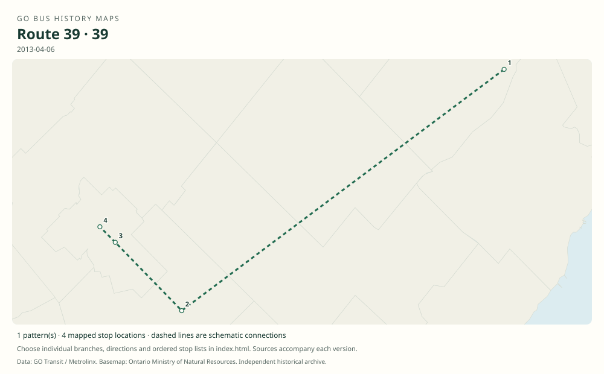

# GO route 39 — Guelph / Aberfoyle / Bramalea

A former express Guelph–Bramalea train connection via Aberfoyle, distinct from Kitchener route 30 and local Georgetown route 33.

**Status:** discontinued. **Documented patterns:** 1. **Research date:** 23 October 2026.

[Download history PDF](route-39-history.pdf) · [Interactive map](index.html) · [All ordered stops (CSV)](stops.csv) · [All mapped versions (GeoJSON)](maps.geojson) · [History data](history.json) · [Timetable archive links](archive-sources.json)

The PDF includes the sourced history, dated maps, numbered stop lists and navigation bookmarks. Older versions retain the timetable timing-point or major-stop limits described below.

Open `index.html` through the repository's local web server to use the map. SVG maps below display directly on GitHub.

## History

### by 2013-04-06

The original booklet identifies 39 with one weekday eastbound trip and three westbound train meets.

[Source 1](https://go-schedule-archive.s3.us-east-1.amazonaws.com/kitchener/2013-04-06-table-31-kitchener.pdf)

### 2015-09-05

39 was discontinued in the Kitchener corridor reorganization.

[Source 1](https://stevemunro.ca/wp-content/uploads/2017/03/ridership-report-september2016.pdf)

## Maps by documented version

Feed maps combine the patterns present in that dated file. The interactive viewer separates every branch and direction. A feed snapshot can include future or temporary service; its filename is not a route-change date.

| Date / evidence | Map | Patterns |
|---|---|---:|
| 2013-04-06 | [SVG map](maps/history-39-2013.svg) | 1 |

## Historical major-stop sequences

These are timetable timing points / major stops, not necessarily every roadside stop. Full GTFS sequences are in `stops.csv` and the snapshot files.

### 2013-04-06 — 39: Bramalea–Guelph express train connection

Bramalea GO → Aberfoyle GO Park & Ride → University of Guelph → Guelph Central GO

Schematic straight connections between established stop areas, not a street-by-street reconstruction. Selected published timepoints or named stops, not an exhaustive curb-stop list. Connectors are schematic and do not establish the roads taken. Westbound trips connected with trains. The route did not travel through Georgetown or Rockwood.

[Original source 1](https://go-schedule-archive.s3.us-east-1.amazonaws.com/kitchener/2013-04-06-table-31-kitchener.pdf)

## Coverage and unresolved questions

- The exact launch date is unverified.
- This retired number must not be applied to the later 30 expansion.
- Manually reconstructed versions generally contain published timetable timing points / major stops. They must not be read as complete roadside stop inventories.

## Sources

- [GO Kitchener table 31, effective 6 April 2013, routes 30 / 31 / 33 / 39](https://go-schedule-archive.s3.us-east-1.amazonaws.com/kitchener/2013-04-06-table-31-kitchener.pdf) — original-timetable
- [Metrolinx GO Transit Ridership Report, September 2016 (original report, archived by Steve Munro)](https://stevemunro.ca/wp-content/uploads/2017/03/ridership-report-september2016.pdf) — official

## Data attribution

Data used in this product or service is provided with the permission of Metrolinx. Metrolinx makes no representations or warranties of any kind, express or implied, with respect to the Data and assumes no responsibility for the accuracy or currency of the data used in this product or service.

Basemap: Ontario Ministry of Natural Resources, Open Government Licence – Ontario. See [methodology](../../docs/METHODOLOGY.md) for geometry and date limitations.
