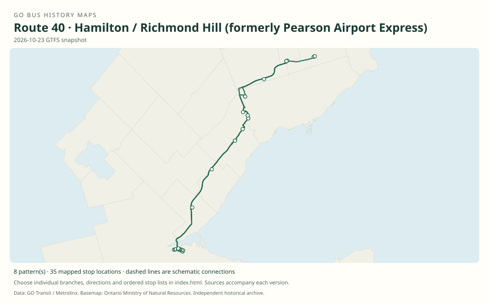

# GO route 40 — Hamilton / Richmond Hill (formerly Pearson Airport Express)

An airport express that began between Square One, Pearson and Richmond Hill Centre, became a two-terminal Pearson–Richmond Hill shuttle, and later expanded west to Hamilton. Its history includes short express branches and, in 2026, Humber and Unionville service.

**Status:** current. **Documented patterns:** 26. **Research date:** 23 October 2026.

[Download history PDF](route-40-history.pdf) · [Interactive map](index.html) · [All ordered stops (CSV)](stops.csv) · [All mapped versions (GeoJSON)](maps.geojson) · [History data](history.json) · [Timetable archive links](archive-sources.json)

The PDF includes the sourced history, dated maps, numbered stop lists and navigation bookmarks. Older versions retain the timetable timing-point or major-stop limits described below.

Open `index.html` through the repository's local web server to use the map. SVG maps below display directly on GitHub.

## History

### 2008-04-26

Route 40 begins with half-hourly Square One–Pearson service; alternate trips continue to Richmond Hill Centre, giving that segment hourly service.

[Source 1](https://transittoronto.ca/archives/weblog/2008/04/22-go_transit.shtml)

### by 2010-02-01

The original timetable documents an hourly Square One–Pearson–Richmond Hill pattern seven days a week.

[Source 1](https://go-schedule-archive.s3.us-east-1.amazonaws.com/hamilton-richmond-hill-pearson-express/2010-02-05-table-40-hamilton-richmond-hill-pearson-express.pdf)

### by 2011-01-01

The route has been shortened to Pearson Terminal 1–Richmond Hill Centre; Square One is absent from the effective January 1 timetable.

[Source 1](https://go-schedule-archive.s3.us-east-1.amazonaws.com/hamilton-richmond-hill-pearson-express/2011-10-27-table-40-hamilton-richmond-hill-pearson-express.pdf)

### 2015-09-05

Route 40 expands to Hamilton and takes over the former 47J Hamilton–Square One express service; GO’s ridership report gives this exact date.

[Source 1](https://stevemunro.ca/wp-content/uploads/2017/03/ridership-report-september2016.pdf)

### 2017-12-30

Highway 407 Bus Terminal opens. The January 2019 route 40 timetable confirms the new terminal, Dixie and Renforth as main-route stops.

[Source 1](https://assets.metrolinx.com/image/upload/v1663237688/Documents/Metrolinx/20180308_BoardMtg_CP_Quarterly_EN.pdf) · [Source 2](https://go-schedule-archive.s3.us-east-1.amazonaws.com/hamilton-richmond-hill-pearson-express/2019-01-05-table-40-hamilton-richmond-hill-pearson-express.pdf)

### by 2019-01-05

40A runs Hamilton–Square One express, bypassing Trafalgar/407; 40B provides a Richmond Hill Centre–Pearson short express that bypasses Highway 407 terminal.

[Source 1](https://go-schedule-archive.s3.us-east-1.amazonaws.com/hamilton-richmond-hill-pearson-express/2019-01-05-table-40-hamilton-richmond-hill-pearson-express.pdf)

### 2026-01-03

The timetable includes 40H and 40M via Humber Polytechnic North Campus, with 40M continuing to Unionville. Dundas/407 is also on the main route by this snapshot. This change accompanies the withdrawal of routes 54 and 66.

[Source 1](https://go-schedule-archive.s3.us-east-1.amazonaws.com/hamilton-richmond-hill-pearson-express/2026-01-03-table-40-hamilton-richmond-hill-pearson-express.pdf) · [Source 2](https://www.metrolinx.com/en/news/holiday-go-transit-service-adjustments)

## Maps by documented version

Feed maps combine the patterns present in that dated file. The interactive viewer separates every branch and direction. A feed snapshot can include future or temporary service; its filename is not a route-change date.

| Date / evidence | Map | Patterns |
|---|---|---:|
| 2016-01-11 GTFS snapshot | [SVG map](maps/2016-01-11.svg) | 6 |
| 2022-03-08 GTFS snapshot | [SVG map](maps/2022-03-08.svg) | 4 |
| 2023-05-05 GTFS snapshot | [SVG map](maps/2023-05-05.svg) | 2 |
| 2026-10-23 GTFS snapshot | [SVG map](maps/2026-10-23.svg) | 8 |
| 2008-04-26 | [SVG map](maps/history-40-2008-pearson-short.svg) | 1 |
| 2010-02-01 | [SVG map](maps/history-40-2010.svg) | 1 |
| 2011-01-01 | [SVG map](maps/history-40-2011.svg) | 1 |
| 2019-01-05 | [SVG map](maps/history-40-2019.svg) | 1 |
| 2019-01-05 | [SVG map](maps/history-40A-2019.svg) | 1 |
| 2019-01-05 | [SVG map](maps/history-40B-2019.svg) | 1 |

## Historical major-stop sequences

These are timetable timing points / major stops, not necessarily every roadside stop. Full GTFS sequences are in `stops.csv` and the snapshot files.

### 2008-04-26 — 40 (short working; suffix unverified): Launch-era Square One–Pearson short working

Square One GO Bus Terminal → Pearson Airport Terminal 1

Schematic straight connections between established stop areas, not a street-by-street reconstruction. The contemporary notice says alternate half-hourly buses continue to Richmond Hill Centre. It does not give a suffix for the short workings. No intermediate stop is described.

[Original source 1](https://transittoronto.ca/archives/weblog/2008/04/22-go_transit.shtml)

### 2010-02-01 — 40: Square One–Pearson–Richmond Hill

Square One GO Bus Terminal → Pearson Airport Terminal 1 → Richmond Hill Centre

Schematic straight connections between established stop areas, not a street-by-street reconstruction. Effective date is printed inside the original, not the archive filename. These are the timetable’s ordered major timing points; intermediate roadside stops are not asserted.

[Original source 1](https://go-schedule-archive.s3.us-east-1.amazonaws.com/hamilton-richmond-hill-pearson-express/2010-02-05-table-40-hamilton-richmond-hill-pearson-express.pdf)

### 2011-01-01 — 40: Pearson–Richmond Hill shuttle

Pearson Airport Terminal 1 → Richmond Hill Centre

Schematic straight connections between established stop areas, not a street-by-street reconstruction.  These are the timetable’s ordered major timing points; intermediate roadside stops are not asserted.

[Original source 1](https://go-schedule-archive.s3.us-east-1.amazonaws.com/hamilton-richmond-hill-pearson-express/2011-10-27-table-40-hamilton-richmond-hill-pearson-express.pdf)

### 2019-01-05 — 40: Hamilton–Richmond Hill main route

Hamilton GO Centre → Trafalgar Rd. @ Hwy. 407 Park & Ride → Square One GO Bus Terminal → Dixie Transitway Station → Renforth Transitway Station → Pearson Airport Terminal 1 → Highway 407 Bus Terminal → Richmond Hill Centre

Schematic straight connections between established stop areas, not a street-by-street reconstruction.  These are the timetable’s ordered major timing points; intermediate roadside stops are not asserted.

[Original source 1](https://go-schedule-archive.s3.us-east-1.amazonaws.com/hamilton-richmond-hill-pearson-express/2019-01-05-table-40-hamilton-richmond-hill-pearson-express.pdf)

### 2019-01-05 — 40A: Hamilton–Square One express

Hamilton GO Centre → Square One GO Bus Terminal

Schematic straight connections between established stop areas, not a street-by-street reconstruction. Trafalgar is explicitly passed without stopping. These are the timetable’s ordered major timing points; intermediate roadside stops are not asserted.

[Original source 1](https://go-schedule-archive.s3.us-east-1.amazonaws.com/hamilton-richmond-hill-pearson-express/2019-01-05-table-40-hamilton-richmond-hill-pearson-express.pdf)

### 2019-01-05 — 40B: Richmond Hill–Pearson express short trip

Richmond Hill Centre → Pearson Airport Terminal 1

Schematic straight connections between established stop areas, not a street-by-street reconstruction. The westbound row has no Highway 407 terminal stop; this is not the stopping main 40. These are the timetable’s ordered major timing points; intermediate roadside stops are not asserted.

[Original source 1](https://go-schedule-archive.s3.us-east-1.amazonaws.com/hamilton-richmond-hill-pearson-express/2019-01-05-table-40-hamilton-richmond-hill-pearson-express.pdf)

## Coverage and unresolved questions

- The exact date of the initial Square One withdrawal has not been located; January 1, 2011 is the verified timetable snapshot.
- The exact first dates of Dixie, Renforth, Dundas/407 and each express suffix require additional change notices. Current and historical GTFS snapshots supply additional full-stop patterns.
- GTFS dates identify captured feeds, not necessarily the first or last day of a route. Open a pattern to see its exact scheduled service dates. Temporary rail replacement and special-service patterns are included when present in the source.
- Manually reconstructed versions generally contain published timetable timing points / major stops. They must not be read as complete roadside stop inventories.

## Sources

- [Toronto Transportation Society / Transit Toronto: GO Transit celebrates 50 years of bus service](https://transittoronto.ca/regional/2115.shtml) — secondary
- [GO route 40 timetable, internally effective February 1, 2010 (archived February 5)](https://go-schedule-archive.s3.us-east-1.amazonaws.com/hamilton-richmond-hill-pearson-express/2010-02-05-table-40-hamilton-richmond-hill-pearson-express.pdf) — original-timetable
- [GO route 40 timetable, internally effective January 1, 2011 (archived October 27)](https://go-schedule-archive.s3.us-east-1.amazonaws.com/hamilton-richmond-hill-pearson-express/2011-10-27-table-40-hamilton-richmond-hill-pearson-express.pdf) — original-timetable
- [GO Transit ridership report, September 2016, footnote 9 (agency original mirrored by Steve Munro)](https://stevemunro.ca/wp-content/uploads/2017/03/ridership-report-september2016.pdf) — official
- [Metrolinx Capital Projects quarterly report, March 8, 2018: Highway 407 Bus Terminal opening](https://assets.metrolinx.com/image/upload/v1663237688/Documents/Metrolinx/20180308_BoardMtg_CP_Quarterly_EN.pdf) — official
- [GO route 40 timetable, effective January 5, 2019](https://go-schedule-archive.s3.us-east-1.amazonaws.com/hamilton-richmond-hill-pearson-express/2019-01-05-table-40-hamilton-richmond-hill-pearson-express.pdf) — original-timetable
- [GO route 40 timetable, effective January 3, 2026](https://go-schedule-archive.s3.us-east-1.amazonaws.com/hamilton-richmond-hill-pearson-express/2026-01-03-table-40-hamilton-richmond-hill-pearson-express.pdf) — original-timetable
- [Metrolinx: Holiday GO Transit service adjustments; January 3, 2026 changes](https://www.metrolinx.com/en/news/holiday-go-transit-service-adjustments) — official
- [Transit Toronto, April 22, 2008: GO Transit changes start April 26; renumbering effective April 28 / May 4](https://transittoronto.ca/archives/weblog/2008/04/22-go_transit.shtml) — secondary
- [GO Transit original GTFS snapshot 2016-01-11](https://openmobilitydata-data.s3.us-west-1.amazonaws.com/public/feeds/go-transit/32/20160111/gtfs.zip) — original-gtfs
- [GO Transit original GTFS snapshot 2022-03-08](https://web.archive.org/web/20220308054107id_/https://www.gotransit.com/static_files/gotransit/assets/Files/GO_GTFS.zip) — original-gtfs
- [GO Transit original GTFS snapshot 2023-05-05](https://openmobilitydata-data.s3.us-west-1.amazonaws.com/public/feeds/go-transit/32/20230505/gtfs.zip) — original-gtfs
- [GO Transit original GTFS snapshot 2026-10-23](https://assets.metrolinx.com/raw/upload/Documents/Metrolinx/Open%20Data/GO-GTFS.zip) — original-gtfs

## Data attribution

Data used in this product or service is provided with the permission of Metrolinx. Metrolinx makes no representations or warranties of any kind, express or implied, with respect to the Data and assumes no responsibility for the accuracy or currency of the data used in this product or service.

Basemap: Ontario Ministry of Natural Resources, Open Government Licence – Ontario. See [methodology](../../docs/METHODOLOGY.md) for geometry and date limitations.
