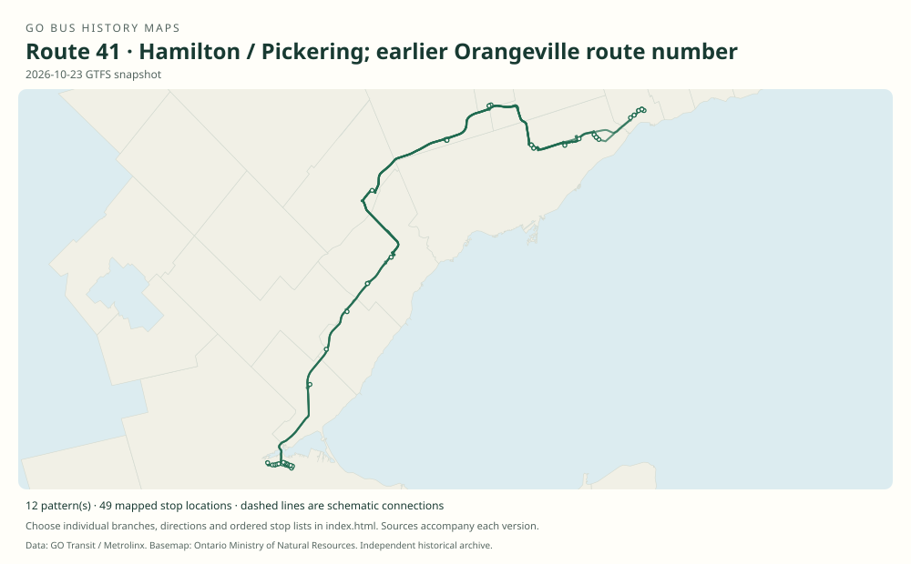

# GO route 41 — Hamilton / Pickering; earlier Orangeville route number

The number has two unrelated eras. Before April 28, 2008, 41 identified Orangeville service, which became route 37. The new Hamilton–Pickering route 41 was created in 2021 by joining the former Highway 407 West and East services.

**Status:** current. **Documented patterns:** 22. **Research date:** 23 October 2026.

[Download history PDF](route-41-history.pdf) · [Interactive map](index.html) · [All ordered stops (CSV)](stops.csv) · [All mapped versions (GeoJSON)](maps.geojson) · [History data](history.json) · [Timetable archive links](archive-sources.json)

The PDF includes the sourced history, dated maps, numbered stop lists and navigation bookmarks. Older versions retain the timetable timing-point or major-stop limits described below.

Open `index.html` through the repository's local web server to use the map. SVG maps below display directly on GitHub.

## History

### before 2008-04-28

The contemporary April 2008 service notice identifies the then-existing Orangeville service as route 41.

[Source 1](https://transittoronto.ca/archives/weblog/2008/04/22-go_transit.shtml)

### 2008-04-28

Orangeville route 41 is renumbered 37. This earlier route is geographically and historically separate from the Hamilton–Pickering route introduced in 2021. See route 37 for the continuing Orangeville family.

[Source 1](https://transittoronto.ca/archives/weblog/2008/04/22-go_transit.shtml)

### 2021-02-13

New route 41 combines most weekday trips on routes 47 and 51. Metrolinx announces 38 weekday trips and a through ride without transferring at Highway 407 Bus Terminal.

[Source 1](https://www.metrolinx.com/en/discover/changes-coming-to-some-go-transit-bus-routes)

### by 2022-06-25

The original main-route pattern runs via McMaster, the western park-and-rides, Square One, Bramalea, Richmond Hill Centre, Consumers Road, Scarborough Centre and the two Scarborough campuses. It does not serve Unionville.

[Source 1](https://go-schedule-archive.s3.us-east-1.amazonaws.com/hamilton-pickering/2022-06-25-table-41-hamilton-pickering.pdf)

### by 2023-01-07

41A appears as a school-oriented express pattern; an explicitly timed trip runs Square One–Bramalea–Highway 407–Consumers Road–Centennial–UTSC, bypassing Richmond Hill Centre and Scarborough Centre.

[Source 1](https://go-schedule-archive.s3.us-east-1.amazonaws.com/hamilton-pickering/2023-01-07-table-41-hamilton-pickering.pdf)

## Maps by documented version

Feed maps combine the patterns present in that dated file. The interactive viewer separates every branch and direction. A feed snapshot can include future or temporary service; its filename is not a route-change date.

| Date / evidence | Map | Patterns |
|---|---|---:|
| 2022-03-08 GTFS snapshot | [SVG map](maps/2022-03-08.svg) | 4 |
| 2023-05-05 GTFS snapshot | [SVG map](maps/2023-05-05.svg) | 4 |
| 2026-10-23 GTFS snapshot | [SVG map](maps/2026-10-23.svg) | 12 |
| 2022-06-25 | [SVG map](maps/history-41-2022.svg) | 1 |
| 2023-01-07 | [SVG map](maps/history-41A-2023-utsc.svg) | 1 |

## Historical major-stop sequences

These are timetable timing points / major stops, not necessarily every roadside stop. Full GTFS sequences are in `stops.csv` and the snapshot files.

### 2022-06-25 — 41: Hamilton–Pickering through route

Hamilton GO Centre → McMaster University → Dundas St. @ Hwy. 407 Park & Ride → Bronte Rd. @ Hwy. 407 Park & Ride → Trafalgar Rd. @ Hwy. 407 Park & Ride → Erin Mills Transitway Station → Square One GO Bus Terminal → Bramalea GO → Highway 407 Bus Terminal → Richmond Hill Centre → Consumers Road Business Park → Scarborough Centre Bus Terminal → Centennial College — Progress Campus → University of Toronto Scarborough → Kingston Rd. @ Fairport Rd. → Pickering GO

Schematic straight connections between established stop areas, not a street-by-street reconstruction.  These are the timetable’s ordered major timing points; intermediate roadside stops are not asserted.

[Original source 1](https://go-schedule-archive.s3.us-east-1.amazonaws.com/hamilton-pickering/2022-06-25-table-41-hamilton-pickering.pdf)

### 2023-01-07 — 41A: Square One–UTSC express short pattern

Square One GO Bus Terminal → Bramalea GO → Highway 407 Bus Terminal → Consumers Road Business Park → Centennial College — Progress Campus → University of Toronto Scarborough

Schematic straight connections between established stop areas, not a street-by-street reconstruction. Documents trip 41042, ending at UTSC; do not assume every 41A trip has this terminus. These are the timetable’s ordered major timing points; intermediate roadside stops are not asserted.

[Original source 1](https://go-schedule-archive.s3.us-east-1.amazonaws.com/hamilton-pickering/2023-01-07-table-41-hamilton-pickering.pdf)

## Coverage and unresolved questions

- The launch announcement says most weekday predecessor trips were merged, not that all route 47 service disappeared.
- Other 41A through or short patterns should be read from their dated GTFS service periods rather than generalized from this one trip.
- No original pre-renumbering Orangeville timetable has been recovered here; later route 37 stops are not silently assigned to old 41.
- GTFS dates identify captured feeds, not necessarily the first or last day of a route. Open a pattern to see its exact scheduled service dates. Temporary rail replacement and special-service patterns are included when present in the source.
- Manually reconstructed versions generally contain published timetable timing points / major stops. They must not be read as complete roadside stop inventories.

## Sources

- [Metrolinx: Changes coming to some GO Transit bus routes, February 2021](https://www.metrolinx.com/en/discover/changes-coming-to-some-go-transit-bus-routes) — official
- [GO Hamilton/Pickering timetable, effective June 25, 2022](https://go-schedule-archive.s3.us-east-1.amazonaws.com/hamilton-pickering/2022-06-25-table-41-hamilton-pickering.pdf) — original-timetable
- [GO Hamilton/Pickering timetable, effective January 7, 2023](https://go-schedule-archive.s3.us-east-1.amazonaws.com/hamilton-pickering/2023-01-07-table-41-hamilton-pickering.pdf) — original-timetable
- [Original GO Transit GTFS snapshot archived May 5, 2023](https://openmobilitydata-data.s3.us-west-1.amazonaws.com/public/feeds/go-transit/32/20230505/gtfs.zip) — official
- [Transit Toronto, April 22, 2008: GO Transit changes start April 26; renumbering effective April 28 / May 4](https://transittoronto.ca/archives/weblog/2008/04/22-go_transit.shtml) — secondary
- [GO Transit original GTFS snapshot 2022-03-08](https://web.archive.org/web/20220308054107id_/https://www.gotransit.com/static_files/gotransit/assets/Files/GO_GTFS.zip) — original-gtfs
- [GO Transit original GTFS snapshot 2026-10-23](https://assets.metrolinx.com/raw/upload/Documents/Metrolinx/Open%20Data/GO-GTFS.zip) — original-gtfs

## Data attribution

Data used in this product or service is provided with the permission of Metrolinx. Metrolinx makes no representations or warranties of any kind, express or implied, with respect to the Data and assumes no responsibility for the accuracy or currency of the data used in this product or service.

Basemap: Ontario Ministry of Natural Resources, Open Government Licence – Ontario. See [methodology](../../docs/METHODOLOGY.md) for geometry and date limitations.
