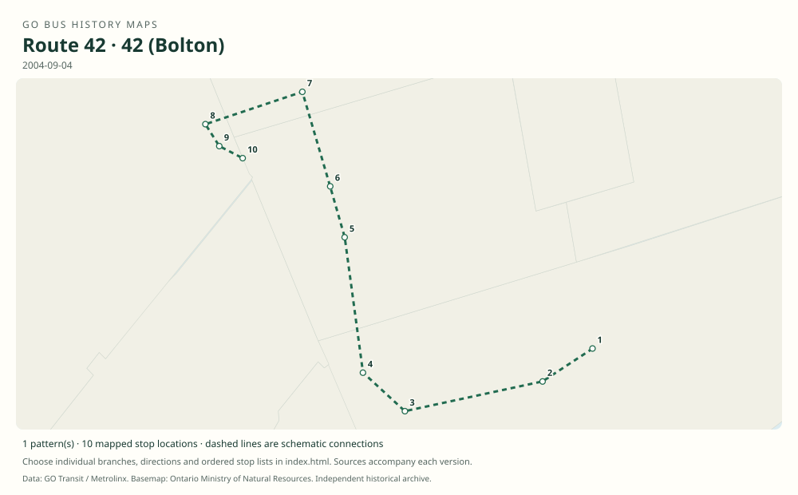

# GO route 42 — Bolton (renumbered 38 in 2008)

The earlier Bolton GO bus number, linked to York Mills through Yorkdale, Etobicoke North, Woodbridge, Kleinburg and Nobleton. The contemporary 2008 notice explicitly establishes the 42-to-38 renumbering; this is stronger evidence than the older Table 42 label alone.

**Status:** discontinued. **Documented patterns:** 1. **Research date:** 23 October 2026.

[Download history PDF](route-42-history.pdf) · [Interactive map](index.html) · [All ordered stops (CSV)](stops.csv) · [All mapped versions (GeoJSON)](maps.geojson) · [History data](history.json) · [Timetable archive links](archive-sources.json)

The PDF includes the sourced history, dated maps, numbered stop lists and navigation bookmarks. Older versions retain the timetable timing-point or major-stop limits described below.

Open `index.html` through the repository's local web server to use the map. SVG maps below display directly on GitHub.

## History

### by 2003-06-28

Original Table 42 documents the weekday York Mills–Yorkdale–Etobicoke North–Bolton service through Woodbridge, Kleinburg and Nobleton. Union Station times are connecting trains, not a through bus to Bolton.

[Source 1](https://go-schedule-archive.s3.us-east-1.amazonaws.com/bolton/2003-06-28-table-42-bolton-dir1-day1-page1.html)

### by 2004-09-04

The original PDF shows two southbound morning and two northbound afternoon weekday bus trips, with rail connections at Etobicoke North. The archive filename says February 2008, but the timetable itself is dated September 4, 2004.

[Source 1](https://go-schedule-archive.s3.us-east-1.amazonaws.com/bolton/2008-02-05-table-42-bolton.pdf)

### 2008-04-28

GO renumbers Bolton route 42 as route 38. The continuing corridor belongs to the route 38 history.

[Source 1](https://transittoronto.ca/archives/weblog/2008/04/22-go_transit.shtml)

## Maps by documented version

Feed maps combine the patterns present in that dated file. The interactive viewer separates every branch and direction. A feed snapshot can include future or temporary service; its filename is not a route-change date.

| Date / evidence | Map | Patterns |
|---|---|---:|
| 2004-09-04 | [SVG map](maps/history-42-2004-bolton.svg) | 1 |

## Historical major-stop sequences

These are timetable timing points / major stops, not necessarily every roadside stop. Full GTFS sequences are in `stops.csv` and the snapshot files.

### 2004-09-04 — 42 (Bolton): York Mills–Bolton weekday route

York Mills GO Bus Terminal → Yorkdale GO Bus Terminal → Etobicoke North GO → Hwy. 27 @ Humber College Blvd. → Rutherford Rd. @ Vaughan Mills Rd. → Islington Ave. @ Nashville Rd. — Kleinburg → King Rd. @ Hwy. 27 — Nobleton → King St. @ Humber Lea Rd. — Bolton → Queen St. @ Queensgate Blvd. — Bolton → Albion-Vaughan Rd. @ Industrial Rd. — Bolton

Schematic straight connections between established stop areas, not a street-by-street reconstruction. Ordered major bus timing points from the original. Excludes Union Station, which is a train connection shown in the shared table. Route identity is corroborated by the April 2008 renumbering notice.

[Original source 1](https://go-schedule-archive.s3.us-east-1.amazonaws.com/bolton/2008-02-05-table-42-bolton.pdf)

## Coverage and unresolved questions

- The corridor’s earlier launch and detailed pre-2003 evolution are not established in these originals.
- See route 38 for changes after the April 28, 2008 renumbering; the old number does not imply a separate contemporary service.
- Manually reconstructed versions generally contain published timetable timing points / major stops. They must not be read as complete roadside stop inventories.

## Sources

- [GO Bolton Table 42, effective June 28, 2003](https://go-schedule-archive.s3.us-east-1.amazonaws.com/bolton/2003-06-28-table-42-bolton-dir1-day1-page1.html) — original-timetable
- [GO Bolton Table 42, internally dated September 4, 2004 (archive filename February 5, 2008)](https://go-schedule-archive.s3.us-east-1.amazonaws.com/bolton/2008-02-05-table-42-bolton.pdf) — original-timetable
- [Transit Toronto, April 22, 2008: GO Transit changes start April 26; renumbering effective April 28 / May 4](https://transittoronto.ca/archives/weblog/2008/04/22-go_transit.shtml) — secondary

## Data attribution

Data used in this product or service is provided with the permission of Metrolinx. Metrolinx makes no representations or warranties of any kind, express or implied, with respect to the Data and assumes no responsibility for the accuracy or currency of the data used in this product or service.

Basemap: Ontario Ministry of Natural Resources, Open Government Licence – Ontario. See [methodology](../../docs/METHODOLOGY.md) for geometry and date limitations.
