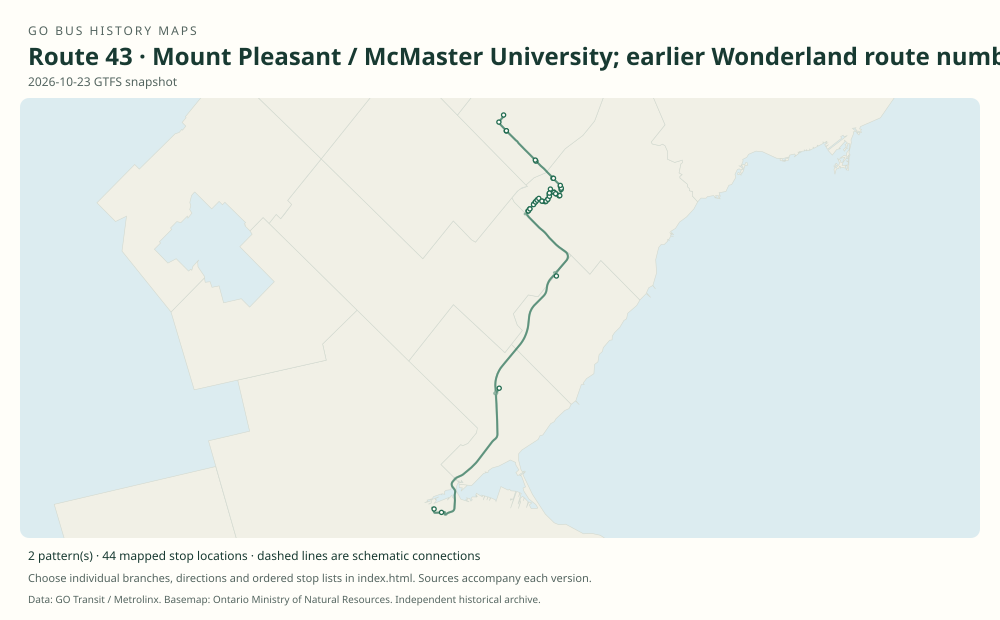

# GO route 43 — Mount Pleasant / McMaster University; earlier Wonderland route number

The number has two unrelated eras: a seasonal Wonderland service, renumbered 60 in 2008, and a new Mount Pleasant–McMaster service introduced in 2026. The earlier service must not be joined into a continuous geography with the new route.

**Status:** current. **Documented patterns:** 4. **Research date:** 23 October 2026.

[Download history PDF](route-43-history.pdf) · [Interactive map](index.html) · [All ordered stops (CSV)](stops.csv) · [All mapped versions (GeoJSON)](maps.geojson) · [History data](history.json) · [Timetable archive links](archive-sources.json)

The PDF includes the sourced history, dated maps, numbered stop lists and navigation bookmarks. Older versions retain the timetable timing-point or major-stop limits described below.

Open `index.html` through the repository's local web server to use the map. SVG maps below display directly on GitHub.

## History

### by 2003-06-28

Original Wonderland Table 43 shows a seasonal service between Canada’s Wonderland, Yorkdale Subway and York Mills Subway, with separate seasonal fares. The surviving page displays July 1, 2003 service.

[Source 1](https://go-schedule-archive.s3.us-east-1.amazonaws.com/wonderland/2003-06-28-table-43-wonderland.html)

### 2008-05-04

The Wonderland service resumes under number 60, replacing number 43, according to the contemporary April 22 service notice.

[Source 1](https://transittoronto.ca/archives/weblog/2008/04/22-go_transit.shtml)

### 2026-09-05

A new, unrelated route 43 appears in the effective September 5 timetable: Mount Pleasant GO to McMaster via Mississauga Road, Meadowvale, Trafalgar/407 and Dundas/407. It operates weekdays excluding holidays.

[Source 1](https://go-schedule-archive.s3.us-east-1.amazonaws.com/mount-pleasant-mcmaster-university/2026-09-05-table-43-mount-pleasant-mcmaster-university.pdf)

## Maps by documented version

Feed maps combine the patterns present in that dated file. The interactive viewer separates every branch and direction. A feed snapshot can include future or temporary service; its filename is not a route-change date.

| Date / evidence | Map | Patterns |
|---|---|---:|
| 2026-10-23 GTFS snapshot | [SVG map](maps/2026-10-23.svg) | 2 |
| 2003-06-28 | [SVG map](maps/history-43-wonderland-2003.svg) | 1 |
| 2026-09-05 | [SVG map](maps/history-43-2026-launch.svg) | 1 |

## Historical major-stop sequences

These are timetable timing points / major stops, not necessarily every roadside stop. Full GTFS sequences are in `stops.csv` and the snapshot files.

### 2003-06-28 — 43 (historical Wonderland): Earlier Wonderland service (Table 43)

Canada’s Wonderland — historic bus stop → Yorkdale GO Bus Terminal → York Mills GO Bus Terminal

Schematic straight connections between established stop areas, not a street-by-street reconstruction. This source labels Table 43; the contemporary 2008 renumbering notice establishes the former service number. The historical Wonderland bus bay has not been located; use a clearly approximate park-area marker. These are the timetable’s ordered major timing points; intermediate roadside stops are not asserted.

[Original source 1](https://go-schedule-archive.s3.us-east-1.amazonaws.com/wonderland/2003-06-28-table-43-wonderland.html)

### 2026-09-05 — 43: Mount Pleasant–McMaster launch pattern

Mount Pleasant GO → Mississauga Rd. @ Williams Pkwy. → Mississauga Rd. @ Steeles Ave. W. → Mississauga Rd. @ Royal Bank Dr. → Meadowvale GO → Aquitaine Ave. @ Meadowvale Town Centre Cir. → Derry Rd. W. @ Ninth Line → Trafalgar Rd. @ Hwy. 407 Park & Ride → Dundas St. @ Hwy. 407 Park & Ride → McMaster University

Schematic straight connections between established stop areas, not a street-by-street reconstruction. This is a new route using the old number. September 5 is the timetable effective date, not necessarily its first weekday operating day. These are the timetable’s ordered major timing points; intermediate roadside stops are not asserted.

[Original source 1](https://go-schedule-archive.s3.us-east-1.amazonaws.com/mount-pleasant-mcmaster-university/2026-09-05-table-43-mount-pleasant-mcmaster-university.pdf)

## Coverage and unresolved questions

- The first launch year of the earlier Wonderland service and its full earlier seasonal branch history remain unverified.
- The 2003 original has only table identification; no claim is made that modern public headsign numbering existed in the same form in 2003.
- Do not copy route 60A’s 2013 short branch into route 43 without an earlier original source.
- GTFS dates identify captured feeds, not necessarily the first or last day of a route. Open a pattern to see its exact scheduled service dates. Temporary rail replacement and special-service patterns are included when present in the source.
- Manually reconstructed versions generally contain published timetable timing points / major stops. They must not be read as complete roadside stop inventories.

## Sources

- [GO Wonderland Table 43, effective June 28, 2003; displayed service for July 1](https://go-schedule-archive.s3.us-east-1.amazonaws.com/wonderland/2003-06-28-table-43-wonderland.html) — original-timetable
- [Transit Toronto, April 22, 2008: GO Transit changes May schedules and Wonderland route number](https://transittoronto.ca/archives/weblog/2008/04/22-go_transit.shtml) — secondary
- [GO route 43 timetable, effective September 5, 2026](https://go-schedule-archive.s3.us-east-1.amazonaws.com/mount-pleasant-mcmaster-university/2026-09-05-table-43-mount-pleasant-mcmaster-university.pdf) — original-timetable
- [GO Transit original GTFS snapshot 2026-10-23](https://assets.metrolinx.com/raw/upload/Documents/Metrolinx/Open%20Data/GO-GTFS.zip) — original-gtfs

## Data attribution

Data used in this product or service is provided with the permission of Metrolinx. Metrolinx makes no representations or warranties of any kind, express or implied, with respect to the Data and assumes no responsibility for the accuracy or currency of the data used in this product or service.

Basemap: Ontario Ministry of Natural Resources, Open Government Licence – Ontario. See [methodology](../../docs/METHODOLOGY.md) for geometry and date limitations.
