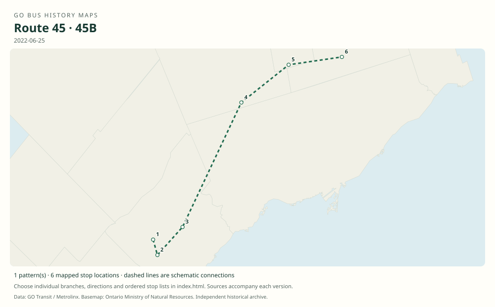

# GO route 45 — Streetsville / York University; later Mississauga / Markham

A direct Mississauga–York service that bypassed Bramalea on its principal patterns. It later terminated at Highway 407 and gained a Unionville branch before being discontinued in 2023.

**Status:** discontinued. **Documented patterns:** 18. **Research date:** 23 October 2026.

[Download history PDF](route-45-history.pdf) · [Interactive map](index.html) · [All ordered stops (CSV)](stops.csv) · [All mapped versions (GeoJSON)](maps.geojson) · [History data](history.json) · [Timetable archive links](archive-sources.json)

The PDF includes the sourced history, dated maps, numbered stop lists and navigation bookmarks. Older versions retain the timetable timing-point or major-stop limits described below.

Open `index.html` through the repository's local web server to use the map. SVG maps below display directly on GitHub.

## History

### by 2006-12-30

The unnumbered route-column predecessor in Table 46 connects Streetsville, Square One and York University; 53xxx trip identifiers in this timetable are not evidence of a separate public route 53.

[Source 1](https://go-schedule-archive.s3.us-east-1.amazonaws.com/hwy-407-west/2008-01-04-table-46-hwy-407-west.pdf)

### by 2011-12-31

Public routes 45 and 45A are printed explicitly: Streetsville–Square One–Keele–York and a Square One short working. Both bypass Bramalea.

[Source 1](https://go-schedule-archive.s3.us-east-1.amazonaws.com/hwy-407-west/2012-08-25-table-46-hwy-407-west.pdf)

### 2015-09-05

Erin Mills Transitway Station opens to GO service; it is included on route 45 in the September 2018 original.

[Source 1](https://www7.mississauga.ca/documents/committees/general/2017/2017_12_06_General_Committee_Agenda_online.pdf) · [Source 2](https://go-schedule-archive.s3.us-east-1.amazonaws.com/hwy-407-west/2018-09-01-table-46-hwy-407-west.pdf)

### by 2018-09-01

Main 45 serves Erin Mills and continues to York via Keele. Unlike the stopping 46/47/48 patterns, 45 and 45A bypass the newly opened Highway 407 Bus Terminal.

[Source 1](https://go-schedule-archive.s3.us-east-1.amazonaws.com/hwy-407-west/2018-09-01-table-46-hwy-407-west.pdf)

### 2019-01-05

GO leaves York University campus; later 2019 route 45 timetables terminate at Highway 407 Bus Terminal.

[Source 1](https://www.yorku.ca/yfile/2018/11/06/go-transit-announces-changes-to-go-bus-services-on-keele-campus/) · [Source 2](https://go-schedule-archive.s3.us-east-1.amazonaws.com/hwy-407-west/2019-08-31-table-46-hwy-407-west.pdf)

### by 2022-06-25

45B is a Streetsville–Erin Mills–Square One–Highway 407–Richmond Hill Centre–Unionville through branch, bypassing Bramalea.

[Source 1](https://go-schedule-archive.s3.us-east-1.amazonaws.com/hamilton-pickering/2022-06-25-table-41-hamilton-pickering.pdf)

### 2023-04-08

Route 45 is discontinued in the spring service revision.

[Source 1](https://transittoronto.ca/archives/weblog/2023/04/08-go_revisin.shtml)

## Maps by documented version

Feed maps combine the patterns present in that dated file. The interactive viewer separates every branch and direction. A feed snapshot can include future or temporary service; its filename is not a route-change date.

| Date / evidence | Map | Patterns |
|---|---|---:|
| 2016-01-11 GTFS snapshot | [SVG map](maps/2016-01-11.svg) | 7 |
| 2022-03-08 GTFS snapshot | [SVG map](maps/2022-03-08.svg) | 4 |
| 2006-12-30 | [SVG map](maps/history-45-pre-2007.svg) | 1 |
| 2011-12-31 | [SVG map](maps/history-45-2011.svg) | 1 |
| 2011-12-31 | [SVG map](maps/history-45A-2011.svg) | 1 |
| 2018-09-01 | [SVG map](maps/history-45-2018.svg) | 1 |
| 2019-08-31 | [SVG map](maps/history-45-2019.svg) | 1 |
| 2019-08-31 | [SVG map](maps/history-45A-2019.svg) | 1 |
| 2022-06-25 | [SVG map](maps/history-45B-2022.svg) | 1 |

## Historical major-stop sequences

These are timetable timing points / major stops, not necessarily every roadside stop. Full GTFS sequences are in `stops.csv` and the snapshot files.

### 2006-12-30 — pre-45: Streetsville predecessor in Table 46

Streetsville GO → Square One GO Bus Terminal → York University Bus Loop

Schematic straight connections between established stop areas, not a street-by-street reconstruction. The original has trip numbers but no public route-number column. These are the timetable’s ordered major timing points; intermediate roadside stops are not asserted.

[Original source 1](https://go-schedule-archive.s3.us-east-1.amazonaws.com/hwy-407-west/2008-01-04-table-46-hwy-407-west.pdf)

### 2011-12-31 — 45: Streetsville–York main route

Streetsville GO → Square One GO Bus Terminal → Keele St. @ Great Gulf Dr. / Snidercroft Rd. → York University Bus Loop

Schematic straight connections between established stop areas, not a street-by-street reconstruction.  These are the timetable’s ordered major timing points; intermediate roadside stops are not asserted.

[Original source 1](https://go-schedule-archive.s3.us-east-1.amazonaws.com/hwy-407-west/2012-08-25-table-46-hwy-407-west.pdf)

### 2011-12-31 — 45A: Square One–York short route

Square One GO Bus Terminal → Keele St. @ Great Gulf Dr. / Snidercroft Rd. → York University Bus Loop

Schematic straight connections between established stop areas, not a street-by-street reconstruction.  These are the timetable’s ordered major timing points; intermediate roadside stops are not asserted.

[Original source 1](https://go-schedule-archive.s3.us-east-1.amazonaws.com/hwy-407-west/2012-08-25-table-46-hwy-407-west.pdf)

### 2018-09-01 — 45: Streetsville–York via Erin Mills

Streetsville GO → Erin Mills Transitway Station → Square One GO Bus Terminal → Keele St. @ Great Gulf Dr. / Snidercroft Rd. → York University Bus Loop

Schematic straight connections between established stop areas, not a street-by-street reconstruction. Bramalea and Highway 407 Bus Terminal have no timing entries for this route. These are the timetable’s ordered major timing points; intermediate roadside stops are not asserted.

[Original source 1](https://go-schedule-archive.s3.us-east-1.amazonaws.com/hwy-407-west/2018-09-01-table-46-hwy-407-west.pdf)

### 2019-08-31 — 45: Streetsville–Highway 407

Streetsville GO → Erin Mills Transitway Station → Square One GO Bus Terminal → Highway 407 Bus Terminal

Schematic straight connections between established stop areas, not a street-by-street reconstruction.  These are the timetable’s ordered major timing points; intermediate roadside stops are not asserted.

[Original source 1](https://go-schedule-archive.s3.us-east-1.amazonaws.com/hwy-407-west/2019-08-31-table-46-hwy-407-west.pdf)

### 2019-08-31 — 45A: Square One–Highway 407 short route

Square One GO Bus Terminal → Highway 407 Bus Terminal

Schematic straight connections between established stop areas, not a street-by-street reconstruction.  These are the timetable’s ordered major timing points; intermediate roadside stops are not asserted.

[Original source 1](https://go-schedule-archive.s3.us-east-1.amazonaws.com/hwy-407-west/2019-08-31-table-46-hwy-407-west.pdf)

### 2022-06-25 — 45B: Streetsville–Unionville through branch

Streetsville GO → Erin Mills Transitway Station → Square One GO Bus Terminal → Highway 407 Bus Terminal → Richmond Hill Centre → Unionville GO

Schematic straight connections between established stop areas, not a street-by-street reconstruction.  These are the timetable’s ordered major timing points; intermediate roadside stops are not asserted.

[Original source 1](https://go-schedule-archive.s3.us-east-1.amazonaws.com/hamilton-pickering/2022-06-25-table-41-hamilton-pickering.pdf)

## Coverage and unresolved questions

- The original start date of the Streetsville service and the exact introduction date of public route number 45 have not been established.
- A secondary account places the Unionville extension in September 2020, but this dataset uses the directly verified June 2022 original instead of assigning an unconfirmed launch day.
- GTFS dates identify captured feeds, not necessarily the first or last day of a route. Open a pattern to see its exact scheduled service dates. Temporary rail replacement and special-service patterns are included when present in the source.
- Manually reconstructed versions generally contain published timetable timing points / major stops. They must not be read as complete roadside stop inventories.

## Sources

- [GO Highway 407 West timetable, internally effective December 30, 2006 (archive filename January 4, 2008)](https://go-schedule-archive.s3.us-east-1.amazonaws.com/hwy-407-west/2008-01-04-table-46-hwy-407-west.pdf) — original-timetable
- [GO routes 45–48 timetable, effective December 31, 2011 (archived August 25, 2012)](https://go-schedule-archive.s3.us-east-1.amazonaws.com/hwy-407-west/2012-08-25-table-46-hwy-407-west.pdf) — original-timetable
- [City of Mississauga General Committee agenda, December 6, 2017: Transitway implementation dates](https://www7.mississauga.ca/documents/committees/general/2017/2017_12_06_General_Committee_Agenda_online.pdf) — official
- [GO routes 45–48 timetable, effective September 1, 2018](https://go-schedule-archive.s3.us-east-1.amazonaws.com/hwy-407-west/2018-09-01-table-46-hwy-407-west.pdf) — original-timetable
- [York University: GO Transit announces changes to GO bus services on Keele campus, November 6, 2018](https://www.yorku.ca/yfile/2018/11/06/go-transit-announces-changes-to-go-bus-services-on-keele-campus/) — official
- [GO routes 45–48 timetable, effective August 31, 2019](https://go-schedule-archive.s3.us-east-1.amazonaws.com/hwy-407-west/2019-08-31-table-46-hwy-407-west.pdf) — original-timetable
- [GO Hamilton/Pickering timetable, effective June 25, 2022](https://go-schedule-archive.s3.us-east-1.amazonaws.com/hamilton-pickering/2022-06-25-table-41-hamilton-pickering.pdf) — original-timetable
- [Transit Toronto, April 8, 2023: GO revising routes and services](https://transittoronto.ca/archives/weblog/2023/04/08-go_revisin.shtml) — secondary
- [GO Transit original GTFS snapshot 2016-01-11](https://openmobilitydata-data.s3.us-west-1.amazonaws.com/public/feeds/go-transit/32/20160111/gtfs.zip) — original-gtfs
- [GO Transit original GTFS snapshot 2022-03-08](https://web.archive.org/web/20220308054107id_/https://www.gotransit.com/static_files/gotransit/assets/Files/GO_GTFS.zip) — original-gtfs

## Data attribution

Data used in this product or service is provided with the permission of Metrolinx. Metrolinx makes no representations or warranties of any kind, express or implied, with respect to the Data and assumes no responsibility for the accuracy or currency of the data used in this product or service.

Basemap: Ontario Ministry of Natural Resources, Open Government Licence – Ontario. See [methodology](../../docs/METHODOLOGY.md) for geometry and date limitations.
