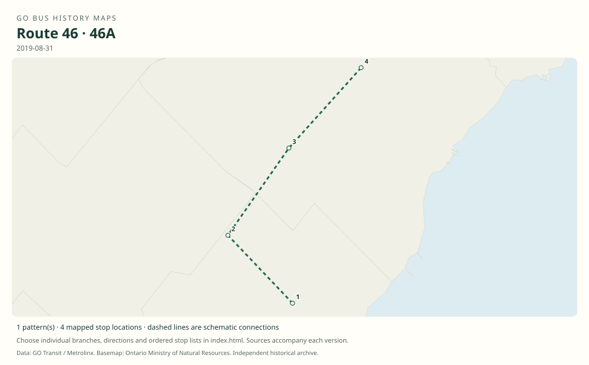

# GO route 46 — Oakville / York University; later Oakville / Highway 407

The Oakville and Sheridan College arm of the Highway 407 network, linked to Square One, Bramalea and York University, then Highway 407 Bus Terminal. Most weekday trips became the western half of route 56 in 2021.

**Status:** discontinued. **Documented patterns:** 12. **Research date:** 23 October 2026.

[Download history PDF](route-46-history.pdf) · [Interactive map](index.html) · [All ordered stops (CSV)](stops.csv) · [All mapped versions (GeoJSON)](maps.geojson) · [History data](history.json) · [Timetable archive links](archive-sources.json)

The PDF includes the sourced history, dated maps, numbered stop lists and navigation bookmarks. Older versions retain the timetable timing-point or major-stop limits described below.

Open `index.html` through the repository's local web server to use the map. SVG maps below display directly on GitHub.

## History

### 2000-09

The original Highway 407 corridor links Oakville GO, Square One, Bramalea, York University and Unionville. York University’s contemporary article documents the launch month.

[Source 1](https://www.yorku.ca/yul/profiles/past/aug00/current/cover/cover2.htm)

### by 2006-12-30

The Oakville–Sheridan–Trafalgar/407–Square One–Bramalea–York pattern is in the original Table 46.

[Source 1](https://go-schedule-archive.s3.us-east-1.amazonaws.com/hwy-407-west/2008-01-04-table-46-hwy-407-west.pdf)

### by 2011-12-31

The route-number column explicitly identifies route 46, including the Keele/Snidercroft stop.

[Source 1](https://go-schedule-archive.s3.us-east-1.amazonaws.com/hwy-407-west/2012-08-25-table-46-hwy-407-west.pdf)

### by 2018-09-01

Route 46 serves Erin Mills and Highway 407 Bus Terminal, then continues via Keele to York University. The terminal opening did not immediately remove campus service.

[Source 1](https://go-schedule-archive.s3.us-east-1.amazonaws.com/hwy-407-west/2018-09-01-table-46-hwy-407-west.pdf)

### 2019-01-05

York University service ends. The August 2019 original shows 46 ending at Highway 407 and 46A linking Sheridan College with Square One.

[Source 1](https://www.yorku.ca/yfile/2018/11/06/go-transit-announces-changes-to-go-bus-services-on-keele-campus/) · [Source 2](https://go-schedule-archive.s3.us-east-1.amazonaws.com/hwy-407-west/2019-08-31-table-46-hwy-407-west.pdf)

### 2021-02-13

Most weekday route 46 trips combine with route 52 to create through route 56.

[Source 1](https://www.metrolinx.com/en/discover/changes-coming-to-some-go-transit-bus-routes)

## Maps by documented version

Feed maps combine the patterns present in that dated file. The interactive viewer separates every branch and direction. A feed snapshot can include future or temporary service; its filename is not a route-change date.

| Date / evidence | Map | Patterns |
|---|---|---:|
| 2016-01-11 GTFS snapshot | [SVG map](maps/2016-01-11.svg) | 7 |
| 2006-12-30 | [SVG map](maps/history-46-pre-2007.svg) | 1 |
| 2011-12-31 | [SVG map](maps/history-46-2011.svg) | 1 |
| 2018-09-01 | [SVG map](maps/history-46-2018.svg) | 1 |
| 2019-08-31 | [SVG map](maps/history-46-2019.svg) | 1 |
| 2019-08-31 | [SVG map](maps/history-46A-2019.svg) | 1 |

## Historical major-stop sequences

These are timetable timing points / major stops, not necessarily every roadside stop. Full GTFS sequences are in `stops.csv` and the snapshot files.

### 2006-12-30 — pre-46: Oakville–York predecessor

Oakville GO → Sheridan College — Trafalgar Campus → Trafalgar Rd. @ Hwy. 407 Park & Ride → Square One GO Bus Terminal → Bramalea GO → York University Bus Loop

Schematic straight connections between established stop areas, not a street-by-street reconstruction.  These are the timetable’s ordered major timing points; intermediate roadside stops are not asserted.

[Original source 1](https://go-schedule-archive.s3.us-east-1.amazonaws.com/hwy-407-west/2008-01-04-table-46-hwy-407-west.pdf)

### 2011-12-31 — 46: Oakville–York via Keele

Oakville GO → Sheridan College — Trafalgar Campus → Trafalgar Rd. @ Hwy. 407 Park & Ride → Square One GO Bus Terminal → Bramalea GO → Keele St. @ Great Gulf Dr. / Snidercroft Rd. → York University Bus Loop

Schematic straight connections between established stop areas, not a street-by-street reconstruction.  These are the timetable’s ordered major timing points; intermediate roadside stops are not asserted.

[Original source 1](https://go-schedule-archive.s3.us-east-1.amazonaws.com/hwy-407-west/2012-08-25-table-46-hwy-407-west.pdf)

### 2018-09-01 — 46: Oakville–York via Highway 407 terminal

Oakville GO → Sheridan College — Trafalgar Campus → Trafalgar Rd. @ Hwy. 407 Park & Ride → Erin Mills Transitway Station → Square One GO Bus Terminal → Bramalea GO → Highway 407 Bus Terminal → Keele St. @ Great Gulf Dr. / Snidercroft Rd. → York University Bus Loop

Schematic straight connections between established stop areas, not a street-by-street reconstruction.  These are the timetable’s ordered major timing points; intermediate roadside stops are not asserted.

[Original source 1](https://go-schedule-archive.s3.us-east-1.amazonaws.com/hwy-407-west/2018-09-01-table-46-hwy-407-west.pdf)

### 2019-08-31 — 46: Oakville–Highway 407

Oakville GO → Sheridan College — Trafalgar Campus → Trafalgar Rd. @ Hwy. 407 Park & Ride → Erin Mills Transitway Station → Square One GO Bus Terminal → Bramalea GO → Highway 407 Bus Terminal

Schematic straight connections between established stop areas, not a street-by-street reconstruction.  These are the timetable’s ordered major timing points; intermediate roadside stops are not asserted.

[Original source 1](https://go-schedule-archive.s3.us-east-1.amazonaws.com/hwy-407-west/2019-08-31-table-46-hwy-407-west.pdf)

### 2019-08-31 — 46A: Sheridan–Square One short route

Sheridan College — Trafalgar Campus → Trafalgar Rd. @ Hwy. 407 Park & Ride → Erin Mills Transitway Station → Square One GO Bus Terminal

Schematic straight connections between established stop areas, not a street-by-street reconstruction.  These are the timetable’s ordered major timing points; intermediate roadside stops are not asserted.

[Original source 1](https://go-schedule-archive.s3.us-east-1.amazonaws.com/hwy-407-west/2019-08-31-table-46-hwy-407-west.pdf)

## Coverage and unresolved questions

- The 2021 announcement specifies most weekday trips, so it is not used to assert the exact final date of every residual route 46 trip. Route 46 is absent from the April 2022 eastern combined table.
- Launch of the corridor predates the public numbering system; early Table 46 must not be read as a single modern route.
- GTFS dates identify captured feeds, not necessarily the first or last day of a route. Open a pattern to see its exact scheduled service dates. Temporary rail replacement and special-service patterns are included when present in the source.
- Manually reconstructed versions generally contain published timetable timing points / major stops. They must not be read as complete roadside stop inventories.

## Sources

- [York University, August 2000: new Highway 407 GO service](https://www.yorku.ca/yul/profiles/past/aug00/current/cover/cover2.htm) — official
- [GO Highway 407 West timetable, internally effective December 30, 2006 (archive filename January 4, 2008)](https://go-schedule-archive.s3.us-east-1.amazonaws.com/hwy-407-west/2008-01-04-table-46-hwy-407-west.pdf) — original-timetable
- [GO routes 45–48 timetable, effective December 31, 2011 (archived August 25, 2012)](https://go-schedule-archive.s3.us-east-1.amazonaws.com/hwy-407-west/2012-08-25-table-46-hwy-407-west.pdf) — original-timetable
- [GO routes 45–48 timetable, effective September 1, 2018](https://go-schedule-archive.s3.us-east-1.amazonaws.com/hwy-407-west/2018-09-01-table-46-hwy-407-west.pdf) — original-timetable
- [York University: GO Transit announces changes to GO bus services on Keele campus, November 6, 2018](https://www.yorku.ca/yfile/2018/11/06/go-transit-announces-changes-to-go-bus-services-on-keele-campus/) — official
- [GO routes 45–48 timetable, effective August 31, 2019](https://go-schedule-archive.s3.us-east-1.amazonaws.com/hwy-407-west/2019-08-31-table-46-hwy-407-west.pdf) — original-timetable
- [Metrolinx: Changes coming to some GO Transit bus routes, February 2021](https://www.metrolinx.com/en/discover/changes-coming-to-some-go-transit-bus-routes) — official
- [GO routes 52, 54 and 56 timetable, effective April 2, 2022](https://go-schedule-archive.s3.us-east-1.amazonaws.com/oshawa-oakville/2022-04-02-table-56-oshawa-oakville.pdf) — original-timetable
- [GO Transit original GTFS snapshot 2016-01-11](https://openmobilitydata-data.s3.us-west-1.amazonaws.com/public/feeds/go-transit/32/20160111/gtfs.zip) — original-gtfs

## Data attribution

Data used in this product or service is provided with the permission of Metrolinx. Metrolinx makes no representations or warranties of any kind, express or implied, with respect to the Data and assumes no responsibility for the accuracy or currency of the data used in this product or service.

Basemap: Ontario Ministry of Natural Resources, Open Government Licence – Ontario. See [methodology](../../docs/METHODOLOGY.md) for geometry and date limitations.
