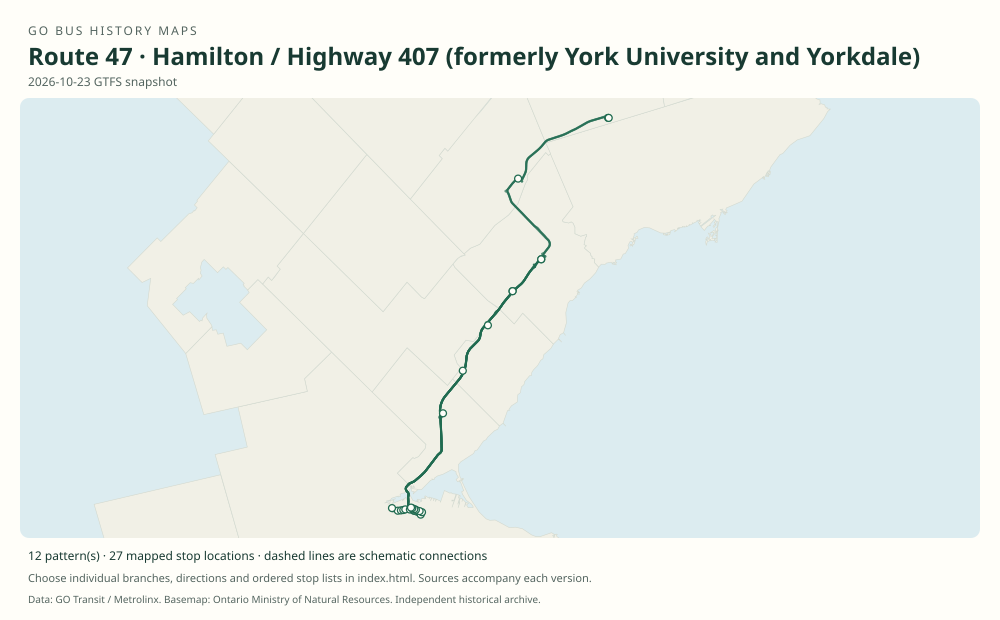

# GO route 47 — Hamilton / Highway 407 (formerly York University and Yorkdale)

The Hamilton and McMaster arm of the 407 network has had numerous express, short and weekend branches. Suffixes have been reused: the older 47D was a Bramalea–York short route, while the 2023 47D is a McMaster express; the older 47G extended to Yorkdale.

**Status:** current. **Documented patterns:** 74. **Research date:** 23 October 2026.

[Download history PDF](route-47-history.pdf) · [Interactive map](index.html) · [All ordered stops (CSV)](stops.csv) · [All mapped versions (GeoJSON)](maps.geojson) · [History data](history.json) · [Timetable archive links](archive-sources.json)

The PDF includes the sourced history, dated maps, numbered stop lists and navigation bookmarks. Older versions retain the timetable timing-point or major-stop limits described below.

Open `index.html` through the repository's local web server to use the map. SVG maps below display directly on GitHub.

## History

### 2002-04-29

The Highway 407 network expands to Hamilton and McMaster University, the predecessor of numbered route 47.

[Source 1](https://transittoronto.ca/regional/2115.shtml)

### by 2006-12-30

The original Hamilton–McMaster–407 park-and-rides–Square One–Bramalea–York pattern is documented.

[Source 1](https://go-schedule-archive.s3.us-east-1.amazonaws.com/hwy-407-west/2008-01-04-table-46-hwy-407-west.pdf)

### by 2011-12-31

The original has branches 47A/B/C/D/E/F/G/H. Weekend 47G runs beyond York University to Yorkdale; 47D is a short Bramalea–Keele–York service.

[Source 1](https://go-schedule-archive.s3.us-east-1.amazonaws.com/hwy-407-west/2012-08-25-table-46-hwy-407-west.pdf)

### by 2014-04-05

47J provides Hamilton–Trafalgar/407–Square One service, bypassing McMaster and the western 407 park-and-rides.

[Source 1](https://go-schedule-archive.s3.us-east-1.amazonaws.com/hwy-407-west/2014-04-05-table-46-hwy-407-west.pdf)

### 2015-09-05

47J is absorbed into the extended route 40.

[Source 1](https://stevemunro.ca/wp-content/uploads/2017/03/ridership-report-september2016.pdf)

### by 2018-09-01

The main route serves Erin Mills and Highway 407 terminal before Keele and York. Express McMaster variants remain.

[Source 1](https://go-schedule-archive.s3.us-east-1.amazonaws.com/hwy-407-west/2018-09-01-table-46-hwy-407-west.pdf)

### 2019-01-05

The York University terminus is replaced by Highway 407 Bus Terminal.

[Source 1](https://www.yorku.ca/yfile/2018/11/06/go-transit-announces-changes-to-go-bus-services-on-keele-campus/) · [Source 2](https://go-schedule-archive.s3.us-east-1.amazonaws.com/hwy-407-west/2019-08-31-table-46-hwy-407-west.pdf)

### 2021-02-13

Most weekday 47 trips combine with 51 into new through route 41; route 47 remains as a separate family.

[Source 1](https://www.metrolinx.com/en/discover/changes-coming-to-some-go-transit-bus-routes)

### by 2022-06-25

Seasonal 47W extends via Canada’s Wonderland to Major Mackenzie/Hwy. 400 Park & Ride.

[Source 1](https://go-schedule-archive.s3.us-east-1.amazonaws.com/hamilton-pickering/2022-06-25-table-41-hamilton-pickering.pdf)

### by 2023-01-07

The timetable uses 47D for McMaster–Square One–Bramalea–Highway 407 express service and 47G for a McMaster–Erin Mills stopping short route. These differ from the 2011 suffix meanings.

[Source 1](https://go-schedule-archive.s3.us-east-1.amazonaws.com/hamilton-pickering/2023-01-07-table-41-hamilton-pickering.pdf)

### 2023-04-08

Weekday route 47 service is increased to roughly half-hourly in the spring revision.

[Source 1](https://transittoronto.ca/archives/weblog/2023/04/08-go_revisin.shtml)

### 2023-05-06

Seasonal Wonderland service uses the new Major Mackenzie West Terminal in 2023.

[Source 1](https://www.metrolinx.com/en/discover/go-buses-to-popular-attractions-back-in-time-for-summer) · [Source 2](https://transittoronto.ca/archives/weblog/2023/04/08-go_revisin.shtml)

## Maps by documented version

Feed maps combine the patterns present in that dated file. The interactive viewer separates every branch and direction. A feed snapshot can include future or temporary service; its filename is not a route-change date.

| Date / evidence | Map | Patterns |
|---|---|---:|
| 2016-01-11 GTFS snapshot | [SVG map](maps/2016-01-11.svg) | 33 |
| 2022-03-08 GTFS snapshot | [SVG map](maps/2022-03-08.svg) | 4 |
| 2023-05-05 GTFS snapshot | [SVG map](maps/2023-05-05.svg) | 8 |
| 2026-10-23 GTFS snapshot | [SVG map](maps/2026-10-23.svg) | 12 |
| 2006-12-30 | [SVG map](maps/history-47-pre-2007.svg) | 1 |
| 2011-12-31 | [SVG map](maps/history-47-2011.svg) | 1 |
| 2011-12-31 | [SVG map](maps/history-47A-2011.svg) | 1 |
| 2011-12-31 | [SVG map](maps/history-47B-2011.svg) | 1 |
| 2014-04-05 | [SVG map](maps/history-47C-2014.svg) | 1 |
| 2011-12-31 | [SVG map](maps/history-47D-2011.svg) | 1 |
| 2011-12-31 | [SVG map](maps/history-47E-2011.svg) | 1 |
| 2014-04-05 | [SVG map](maps/history-47F-2014.svg) | 1 |
| 2011-12-31 | [SVG map](maps/history-47G-2011.svg) | 1 |
| 2011-12-31 | [SVG map](maps/history-47H-2011.svg) | 1 |
| 2014-04-05 | [SVG map](maps/history-47J-2014.svg) | 1 |
| 2018-09-01 | [SVG map](maps/history-47-2018.svg) | 1 |
| 2019-08-31 | [SVG map](maps/history-47-2019.svg) | 1 |
| 2019-08-31 | [SVG map](maps/history-47F-2019.svg) | 1 |
| 2022-06-25 | [SVG map](maps/history-47W-2022.svg) | 1 |
| 2023-01-07 | [SVG map](maps/history-47D-2023.svg) | 1 |
| 2023-01-07 | [SVG map](maps/history-47G-2023.svg) | 1 |

## Historical major-stop sequences

These are timetable timing points / major stops, not necessarily every roadside stop. Full GTFS sequences are in `stops.csv` and the snapshot files.

### 2006-12-30 — pre-47: Hamilton–York predecessor

Hamilton GO Centre → McMaster University → Dundas St. @ Hwy. 407 Park & Ride → Bronte Rd. @ Hwy. 407 Park & Ride → Trafalgar Rd. @ Hwy. 407 Park & Ride → Square One GO Bus Terminal → Bramalea GO → York University Bus Loop

Schematic straight connections between established stop areas, not a street-by-street reconstruction.  These are the timetable’s ordered major timing points; intermediate roadside stops are not asserted.

[Original source 1](https://go-schedule-archive.s3.us-east-1.amazonaws.com/hwy-407-west/2008-01-04-table-46-hwy-407-west.pdf)

### 2011-12-31 — 47: Hamilton–York main route

Hamilton GO Centre → McMaster University → Dundas St. @ Hwy. 407 Park & Ride → Bronte Rd. @ Hwy. 407 Park & Ride → Trafalgar Rd. @ Hwy. 407 Park & Ride → Square One GO Bus Terminal → Bramalea GO → Keele St. @ Great Gulf Dr. / Snidercroft Rd. → York University Bus Loop

Schematic straight connections between established stop areas, not a street-by-street reconstruction.  These are the timetable’s ordered major timing points; intermediate roadside stops are not asserted.

[Original source 1](https://go-schedule-archive.s3.us-east-1.amazonaws.com/hwy-407-west/2012-08-25-table-46-hwy-407-west.pdf)

### 2011-12-31 — 47A: McMaster–Square One–Bramalea express

McMaster University → Square One GO Bus Terminal → Bramalea GO

Schematic straight connections between established stop areas, not a street-by-street reconstruction.  These are the timetable’s ordered major timing points; intermediate roadside stops are not asserted.

[Original source 1](https://go-schedule-archive.s3.us-east-1.amazonaws.com/hwy-407-west/2012-08-25-table-46-hwy-407-west.pdf)

### 2011-12-31 — 47B: McMaster–Square One express

McMaster University → Square One GO Bus Terminal

Schematic straight connections between established stop areas, not a street-by-street reconstruction.  These are the timetable’s ordered major timing points; intermediate roadside stops are not asserted.

[Original source 1](https://go-schedule-archive.s3.us-east-1.amazonaws.com/hwy-407-west/2012-08-25-table-46-hwy-407-west.pdf)

### 2014-04-05 — 47C: McMaster–Trafalgar express

McMaster University → Trafalgar Rd. @ Hwy. 407 Park & Ride

Schematic straight connections between established stop areas, not a street-by-street reconstruction.  These are the timetable’s ordered major timing points; intermediate roadside stops are not asserted.

[Original source 1](https://go-schedule-archive.s3.us-east-1.amazonaws.com/hwy-407-west/2014-04-05-table-46-hwy-407-west.pdf)

### 2011-12-31 — 47D: Bramalea–York short route

Bramalea GO → Keele St. @ Great Gulf Dr. / Snidercroft Rd. → York University Bus Loop

Schematic straight connections between established stop areas, not a street-by-street reconstruction. Historical suffix meaning; differs from the 2023 McMaster express. These are the timetable’s ordered major timing points; intermediate roadside stops are not asserted.

[Original source 1](https://go-schedule-archive.s3.us-east-1.amazonaws.com/hwy-407-west/2012-08-25-table-46-hwy-407-west.pdf)

### 2011-12-31 — 47E: McMaster–Trafalgar via 407 park-and-rides

McMaster University → Dundas St. @ Hwy. 407 Park & Ride → Bronte Rd. @ Hwy. 407 Park & Ride → Trafalgar Rd. @ Hwy. 407 Park & Ride

Schematic straight connections between established stop areas, not a street-by-street reconstruction.  These are the timetable’s ordered major timing points; intermediate roadside stops are not asserted.

[Original source 1](https://go-schedule-archive.s3.us-east-1.amazonaws.com/hwy-407-west/2012-08-25-table-46-hwy-407-west.pdf)

### 2014-04-05 — 47F: McMaster–Bramalea–York express

McMaster University → Bramalea GO → Keele St. @ Great Gulf Dr. / Snidercroft Rd. → York University Bus Loop

Schematic straight connections between established stop areas, not a street-by-street reconstruction. The main 47’s intermediate stops between McMaster and Bramalea are bypassed. These are the timetable’s ordered major timing points; intermediate roadside stops are not asserted.

[Original source 1](https://go-schedule-archive.s3.us-east-1.amazonaws.com/hwy-407-west/2014-04-05-table-46-hwy-407-west.pdf)

### 2011-12-31 — 47G: Weekend Hamilton–Yorkdale extension

Hamilton GO Centre → McMaster University → Dundas St. @ Hwy. 407 Park & Ride → Bronte Rd. @ Hwy. 407 Park & Ride → Trafalgar Rd. @ Hwy. 407 Park & Ride → Square One GO Bus Terminal → Bramalea GO → Keele St. @ Great Gulf Dr. / Snidercroft Rd. → York University Bus Loop → Yorkdale GO Bus Terminal

Schematic straight connections between established stop areas, not a street-by-street reconstruction. Historical suffix meaning; not the later McMaster–Erin Mills 47G. These are the timetable’s ordered major timing points; intermediate roadside stops are not asserted.

[Original source 1](https://go-schedule-archive.s3.us-east-1.amazonaws.com/hwy-407-west/2012-08-25-table-46-hwy-407-west.pdf)

### 2011-12-31 — 47H: McMaster–Bronte short route

McMaster University → Dundas St. @ Hwy. 407 Park & Ride → Bronte Rd. @ Hwy. 407 Park & Ride

Schematic straight connections between established stop areas, not a street-by-street reconstruction.  These are the timetable’s ordered major timing points; intermediate roadside stops are not asserted.

[Original source 1](https://go-schedule-archive.s3.us-east-1.amazonaws.com/hwy-407-west/2012-08-25-table-46-hwy-407-west.pdf)

### 2014-04-05 — 47J: Hamilton–Square One via Trafalgar

Hamilton GO Centre → Trafalgar Rd. @ Hwy. 407 Park & Ride → Square One GO Bus Terminal

Schematic straight connections between established stop areas, not a street-by-street reconstruction. Despite the express description, the original has a scheduled stop at Trafalgar/407. These are the timetable’s ordered major timing points; intermediate roadside stops are not asserted.

[Original source 1](https://go-schedule-archive.s3.us-east-1.amazonaws.com/hwy-407-west/2014-04-05-table-46-hwy-407-west.pdf)

### 2018-09-01 — 47: Hamilton–York via Highway 407 terminal

Hamilton GO Centre → McMaster University → Dundas St. @ Hwy. 407 Park & Ride → Bronte Rd. @ Hwy. 407 Park & Ride → Trafalgar Rd. @ Hwy. 407 Park & Ride → Erin Mills Transitway Station → Square One GO Bus Terminal → Bramalea GO → Highway 407 Bus Terminal → Keele St. @ Great Gulf Dr. / Snidercroft Rd. → York University Bus Loop

Schematic straight connections between established stop areas, not a street-by-street reconstruction.  These are the timetable’s ordered major timing points; intermediate roadside stops are not asserted.

[Original source 1](https://go-schedule-archive.s3.us-east-1.amazonaws.com/hwy-407-west/2018-09-01-table-46-hwy-407-west.pdf)

### 2019-08-31 — 47: Hamilton–Highway 407 main route

Hamilton GO Centre → McMaster University → Dundas St. @ Hwy. 407 Park & Ride → Bronte Rd. @ Hwy. 407 Park & Ride → Trafalgar Rd. @ Hwy. 407 Park & Ride → Erin Mills Transitway Station → Square One GO Bus Terminal → Bramalea GO → Highway 407 Bus Terminal

Schematic straight connections between established stop areas, not a street-by-street reconstruction.  These are the timetable’s ordered major timing points; intermediate roadside stops are not asserted.

[Original source 1](https://go-schedule-archive.s3.us-east-1.amazonaws.com/hwy-407-west/2019-08-31-table-46-hwy-407-west.pdf)

### 2019-08-31 — 47F: McMaster–Highway 407 express via Bramalea

McMaster University → Bramalea GO → Highway 407 Bus Terminal

Schematic straight connections between established stop areas, not a street-by-street reconstruction.  These are the timetable’s ordered major timing points; intermediate roadside stops are not asserted.

[Original source 1](https://go-schedule-archive.s3.us-east-1.amazonaws.com/hwy-407-west/2019-08-31-table-46-hwy-407-west.pdf)

### 2022-06-25 — 47W: Summer Wonderland / Major Mackenzie extension

Hamilton GO Centre → McMaster University → Dundas St. @ Hwy. 407 Park & Ride → Bronte Rd. @ Hwy. 407 Park & Ride → Trafalgar Rd. @ Hwy. 407 Park & Ride → Erin Mills Transitway Station → Square One GO Bus Terminal → Bramalea GO → Highway 407 Bus Terminal → Canada’s Wonderland — historic bus stop → Major Mackenzie Dr. @ Hwy. 400 Park & Ride

Schematic straight connections between established stop areas, not a street-by-street reconstruction. The old Wonderland bus stop is not the later Major Mackenzie West Terminal; map only an approximate park area if no bay source is available. These are the timetable’s ordered major timing points; intermediate roadside stops are not asserted.

[Original source 1](https://go-schedule-archive.s3.us-east-1.amazonaws.com/hamilton-pickering/2022-06-25-table-41-hamilton-pickering.pdf)

### 2023-01-07 — 47D: McMaster–Highway 407 via Square One express

McMaster University → Square One GO Bus Terminal → Bramalea GO → Highway 407 Bus Terminal

Schematic straight connections between established stop areas, not a street-by-street reconstruction.  These are the timetable’s ordered major timing points; intermediate roadside stops are not asserted.

[Original source 1](https://go-schedule-archive.s3.us-east-1.amazonaws.com/hamilton-pickering/2023-01-07-table-41-hamilton-pickering.pdf)

### 2023-01-07 — 47G: McMaster–Erin Mills short route

McMaster University → Dundas St. @ Hwy. 407 Park & Ride → Bronte Rd. @ Hwy. 407 Park & Ride → Trafalgar Rd. @ Hwy. 407 Park & Ride → Erin Mills Transitway Station

Schematic straight connections between established stop areas, not a street-by-street reconstruction.  These are the timetable’s ordered major timing points; intermediate roadside stops are not asserted.

[Original source 1](https://go-schedule-archive.s3.us-east-1.amazonaws.com/hamilton-pickering/2023-01-07-table-41-hamilton-pickering.pdf)

## Coverage and unresolved questions

- Dates are snapshots for branch patterns unless a launch or withdrawal notice is cited.
- The exact introduction/retirement dates of every 47 suffix are not established; suffixes must always be paired with a date.
- This inventory describes ordered timing points, not all possible trip-level short turns; original GTFS patterns provide a more detailed view in available years.
- GTFS dates identify captured feeds, not necessarily the first or last day of a route. Open a pattern to see its exact scheduled service dates. Temporary rail replacement and special-service patterns are included when present in the source.
- Manually reconstructed versions generally contain published timetable timing points / major stops. They must not be read as complete roadside stop inventories.

## Sources

- [Toronto Transportation Society / Transit Toronto: GO Transit celebrates 50 years of bus service](https://transittoronto.ca/regional/2115.shtml) — secondary
- [GO Highway 407 West timetable, internally effective December 30, 2006 (archive filename January 4, 2008)](https://go-schedule-archive.s3.us-east-1.amazonaws.com/hwy-407-west/2008-01-04-table-46-hwy-407-west.pdf) — original-timetable
- [GO routes 45–48 timetable, effective December 31, 2011 (archived August 25, 2012)](https://go-schedule-archive.s3.us-east-1.amazonaws.com/hwy-407-west/2012-08-25-table-46-hwy-407-west.pdf) — original-timetable
- [GO routes 45–48 timetable, effective April 5, 2014](https://go-schedule-archive.s3.us-east-1.amazonaws.com/hwy-407-west/2014-04-05-table-46-hwy-407-west.pdf) — original-timetable
- [GO Transit ridership report, September 2016, footnote 9 (agency original mirrored by Steve Munro)](https://stevemunro.ca/wp-content/uploads/2017/03/ridership-report-september2016.pdf) — official
- [GO routes 45–48 timetable, effective September 1, 2018](https://go-schedule-archive.s3.us-east-1.amazonaws.com/hwy-407-west/2018-09-01-table-46-hwy-407-west.pdf) — original-timetable
- [York University: GO Transit announces changes to GO bus services on Keele campus, November 6, 2018](https://www.yorku.ca/yfile/2018/11/06/go-transit-announces-changes-to-go-bus-services-on-keele-campus/) — official
- [GO routes 45–48 timetable, effective August 31, 2019](https://go-schedule-archive.s3.us-east-1.amazonaws.com/hwy-407-west/2019-08-31-table-46-hwy-407-west.pdf) — original-timetable
- [Metrolinx: Changes coming to some GO Transit bus routes, February 2021](https://www.metrolinx.com/en/discover/changes-coming-to-some-go-transit-bus-routes) — official
- [GO Hamilton/Pickering timetable, effective June 25, 2022](https://go-schedule-archive.s3.us-east-1.amazonaws.com/hamilton-pickering/2022-06-25-table-41-hamilton-pickering.pdf) — original-timetable
- [GO Hamilton/Pickering timetable, effective January 7, 2023](https://go-schedule-archive.s3.us-east-1.amazonaws.com/hamilton-pickering/2023-01-07-table-41-hamilton-pickering.pdf) — original-timetable
- [Transit Toronto, April 8, 2023: GO revising routes and services](https://transittoronto.ca/archives/weblog/2023/04/08-go_revisin.shtml) — secondary
- [Metrolinx, May 17, 2023: GO buses to popular attractions back in time for summer](https://www.metrolinx.com/en/discover/go-buses-to-popular-attractions-back-in-time-for-summer) — official
- [GO Transit original GTFS snapshot 2016-01-11](https://openmobilitydata-data.s3.us-west-1.amazonaws.com/public/feeds/go-transit/32/20160111/gtfs.zip) — original-gtfs
- [GO Transit original GTFS snapshot 2022-03-08](https://web.archive.org/web/20220308054107id_/https://www.gotransit.com/static_files/gotransit/assets/Files/GO_GTFS.zip) — original-gtfs
- [GO Transit original GTFS snapshot 2023-05-05](https://openmobilitydata-data.s3.us-west-1.amazonaws.com/public/feeds/go-transit/32/20230505/gtfs.zip) — original-gtfs
- [GO Transit original GTFS snapshot 2026-10-23](https://assets.metrolinx.com/raw/upload/Documents/Metrolinx/Open%20Data/GO-GTFS.zip) — original-gtfs

## Data attribution

Data used in this product or service is provided with the permission of Metrolinx. Metrolinx makes no representations or warranties of any kind, express or implied, with respect to the Data and assumes no responsibility for the accuracy or currency of the data used in this product or service.

Basemap: Ontario Ministry of Natural Resources, Open Government Licence – Ontario. See [methodology](../../docs/METHODOLOGY.md) for geometry and date limitations.
