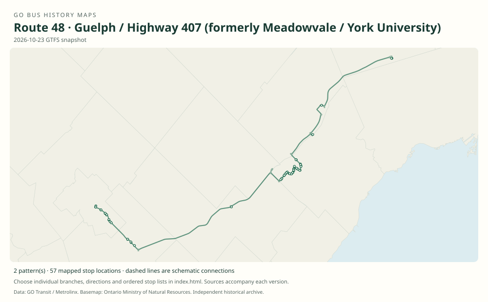

# GO route 48 — Guelph / Highway 407 (formerly Meadowvale / York University)

A Meadowvale–Bramalea–York corridor expanded west to the University of Guelph through Aberfoyle. It retained direct student expresses and short Meadowvale workings alongside the stopping route.

**Status:** current. **Documented patterns:** 28. **Research date:** 23 October 2026.

[Download history PDF](route-48-history.pdf) · [Interactive map](index.html) · [All ordered stops (CSV)](stops.csv) · [All mapped versions (GeoJSON)](maps.geojson) · [History data](history.json) · [Timetable archive links](archive-sources.json)

The PDF includes the sourced history, dated maps, numbered stop lists and navigation bookmarks. Older versions retain the timetable timing-point or major-stop limits described below.

Open `index.html` through the repository's local web server to use the map. SVG maps below display directly on GitHub.

## History

### by 2006-12-30

Table 46 shows Meadowvale–Bramalea–York and a direct Meadowvale–York predecessor express.

[Source 1](https://go-schedule-archive.s3.us-east-1.amazonaws.com/hwy-407-west/2008-01-04-table-46-hwy-407-west.pdf)

### 2007-09

Government releases document the Guelph–Aberfoyle–Meadowvale expansion. The August announcement gave September 3, while the November retrospective says service began September 4.

[Source 1](https://www.canada.ca/en/news/archive/2007/08/go-transit-expands-bus-service-university-guelph.html) · [Source 2](https://www.canada.ca/en/news/archive/2007/11/go-transit-announces-union-station-signalling-contract.html)

### by 2011-12-31

Main 48 runs Guelph–Aberfoyle–Meadowvale–Hurontario/407–Bramalea–Keele–York. 48A bypasses Hurontario and Bramalea, while 48B is the stopping Meadowvale short route.

[Source 1](https://go-schedule-archive.s3.us-east-1.amazonaws.com/hwy-407-west/2012-08-25-table-46-hwy-407-west.pdf)

### by 2018-09-01

Main 48 and 48B call at Highway 407 terminal before York, while 48A bypasses it. 48F is a limited Guelph–Bramalea–Highway 407–Keele–York express.

[Source 1](https://go-schedule-archive.s3.us-east-1.amazonaws.com/hwy-407-west/2018-09-01-table-46-hwy-407-west.pdf)

### 2019-01-05

GO leaves York campus and the route’s eastern end becomes Highway 407 Bus Terminal.

[Source 1](https://www.yorku.ca/yfile/2018/11/06/go-transit-announces-changes-to-go-bus-services-on-keele-campus/) · [Source 2](https://go-schedule-archive.s3.us-east-1.amazonaws.com/hwy-407-west/2019-08-31-table-46-hwy-407-west.pdf)

## Maps by documented version

Feed maps combine the patterns present in that dated file. The interactive viewer separates every branch and direction. A feed snapshot can include future or temporary service; its filename is not a route-change date.

| Date / evidence | Map | Patterns |
|---|---|---:|
| 2016-01-11 GTFS snapshot | [SVG map](maps/2016-01-11.svg) | 10 |
| 2022-03-08 GTFS snapshot | [SVG map](maps/2022-03-08.svg) | 4 |
| 2023-05-05 GTFS snapshot | [SVG map](maps/2023-05-05.svg) | 2 |
| 2026-10-23 GTFS snapshot | [SVG map](maps/2026-10-23.svg) | 2 |
| 2006-12-30 | [SVG map](maps/history-48-pre-2007.svg) | 1 |
| 2006-12-30 | [SVG map](maps/history-48-pre-2007-express.svg) | 1 |
| 2011-12-31 | [SVG map](maps/history-48-2011.svg) | 1 |
| 2011-12-31 | [SVG map](maps/history-48A-2011.svg) | 1 |
| 2011-12-31 | [SVG map](maps/history-48B-2011.svg) | 1 |
| 2018-09-01 | [SVG map](maps/history-48-2018.svg) | 1 |
| 2018-09-01 | [SVG map](maps/history-48A-2018.svg) | 1 |
| 2018-09-01 | [SVG map](maps/history-48F-2018.svg) | 1 |
| 2019-08-31 | [SVG map](maps/history-48-2019.svg) | 1 |
| 2019-08-31 | [SVG map](maps/history-48F-2019.svg) | 1 |

## Historical major-stop sequences

These are timetable timing points / major stops, not necessarily every roadside stop. Full GTFS sequences are in `stops.csv` and the snapshot files.

### 2006-12-30 — pre-48: Meadowvale–York predecessor

Meadowvale GO → Bramalea GO → York University Bus Loop

Schematic straight connections between established stop areas, not a street-by-street reconstruction.  These are the timetable’s ordered major timing points; intermediate roadside stops are not asserted.

[Original source 1](https://go-schedule-archive.s3.us-east-1.amazonaws.com/hwy-407-west/2008-01-04-table-46-hwy-407-west.pdf)

### 2006-12-30 — pre-48 express: Meadowvale–York predecessor express

Meadowvale GO → York University Bus Loop

Schematic straight connections between established stop areas, not a street-by-street reconstruction.  These are the timetable’s ordered major timing points; intermediate roadside stops are not asserted.

[Original source 1](https://go-schedule-archive.s3.us-east-1.amazonaws.com/hwy-407-west/2008-01-04-table-46-hwy-407-west.pdf)

### 2011-12-31 — 48: Guelph–York stopping route

University of Guelph → Aberfoyle GO Park & Ride → Meadowvale GO → Hurontario St. @ Hwy. 407 Park & Ride → Bramalea GO → Keele St. @ Great Gulf Dr. / Snidercroft Rd. → York University Bus Loop

Schematic straight connections between established stop areas, not a street-by-street reconstruction.  These are the timetable’s ordered major timing points; intermediate roadside stops are not asserted.

[Original source 1](https://go-schedule-archive.s3.us-east-1.amazonaws.com/hwy-407-west/2012-08-25-table-46-hwy-407-west.pdf)

### 2011-12-31 — 48A: Meadowvale–York express

Meadowvale GO → Keele St. @ Great Gulf Dr. / Snidercroft Rd. → York University Bus Loop

Schematic straight connections between established stop areas, not a street-by-street reconstruction.  These are the timetable’s ordered major timing points; intermediate roadside stops are not asserted.

[Original source 1](https://go-schedule-archive.s3.us-east-1.amazonaws.com/hwy-407-west/2012-08-25-table-46-hwy-407-west.pdf)

### 2011-12-31 — 48B: Meadowvale–York stopping short route

Meadowvale GO → Hurontario St. @ Hwy. 407 Park & Ride → Bramalea GO → Keele St. @ Great Gulf Dr. / Snidercroft Rd. → York University Bus Loop

Schematic straight connections between established stop areas, not a street-by-street reconstruction.  These are the timetable’s ordered major timing points; intermediate roadside stops are not asserted.

[Original source 1](https://go-schedule-archive.s3.us-east-1.amazonaws.com/hwy-407-west/2012-08-25-table-46-hwy-407-west.pdf)

### 2018-09-01 — 48: Guelph–York via Highway 407 terminal

University of Guelph → Aberfoyle GO Park & Ride → Meadowvale GO → Hurontario St. @ Hwy. 407 Park & Ride → Bramalea GO → Highway 407 Bus Terminal → Keele St. @ Great Gulf Dr. / Snidercroft Rd. → York University Bus Loop

Schematic straight connections between established stop areas, not a street-by-street reconstruction.  These are the timetable’s ordered major timing points; intermediate roadside stops are not asserted.

[Original source 1](https://go-schedule-archive.s3.us-east-1.amazonaws.com/hwy-407-west/2018-09-01-table-46-hwy-407-west.pdf)

### 2018-09-01 — 48A: Meadowvale–York express bypassing Highway 407 terminal

Meadowvale GO → Keele St. @ Great Gulf Dr. / Snidercroft Rd. → York University Bus Loop

Schematic straight connections between established stop areas, not a street-by-street reconstruction.  These are the timetable’s ordered major timing points; intermediate roadside stops are not asserted.

[Original source 1](https://go-schedule-archive.s3.us-east-1.amazonaws.com/hwy-407-west/2018-09-01-table-46-hwy-407-west.pdf)

### 2018-09-01 — 48F: Guelph–York limited express

University of Guelph → Bramalea GO → Highway 407 Bus Terminal → Keele St. @ Great Gulf Dr. / Snidercroft Rd. → York University Bus Loop

Schematic straight connections between established stop areas, not a street-by-street reconstruction. Limited school/Friday pattern; Aberfoyle, Meadowvale and Hurontario are bypassed. These are the timetable’s ordered major timing points; intermediate roadside stops are not asserted.

[Original source 1](https://go-schedule-archive.s3.us-east-1.amazonaws.com/hwy-407-west/2018-09-01-table-46-hwy-407-west.pdf)

### 2019-08-31 — 48: Guelph–Highway 407 stopping route

University of Guelph → Aberfoyle GO Park & Ride → Meadowvale GO → Hurontario St. @ Hwy. 407 Park & Ride → Bramalea GO → Highway 407 Bus Terminal

Schematic straight connections between established stop areas, not a street-by-street reconstruction.  These are the timetable’s ordered major timing points; intermediate roadside stops are not asserted.

[Original source 1](https://go-schedule-archive.s3.us-east-1.amazonaws.com/hwy-407-west/2019-08-31-table-46-hwy-407-west.pdf)

### 2019-08-31 — 48F: Guelph–Highway 407 limited express

University of Guelph → Bramalea GO → Highway 407 Bus Terminal

Schematic straight connections between established stop areas, not a street-by-street reconstruction.  These are the timetable’s ordered major timing points; intermediate roadside stops are not asserted.

[Original source 1](https://go-schedule-archive.s3.us-east-1.amazonaws.com/hwy-407-west/2019-08-31-table-46-hwy-407-west.pdf)

## Coverage and unresolved questions

- Official 2007 announcements differ by one day on Guelph’s start; this dataset states September 2007 rather than silently choosing one.
- The exact launch dates of the original Meadowvale service, 48A, 48B and 48F were not located.
- GTFS dates identify captured feeds, not necessarily the first or last day of a route. Open a pattern to see its exact scheduled service dates. Temporary rail replacement and special-service patterns are included when present in the source.
- Manually reconstructed versions generally contain published timetable timing points / major stops. They must not be read as complete roadside stop inventories.

## Sources

- [GO Highway 407 West timetable, internally effective December 30, 2006 (archive filename January 4, 2008)](https://go-schedule-archive.s3.us-east-1.amazonaws.com/hwy-407-west/2008-01-04-table-46-hwy-407-west.pdf) — original-timetable
- [Government of Canada: GO Transit expands bus service to the University of Guelph, August 2007](https://www.canada.ca/en/news/archive/2007/08/go-transit-expands-bus-service-university-guelph.html) — official
- [Government of Canada: GO Transit announces Union Station signalling contract, November 2007, project backgrounder](https://www.canada.ca/en/news/archive/2007/11/go-transit-announces-union-station-signalling-contract.html) — official
- [GO routes 45–48 timetable, effective December 31, 2011 (archived August 25, 2012)](https://go-schedule-archive.s3.us-east-1.amazonaws.com/hwy-407-west/2012-08-25-table-46-hwy-407-west.pdf) — original-timetable
- [GO routes 45–48 timetable, effective September 1, 2018](https://go-schedule-archive.s3.us-east-1.amazonaws.com/hwy-407-west/2018-09-01-table-46-hwy-407-west.pdf) — original-timetable
- [York University: GO Transit announces changes to GO bus services on Keele campus, November 6, 2018](https://www.yorku.ca/yfile/2018/11/06/go-transit-announces-changes-to-go-bus-services-on-keele-campus/) — official
- [GO routes 45–48 timetable, effective August 31, 2019](https://go-schedule-archive.s3.us-east-1.amazonaws.com/hwy-407-west/2019-08-31-table-46-hwy-407-west.pdf) — original-timetable
- [GO Transit original GTFS snapshot 2016-01-11](https://openmobilitydata-data.s3.us-west-1.amazonaws.com/public/feeds/go-transit/32/20160111/gtfs.zip) — original-gtfs
- [GO Transit original GTFS snapshot 2022-03-08](https://web.archive.org/web/20220308054107id_/https://www.gotransit.com/static_files/gotransit/assets/Files/GO_GTFS.zip) — original-gtfs
- [GO Transit original GTFS snapshot 2023-05-05](https://openmobilitydata-data.s3.us-west-1.amazonaws.com/public/feeds/go-transit/32/20230505/gtfs.zip) — original-gtfs
- [GO Transit original GTFS snapshot 2026-10-23](https://assets.metrolinx.com/raw/upload/Documents/Metrolinx/Open%20Data/GO-GTFS.zip) — original-gtfs

## Data attribution

Data used in this product or service is provided with the permission of Metrolinx. Metrolinx makes no representations or warranties of any kind, express or implied, with respect to the Data and assumes no responsibility for the accuracy or currency of the data used in this product or service.

Basemap: Ontario Ministry of Natural Resources, Open Government Licence – Ontario. See [methodology](../../docs/METHODOLOGY.md) for geometry and date limitations.
