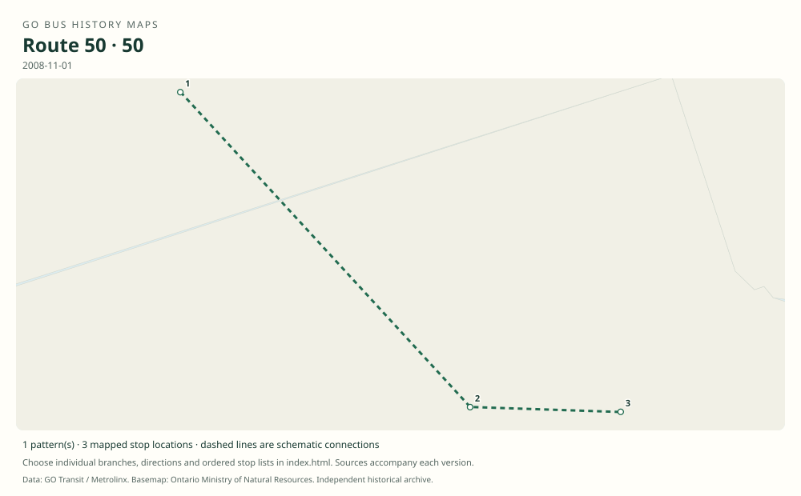

# GO route 50 — Unionville / Centennial College / University of Toronto Scarborough

A documented school-period GO route, distinct from its surrounding Table 52 corridor. The original explicitly prints route number 50, with three morning southbound and three afternoon northbound trips.

**Status:** discontinued. **Documented patterns:** 1. **Research date:** 23 October 2026.

[Download history PDF](route-50-history.pdf) · [Interactive map](index.html) · [All ordered stops (CSV)](stops.csv) · [All mapped versions (GeoJSON)](maps.geojson) · [History data](history.json) · [Timetable archive links](archive-sources.json)

The PDF includes the sourced history, dated maps, numbered stop lists and navigation bookmarks. Older versions retain the timetable timing-point or major-stop limits described below.

Open `index.html` through the repository's local web server to use the map. SVG maps below display directly on GitHub.

## History

### by 2008-11-01

The original combined timetable identifies route 50 between Unionville GO, Centennial College Progress Court and UTSC; trips are excluded during the listed December 2008–January 2009 school holiday.

[Source 1](https://go-schedule-archive.s3.us-east-1.amazonaws.com/oshawa-oakville/2009-02-19-table-52-oshawa-oakville.pdf)

### by 2011-12-31

Route 50 is absent from the later combined Highway 407 East timetable; this establishes an archive boundary, not an exact withdrawal date.

[Source 1](https://go-schedule-archive.s3.us-east-1.amazonaws.com/oshawa-oakville/2012-08-23-table-52-oshawa-oakville.pdf)

## Maps by documented version

Feed maps combine the patterns present in that dated file. The interactive viewer separates every branch and direction. A feed snapshot can include future or temporary service; its filename is not a route-change date.

| Date / evidence | Map | Patterns |
|---|---|---:|
| 2008-11-01 | [SVG map](maps/history-50-2008.svg) | 1 |

## Historical major-stop sequences

These are timetable timing points / major stops, not necessarily every roadside stop. Full GTFS sequences are in `stops.csv` and the snapshot files.

### 2008-11-01 — 50: Unionville–Centennial–UTSC school service

Unionville GO → Centennial College — Progress Ct. Bus Stop → University of Toronto Scarborough

Schematic straight connections between established stop areas, not a street-by-street reconstruction. Three AM southbound and three PM northbound trips are printed. This is an actual route-number entry, not a timetable-number inference. These are the timetable’s ordered major timing points; intermediate roadside stops are not asserted.

[Original source 1](https://go-schedule-archive.s3.us-east-1.amazonaws.com/oshawa-oakville/2009-02-19-table-52-oshawa-oakville.pdf)

## Coverage and unresolved questions

- The route’s exact introduction and final operating dates have not been established.
- No full all-stop GTFS or original geographic route map has yet been recovered for 50; the pattern records its three published timing points.
- Manually reconstructed versions generally contain published timetable timing points / major stops. They must not be read as complete roadside stop inventories.

## Sources

- [GO Highway 407 East timetable, internally dated November 1, 2008 (archived February 19, 2009)](https://go-schedule-archive.s3.us-east-1.amazonaws.com/oshawa-oakville/2009-02-19-table-52-oshawa-oakville.pdf) — original-timetable
- [GO routes 51, 52 and 54 timetable, effective December 31, 2011 (archived August 23, 2012)](https://go-schedule-archive.s3.us-east-1.amazonaws.com/oshawa-oakville/2012-08-23-table-52-oshawa-oakville.pdf) — original-timetable

## Data attribution

Data used in this product or service is provided with the permission of Metrolinx. Metrolinx makes no representations or warranties of any kind, express or implied, with respect to the Data and assumes no responsibility for the accuracy or currency of the data used in this product or service.

Basemap: Ontario Ministry of Natural Resources, Open Government Licence – Ontario. See [methodology](../../docs/METHODOLOGY.md) for geometry and date limitations.
