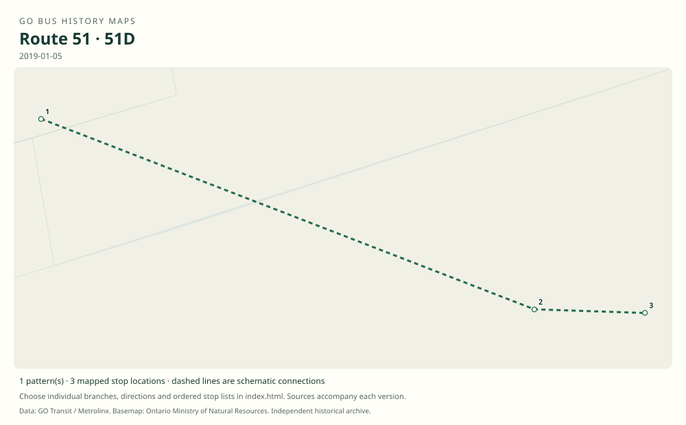

# GO route 51 — Pickering / York University; later Pickering / Highway 407

The Scarborough and Pickering arm of Highway 407 East, with a stopping main line and direct school expresses to Scarborough Centre, Pickering and the Scarborough campuses. Most weekday trips were joined to Hamilton service as route 41 in 2021.

**Status:** discontinued. **Documented patterns:** 28. **Research date:** 23 October 2026.

[Download history PDF](route-51-history.pdf) · [Interactive map](index.html) · [All ordered stops (CSV)](stops.csv) · [All mapped versions (GeoJSON)](maps.geojson) · [History data](history.json) · [Timetable archive links](archive-sources.json)

The PDF includes the sourced history, dated maps, numbered stop lists and navigation bookmarks. Older versions retain the timetable timing-point or major-stop limits described below.

Open `index.html` through the repository's local web server to use the map. SVG maps below display directly on GitHub.

## History

### 2002-01

The original 407 corridor is extended to Scarborough Town Centre, a predecessor of route 51.

[Source 1](https://transittoronto.ca/regional/2115.shtml)

### 2002-04-29

The eastern service is extended to Pickering via Centennial College and UTSC.

[Source 1](https://transittoronto.ca/regional/2115.shtml)

### by 2008-11-01

The public route column documents 51, Scarborough Centre express 51A and Pickering express 51B. Main 51 uses Langstaff’s south lot and bypasses Unionville.

[Source 1](https://go-schedule-archive.s3.us-east-1.amazonaws.com/oshawa-oakville/2009-02-19-table-52-oshawa-oakville.pdf)

### by 2011-12-31

Richmond Hill Centre replaces Langstaff in the timetable. Keele/Great Gulf is now listed, and 51C directly connects the Scarborough campuses with Keele and York.

[Source 1](https://go-schedule-archive.s3.us-east-1.amazonaws.com/oshawa-oakville/2012-08-23-table-52-oshawa-oakville.pdf)

### by 2017-09-02

51D is a Richmond Hill Centre–Centennial–UTSC short express. Main 51 serves Kingston/Fairport rather than the earlier Highway 2/Liverpool timing point.

[Source 1](https://web.archive.org/web/20171208211455id_/http://www.gotransit.com:80/timetables/en/PDF/Timetables/09171217/Table52.pdf)

### 2019-01-05

Routes end at Highway 407 Bus Terminal instead of York. The 51B express calls at Brock/407 between Pickering and the terminal; 51C serves the Scarborough campuses, and 51D still starts at Richmond Hill Centre.

[Source 1](https://www.yorku.ca/yfile/2018/11/06/go-transit-announces-changes-to-go-bus-services-on-keele-campus/) · [Source 2](https://go-schedule-archive.s3.us-east-1.amazonaws.com/oshawa-oakville/2019-01-05-table-52-oshawa-oakville.pdf)

### 2021-02-13

Most weekday 51 trips combine with route 47 to create route 41.

[Source 1](https://www.metrolinx.com/en/discover/changes-coming-to-some-go-transit-bus-routes)

## Maps by documented version

Feed maps combine the patterns present in that dated file. The interactive viewer separates every branch and direction. A feed snapshot can include future or temporary service; its filename is not a route-change date.

| Date / evidence | Map | Patterns |
|---|---|---:|
| 2016-01-11 GTFS snapshot | [SVG map](maps/2016-01-11.svg) | 17 |
| 2008-11-01 | [SVG map](maps/history-51-2008.svg) | 1 |
| 2008-11-01 | [SVG map](maps/history-51A-2008.svg) | 1 |
| 2008-11-01 | [SVG map](maps/history-51B-2008.svg) | 1 |
| 2011-12-31 | [SVG map](maps/history-51-2011.svg) | 1 |
| 2011-12-31 | [SVG map](maps/history-51C-2011.svg) | 1 |
| 2017-09-02 | [SVG map](maps/history-51D-2017.svg) | 1 |
| 2019-01-05 | [SVG map](maps/history-51-2019.svg) | 1 |
| 2019-01-05 | [SVG map](maps/history-51A-2019.svg) | 1 |
| 2019-01-05 | [SVG map](maps/history-51B-2019.svg) | 1 |
| 2019-01-05 | [SVG map](maps/history-51C-2019.svg) | 1 |
| 2019-01-05 | [SVG map](maps/history-51D-2019.svg) | 1 |

## Historical major-stop sequences

These are timetable timing points / major stops, not necessarily every roadside stop. Full GTFS sequences are in `stops.csv` and the snapshot files.

### 2008-11-01 — 51: York–Pickering main route via Langstaff

York University Bus Loop → Langstaff GO — Langstaff Rd. south lot → Scarborough Centre Bus Terminal → Centennial College — Progress Campus → University of Toronto Scarborough → Hwy. 2 @ Liverpool Rd. → Pickering GO

Schematic straight connections between established stop areas, not a street-by-street reconstruction.  These are the timetable’s ordered major timing points; intermediate roadside stops are not asserted.

[Original source 1](https://go-schedule-archive.s3.us-east-1.amazonaws.com/oshawa-oakville/2009-02-19-table-52-oshawa-oakville.pdf)

### 2008-11-01 — 51A: Scarborough Centre–York express

Scarborough Centre Bus Terminal → York University Bus Loop

Schematic straight connections between established stop areas, not a street-by-street reconstruction.  These are the timetable’s ordered major timing points; intermediate roadside stops are not asserted.

[Original source 1](https://go-schedule-archive.s3.us-east-1.amazonaws.com/oshawa-oakville/2009-02-19-table-52-oshawa-oakville.pdf)

### 2008-11-01 — 51B: Pickering–York express

Pickering GO → York University Bus Loop

Schematic straight connections between established stop areas, not a street-by-street reconstruction.  These are the timetable’s ordered major timing points; intermediate roadside stops are not asserted.

[Original source 1](https://go-schedule-archive.s3.us-east-1.amazonaws.com/oshawa-oakville/2009-02-19-table-52-oshawa-oakville.pdf)

### 2011-12-31 — 51: York–Pickering via Richmond Hill Centre

York University Bus Loop → Keele St. @ Great Gulf Dr. / Snidercroft Rd. → Richmond Hill Centre → Scarborough Centre Bus Terminal → Centennial College — Progress Campus → University of Toronto Scarborough → Hwy. 2 @ Liverpool Rd. → Pickering GO

Schematic straight connections between established stop areas, not a street-by-street reconstruction.  These are the timetable’s ordered major timing points; intermediate roadside stops are not asserted.

[Original source 1](https://go-schedule-archive.s3.us-east-1.amazonaws.com/oshawa-oakville/2012-08-23-table-52-oshawa-oakville.pdf)

### 2011-12-31 — 51C: UTSC–Centennial–York express

University of Toronto Scarborough → Centennial College — Progress Campus → Keele St. @ Great Gulf Dr. / Snidercroft Rd. → York University Bus Loop

Schematic straight connections between established stop areas, not a street-by-street reconstruction. Scarborough Centre and Richmond Hill Centre are bypassed. These are the timetable’s ordered major timing points; intermediate roadside stops are not asserted.

[Original source 1](https://go-schedule-archive.s3.us-east-1.amazonaws.com/oshawa-oakville/2012-08-23-table-52-oshawa-oakville.pdf)

### 2017-09-02 — 51D: Richmond Hill–Scarborough campuses express

Richmond Hill Centre → Centennial College — Progress Campus → University of Toronto Scarborough

Schematic straight connections between established stop areas, not a street-by-street reconstruction.  These are the timetable’s ordered major timing points; intermediate roadside stops are not asserted.

[Original source 1](https://web.archive.org/web/20171208211455id_/http://www.gotransit.com:80/timetables/en/PDF/Timetables/09171217/Table52.pdf)

### 2019-01-05 — 51: Highway 407–Pickering main route

Highway 407 Bus Terminal → Richmond Hill Centre → Scarborough Centre Bus Terminal → Centennial College — Progress Campus → University of Toronto Scarborough → Kingston Rd. @ Fairport Rd. → Pickering GO

Schematic straight connections between established stop areas, not a street-by-street reconstruction. Consumers Road is not a timing point in this original; do not insert the later route 41 stop. These are the timetable’s ordered major timing points; intermediate roadside stops are not asserted.

[Original source 1](https://go-schedule-archive.s3.us-east-1.amazonaws.com/oshawa-oakville/2019-01-05-table-52-oshawa-oakville.pdf)

### 2019-01-05 — 51A: Scarborough Centre–Highway 407 express

Scarborough Centre Bus Terminal → Highway 407 Bus Terminal

Schematic straight connections between established stop areas, not a street-by-street reconstruction.  These are the timetable’s ordered major timing points; intermediate roadside stops are not asserted.

[Original source 1](https://go-schedule-archive.s3.us-east-1.amazonaws.com/oshawa-oakville/2019-01-05-table-52-oshawa-oakville.pdf)

### 2019-01-05 — 51B: Pickering–Highway 407 via Brock express

Pickering GO → Brock Rd. @ Hwy. 407 Park & Ride → Highway 407 Bus Terminal

Schematic straight connections between established stop areas, not a street-by-street reconstruction.  These are the timetable’s ordered major timing points; intermediate roadside stops are not asserted.

[Original source 1](https://go-schedule-archive.s3.us-east-1.amazonaws.com/oshawa-oakville/2019-01-05-table-52-oshawa-oakville.pdf)

### 2019-01-05 — 51C: Highway 407–Scarborough campuses express

Highway 407 Bus Terminal → Centennial College — Progress Campus → University of Toronto Scarborough

Schematic straight connections between established stop areas, not a street-by-street reconstruction.  These are the timetable’s ordered major timing points; intermediate roadside stops are not asserted.

[Original source 1](https://go-schedule-archive.s3.us-east-1.amazonaws.com/oshawa-oakville/2019-01-05-table-52-oshawa-oakville.pdf)

### 2019-01-05 — 51D: Richmond Hill–Scarborough campuses short express

Richmond Hill Centre → Centennial College — Progress Campus → University of Toronto Scarborough

Schematic straight connections between established stop areas, not a street-by-street reconstruction.  These are the timetable’s ordered major timing points; intermediate roadside stops are not asserted.

[Original source 1](https://go-schedule-archive.s3.us-east-1.amazonaws.com/oshawa-oakville/2019-01-05-table-52-oshawa-oakville.pdf)

## Coverage and unresolved questions

- The exact final day of every remaining route 51 trip is not established by the launch notice, which says most weekday trips were combined.
- Timetable 52 before public route numbering covered several separate corridors; references to the old table must not turn all of them into route 52.
- GTFS dates identify captured feeds, not necessarily the first or last day of a route. Open a pattern to see its exact scheduled service dates. Temporary rail replacement and special-service patterns are included when present in the source.
- Manually reconstructed versions generally contain published timetable timing points / major stops. They must not be read as complete roadside stop inventories.

## Sources

- [Toronto Transportation Society / Transit Toronto: GO Transit celebrates 50 years of bus service](https://transittoronto.ca/regional/2115.shtml) — secondary
- [GO Highway 407 East timetable, internally dated November 1, 2008 (archived February 19, 2009)](https://go-schedule-archive.s3.us-east-1.amazonaws.com/oshawa-oakville/2009-02-19-table-52-oshawa-oakville.pdf) — original-timetable
- [GO routes 51, 52 and 54 timetable, effective December 31, 2011 (archived August 23, 2012)](https://go-schedule-archive.s3.us-east-1.amazonaws.com/oshawa-oakville/2012-08-23-table-52-oshawa-oakville.pdf) — original-timetable
- [GO routes 51, 52 and 54 timetable, effective September 2, 2017](https://web.archive.org/web/20171208211455id_/http://www.gotransit.com:80/timetables/en/PDF/Timetables/09171217/Table52.pdf) — original-timetable
- [York University: GO Transit announces changes to GO bus services on Keele campus, November 6, 2018](https://www.yorku.ca/yfile/2018/11/06/go-transit-announces-changes-to-go-bus-services-on-keele-campus/) — official
- [GO routes 51, 52 and 54 timetable, effective January 5, 2019](https://go-schedule-archive.s3.us-east-1.amazonaws.com/oshawa-oakville/2019-01-05-table-52-oshawa-oakville.pdf) — original-timetable
- [Metrolinx: Changes coming to some GO Transit bus routes, February 2021](https://www.metrolinx.com/en/discover/changes-coming-to-some-go-transit-bus-routes) — official
- [GO Transit original GTFS snapshot 2016-01-11](https://openmobilitydata-data.s3.us-west-1.amazonaws.com/public/feeds/go-transit/32/20160111/gtfs.zip) — original-gtfs

## Data attribution

Data used in this product or service is provided with the permission of Metrolinx. Metrolinx makes no representations or warranties of any kind, express or implied, with respect to the Data and assumes no responsibility for the accuracy or currency of the data used in this product or service.

Basemap: Ontario Ministry of Natural Resources, Open Government Licence – Ontario. See [methodology](../../docs/METHODOLOGY.md) for geometry and date limitations.
