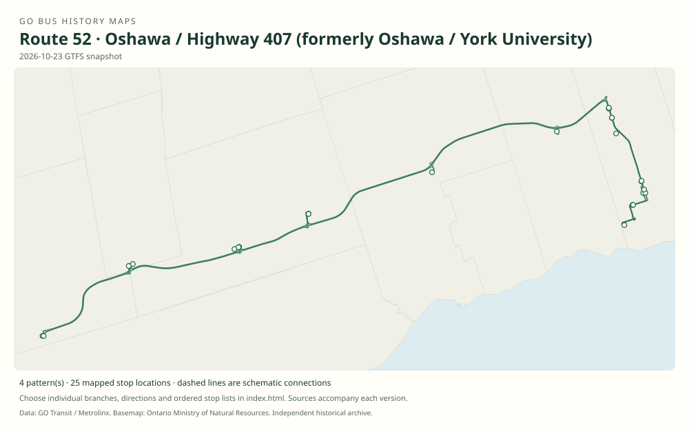

# GO route 52 — Oshawa / Highway 407 (formerly Oshawa / York University)

The Oshawa arm of Highway 407 East, with multiple campus expresses, a move from Langstaff to Richmond Hill Centre, terminal changes in Vaughan and Oshawa, and later use of Highway 407 across Durham. Twenty documentary corridor reconstructions cover the predecessor service and changing branches.

**Status:** current. **Documented patterns:** 40. **Research date:** 23 October 2026.

[Download history PDF](route-52-history.pdf) · [Interactive map](index.html) · [All ordered stops (CSV)](stops.csv) · [All mapped versions (GeoJSON)](maps.geojson) · [History data](history.json) · [Timetable archive links](archive-sources.json)

The PDF includes the sourced history, dated maps, numbered stop lists and navigation bookmarks. Older versions retain the timetable timing-point or major-stop limits described below.

Open `index.html` through the repository's local web server to use the map. SVG maps below display directly on GitHub.

## History

### 2004-09-07

Oshawa–York service begins, with nine weekday trips each way. The contemporary newspaper report and York University article establish the original corridor before public route numbering.

[Source 1](https://corporate.pickering.ca/PLHCWebLink/0/edoc/175252/NA2004_07_30.pdf) · [Source 2](https://www.yorku.ca/yfile/2004/07/23/york-hub-for-transit-solutions-to-urban-sprawl/)

### by 2008-11-01

Numbered 52 runs York–Langstaff–Unionville–Brock/407–Greenwood–Brooklin–Durham College/UOIT–Oshawa terminal. 52A is a Unionville–campus short route via the Durham roadside stops.

[Source 1](https://go-schedule-archive.s3.us-east-1.amazonaws.com/oshawa-oakville/2009-02-19-table-52-oshawa-oakville.pdf)

### by 2011-12-31

The original replaces Langstaff with Richmond Hill Centre and explicitly serves Keele at Great Gulf Dr. westbound / Snidercroft eastbound. Example: 06:05 Oshawa, 07:07 Richmond Hill Centre, 07:18 Keele, 07:25 York.

[Source 1](https://go-schedule-archive.s3.us-east-1.amazonaws.com/oshawa-oakville/2012-08-23-table-52-oshawa-oakville.pdf)

### by 2017-09-02

The Durham route uses the Lake Ridge/Highway 7 timing point instead of Greenwood. The timetable includes an express Unionville–campus 52A and a campus–Richmond Hill–Keele–York 52B.

[Source 1](https://web.archive.org/web/20171208211455id_/http://www.gotransit.com:80/timetables/en/PDF/Timetables/09171217/Table52.pdf)

### 2017-12-30

Highway 407 Bus Terminal opens.

[Source 1](https://assets.metrolinx.com/image/upload/v1663237688/Documents/Metrolinx/20180308_BoardMtg_CP_Quarterly_EN.pdf)

### 2019-01-05

GO leaves York campus. Route 52 terminates at Highway 407; the timetable includes Unionville express 52D and campus express 52B.

[Source 1](https://www.yorku.ca/yfile/2018/11/06/go-transit-announces-changes-to-go-bus-services-on-keele-campus/) · [Source 2](https://go-schedule-archive.s3.us-east-1.amazonaws.com/oshawa-oakville/2019-01-05-table-52-oshawa-oakville.pdf)

### 2020-09-05

The original timetable replaces the former Oshawa Bus Terminal terminus with downtown street stops and an extension to Oshawa GO.

[Source 1](https://transittoronto.ca/archives/flyers/go-407-east-51-54-20200905.pdf)

### 2021-02-13

Most weekday 52 trips join route 46 as new route 56; 52 remains a separate route, especially for weekend and special patterns.

[Source 1](https://www.metrolinx.com/en/discover/changes-coming-to-some-go-transit-bus-routes)

### by 2022-04-02

The 52A suffix now marks the stopping route with Baldwin/407 added; this differs from its earlier campus-express meaning.

[Source 1](https://go-schedule-archive.s3.us-east-1.amazonaws.com/oshawa-oakville/2022-04-02-table-56-oshawa-oakville.pdf)

### by 2022-06-25

Seasonal 52X runs to Canada’s Wonderland and Major Mackenzie/Hwy. 400 Park & Ride.

[Source 1](https://transittoronto.ca/archives/flyers/go-52-54-56-oshawa-oakville-20220625.pdf)

### 2022-10-01

Cornell Bus Terminal is added to routes 52 and 56.

[Source 1](https://transittoronto.ca/archives/weblog/2022/10/01-go_revises.shtml) · [Source 2](https://go-schedule-archive.s3.us-east-1.amazonaws.com/oshawa-oakville/2023-01-07-table-56-oshawa-oakville.pdf)

### 2023-04-08

52 and 56 move from the Highway 7/Winchester corridor to Highway 407 between the Brock and Simcoe areas, removing the Lake Ridge and Winchester/Anderson stops from the main route.

[Source 1](https://transittoronto.ca/archives/weblog/2023/04/08-go_revisin.shtml) · [Source 2](https://go-schedule-archive.s3.us-east-1.amazonaws.com/oshawa-oakville/2023-04-08-table-56-oshawa-oakville.pdf)

### 2023-05-06

Seasonal 52X uses Major Mackenzie West Terminal for Wonderland access.

[Source 1](https://www.metrolinx.com/en/discover/go-buses-to-popular-attractions-back-in-time-for-summer) · [Source 2](https://transittoronto.ca/archives/weblog/2023/04/08-go_revisin.shtml)

### by 2024-08-31

A campus express version skips Brock, Baldwin, downtown Oshawa and Oshawa GO, while serving Cornell, Unionville, Richmond Hill and Highway 407.

[Source 1](https://go-schedule-archive.s3.us-east-1.amazonaws.com/oshawa-oakville/2024-11-18-table-56-oshawa-oakville.pdf)

### by 2025-08-30

The researched 52A express pattern serves Highway 407, Richmond Hill, Unionville, Cornell, the campus, downtown Oshawa and Oshawa GO while bypassing Brock and Baldwin.

[Source 1](https://go-schedule-archive.s3.us-east-1.amazonaws.com/oshawa-oakville/2025-08-30-table-56-oshawa-oakville.pdf)

## Maps by documented version

Feed maps combine the patterns present in that dated file. The interactive viewer separates every branch and direction. A feed snapshot can include future or temporary service; its filename is not a route-change date.

| Date / evidence | Map | Patterns |
|---|---|---:|
| 2016-01-11 GTFS snapshot | [SVG map](maps/2016-01-11.svg) | 10 |
| 2022-03-08 GTFS snapshot | [SVG map](maps/2022-03-08.svg) | 2 |
| 2023-05-05 GTFS snapshot | [SVG map](maps/2023-05-05.svg) | 4 |
| 2026-10-23 GTFS snapshot | [SVG map](maps/2026-10-23.svg) | 4 |
| 30 Oct 2004 | [SVG map](maps/history-52-p2004.svg) | 1 |
| 1 Nov 2008 | [SVG map](maps/history-52-p2008.svg) | 1 |
| 1 Nov 2008 | [SVG map](maps/history-52-p2008a.svg) | 1 |
| 31 Dec 2011 | [SVG map](maps/history-52-p2011.svg) | 1 |
| 3 Jan 2015 | [SVG map](maps/history-52-p2015.svg) | 1 |
| 3 Jan 2015 | [SVG map](maps/history-52-p2015b.svg) | 1 |
| 2 Sep 2017 | [SVG map](maps/history-52-p2017.svg) | 1 |
| By Sep 2016; Sep 2017 snapshot | [SVG map](maps/history-52-p2016a.svg) | 1 |
| By Sep 2016; Sep 2017 snapshot | [SVG map](maps/history-52-p2016b.svg) | 1 |
| 5 Jan 2019 | [SVG map](maps/history-52-p2019.svg) | 1 |
| 5 Jan 2019 | [SVG map](maps/history-52-p2019b.svg) | 1 |
| 5 Jan 2019 | [SVG map](maps/history-52-p2019d.svg) | 1 |
| 5 Sep 2020 | [SVG map](maps/history-52-p2020.svg) | 1 |
| 2 Apr 2022 | [SVG map](maps/history-52-p2022a.svg) | 1 |
| 25 Jun 2022 | [SVG map](maps/history-52-p2022x.svg) | 1 |
| 7 Jan 2023 | [SVG map](maps/history-52-p2023jan.svg) | 1 |
| 8 Apr 2023; still in 2026 | [SVG map](maps/history-52-p2023.svg) | 1 |
| May 2023 onward, seasonal | [SVG map](maps/history-52-p2023x.svg) | 1 |
| 31 Aug 2024 | [SVG map](maps/history-52-p2024a.svg) | 1 |
| 30 Aug 2025; still in 2026 | [SVG map](maps/history-52-p2025a.svg) | 1 |

## Historical major-stop sequences

These are timetable timing points / major stops, not necessarily every roadside stop. Full GTFS sequences are in `stops.csv` and the snapshot files.

### 30 Oct 2004 — Pre-52: The original Oshawa corridor

York University campus → Yonge St / Langstaff Rd → Langstaff GO - south-lot service → Unionville GO → Brock Rd / Hwy 407 → Greenwood - Hwy 7 / Westney → Winchester / Anderson-Watford → Durham College / UOIT / Ontario Tech campus → Oshawa Bus Terminal - Bond / Centre

Service began 7 September 2004. The October timetable also listed Yonge / Langstaff Road. This preceded the public route-number column; it was the Oshawa service in Table 52. Corridor reconstructed from source roads; local approaches generalized. Main timing points only.

[Original source 1](https://go-schedule-archive.s3.us-east-1.amazonaws.com/oshawa-oakville/2004-10-30-table-52-oshawa-oakville-dir0-day1-page1.html)

### 1 Nov 2008 — 52: Langstaff south-lot era

York University campus → Langstaff GO - south-lot service → Unionville GO → Brock Rd / Hwy 407 → Greenwood - Hwy 7 / Westney → Winchester / Anderson-Watford → Durham College / UOIT / Ontario Tech campus → Oshawa Bus Terminal - Bond / Centre

Numbered route 52 is explicit in this timetable. Highway 407 across York Region; Highway 7 and Winchester Road through northern Durham; Simcoe Street to the campus and downtown terminal. Corridor reconstructed from source roads; local approaches generalized. Main timing points only.

[Original source 1](https://go-schedule-archive.s3.us-east-1.amazonaws.com/oshawa-oakville/2009-02-19-table-52-oshawa-oakville.pdf)

### 1 Nov 2008 — 52A: Unionville to campus: local short turn

Unionville GO → Brock Rd / Hwy 407 → Greenwood - Hwy 7 / Westney → Winchester / Anderson-Watford → Durham College / UOIT / Ontario Tech campus

One seasonal weekday morning eastbound trip in the recovered 2008 timetable. This local 52A pattern is also documented in 2015. It did not reach York University or downtown Oshawa. Corridor reconstructed from source roads; local approaches generalized. Main timing points only.

[Original source 1](https://go-schedule-archive.s3.us-east-1.amazonaws.com/oshawa-oakville/2009-02-19-table-52-oshawa-oakville.pdf)

### 31 Dec 2011 — 52: Richmond Hill Centre replaces Langstaff

York University campus → Keele / Great Gulf-Snidercroft → Richmond Hill Centre → Unionville GO → Brock Rd / Hwy 407 → Greenwood - Hwy 7 / Westney → Winchester / Anderson-Watford → Durham College / UOIT / Ontario Tech campus → Oshawa Bus Terminal - Bond / Centre

The recovered timetable now uses Richmond Hill Centre. The local Highway 7 / Winchester corridor and downtown Oshawa terminus remain. The move is documented by this date. Corridor reconstructed from source roads; local approaches generalized. Main timing points only. Correction: the December31,2011 timetable includes Keele / Great Gulf before York University.

[Original source 1](https://go-schedule-archive.s3.us-east-1.amazonaws.com/oshawa-oakville/2012-08-23-table-52-oshawa-oakville.pdf)

### 3 Jan 2015 — 52: Richmond Hill, with the Keele timing point

York University campus → Keele / Great Gulf-Snidercroft → Richmond Hill Centre → Unionville GO → Brock Rd / Hwy 407 → Greenwood - Hwy 7 / Westney → Winchester / Anderson-Watford → Durham College / UOIT / Ontario Tech campus → Oshawa Bus Terminal - Bond / Centre

This snapshot includes the Keele Street timing point while retaining Greenwood as a printed major stop. Brougham is the older Highway 407 / Brock stop, before the new park-and-ride opened in February 2016. Corridor reconstructed from source roads; local approaches generalized. Main timing points only.

[Original source 1](https://web.archive.org/web/20150319070213id_/http://www.gotransit.com:80/timetables/en/PDF/Timetables/01150415/Table52.pdf)

### 3 Jan 2015 — 52B: York to campus, skipping Unionville

York University campus → Keele / Great Gulf-Snidercroft → Richmond Hill Centre → Brock Rd / Hwy 407 → Greenwood - Hwy 7 / Westney → Winchester / Anderson-Watford → Durham College / UOIT / Ontario Tech campus

The early 52B skipped Unionville GO but retained the Durham timing points at Brock Road, Greenwood and Brooklin. It terminated at the north campus rather than downtown Oshawa. Corridor reconstructed from source roads; local approaches generalized. Main timing points only.

[Original source 1](https://web.archive.org/web/20150319070213id_/http://www.gotransit.com:80/timetables/en/PDF/Timetables/01150415/Table52.pdf)

### 2 Sep 2017 — 52: The familiar York University route

York University campus → Keele / Great Gulf-Snidercroft → Richmond Hill Centre → Unionville GO → Brock Rd / Hwy 407 → Hwy 7 / Winchester at Lake Ridge → Winchester / Anderson-Watford → Durham College / UOIT / Ontario Tech campus → Oshawa Bus Terminal - Bond / Centre

The main route still used Highway 7 / Winchester east of Brock Road. Lake Ridge replaced Greenwood as a printed major timing point; that alone does not prove the Greenwood local stop closed. Corridor reconstructed from source roads; local approaches generalized. Main timing points only.

[Original source 1](https://web.archive.org/web/20171208211455id_/http://www.gotransit.com:80/timetables/en/PDF/Timetables/09171217/Table52.pdf)

### By Sep 2016; Sep 2017 snapshot — 52A: Unionville to campus: express

Unionville GO → Durham College / UOIT / Ontario Tech campus

Now an express with no intervening timing-point stops. September 2017 shows one weekday eastbound trip, 07:10 to 07:45; the same stop pattern remains in 2019. The 2017 map places this branch on the old road corridor. Corridor reconstructed from source roads; local approaches generalized. Main timing points only.

[Original source 1](https://web.archive.org/web/20160916213825id_/http://www.gotransit.com/timetables/en/PDF/Timetables/09161216/Table52.pdf)

### By Sep 2016; Sep 2017 snapshot — 52B: Campus to York: express via Richmond Hill

Durham College / UOIT / Ontario Tech campus → Richmond Hill Centre → Keele / Great Gulf-Snidercroft → York University campus

The Durham intermediate stops and Unionville are skipped. The illustrated September 2017 westbound trip leaves campus at 17:05, reaches Richmond Hill Centre at 17:52 and York University at 18:10. Corridor reconstructed from source roads; local approaches generalized. Main timing points only.

[Original source 1](https://web.archive.org/web/20160916213825id_/http://www.gotransit.com/timetables/en/PDF/Timetables/09161216/Table52.pdf)

### 5 Jan 2019 — 52: Highway 407 Bus Terminal replaces York

Highway 407 Bus Terminal → Richmond Hill Centre → Unionville GO → Brock Rd / Hwy 407 → Hwy 7 / Winchester at Lake Ridge → Winchester / Anderson-Watford → Durham College / UOIT / Ontario Tech campus → Oshawa Bus Terminal - Bond / Centre

The western terminus moves to Highway 407 Bus Terminal. East of Brock Road, the route continues on Highway 7 and Winchester Road to Simcoe Street, the north campus and downtown Oshawa. Corridor reconstructed from source roads; local approaches generalized. Main timing points only.

[Original source 1](https://transittoronto.ca/archives/flyers/go-51-52-54-407east-20190105.pdf)

### 5 Jan 2019 — 52B: Campus express to Highway 407 Terminal

Durham College / UOIT / Ontario Tech campus → Richmond Hill Centre → Highway 407 Bus Terminal

The former York-bound 52B now finishes at Highway 407 Bus Terminal. A 2019 example runs 17:10 from campus, 17:47 at Richmond Hill Centre and 18:00 at the terminal. Dashed links show the verified stops; exact express street alignment is unresolved. Corridor reconstructed from source roads; local approaches generalized. Main timing points only.

[Original source 1](https://transittoronto.ca/archives/flyers/go-51-52-54-407east-20190105.pdf)

### 5 Jan 2019 — 52D: Unionville express, bypassing Richmond Hill

Highway 407 Bus Terminal → Unionville GO

A short express between Highway 407 Bus Terminal and Unionville GO. Richmond Hill Centre is bypassed. The recovered 2019 schedules show several college-period weekday trips. Corridor reconstructed from source roads; local approaches generalized. Main timing points only.

[Original source 1](https://transittoronto.ca/archives/flyers/go-51-52-54-407east-20190105.pdf)

### 5 Sep 2020 — 52: Extended to Oshawa GO rail station

Highway 407 Bus Terminal → Richmond Hill Centre → Unionville GO → Brock Rd / Hwy 407 → Hwy 7 / Winchester at Lake Ridge → Winchester / Anderson-Watford → Durham College / UOIT / Ontario Tech campus → Downtown Oshawa - Athol Street → Oshawa GO rail station

The downtown bus-terminal stop is replaced by street stops at Athol Street. Buses continue to Oshawa GO. From February 2021, route 56 takes over most weekday through service; 52 remains the weekend counterpart. Corridor reconstructed from source roads; local approaches generalized. Main timing points only.

[Original source 1](https://transittoronto.ca/archives/flyers/go-407-east-51-54-20200905.pdf)

### 2 Apr 2022 — 52A: The reused 52A: via Baldwin Park & Ride

Highway 407 Bus Terminal → Richmond Hill Centre → Unionville GO → Brock Rd / Hwy 407 → Hwy 7 / Winchester at Lake Ridge → Baldwin St / Hwy 407 → Winchester / Anderson-Watford → Durham College / UOIT / Ontario Tech campus → Downtown Oshawa - Athol Street → Oshawa GO rail station

A different use of 52A: the full weekend route, with a detour to Baldwin Street / Highway 407 Park & Ride while retaining both Winchester timing points. This is not the later express 52A. Corridor reconstructed from source roads; local approaches generalized. Main timing points only.

[Original source 1](https://go-schedule-archive.s3.us-east-1.amazonaws.com/oshawa-oakville/2022-04-02-table-56-oshawa-oakville.pdf)

### 25 Jun 2022 — 52X: Wonderland and Highway 400 extension

Major Mackenzie / Hwy 400 Park & Ride → Canada's Wonderland - approximate area → Highway 407 Bus Terminal → Richmond Hill Centre → Unionville GO → Brock Rd / Hwy 407 → Hwy 7 / Winchester at Lake Ridge → Baldwin St / Hwy 407 → Winchester / Anderson-Watford → Durham College / UOIT / Ontario Tech campus → Downtown Oshawa - Athol Street → Oshawa GO rail station

Summer weekend service extends the Baldwin / Winchester pattern past Highway 407 Terminal to Canada's Wonderland and Major Mackenzie Drive / Highway 400 Park & Ride. Corridor reconstructed from source roads; local approaches generalized. Main timing points only.

[Original source 1](https://transittoronto.ca/archives/flyers/go-52-54-56-oshawa-oakville-20220625.pdf)

### 7 Jan 2023 — 52: Cornell added, Winchester still served

Highway 407 Bus Terminal → Richmond Hill Centre → Unionville GO → Cornell Bus Terminal → Brock Rd / Hwy 407 → Hwy 7 / Winchester at Lake Ridge → Baldwin St / Hwy 407 → Winchester / Anderson-Watford → Durham College / UOIT / Ontario Tech campus → Downtown Oshawa - Athol Street → Oshawa GO rail station

Cornell Bus Terminal joined the corridor in October 2022. This January snapshot is an intermediate pattern: Cornell is present, while the Lake Ridge and Anderson / Watford timing points still remain. Corridor reconstructed from source roads; local approaches generalized. Main timing points only.

[Original source 1](https://go-schedule-archive.s3.us-east-1.amazonaws.com/oshawa-oakville/2023-01-07-table-56-oshawa-oakville.pdf)

### 8 Apr 2023; still in 2026 — 52: The later Highway 407 / Simcoe route

Highway 407 Bus Terminal → Richmond Hill Centre → Unionville GO → Cornell Bus Terminal → Brock Rd / Hwy 407 → Baldwin St / Hwy 407 → Durham College / UOIT / Ontario Tech campus → Downtown Oshawa - Athol Street → Oshawa GO rail station

The bus uses Highway 407 farther east to Simcoe Street. Cornell, Brock and Baldwin are served; the former Winchester timing points are no longer on this pattern. Shown in the September 2026 timetable too. Corridor reconstructed from source roads; local approaches generalized. Main timing points only.

[Original source 1](https://go-schedule-archive.s3.us-east-1.amazonaws.com/oshawa-oakville/2023-04-08-table-56-oshawa-oakville.pdf)

### May 2023 onward, seasonal — 52X: Wonderland via Major Mackenzie West

Major Mackenzie West Terminal → Highway 407 Bus Terminal → Richmond Hill Centre → Unionville GO → Cornell Bus Terminal → Brock Rd / Hwy 407 → Baldwin St / Hwy 407 → Durham College / UOIT / Ontario Tech campus → Downtown Oshawa - Athol Street → Oshawa GO rail station

The later seasonal extension serves Major Mackenzie West Terminal beside Canada's Wonderland. It replaces the 2022 combination of the Wonderland stop and Highway 400 Park & Ride. Corridor reconstructed from source roads; local approaches generalized. Main timing points only.

[Original source 1](https://www.metrolinx.com/en/discover/go-buses-to-popular-attractions-back-in-time-for-summer)

### 31 Aug 2024 — 52A: The reused 52A: campus express westbound

Durham College / UOIT / Ontario Tech campus → Cornell Bus Terminal → Unionville GO → Richmond Hill Centre → Highway 407 Bus Terminal

Weekday morning express from the north campus, via Cornell, Unionville and Richmond Hill Centre. Brock and Baldwin Park & Ride are skipped. The recovered snapshot shows two morning trips. Corridor reconstructed from source roads; local approaches generalized. Main timing points only.

[Original source 1](https://go-schedule-archive.s3.us-east-1.amazonaws.com/oshawa-oakville/2024-11-18-table-56-oshawa-oakville.pdf)

### 30 Aug 2025; still in 2026 — 52A: Express extended to Oshawa GO

Highway 407 Bus Terminal → Richmond Hill Centre → Unionville GO → Cornell Bus Terminal → Durham College / UOIT / Ontario Tech campus → Downtown Oshawa - Athol Street → Oshawa GO rail station

The modern express is extended through downtown Oshawa to the GO rail station, with eastbound service added. It continues to skip Brock and Baldwin. This pattern is present in September 2026. Corridor reconstructed from source roads; local approaches generalized. Main timing points only.

[Original source 1](https://go-schedule-archive.s3.us-east-1.amazonaws.com/oshawa-oakville/2025-08-30-table-56-oshawa-oakville.pdf)

## Coverage and unresolved questions

- Suffixes were reused; a 52A in 2008, 2017, 2022 or 2025 does not imply the same route.
- The exact first dates of several branch changes are bounded only by surviving original snapshots.
- GTFS dates identify captured feeds, not necessarily the first or last day of a route. Open a pattern to see its exact scheduled service dates. Temporary rail replacement and special-service patterns are included when present in the source.
- Manually reconstructed versions generally contain published timetable timing points / major stops. They must not be read as complete roadside stop inventories.

## Sources

- [GO Highway 407 East timetable, internally dated November 1, 2008 (archived February 19, 2009)](https://go-schedule-archive.s3.us-east-1.amazonaws.com/oshawa-oakville/2009-02-19-table-52-oshawa-oakville.pdf) — original-timetable
- [GO routes 51, 52 and 54 timetable, effective December 31, 2011 (archived August 23, 2012)](https://go-schedule-archive.s3.us-east-1.amazonaws.com/oshawa-oakville/2012-08-23-table-52-oshawa-oakville.pdf) — original-timetable
- [GO routes 51, 52 and 54 timetable, effective September 2, 2017](https://web.archive.org/web/20171208211455id_/http://www.gotransit.com:80/timetables/en/PDF/Timetables/09171217/Table52.pdf) — original-timetable
- [Metrolinx Capital Projects quarterly report, March 8, 2018: Highway 407 Bus Terminal opening](https://assets.metrolinx.com/image/upload/v1663237688/Documents/Metrolinx/20180308_BoardMtg_CP_Quarterly_EN.pdf) — official
- [York University: GO Transit announces changes to GO bus services on Keele campus, November 6, 2018](https://www.yorku.ca/yfile/2018/11/06/go-transit-announces-changes-to-go-bus-services-on-keele-campus/) — official
- [GO routes 51, 52 and 54 timetable, effective January 5, 2019](https://go-schedule-archive.s3.us-east-1.amazonaws.com/oshawa-oakville/2019-01-05-table-52-oshawa-oakville.pdf) — original-timetable
- [Metrolinx: Changes coming to some GO Transit bus routes, February 2021](https://www.metrolinx.com/en/discover/changes-coming-to-some-go-transit-bus-routes) — official
- [GO routes 52, 54 and 56 timetable, effective April 2, 2022](https://go-schedule-archive.s3.us-east-1.amazonaws.com/oshawa-oakville/2022-04-02-table-56-oshawa-oakville.pdf) — original-timetable
- [Transit Toronto, October 1, 2022: GO revises services and adds Cornell stops](https://transittoronto.ca/archives/weblog/2022/10/01-go_revises.shtml) — secondary
- [GO routes 52, 54 and 56 timetable, effective January 7, 2023](https://go-schedule-archive.s3.us-east-1.amazonaws.com/oshawa-oakville/2023-01-07-table-56-oshawa-oakville.pdf) — original-timetable
- [GO routes 52, 54 and 56 timetable, effective April 8, 2023](https://go-schedule-archive.s3.us-east-1.amazonaws.com/oshawa-oakville/2023-04-08-table-56-oshawa-oakville.pdf) — original-timetable
- [Transit Toronto, April 8, 2023: GO revising routes and services](https://transittoronto.ca/archives/weblog/2023/04/08-go_revisin.shtml) — secondary
- [Metrolinx, May 17, 2023: GO buses to popular attractions back in time for summer](https://www.metrolinx.com/en/discover/go-buses-to-popular-attractions-back-in-time-for-summer) — official
- [News Advertiser, July 30, 2004: Oshawa–York University GO bus announcement](https://corporate.pickering.ca/PLHCWebLink/0/edoc/175252/NA2004_07_30.pdf) — contemporary-newspaper
- [York University YFile, July 23, 2004: York hub for transit solutions to urban sprawl](https://www.yorku.ca/yfile/2004/07/23/york-hub-for-transit-solutions-to-urban-sprawl/) — official
- [go-407-east-51-54-20200905.pdf](https://transittoronto.ca/archives/flyers/go-407-east-51-54-20200905.pdf) — original-timetable
- [go-52-54-56-oshawa-oakville-20220625.pdf](https://transittoronto.ca/archives/flyers/go-52-54-56-oshawa-oakville-20220625.pdf) — original-timetable
- [2024-11-18-table-56-oshawa-oakville.pdf](https://go-schedule-archive.s3.us-east-1.amazonaws.com/oshawa-oakville/2024-11-18-table-56-oshawa-oakville.pdf) — original-timetable
- [2025-08-30-table-56-oshawa-oakville.pdf](https://go-schedule-archive.s3.us-east-1.amazonaws.com/oshawa-oakville/2025-08-30-table-56-oshawa-oakville.pdf) — original-timetable
- [GO Transit original GTFS snapshot 2016-01-11](https://openmobilitydata-data.s3.us-west-1.amazonaws.com/public/feeds/go-transit/32/20160111/gtfs.zip) — original-gtfs
- [GO Transit original GTFS snapshot 2022-03-08](https://web.archive.org/web/20220308054107id_/https://www.gotransit.com/static_files/gotransit/assets/Files/GO_GTFS.zip) — original-gtfs
- [GO Transit original GTFS snapshot 2023-05-05](https://openmobilitydata-data.s3.us-west-1.amazonaws.com/public/feeds/go-transit/32/20230505/gtfs.zip) — original-gtfs
- [GO Transit original GTFS snapshot 2026-10-23](https://assets.metrolinx.com/raw/upload/Documents/Metrolinx/Open%20Data/GO-GTFS.zip) — original-gtfs
- [https://go-schedule-archive.s3.us-east-1.amazonaws.com/oshawa-oakville/2004-10-30-table-52-oshawa-oakville-dir0-day1-page1.html](https://go-schedule-archive.s3.us-east-1.amazonaws.com/oshawa-oakville/2004-10-30-table-52-oshawa-oakville-dir0-day1-page1.html) — source
- [https://web.archive.org/web/20150319070213id_/http://www.gotransit.com:80/timetables/en/PDF/Timetables/01150415/Table52.pdf](https://web.archive.org/web/20150319070213id_/http://www.gotransit.com:80/timetables/en/PDF/Timetables/01150415/Table52.pdf) — source
- [https://web.archive.org/web/20160916213825id_/http://www.gotransit.com/timetables/en/PDF/Timetables/09161216/Table52.pdf](https://web.archive.org/web/20160916213825id_/http://www.gotransit.com/timetables/en/PDF/Timetables/09161216/Table52.pdf) — source
- [https://transittoronto.ca/archives/flyers/go-51-52-54-407east-20190105.pdf](https://transittoronto.ca/archives/flyers/go-51-52-54-407east-20190105.pdf) — source

## Data attribution

Data used in this product or service is provided with the permission of Metrolinx. Metrolinx makes no representations or warranties of any kind, express or implied, with respect to the Data and assumes no responsibility for the accuracy or currency of the data used in this product or service.

Basemap: Ontario Ministry of Natural Resources, Open Government Licence – Ontario. See [methodology](../../docs/METHODOLOGY.md) for geometry and date limitations.
