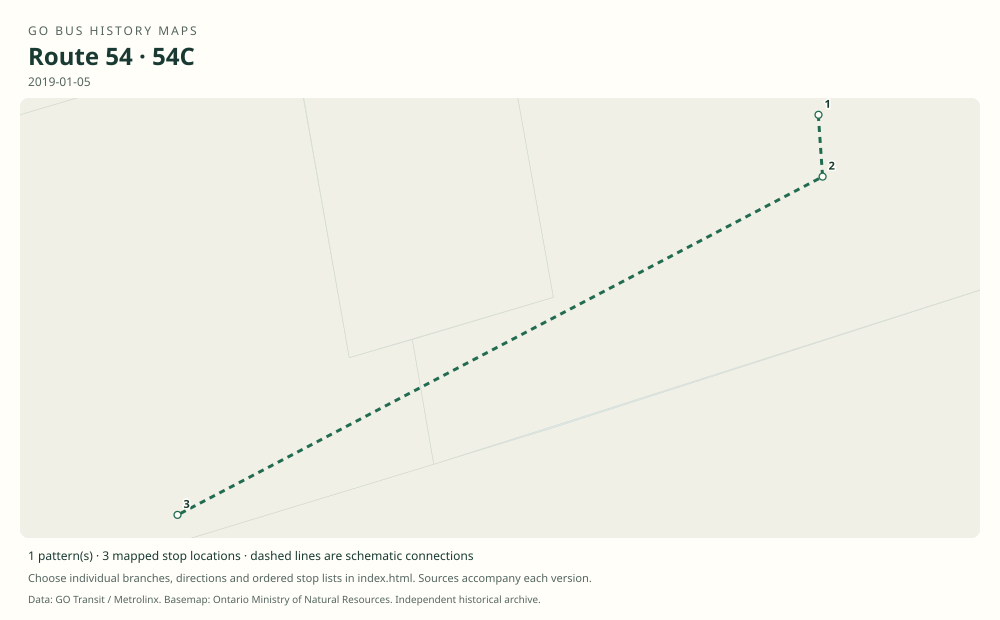

# GO route 54 — Mount Joy / York University; later Mount Joy / Highway 407

The Markham arm of the Highway 407 network connected Mount Joy, Markham, Centennial and Unionville with Langstaff or Richmond Hill Centre and York University. Expresses served different portions of the Markham corridor. It later terminated at Highway 407 and ended in January 2026.

**Status:** discontinued. **Documented patterns:** 24. **Research date:** 23 October 2026.

[Download history PDF](route-54-history.pdf) · [Interactive map](index.html) · [All ordered stops (CSV)](stops.csv) · [All mapped versions (GeoJSON)](maps.geojson) · [History data](history.json) · [Timetable archive links](archive-sources.json)

The PDF includes the sourced history, dated maps, numbered stop lists and navigation bookmarks. Older versions retain the timetable timing-point or major-stop limits described below.

Open `index.html` through the repository's local web server to use the map. SVG maps below display directly on GitHub.

## History

### 2000-09

The original Highway 407 launch reaches Unionville through York University, a predecessor corridor of 54.

[Source 1](https://www.yorku.ca/yul/profiles/past/aug00/current/cover/cover2.htm)

### by 2008-11-01

The timetable explicitly identifies 54 Mount Joy–Markham–Centennial–Unionville–Langstaff–York; 54A starts at Unionville and 54B at Centennial, both bypassing Langstaff.

[Source 1](https://go-schedule-archive.s3.us-east-1.amazonaws.com/oshawa-oakville/2009-02-19-table-52-oshawa-oakville.pdf)

### by 2011-12-31

Richmond Hill Centre replaces Langstaff and the Keele stop is added. 54C connects Mount Joy and Markham directly with Keele and York, bypassing Centennial, Unionville and Richmond Hill Centre.

[Source 1](https://go-schedule-archive.s3.us-east-1.amazonaws.com/oshawa-oakville/2012-08-23-table-52-oshawa-oakville.pdf)

### 2019-01-05

GO’s York University service ends. The main 54 and its express variants terminate at Highway 407 Bus Terminal.

[Source 1](https://www.yorku.ca/yfile/2018/11/06/go-transit-announces-changes-to-go-bus-services-on-keele-campus/) · [Source 2](https://go-schedule-archive.s3.us-east-1.amazonaws.com/oshawa-oakville/2019-01-05-table-52-oshawa-oakville.pdf)

### 2026-01-03

Route 54 is discontinued as part of the January service changes, with replacement services described in Metrolinx’s announcement and the revised route 40 timetable.

[Source 1](https://www.metrolinx.com/en/news/holiday-go-transit-service-adjustments) · [Source 2](https://go-schedule-archive.s3.us-east-1.amazonaws.com/hamilton-richmond-hill-pearson-express/2026-01-03-table-40-hamilton-richmond-hill-pearson-express.pdf)

## Maps by documented version

Feed maps combine the patterns present in that dated file. The interactive viewer separates every branch and direction. A feed snapshot can include future or temporary service; its filename is not a route-change date.

| Date / evidence | Map | Patterns |
|---|---|---:|
| 2016-01-11 GTFS snapshot | [SVG map](maps/2016-01-11.svg) | 11 |
| 2022-03-08 GTFS snapshot | [SVG map](maps/2022-03-08.svg) | 4 |
| 2023-05-05 GTFS snapshot | [SVG map](maps/2023-05-05.svg) | 2 |
| 2008-11-01 | [SVG map](maps/history-54-2008.svg) | 1 |
| 2008-11-01 | [SVG map](maps/history-54A-2008.svg) | 1 |
| 2008-11-01 | [SVG map](maps/history-54B-2008.svg) | 1 |
| 2011-12-31 | [SVG map](maps/history-54-2011.svg) | 1 |
| 2011-12-31 | [SVG map](maps/history-54C-2011.svg) | 1 |
| 2019-01-05 | [SVG map](maps/history-54-2019.svg) | 1 |
| 2019-01-05 | [SVG map](maps/history-54C-2019.svg) | 1 |

## Historical major-stop sequences

These are timetable timing points / major stops, not necessarily every roadside stop. Full GTFS sequences are in `stops.csv` and the snapshot files.

### 2008-11-01 — 54: York–Mount Joy via Langstaff

York University Bus Loop → Langstaff GO — Langstaff Rd. south lot → Unionville GO → Centennial GO — Bullock Dr. @ McCowan Rd. → Markham GO — Main St. N. @ Ramona Blvd. / Station St. → Mount Joy GO

Schematic straight connections between established stop areas, not a street-by-street reconstruction.  These are the timetable’s ordered major timing points; intermediate roadside stops are not asserted.

[Original source 1](https://go-schedule-archive.s3.us-east-1.amazonaws.com/oshawa-oakville/2009-02-19-table-52-oshawa-oakville.pdf)

### 2008-11-01 — 54A: Unionville–York express

Unionville GO → York University Bus Loop

Schematic straight connections between established stop areas, not a street-by-street reconstruction.  These are the timetable’s ordered major timing points; intermediate roadside stops are not asserted.

[Original source 1](https://go-schedule-archive.s3.us-east-1.amazonaws.com/oshawa-oakville/2009-02-19-table-52-oshawa-oakville.pdf)

### 2008-11-01 — 54B: Centennial–Unionville–York express

Centennial GO — Bullock Dr. @ McCowan Rd. → Unionville GO → York University Bus Loop

Schematic straight connections between established stop areas, not a street-by-street reconstruction.  These are the timetable’s ordered major timing points; intermediate roadside stops are not asserted.

[Original source 1](https://go-schedule-archive.s3.us-east-1.amazonaws.com/oshawa-oakville/2009-02-19-table-52-oshawa-oakville.pdf)

### 2011-12-31 — 54: York–Mount Joy via Richmond Hill Centre

York University Bus Loop → Keele St. @ Great Gulf Dr. / Snidercroft Rd. → Richmond Hill Centre → Unionville GO → Centennial GO — Bullock Dr. @ McCowan Rd. → Markham GO — Main St. N. @ Ramona Blvd. / Station St. → Mount Joy GO

Schematic straight connections between established stop areas, not a street-by-street reconstruction.  These are the timetable’s ordered major timing points; intermediate roadside stops are not asserted.

[Original source 1](https://go-schedule-archive.s3.us-east-1.amazonaws.com/oshawa-oakville/2012-08-23-table-52-oshawa-oakville.pdf)

### 2011-12-31 — 54C: Mount Joy–Markham–York express

Mount Joy GO → Markham GO — Main St. N. @ Ramona Blvd. / Station St. → Keele St. @ Great Gulf Dr. / Snidercroft Rd. → York University Bus Loop

Schematic straight connections between established stop areas, not a street-by-street reconstruction.  These are the timetable’s ordered major timing points; intermediate roadside stops are not asserted.

[Original source 1](https://go-schedule-archive.s3.us-east-1.amazonaws.com/oshawa-oakville/2012-08-23-table-52-oshawa-oakville.pdf)

### 2019-01-05 — 54: Highway 407–Mount Joy main route

Highway 407 Bus Terminal → Richmond Hill Centre → Unionville GO → Centennial GO — Bullock Dr. @ McCowan Rd. → Markham GO — Main St. N. @ Ramona Blvd. / Station St. → Mount Joy GO

Schematic straight connections between established stop areas, not a street-by-street reconstruction.  These are the timetable’s ordered major timing points; intermediate roadside stops are not asserted.

[Original source 1](https://go-schedule-archive.s3.us-east-1.amazonaws.com/oshawa-oakville/2019-01-05-table-52-oshawa-oakville.pdf)

### 2019-01-05 — 54C: Mount Joy–Markham–Highway 407 express

Mount Joy GO → Markham GO — Main St. N. @ Ramona Blvd. / Station St. → Highway 407 Bus Terminal

Schematic straight connections between established stop areas, not a street-by-street reconstruction.  These are the timetable’s ordered major timing points; intermediate roadside stops are not asserted.

[Original source 1](https://go-schedule-archive.s3.us-east-1.amazonaws.com/oshawa-oakville/2019-01-05-table-52-oshawa-oakville.pdf)

## Coverage and unresolved questions

- The exact extension dates from Unionville into Markham and Mount Joy have not been established.
- 54A/B/C introduction and withdrawal dates are represented by original timetable snapshots; later full-stop patterns come from dated GTFS.
- GTFS dates identify captured feeds, not necessarily the first or last day of a route. Open a pattern to see its exact scheduled service dates. Temporary rail replacement and special-service patterns are included when present in the source.
- Manually reconstructed versions generally contain published timetable timing points / major stops. They must not be read as complete roadside stop inventories.

## Sources

- [York University, August 2000: new Highway 407 GO service](https://www.yorku.ca/yul/profiles/past/aug00/current/cover/cover2.htm) — official
- [GO Highway 407 East timetable, internally dated November 1, 2008 (archived February 19, 2009)](https://go-schedule-archive.s3.us-east-1.amazonaws.com/oshawa-oakville/2009-02-19-table-52-oshawa-oakville.pdf) — original-timetable
- [GO routes 51, 52 and 54 timetable, effective December 31, 2011 (archived August 23, 2012)](https://go-schedule-archive.s3.us-east-1.amazonaws.com/oshawa-oakville/2012-08-23-table-52-oshawa-oakville.pdf) — original-timetable
- [York University: GO Transit announces changes to GO bus services on Keele campus, November 6, 2018](https://www.yorku.ca/yfile/2018/11/06/go-transit-announces-changes-to-go-bus-services-on-keele-campus/) — official
- [GO routes 51, 52 and 54 timetable, effective January 5, 2019](https://go-schedule-archive.s3.us-east-1.amazonaws.com/oshawa-oakville/2019-01-05-table-52-oshawa-oakville.pdf) — original-timetable
- [Metrolinx: Holiday GO Transit service adjustments; January 3, 2026 changes](https://www.metrolinx.com/en/news/holiday-go-transit-service-adjustments) — official
- [GO route 40 timetable, effective January 3, 2026](https://go-schedule-archive.s3.us-east-1.amazonaws.com/hamilton-richmond-hill-pearson-express/2026-01-03-table-40-hamilton-richmond-hill-pearson-express.pdf) — original-timetable
- [Original GO Transit GTFS snapshot archived January 11, 2016](https://openmobilitydata-data.s3.us-west-1.amazonaws.com/public/feeds/go-transit/32/20160111/gtfs.zip) — official
- [Original GO Transit GTFS snapshot archived May 5, 2023](https://openmobilitydata-data.s3.us-west-1.amazonaws.com/public/feeds/go-transit/32/20230505/gtfs.zip) — official
- [GO Transit original GTFS snapshot 2022-03-08](https://web.archive.org/web/20220308054107id_/https://www.gotransit.com/static_files/gotransit/assets/Files/GO_GTFS.zip) — original-gtfs

## Data attribution

Data used in this product or service is provided with the permission of Metrolinx. Metrolinx makes no representations or warranties of any kind, express or implied, with respect to the Data and assumes no responsibility for the accuracy or currency of the data used in this product or service.

Basemap: Ontario Ministry of Natural Resources, Open Government Licence – Ontario. See [methodology](../../docs/METHODOLOGY.md) for geometry and date limitations.
