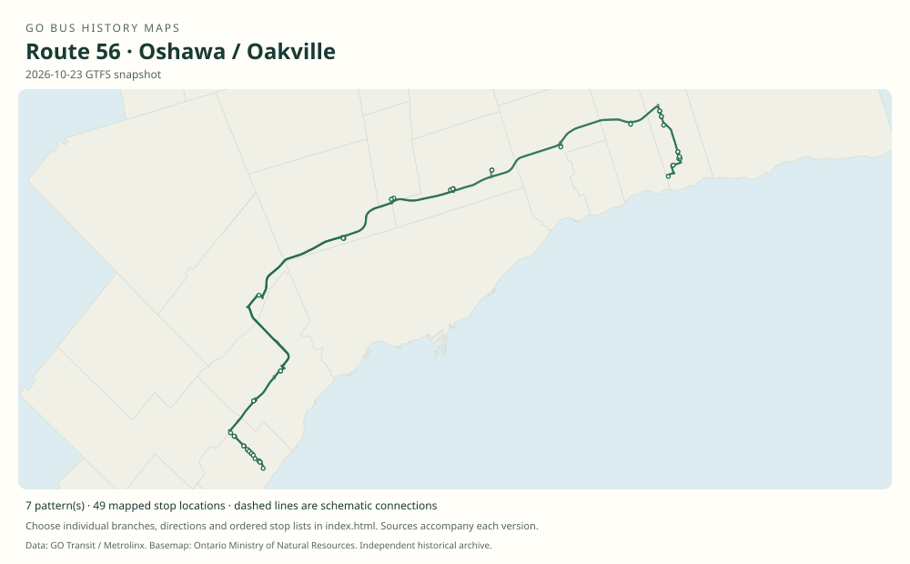

# GO route 56 — Oshawa / Oakville

A long through route created in 2021 by joining the Oakville and Oshawa arms of the Highway 407 network. It inherited both the western college/park-and-ride stops and the eastern campus/downtown corridor.

**Status:** current. **Documented patterns:** 15. **Research date:** 23 October 2026.

[Download history PDF](route-56-history.pdf) · [Interactive map](index.html) · [All ordered stops (CSV)](stops.csv) · [All mapped versions (GeoJSON)](maps.geojson) · [History data](history.json) · [Timetable archive links](archive-sources.json)

The PDF includes the sourced history, dated maps, numbered stop lists and navigation bookmarks. Older versions retain the timetable timing-point or major-stop limits described below.

Open `index.html` through the repository's local web server to use the map. SVG maps below display directly on GitHub.

## History

### 2021-02-13

Metrolinx creates route 56 by combining most weekday trips on routes 46 and 52, with 38 weekday through trips announced.

[Source 1](https://www.metrolinx.com/en/discover/changes-coming-to-some-go-transit-bus-routes)

### by 2022-04-02

The original labels the principal route 56A and includes the Baldwin/407 detour together with Lake Ridge and Winchester/Anderson. It links Oakville GO and Oshawa GO through Sheridan, Square One, Bramalea, Highway 407 and Richmond Hill Centre.

[Source 1](https://go-schedule-archive.s3.us-east-1.amazonaws.com/oshawa-oakville/2022-04-02-table-56-oshawa-oakville.pdf)

### 2022-10-01

Cornell Bus Terminal is added. The January 2023 original confirms it.

[Source 1](https://transittoronto.ca/archives/weblog/2022/10/01-go_revises.shtml) · [Source 2](https://go-schedule-archive.s3.us-east-1.amazonaws.com/oshawa-oakville/2023-01-07-table-56-oshawa-oakville.pdf)

### 2023-04-08

The Durham part moves onto Highway 407, replacing the Lake Ridge/Winchester street section while retaining Brock/407, Baldwin/407, Ontario Tech/Durham College and Oshawa stops.

[Source 1](https://transittoronto.ca/archives/weblog/2023/04/08-go_revisin.shtml) · [Source 2](https://go-schedule-archive.s3.us-east-1.amazonaws.com/oshawa-oakville/2023-04-08-table-56-oshawa-oakville.pdf)

## Maps by documented version

Feed maps combine the patterns present in that dated file. The interactive viewer separates every branch and direction. A feed snapshot can include future or temporary service; its filename is not a route-change date.

| Date / evidence | Map | Patterns |
|---|---|---:|
| 2022-03-08 GTFS snapshot | [SVG map](maps/2022-03-08.svg) | 4 |
| 2023-05-05 GTFS snapshot | [SVG map](maps/2023-05-05.svg) | 2 |
| 2026-10-23 GTFS snapshot | [SVG map](maps/2026-10-23.svg) | 7 |
| 2022-04-02 | [SVG map](maps/history-56A-2022.svg) | 1 |
| 2023-04-08 | [SVG map](maps/history-56-2023.svg) | 1 |

## Historical major-stop sequences

These are timetable timing points / major stops, not necessarily every roadside stop. Full GTFS sequences are in `stops.csv` and the snapshot files.

### 2022-04-02 — 56A: Oakville–Oshawa via Winchester and Baldwin

Oakville GO → Sheridan College — Trafalgar Campus → Trafalgar Rd. @ Hwy. 407 Park & Ride → Erin Mills Transitway Station → Square One GO Bus Terminal → Bramalea GO → Highway 407 Bus Terminal → Richmond Hill Centre → Unionville GO → Brock Rd. @ Hwy. 407 Park & Ride → Winchester Rd. W. / Hwy. 7 @ Lake Ridge Rd. → Baldwin St. @ Hwy. 407 Park & Ride → Winchester Rd. @ Anderson St. / Watford St. → Ontario Tech University / Durham College → Downtown Oshawa — Centre St. S. @ Athol St. W. → Oshawa GO

Schematic straight connections between established stop areas, not a street-by-street reconstruction. Eastbound downtown timing point is Centre/Athol; westbound uses Simcoe/Athol. Lake Ridge is on the Winchester/Highway 7 corridor. Do not substitute the post-April-2023 highway geometry. These are the timetable’s ordered major timing points; intermediate roadside stops are not asserted.

[Original source 1](https://go-schedule-archive.s3.us-east-1.amazonaws.com/oshawa-oakville/2022-04-02-table-56-oshawa-oakville.pdf)

### 2023-04-08 — 56: Oakville–Oshawa via Cornell and Highway 407

Oakville GO → Sheridan College — Trafalgar Campus → Trafalgar Rd. @ Hwy. 407 Park & Ride → Erin Mills Transitway Station → Square One GO Bus Terminal → Bramalea GO → Highway 407 Bus Terminal → Richmond Hill Centre → Unionville GO → Cornell Bus Terminal → Brock Rd. @ Hwy. 407 Park & Ride → Baldwin St. @ Hwy. 407 Park & Ride → Ontario Tech University / Durham College → Downtown Oshawa — Centre St. S. @ Athol St. W. → Oshawa GO

Schematic straight connections between established stop areas, not a street-by-street reconstruction. Highway 407 replaces the old Durham street corridor; there is no Lake Ridge or Winchester/Anderson timing point in this pattern. These are the timetable’s ordered major timing points; intermediate roadside stops are not asserted.

[Original source 1](https://go-schedule-archive.s3.us-east-1.amazonaws.com/oshawa-oakville/2023-04-08-table-56-oshawa-oakville.pdf)

## Coverage and unresolved questions

- The February 2021 announcement establishes the through-route launch but does not enumerate every trip-level branch.
- Historical and current GTFS patterns should be used for the full intermediate stop lists and any later short or express variants.
- GTFS dates identify captured feeds, not necessarily the first or last day of a route. Open a pattern to see its exact scheduled service dates. Temporary rail replacement and special-service patterns are included when present in the source.
- Manually reconstructed versions generally contain published timetable timing points / major stops. They must not be read as complete roadside stop inventories.

## Sources

- [Metrolinx: Changes coming to some GO Transit bus routes, February 2021](https://www.metrolinx.com/en/discover/changes-coming-to-some-go-transit-bus-routes) — official
- [GO routes 52, 54 and 56 timetable, effective April 2, 2022](https://go-schedule-archive.s3.us-east-1.amazonaws.com/oshawa-oakville/2022-04-02-table-56-oshawa-oakville.pdf) — original-timetable
- [Transit Toronto, October 1, 2022: GO revises services and adds Cornell stops](https://transittoronto.ca/archives/weblog/2022/10/01-go_revises.shtml) — secondary
- [GO routes 52, 54 and 56 timetable, effective January 7, 2023](https://go-schedule-archive.s3.us-east-1.amazonaws.com/oshawa-oakville/2023-01-07-table-56-oshawa-oakville.pdf) — original-timetable
- [Transit Toronto, April 8, 2023: GO revising routes and services](https://transittoronto.ca/archives/weblog/2023/04/08-go_revisin.shtml) — secondary
- [GO routes 52, 54 and 56 timetable, effective April 8, 2023](https://go-schedule-archive.s3.us-east-1.amazonaws.com/oshawa-oakville/2023-04-08-table-56-oshawa-oakville.pdf) — original-timetable
- [Original GO Transit GTFS snapshot archived May 5, 2023](https://openmobilitydata-data.s3.us-west-1.amazonaws.com/public/feeds/go-transit/32/20230505/gtfs.zip) — official
- [GO Transit original GTFS snapshot 2022-03-08](https://web.archive.org/web/20220308054107id_/https://www.gotransit.com/static_files/gotransit/assets/Files/GO_GTFS.zip) — original-gtfs
- [GO Transit original GTFS snapshot 2026-10-23](https://assets.metrolinx.com/raw/upload/Documents/Metrolinx/Open%20Data/GO-GTFS.zip) — original-gtfs

## Data attribution

Data used in this product or service is provided with the permission of Metrolinx. Metrolinx makes no representations or warranties of any kind, express or implied, with respect to the Data and assumes no responsibility for the accuracy or currency of the data used in this product or service.

Basemap: Ontario Ministry of Natural Resources, Open Government Licence – Ontario. See [methodology](../../docs/METHODOLOGY.md) for geometry and date limitations.
