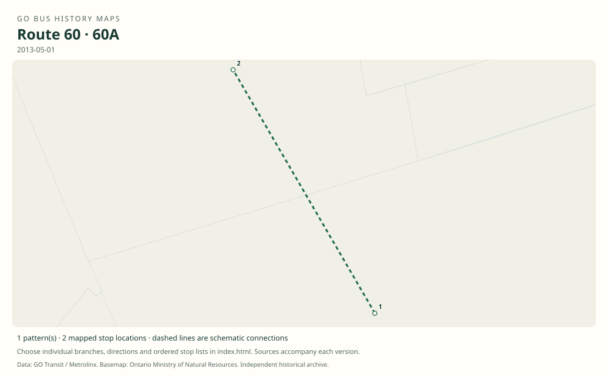

# GO route 60 — Canada’s Wonderland

Seasonal direct GO buses from York Mills and Yorkdale to Canada’s Wonderland. This was the renumbered successor to route 43; later Wonderland service using other route families is a separate service.

**Status:** discontinued. **Documented patterns:** 2. **Research date:** 23 October 2026.

[Download history PDF](route-60-history.pdf) · [Interactive map](index.html) · [All ordered stops (CSV)](stops.csv) · [All mapped versions (GeoJSON)](maps.geojson) · [History data](history.json) · [Timetable archive links](archive-sources.json)

The PDF includes the sourced history, dated maps, numbered stop lists and navigation bookmarks. Older versions retain the timetable timing-point or major-stop limits described below.

Open `index.html` through the repository's local web server to use the map. SVG maps below display directly on GitHub.

## History

### 2008-05-04

The seasonal Wonderland service returned under number 60, replacing number 43.

[Source 1](https://transittoronto.ca/archives/weblog/2008/04/22-go_transit.shtml)

### 2010-05

Weekend/holiday service resumed May 2; daily operation followed May 20.

[Source 1](https://transittoronto.ca/archives/weblog/2010/05/15-brampton_m.shtml)

### 2013-05-01

The original seasonal timetable shows 60 from York Mills via Yorkdale and 60A starting at Yorkdale.

[Source 1](https://go-schedule-archive.s3.us-east-1.amazonaws.com/canadas-wonderland/2013-06-12-table-60-canadas-wonderland.pdf)

### 2019

The 2019 service-change account states that route 60 would not return and directs riders to YRT route 20.

[Source 1](https://stevemunro.ca/2019/08/16/go-transit-service-changes-effective-september-3-2019/)

## Maps by documented version

Feed maps combine the patterns present in that dated file. The interactive viewer separates every branch and direction. A feed snapshot can include future or temporary service; its filename is not a route-change date.

| Date / evidence | Map | Patterns |
|---|---|---:|
| 2013-05-01 | [SVG map](maps/history-60-2013-main.svg) | 1 |
| 2013-05-01 | [SVG map](maps/history-60-2013-a.svg) | 1 |

## Historical major-stop sequences

These are timetable timing points / major stops, not necessarily every roadside stop. Full GTFS sequences are in `stops.csv` and the snapshot files.

### 2013-05-01 — 60: York Mills–Yorkdale–Wonderland

York Mills Bus Terminal → Yorkdale Bus Terminal → Canada’s Wonderland

Schematic straight connections between established stop areas, not a street-by-street reconstruction. Seasonal timetable; route map uses Highway 401, Highway 400 and Major Mackenzie Drive. The listed points are the complete terminal sequence.

[Original source 1](https://go-schedule-archive.s3.us-east-1.amazonaws.com/canadas-wonderland/2013-06-12-table-60-canadas-wonderland.pdf)

### 2013-05-01 — 60A: Yorkdale–Wonderland short service

Yorkdale Bus Terminal → Canada’s Wonderland

Schematic straight connections between established stop areas, not a street-by-street reconstruction. Distinct Yorkdale short branch identified on the original route map.

[Original source 1](https://go-schedule-archive.s3.us-east-1.amazonaws.com/canadas-wonderland/2013-06-12-table-60-canadas-wonderland.pdf)

## Coverage and unresolved questions

- The exact final operating day of the last season has not been established. Route 43 has its own folder for the earlier number.
- These are documented dated snapshots. Changes between snapshots, temporary diversions and every historical local stop have not all been recovered.
- Manually reconstructed versions generally contain published timetable timing points / major stops. They must not be read as complete roadside stop inventories.

## Sources

- [GO Transit revises services, April/May 2008 — Transit Toronto](https://transittoronto.ca/archives/weblog/2008/04/22-go_transit.shtml) — secondary
- [Seasonal Canada’s Wonderland services, May 2010 — Transit Toronto](https://transittoronto.ca/archives/weblog/2010/05/15-brampton_m.shtml) — secondary
- [GO Canada’s Wonderland route 60, printed effective May 1, 2013; archive filename June 12](https://go-schedule-archive.s3.us-east-1.amazonaws.com/canadas-wonderland/2013-06-12-table-60-canadas-wonderland.pdf) — original-timetable
- [GO Transit Service Changes Effective September 3, 2019 — Steve Munro](https://stevemunro.ca/2019/08/16/go-transit-service-changes-effective-september-3-2019/) — secondary

## Data attribution

Data used in this product or service is provided with the permission of Metrolinx. Metrolinx makes no representations or warranties of any kind, express or implied, with respect to the Data and assumes no responsibility for the accuracy or currency of the data used in this product or service.

Basemap: Ontario Ministry of Natural Resources, Open Government Licence – Ontario. See [methodology](../../docs/METHODOLOGY.md) for geometry and date limitations.
