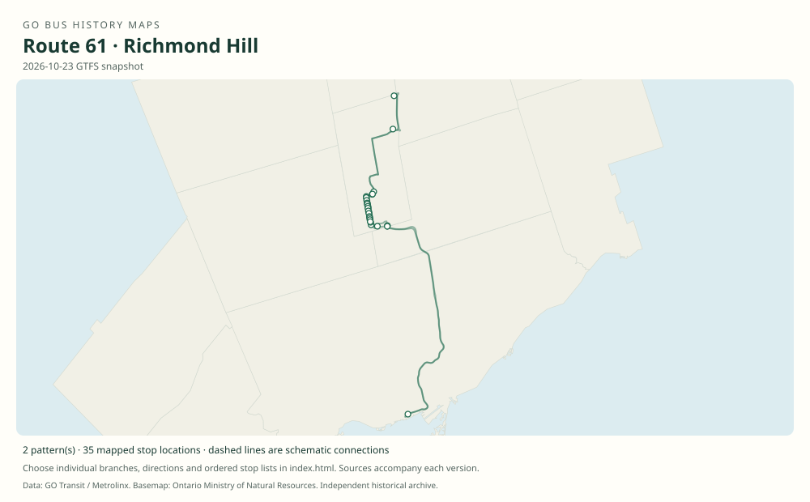

# GO route 61 — Richmond Hill

Bus complement to the Richmond Hill rail corridor. Earlier buses ended at Richmond Hill GO; later service reached Gormley and Bloomington. The 2005 table also contains shorter Leslie Street services.

**Status:** current. **Documented patterns:** 21. **Research date:** 23 October 2026.

[Download history PDF](route-61-history.pdf) · [Interactive map](index.html) · [All ordered stops (CSV)](stops.csv) · [All mapped versions (GeoJSON)](maps.geojson) · [History data](history.json) · [Timetable archive links](archive-sources.json)

The PDF includes the sourced history, dated maps, numbered stop lists and navigation bookmarks. Older versions retain the timetable timing-point or major-stop limits described below.

Open `index.html` through the repository's local web server to use the map. SVG maps below display directly on GitHub.

## History

### 2005-11-21

The timetable documents Richmond Hill–Langstaff–Union buses, Richmond Hill–Union expresses, and Leslie/Old Cummer–Leslie/401–Union trips.

[Source 1](https://go-schedule-archive.s3.us-east-1.amazonaws.com/richmond-hill/2007-09-27-table-61-richmond-hill.pdf)

### 2019-01-05

The route family had reached Gormley; the timetable displays branches 61 and 61A through 61F.

[Source 1](https://go-schedule-archive.s3.us-east-1.amazonaws.com/richmond-hill/2019-01-05-table-61-richmond-hill.pdf)

### 2020-09-05

Branches 61A, 61B, 61C and 61F were withdrawn in the September restructuring.

[Source 1](https://transittoronto.ca/archives/weblog/2020/09/04-go_revises.shtml)

### 2021-06-28

Bloomington GO opened with weekday route 61 bus service.

[Source 1](https://news.ontario.ca/en/release/1000355/ontario-to-officially-open-new-bloomington-go-station)

### 2023-01-07

The timetable shows the Bloomington–Gormley–Richmond Hill–Langstaff–Union corridor and the Richmond Hill short service.

[Source 1](https://go-schedule-archive.s3.us-east-1.amazonaws.com/richmond-hill/2023-01-07-table-61-richmond-hill.pdf)

## Maps by documented version

Feed maps combine the patterns present in that dated file. The interactive viewer separates every branch and direction. A feed snapshot can include future or temporary service; its filename is not a route-change date.

| Date / evidence | Map | Patterns |
|---|---|---:|
| 2016-01-11 GTFS snapshot | [SVG map](maps/2016-01-11.svg) | 6 |
| 2022-03-08 GTFS snapshot | [SVG map](maps/2022-03-08.svg) | 6 |
| 2023-05-05 GTFS snapshot | [SVG map](maps/2023-05-05.svg) | 3 |
| 2026-10-23 GTFS snapshot | [SVG map](maps/2026-10-23.svg) | 2 |
| 2005-11-21 | [SVG map](maps/history-61-2005-langstaff.svg) | 1 |
| 2005-11-21 | [SVG map](maps/history-61-2005-express.svg) | 1 |
| 2005-11-21 | [SVG map](maps/history-61-2005-leslie.svg) | 1 |
| 2023-01-07 | [SVG map](maps/history-61-2023-bloomington.svg) | 1 |

## Historical major-stop sequences

These are timetable timing points / major stops, not necessarily every roadside stop. Full GTFS sequences are in `stops.csv` and the snapshot files.

### 2005-11-21 — 61: Richmond Hill via Langstaff

Richmond Hill GO — Newkirk Rd / Major Mackenzie Dr → Langstaff GO — south lot, Langstaff Rd → Union Station Bus Terminal

Schematic straight connections between established stop areas, not a street-by-street reconstruction. The bus columns bypass Old Cummer and Oriole; train station columns must not be mistaken for bus stops. No letter suffix is printed for this older pattern.

[Original source 1](https://go-schedule-archive.s3.us-east-1.amazonaws.com/richmond-hill/2007-09-27-table-61-richmond-hill.pdf)

### 2005-11-21 — 61: Richmond Hill express

Richmond Hill GO — Newkirk Rd / Major Mackenzie Dr → Union Station Bus Terminal

Schematic straight connections between established stop areas, not a street-by-street reconstruction. Unlettered express rows in Table 61; not an assertion of a later branch designation.

[Original source 1](https://go-schedule-archive.s3.us-east-1.amazonaws.com/richmond-hill/2007-09-27-table-61-richmond-hill.pdf)

### 2005-11-21 — 61: Leslie Street short service

Leslie St / Old Cummer Ave → Leslie St / Highway 401 → Union Station Bus Terminal

Schematic straight connections between established stop areas, not a street-by-street reconstruction. Street stops associated with the Old Cummer and Oriole areas; not stops inside those rail stations. 1 stop locations remain unestablished; the full ordered sequence is preserved in the list.

[Original source 1](https://go-schedule-archive.s3.us-east-1.amazonaws.com/richmond-hill/2007-09-27-table-61-richmond-hill.pdf)

### 2023-01-07 — 61: Bloomington–Union

Bloomington GO → Gormley GO → Richmond Hill GO → Langstaff GO → Union Station Bus Terminal

Schematic straight connections between established stop areas, not a street-by-street reconstruction. Ordered major timetable timing points, not an exhaustive list of intermediate stops. Lines are schematic, not a surveyed road alignment.

[Original source 1](https://go-schedule-archive.s3.us-east-1.amazonaws.com/richmond-hill/2023-01-07-table-61-richmond-hill.pdf)

## Coverage and unresolved questions

- Detailed Gormley-era lettered patterns should be read from the original 2019 timetable; a modern letter must not be assigned retroactively to a 2005 trip.
- These are documented dated snapshots. Changes between snapshots, temporary diversions and every historical local stop have not all been recovered.
- GTFS dates identify captured feeds, not necessarily the first or last day of a route. Open a pattern to see its exact scheduled service dates. Temporary rail replacement and special-service patterns are included when present in the source.
- Manually reconstructed versions generally contain published timetable timing points / major stops. They must not be read as complete roadside stop inventories.

## Sources

- [GO Richmond Hill Table 61, printed November 21, 2005; archive filename September 27, 2007](https://go-schedule-archive.s3.us-east-1.amazonaws.com/richmond-hill/2007-09-27-table-61-richmond-hill.pdf) — original-timetable
- [GO Richmond Hill route 61 schedule, effective January 5, 2019](https://go-schedule-archive.s3.us-east-1.amazonaws.com/richmond-hill/2019-01-05-table-61-richmond-hill.pdf) — original-timetable
- [GO revises routes and services, September 5, 2020 — Transit Toronto](https://transittoronto.ca/archives/weblog/2020/09/04-go_revises.shtml) — secondary
- [Ontario to Officially Open New Bloomington GO Station, June 16, 2021](https://news.ontario.ca/en/release/1000355/ontario-to-officially-open-new-bloomington-go-station) — official
- [GO Richmond Hill route 61 schedule, effective January 7, 2023](https://go-schedule-archive.s3.us-east-1.amazonaws.com/richmond-hill/2023-01-07-table-61-richmond-hill.pdf) — original-timetable
- [GO Transit original GTFS snapshot 2016-01-11](https://openmobilitydata-data.s3.us-west-1.amazonaws.com/public/feeds/go-transit/32/20160111/gtfs.zip) — original-gtfs
- [GO Transit original GTFS snapshot 2022-03-08](https://web.archive.org/web/20220308054107id_/https://www.gotransit.com/static_files/gotransit/assets/Files/GO_GTFS.zip) — original-gtfs
- [GO Transit original GTFS snapshot 2023-05-05](https://openmobilitydata-data.s3.us-west-1.amazonaws.com/public/feeds/go-transit/32/20230505/gtfs.zip) — original-gtfs
- [GO Transit original GTFS snapshot 2026-10-23](https://assets.metrolinx.com/raw/upload/Documents/Metrolinx/Open%20Data/GO-GTFS.zip) — original-gtfs

## Data attribution

Data used in this product or service is provided with the permission of Metrolinx. Metrolinx makes no representations or warranties of any kind, express or implied, with respect to the Data and assumes no responsibility for the accuracy or currency of the data used in this product or service.

Basemap: Ontario Ministry of Natural Resources, Open Government Licence – Ontario. See [methodology](../../docs/METHODOLOGY.md) for geometry and date limitations.
