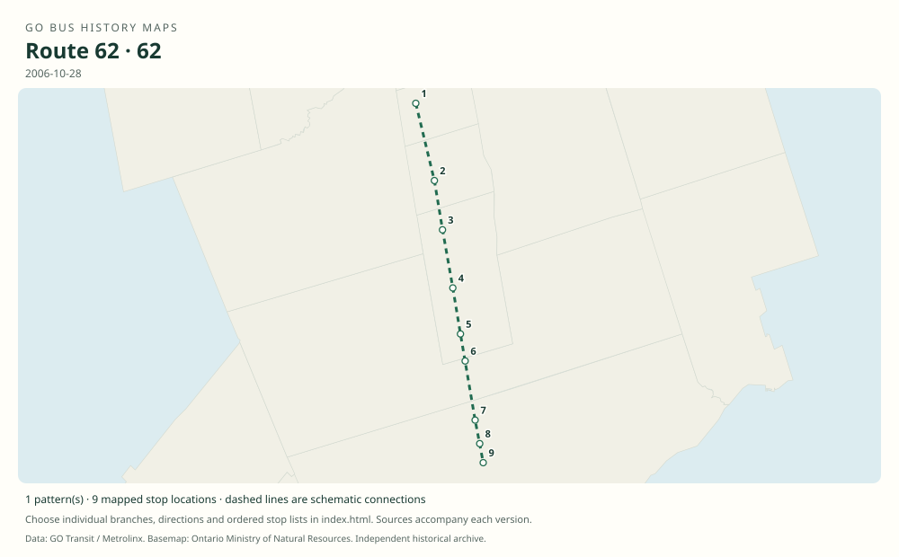

# GO route 62 — Newmarket B / Yonge Street

The former Newmarket–Aurora–Richmond Hill–North York bus along Yonge Street. Older timetables call this Table 62 and Newmarket B; the final contemporary notice explicitly calls it route 62.

**Status:** discontinued. **Documented patterns:** 2. **Research date:** 23 October 2026.

[Download history PDF](route-62-history.pdf) · [Interactive map](index.html) · [All ordered stops (CSV)](stops.csv) · [All mapped versions (GeoJSON)](maps.geojson) · [History data](history.json) · [Timetable archive links](archive-sources.json)

The PDF includes the sourced history, dated maps, numbered stop lists and navigation bookmarks. Older versions retain the timetable timing-point or major-stop limits described below.

Open `index.html` through the repository's local web server to use the map. SVG maps below display directly on GitHub.

## History

### 1970

The Newmarket B corridor was among the early GO bus services; this does not establish that number 62 was publicly used in 1970.

[Source 1](https://transittoronto.ca/regional/2115.shtml)

### 2004-10-30

Table 62 documents Newmarket Bus Terminal to York Mills, with some trips entering the north lot at Langstaff GO.

[Source 1](https://go-schedule-archive.s3.us-east-1.amazonaws.com/newmarket-b/2004-10-30-table-62-newmarket-b-dir0-day1-page1.html)

### 2006-10-28

The documented Yonge Street service still ran to York Mills, via the Finch and Sheppard areas.

[Source 1](https://go-schedule-archive.s3.us-east-1.amazonaws.com/newmarket-b/2006-10-28-table-62-newmarket-b-dir0-day1-page2.html)

### 2010-06-25

Last operating day of route 62. Viva Blue A began June 28 as its replacement between Newmarket and Finch.

[Source 1](https://transittoronto.ca/archives/weblog/2010/06/13-viva_buses.shtml)

## Maps by documented version

Feed maps combine the patterns present in that dated file. The interactive viewer separates every branch and direction. A feed snapshot can include future or temporary service; its filename is not a route-change date.

| Date / evidence | Map | Patterns |
|---|---|---:|
| 2004-10-30 | [SVG map](maps/history-62-2004-langstaff.svg) | 1 |
| 2006-10-28 | [SVG map](maps/history-62-2006-yonge.svg) | 1 |

## Historical major-stop sequences

These are timetable timing points / major stops, not necessarily every roadside stop. Full GTFS sequences are in `stops.csv` and the snapshot files.

### 2004-10-30 — 62: Newmarket B via Langstaff GO north lot

Newmarket Bus Terminal → Yonge St / Murray Dr — Aurora → Yonge St / King Rd — Oak Ridges → Yonge St / Bernard Ave → Hillcrest Mall → Langstaff GO — north lot → Yonge St / Langstaff Rd → Yonge St / Bishop Ave — Finch area → Yonge St / Sheppard Ave → York Mills Bus Terminal

Schematic straight connections between established stop areas, not a street-by-street reconstruction. The original HTML is Table 62. This sequence represents the trips with a Langstaff north-lot time, not every trip. Finch-area southbound stops are on Yonge Street. 1 stop locations remain unestablished; the full ordered sequence is preserved in the list.

[Original source 1](https://go-schedule-archive.s3.us-east-1.amazonaws.com/newmarket-b/2004-10-30-table-62-newmarket-b-dir0-day1-page1.html)

### 2006-10-28 — 62: Newmarket B Yonge Street service

Newmarket Bus Terminal → Yonge St / Murray Dr — Aurora → Yonge St / King Rd — Oak Ridges → Yonge St / Bernard Ave → Hillcrest Mall → Yonge St / Langstaff Rd → Yonge St / Bishop Ave — Finch area → Yonge St / Sheppard Ave → York Mills Bus Terminal

Schematic straight connections between established stop areas, not a street-by-street reconstruction. Ordered major timetable timing points, not an exhaustive list of intermediate stops. Lines are schematic, not a surveyed road alignment.

[Original source 1](https://go-schedule-archive.s3.us-east-1.amazonaws.com/newmarket-b/2006-10-28-table-62-newmarket-b-dir0-day1-page2.html)

## Coverage and unresolved questions

- The 2004 table refers to Table 63 for Newmarket B express service. That reference is not evidence that the later King City route 63 was the former Yonge C route.
- Intermediate Yonge Street stops are not all listed in these timing-point tables.
- These are documented dated snapshots. Changes between snapshots, temporary diversions and every historical local stop have not all been recovered.
- Manually reconstructed versions generally contain published timetable timing points / major stops. They must not be read as complete roadside stop inventories.

## Sources

- [50 Years of GO Transit Bus Operations — Adam Zhelka / Transit Toronto](https://transittoronto.ca/regional/2115.shtml) — secondary
- [GO Newmarket B Table 62 original HTML timetable, effective October 30, 2004](https://go-schedule-archive.s3.us-east-1.amazonaws.com/newmarket-b/2004-10-30-table-62-newmarket-b-dir0-day1-page1.html) — original-timetable
- [GO Newmarket B Table 62 original HTML timetable, effective October 28, 2006](https://go-schedule-archive.s3.us-east-1.amazonaws.com/newmarket-b/2006-10-28-table-62-newmarket-b-dir0-day1-page2.html) — original-timetable
- [Viva buses replace GO route 62 Newmarket B, June 28, 2010 — Transit Toronto](https://transittoronto.ca/archives/weblog/2010/06/13-viva_buses.shtml) — secondary

## Data attribution

Data used in this product or service is provided with the permission of Metrolinx. Metrolinx makes no representations or warranties of any kind, express or implied, with respect to the Data and assumes no responsibility for the accuracy or currency of the data used in this product or service.

Basemap: Ontario Ministry of Natural Resources, Open Government Licence – Ontario. See [methodology](../../docs/METHODOLOGY.md) for geometry and date limitations.
