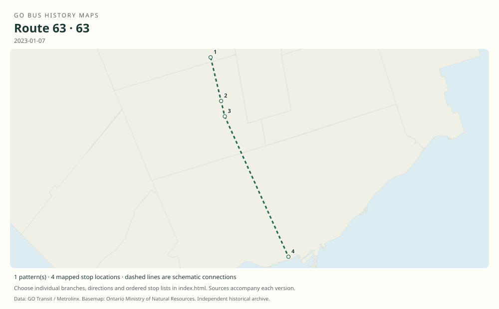

# GO route 63 — King City–Toronto

The King City–Maple–Rutherford–Union branch of the Barrie bus network. Its remaining service was renumbered 65A in the April 2024 schedule.

**Status:** discontinued. **Documented patterns:** 9. **Research date:** 23 October 2026.

[Download history PDF](route-63-history.pdf) · [Interactive map](index.html) · [All ordered stops (CSV)](stops.csv) · [All mapped versions (GeoJSON)](maps.geojson) · [History data](history.json) · [Timetable archive links](archive-sources.json)

The PDF includes the sourced history, dated maps, numbered stop lists and navigation bookmarks. Older versions retain the timetable timing-point or major-stop limits described below.

Open `index.html` through the repository's local web server to use the map. SVG maps below display directly on GitHub.

## History

### 2011-09-03

The Barrie timetable explicitly identifies King City–Toronto buses as route 63.

[Source 1](https://go-schedule-archive.s3.us-east-1.amazonaws.com/barrie/2011-11-12-table-65-barrie.pdf)

### 2023-01-07

Route 63 remained in the Barrie schedule, serving King City, Maple, Rutherford and Union.

[Source 1](https://go-schedule-archive.s3.us-east-1.amazonaws.com/barrie/2023-01-07-table-65-barrie.pdf)

### 2024-01-06

The January timetable still labels the early King City–Union trip 63.

[Source 1](https://go-schedule-archive.s3.us-east-1.amazonaws.com/barrie/2024-01-06-table-65-barrie.pdf)

### 2024-04-27

The corresponding King City–Union trip is labelled 65A in the April timetable, establishing the renumbering between these schedule editions.

[Source 1](https://go-schedule-archive.s3.us-east-1.amazonaws.com/barrie/2024-04-27-table-65-barrie.pdf)

## Maps by documented version

Feed maps combine the patterns present in that dated file. The interactive viewer separates every branch and direction. A feed snapshot can include future or temporary service; its filename is not a route-change date.

| Date / evidence | Map | Patterns |
|---|---|---:|
| 2016-01-11 GTFS snapshot | [SVG map](maps/2016-01-11.svg) | 4 |
| 2022-03-08 GTFS snapshot | [SVG map](maps/2022-03-08.svg) | 2 |
| 2023-05-05 GTFS snapshot | [SVG map](maps/2023-05-05.svg) | 1 |
| 2011-09-03 | [SVG map](maps/history-63-2011-king-city.svg) | 1 |
| 2023-01-07 | [SVG map](maps/history-63-2023-main.svg) | 1 |

## Historical major-stop sequences

These are timetable timing points / major stops, not necessarily every roadside stop. Full GTFS sequences are in `stops.csv` and the snapshot files.

### 2011-09-03 — 63: King City–Maple–Rutherford–Union

King City GO — Keele St / Station Rd → Maple GO → Rutherford GO → Union Station Bus Terminal

Schematic straight connections between established stop areas, not a street-by-street reconstruction. Ordered major timetable timing points, not an exhaustive list of intermediate stops. Lines are schematic, not a surveyed road alignment.

[Original source 1](https://go-schedule-archive.s3.us-east-1.amazonaws.com/barrie/2011-11-12-table-65-barrie.pdf)

### 2023-01-07 — 63: King City–Union final-number era

King City GO → Maple GO → Rutherford GO → Union Station Bus Terminal

Schematic straight connections between established stop areas, not a street-by-street reconstruction. Ordered major timetable timing points, not an exhaustive list of intermediate stops. Lines are schematic, not a surveyed road alignment.

[Original source 1](https://go-schedule-archive.s3.us-east-1.amazonaws.com/barrie/2023-01-07-table-65-barrie.pdf)

## Coverage and unresolved questions

- The date on which King City buses first acquired number 63 has not been established.
- Earlier Table 63 references for Newmarket B express service are not automatically treated as this route or as proof of a different route 63.
- These are documented dated snapshots. Changes between snapshots, temporary diversions and every historical local stop have not all been recovered.
- GTFS dates identify captured feeds, not necessarily the first or last day of a route. Open a pattern to see its exact scheduled service dates. Temporary rail replacement and special-service patterns are included when present in the source.
- Manually reconstructed versions generally contain published timetable timing points / major stops. They must not be read as complete roadside stop inventories.

## Sources

- [GO Barrie routes 63/65/68, effective September 3, 2011; archive filename November 12](https://go-schedule-archive.s3.us-east-1.amazonaws.com/barrie/2011-11-12-table-65-barrie.pdf) — original-timetable
- [GO Barrie routes 63/65/68, effective January 7, 2023](https://go-schedule-archive.s3.us-east-1.amazonaws.com/barrie/2023-01-07-table-65-barrie.pdf) — original-timetable
- [GO Barrie schedule, effective January 6, 2024; King City bus still numbered 63](https://go-schedule-archive.s3.us-east-1.amazonaws.com/barrie/2024-01-06-table-65-barrie.pdf) — original-timetable
- [GO Barrie schedule, effective April 27, 2024; King City bus numbered 65A](https://go-schedule-archive.s3.us-east-1.amazonaws.com/barrie/2024-04-27-table-65-barrie.pdf) — original-timetable
- [GO Transit original GTFS snapshot 2016-01-11](https://openmobilitydata-data.s3.us-west-1.amazonaws.com/public/feeds/go-transit/32/20160111/gtfs.zip) — original-gtfs
- [GO Transit original GTFS snapshot 2022-03-08](https://web.archive.org/web/20220308054107id_/https://www.gotransit.com/static_files/gotransit/assets/Files/GO_GTFS.zip) — original-gtfs
- [GO Transit original GTFS snapshot 2023-05-05](https://openmobilitydata-data.s3.us-west-1.amazonaws.com/public/feeds/go-transit/32/20230505/gtfs.zip) — original-gtfs

## Data attribution

Data used in this product or service is provided with the permission of Metrolinx. Metrolinx makes no representations or warranties of any kind, express or implied, with respect to the Data and assumes no responsibility for the accuracy or currency of the data used in this product or service.

Basemap: Ontario Ministry of Natural Resources, Open Government Licence – Ontario. See [methodology](../../docs/METHODOLOGY.md) for geometry and date limitations.
