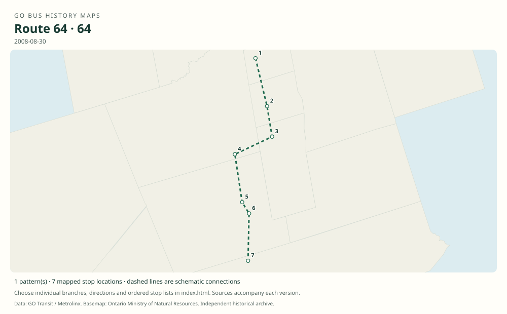

# GO route 64 — Newmarket–York University

Direct weekday bus from Newmarket to York University’s Keele campus through Aurora, Oak Ridges, King City and Maple. The shared timetable’s rail comparison columns are not bus stops.

**Status:** discontinued. **Documented patterns:** 1. **Research date:** 23 October 2026.

[Download history PDF](route-64-history.pdf) · [Interactive map](index.html) · [All ordered stops (CSV)](stops.csv) · [All mapped versions (GeoJSON)](maps.geojson) · [History data](history.json) · [Timetable archive links](archive-sources.json)

The PDF includes the sourced history, dated maps, numbered stop lists and navigation bookmarks. Older versions retain the timetable timing-point or major-stop limits described below.

Open `index.html` through the repository's local web server to use the map. SVG maps below display directly on GitHub.

## History

### 2008-08-30

The original timetable documents weekday Newmarket–York University service through King City and Rutherford.

[Source 1](https://go-schedule-archive.s3.us-east-1.amazonaws.com/newmarket-york-u/2008-12-03-table-64-newmarket-york-u.pdf)

### by 2010-04-26

The contemporary account quoted by York University reports that route 64 had permanently stopped operating.

[Source 1](https://www.yorku.ca/yfile/2010/04/28/former-go-riders-push-for-better-plan/)

## Maps by documented version

Feed maps combine the patterns present in that dated file. The interactive viewer separates every branch and direction. A feed snapshot can include future or temporary service; its filename is not a route-change date.

| Date / evidence | Map | Patterns |
|---|---|---:|
| 2008-08-30 | [SVG map](maps/history-64-2008-main.svg) | 1 |

## Historical major-stop sequences

These are timetable timing points / major stops, not necessarily every roadside stop. Full GTFS sequences are in `stops.csv` and the snapshot files.

### 2008-08-30 — 64: Newmarket–King City–York University

Newmarket Bus Terminal → Yonge St / Murray Dr — Aurora → Yonge St / King Rd — Oak Ridges → King City GO — Keele St / Station Rd → Keele St / Major Mackenzie Dr — Maple → Rutherford GO → York University — Keele campus bus loop

Schematic straight connections between established stop areas, not a street-by-street reconstruction. The actual bus row bypasses Newmarket GO, Aurora GO, Maple GO and York University GO rail-station columns. The York University destination is the campus, not the former rail station.

[Original source 1](https://go-schedule-archive.s3.us-east-1.amazonaws.com/newmarket-york-u/2008-12-03-table-64-newmarket-york-u.pdf)

## Coverage and unresolved questions

- The exact final operating day and original launch date have not been confirmed from an operator timetable or notice.
- These are documented dated snapshots. Changes between snapshots, temporary diversions and every historical local stop have not all been recovered.
- Manually reconstructed versions generally contain published timetable timing points / major stops. They must not be read as complete roadside stop inventories.

## Sources

- [GO Newmarket–York University Table 64, printed effective August 30, 2008; archive filename December 3](https://go-schedule-archive.s3.us-east-1.amazonaws.com/newmarket-york-u/2008-12-03-table-64-newmarket-york-u.pdf) — original-timetable
- [York University YFile: Former GO riders push for better plan, April 28, 2010; quotes Aurora Banner April 26](https://www.yorku.ca/yfile/2010/04/28/former-go-riders-push-for-better-plan/) — secondary

## Data attribution

Data used in this product or service is provided with the permission of Metrolinx. Metrolinx makes no representations or warranties of any kind, express or implied, with respect to the Data and assumes no responsibility for the accuracy or currency of the data used in this product or service.

Basemap: Ontario Ministry of Natural Resources, Open Government Licence – Ontario. See [methodology](../../docs/METHODOLOGY.md) for geometry and date limitations.
