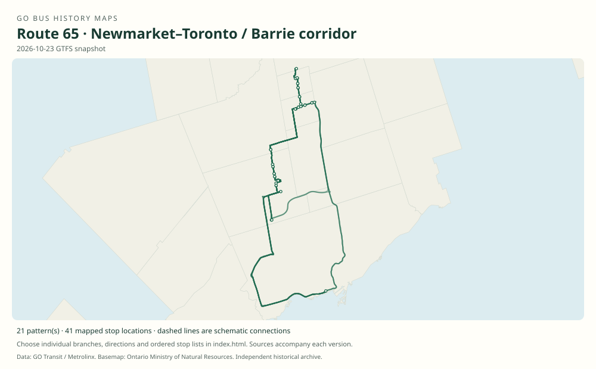

# GO route 65 — Newmarket–Toronto / Barrie corridor

Union-bound and rail-connecting services in the Barrie corridor. Route 65 has repeatedly changed as train service expanded; suffixes describe a dated pattern rather than a permanent route identity.

**Status:** current. **Documented patterns:** 71. **Research date:** 23 October 2026.

[Download history PDF](route-65-history.pdf) · [Interactive map](index.html) · [All ordered stops (CSV)](stops.csv) · [All mapped versions (GeoJSON)](maps.geojson) · [History data](history.json) · [Timetable archive links](archive-sources.json)

The PDF includes the sourced history, dated maps, numbered stop lists and navigation bookmarks. Older versions retain the timetable timing-point or major-stop limits described below.

Open `index.html` through the repository's local web server to use the map. SVG maps below display directly on GitHub.

## History

### 2009-06-27

The timetable documents East Gwillimbury/Newmarket–Aurora–Highway 404–Union buses, with other Barrie-corridor bus connections in the same table.

[Source 1](https://go-schedule-archive.s3.us-east-1.amazonaws.com/barrie/2009-10-07-table-65-barrie.pdf)

### 2012-09

Additional weekday and weekend Union trips were introduced; the former 69 service between Union and East Gwillimbury became route 65.

[Source 1](https://www.newswire.ca/news-releases/new-adjusted-go-bus-service-for-richmond-hill-keswick-barrie-riders-school-service-returns-510584921.html)

### 2018-01-02

Expanded Barrie train service replaced much daytime bus service; the local Newmarket–Aurora portion gained route number 69.

[Source 1](https://transittoronto.ca/archives/weblog/2017/12/29-go_revises.shtml)

### 2023-01-07

The timetable retains several Union branches serving East Gwillimbury, Newmarket and Aurora alongside routes 63 and 68.

[Source 1](https://go-schedule-archive.s3.us-east-1.amazonaws.com/barrie/2023-01-07-table-65-barrie.pdf)

### 2024-04-27

The former King City route 63 appears as 65A.

[Source 1](https://go-schedule-archive.s3.us-east-1.amazonaws.com/barrie/2024-04-27-table-65-barrie.pdf)

## Maps by documented version

Feed maps combine the patterns present in that dated file. The interactive viewer separates every branch and direction. A feed snapshot can include future or temporary service; its filename is not a route-change date.

| Date / evidence | Map | Patterns |
|---|---|---:|
| 2016-01-11 GTFS snapshot | [SVG map](maps/2016-01-11.svg) | 23 |
| 2022-03-08 GTFS snapshot | [SVG map](maps/2022-03-08.svg) | 16 |
| 2023-05-05 GTFS snapshot | [SVG map](maps/2023-05-05.svg) | 9 |
| 2026-10-23 GTFS snapshot | [SVG map](maps/2026-10-23.svg) | 21 |
| 2009-06-27 | [SVG map](maps/history-65-2009-main.svg) | 1 |
| 2024-04-27 | [SVG map](maps/history-65-2024-a.svg) | 1 |

## Historical major-stop sequences

These are timetable timing points / major stops, not necessarily every roadside stop. Full GTFS sequences are in `stops.csv` and the snapshot files.

### 2009-06-27 — 65: East Gwillimbury–Aurora–Union

East Gwillimbury GO → Newmarket Bus Terminal → Aurora GO → Highway 404 / Aurora Rd Park & Ride → Union Station Bus Terminal

Schematic straight connections between established stop areas, not a street-by-street reconstruction. Representative timetable timing points. This older routing entered Newmarket Bus Terminal and reached Highway 404 via the Aurora area; it is not interchangeable with every later 65 branch.

[Original source 1](https://go-schedule-archive.s3.us-east-1.amazonaws.com/barrie/2009-10-07-table-65-barrie.pdf)

### 2024-04-27 — 65A: King City service renumbered 65A

King City GO → Maple GO → Rutherford GO → Union Station Bus Terminal

Schematic straight connections between established stop areas, not a street-by-street reconstruction. The 04:55 King City departure is explicitly 65A in this edition; corresponding January service was 63.

[Original source 1](https://go-schedule-archive.s3.us-east-1.amazonaws.com/barrie/2024-04-27-table-65-barrie.pdf)

## Coverage and unresolved questions

- Older Barrie-area trips printed in Table 65 without clear public route/suffix labels have not been assigned invented branches.
- Use the separate 2016, 2022, 2023 and 2026 GTFS snapshots for their full stop and shape variants.
- These are documented dated snapshots. Changes between snapshots, temporary diversions and every historical local stop have not all been recovered.
- GTFS dates identify captured feeds, not necessarily the first or last day of a route. Open a pattern to see its exact scheduled service dates. Temporary rail replacement and special-service patterns are included when present in the source.
- Manually reconstructed versions generally contain published timetable timing points / major stops. They must not be read as complete roadside stop inventories.

## Sources

- [GO Barrie Table 65, printed June 27, 2009; archive filename October 7](https://go-schedule-archive.s3.us-east-1.amazonaws.com/barrie/2009-10-07-table-65-barrie.pdf) — original-timetable
- [GO Transit: New, adjusted bus service for Richmond Hill, Keswick and Barrie; August 15, 2012](https://www.newswire.ca/news-releases/new-adjusted-go-bus-service-for-richmond-hill-keswick-barrie-riders-school-service-returns-510584921.html) — official
- [GO revises routes and services, December 30, 2017 / January 2018 — Transit Toronto](https://transittoronto.ca/archives/weblog/2017/12/29-go_revises.shtml) — secondary
- [GO Barrie routes 63/65/68, effective January 7, 2023](https://go-schedule-archive.s3.us-east-1.amazonaws.com/barrie/2023-01-07-table-65-barrie.pdf) — original-timetable
- [GO Barrie schedule, effective April 27, 2024; King City bus numbered 65A](https://go-schedule-archive.s3.us-east-1.amazonaws.com/barrie/2024-04-27-table-65-barrie.pdf) — original-timetable
- [GO Transit original GTFS snapshot 2016-01-11](https://openmobilitydata-data.s3.us-west-1.amazonaws.com/public/feeds/go-transit/32/20160111/gtfs.zip) — original-gtfs
- [GO Transit original GTFS snapshot 2022-03-08](https://web.archive.org/web/20220308054107id_/https://www.gotransit.com/static_files/gotransit/assets/Files/GO_GTFS.zip) — original-gtfs
- [GO Transit original GTFS snapshot 2023-05-05](https://openmobilitydata-data.s3.us-west-1.amazonaws.com/public/feeds/go-transit/32/20230505/gtfs.zip) — original-gtfs
- [GO Transit original GTFS snapshot 2026-10-23](https://assets.metrolinx.com/raw/upload/Documents/Metrolinx/Open%20Data/GO-GTFS.zip) — original-gtfs

## Data attribution

Data used in this product or service is provided with the permission of Metrolinx. Metrolinx makes no representations or warranties of any kind, express or implied, with respect to the Data and assumes no responsibility for the accuracy or currency of the data used in this product or service.

Basemap: Ontario Ministry of Natural Resources, Open Government Licence – Ontario. See [methodology](../../docs/METHODOLOGY.md) for geometry and date limitations.
