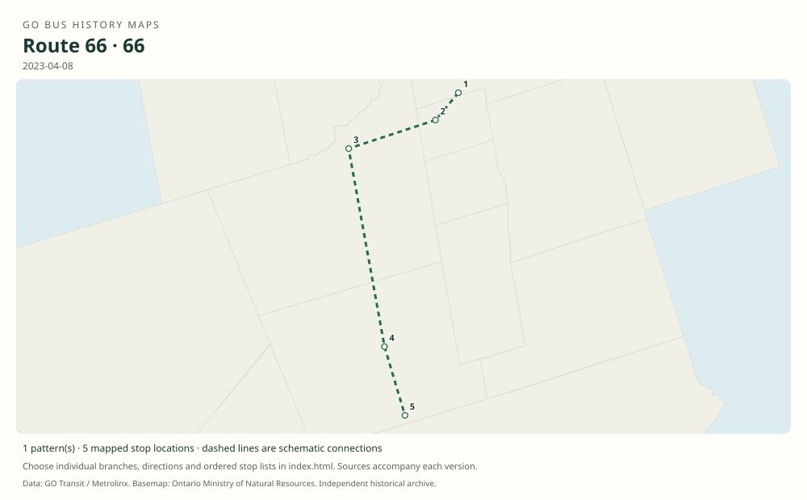

# GO route 66 — Newmarket Highway 400 / East Gwillimbury Express

Highway 400 bus linking Newmarket, later East Gwillimbury, with North York. Its southern terminal changed from Yorkdale to Highway 407 Bus Terminal before the route was withdrawn.

**Status:** discontinued. **Documented patterns:** 22. **Research date:** 23 October 2026.

[Download history PDF](route-66-history.pdf) · [Interactive map](index.html) · [All ordered stops (CSV)](stops.csv) · [All mapped versions (GeoJSON)](maps.geojson) · [History data](history.json) · [Timetable archive links](archive-sources.json)

The PDF includes the sourced history, dated maps, numbered stop lists and navigation bookmarks. Older versions retain the timetable timing-point or major-stop limits described below.

Open `index.html` through the repository's local web server to use the map. SVG maps below display directly on GitHub.

## History

### by 2011-03-13

The original timetable shows Newmarket Bus Terminal–Highway 9/400–Major Mackenzie/400–Yorkdale, with a Keele/401 branch.

[Source 1](https://go-schedule-archive.s3.us-east-1.amazonaws.com/newmarket-hwy-400/2011-03-13-table-66-newmarket-hwy-400.pdf)

### 2012-09

Five weekday Newmarket–Yorkdale trips were added.

[Source 1](https://www.newswire.ca/news-releases/new-adjusted-go-bus-service-for-richmond-hill-keswick-barrie-riders-school-service-returns-510584921.html)

### 2019-01-05

The documented northern terminus is East Gwillimbury GO; 66 and 66A still run to Yorkdale.

[Source 1](https://go-schedule-archive.s3.us-east-1.amazonaws.com/newmarket-hwy-400/2019-01-05-table-66-newmarket-hwy-400.pdf)

### 2023-04-08

The documented route ends at Highway 407 Bus Terminal and uses the Davis/Eagle street stop in Newmarket.

[Source 1](https://go-schedule-archive.s3.us-east-1.amazonaws.com/newmarket-hwy-400/2023-04-08-table-66-newmarket-hwy-400.pdf)

### 2026-01-03

Metrolinx discontinued route 66.

[Source 1](https://www.metrolinx.com/en/news/holiday-go-transit-service-adjustments)

## Maps by documented version

Feed maps combine the patterns present in that dated file. The interactive viewer separates every branch and direction. A feed snapshot can include future or temporary service; its filename is not a route-change date.

| Date / evidence | Map | Patterns |
|---|---|---:|
| 2016-01-11 GTFS snapshot | [SVG map](maps/2016-01-11.svg) | 8 |
| 2022-03-08 GTFS snapshot | [SVG map](maps/2022-03-08.svg) | 8 |
| 2023-05-05 GTFS snapshot | [SVG map](maps/2023-05-05.svg) | 2 |
| by 2011-03-13 | [SVG map](maps/history-66-2011-main.svg) | 1 |
| by 2011-03-13 | [SVG map](maps/history-66-2011-a.svg) | 1 |
| 2019-01-05 | [SVG map](maps/history-66-2019-main.svg) | 1 |
| 2023-04-08 | [SVG map](maps/history-66-2023-407.svg) | 1 |

## Historical major-stop sequences

These are timetable timing points / major stops, not necessarily every roadside stop. Full GTFS sequences are in `stops.csv` and the snapshot files.

### by 2011-03-13 — 66: Newmarket–Yorkdale

Newmarket Bus Terminal → Highway 9 / Highway 400 Park & Ride → Major Mackenzie Dr / Highway 400 Park & Ride → Yorkdale Bus Terminal

Schematic straight connections between established stop areas, not a street-by-street reconstruction. Ordered major timetable timing points, not an exhaustive list of intermediate stops. Lines are schematic, not a surveyed road alignment.

[Original source 1](https://go-schedule-archive.s3.us-east-1.amazonaws.com/newmarket-hwy-400/2011-03-13-table-66-newmarket-hwy-400.pdf)

### by 2011-03-13 — 66A: Newmarket–Yorkdale via Keele

Newmarket Bus Terminal → Highway 9 / Highway 400 Park & Ride → Major Mackenzie Dr / Highway 400 Park & Ride → Keele St / Highway 401 → Yorkdale Bus Terminal

Schematic straight connections between established stop areas, not a street-by-street reconstruction. Ordered major timetable timing points, not an exhaustive list of intermediate stops. Lines are schematic, not a surveyed road alignment.

[Original source 1](https://go-schedule-archive.s3.us-east-1.amazonaws.com/newmarket-hwy-400/2011-03-13-table-66-newmarket-hwy-400.pdf)

### 2019-01-05 — 66: East Gwillimbury–Yorkdale

East Gwillimbury GO → Newmarket Bus Terminal → Highway 9 / Highway 400 Park & Ride → Major Mackenzie Dr / Highway 400 Park & Ride → Yorkdale Bus Terminal

Schematic straight connections between established stop areas, not a street-by-street reconstruction. Ordered major timetable timing points, not an exhaustive list of intermediate stops. Lines are schematic, not a surveyed road alignment.

[Original source 1](https://go-schedule-archive.s3.us-east-1.amazonaws.com/newmarket-hwy-400/2019-01-05-table-66-newmarket-hwy-400.pdf)

### 2023-04-08 — 66: East Gwillimbury–Highway 407

East Gwillimbury GO → Davis Dr W / Eagle St W — Newmarket → Highway 9 / Highway 400 Park & Ride → Major Mackenzie Dr / Highway 400 Park & Ride → Highway 407 Bus Terminal

Schematic straight connections between established stop areas, not a street-by-street reconstruction. Ordered major timetable timing points, not an exhaustive list of intermediate stops. Lines are schematic, not a surveyed road alignment.

[Original source 1](https://go-schedule-archive.s3.us-east-1.amazonaws.com/newmarket-hwy-400/2023-04-08-table-66-newmarket-hwy-400.pdf)

## Coverage and unresolved questions

- The precise dates of the East Gwillimbury extension and Yorkdale-to-Highway-407 terminal change have not been pinned down; the dated timetables establish their presence.
- These are documented dated snapshots. Changes between snapshots, temporary diversions and every historical local stop have not all been recovered.
- GTFS dates identify captured feeds, not necessarily the first or last day of a route. Open a pattern to see its exact scheduled service dates. Temporary rail replacement and special-service patterns are included when present in the source.
- Manually reconstructed versions generally contain published timetable timing points / major stops. They must not be read as complete roadside stop inventories.

## Sources

- [GO Newmarket Highway 400 route 66 timetable archived March 13, 2011](https://go-schedule-archive.s3.us-east-1.amazonaws.com/newmarket-hwy-400/2011-03-13-table-66-newmarket-hwy-400.pdf) — original-timetable
- [GO Transit: New, adjusted bus service for Richmond Hill, Keswick and Barrie; August 15, 2012](https://www.newswire.ca/news-releases/new-adjusted-go-bus-service-for-richmond-hill-keswick-barrie-riders-school-service-returns-510584921.html) — official
- [GO East Gwillimbury/North York Express route 66, effective January 5, 2019](https://go-schedule-archive.s3.us-east-1.amazonaws.com/newmarket-hwy-400/2019-01-05-table-66-newmarket-hwy-400.pdf) — original-timetable
- [GO East Gwillimbury/North York Express route 66, effective April 8, 2023](https://go-schedule-archive.s3.us-east-1.amazonaws.com/newmarket-hwy-400/2023-04-08-table-66-newmarket-hwy-400.pdf) — original-timetable
- [Metrolinx holiday GO service adjustments; route 66 discontinued January 3, 2026](https://www.metrolinx.com/en/news/holiday-go-transit-service-adjustments) — official
- [GO Transit original GTFS snapshot 2016-01-11](https://openmobilitydata-data.s3.us-west-1.amazonaws.com/public/feeds/go-transit/32/20160111/gtfs.zip) — original-gtfs
- [GO Transit original GTFS snapshot 2022-03-08](https://web.archive.org/web/20220308054107id_/https://www.gotransit.com/static_files/gotransit/assets/Files/GO_GTFS.zip) — original-gtfs
- [GO Transit original GTFS snapshot 2023-05-05](https://openmobilitydata-data.s3.us-west-1.amazonaws.com/public/feeds/go-transit/32/20230505/gtfs.zip) — original-gtfs

## Data attribution

Data used in this product or service is provided with the permission of Metrolinx. Metrolinx makes no representations or warranties of any kind, express or implied, with respect to the Data and assumes no responsibility for the accuracy or currency of the data used in this product or service.

Basemap: Ontario Ministry of Natural Resources, Open Government Licence – Ontario. See [methodology](../../docs/METHODOLOGY.md) for geometry and date limitations.
