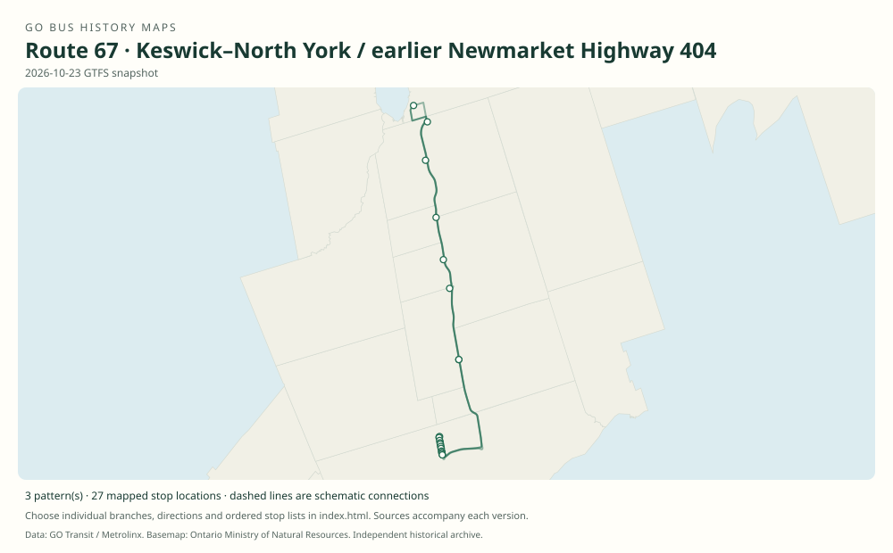

# GO route 67 — Keswick–North York / earlier Newmarket Highway 404

The current route family connects the Keswick/Highway 404 corridor with Finch. An earlier Table 67 describes Newmarket Highway 404 service; it should not be mistaken for evidence of a Keswick route in 2003.

**Status:** current. **Documented patterns:** 16. **Research date:** 23 October 2026.

[Download history PDF](route-67-history.pdf) · [Interactive map](index.html) · [All ordered stops (CSV)](stops.csv) · [All mapped versions (GeoJSON)](maps.geojson) · [History data](history.json) · [Timetable archive links](archive-sources.json)

The PDF includes the sourced history, dated maps, numbered stop lists and navigation bookmarks. Older versions retain the timetable timing-point or major-stop limits described below.

Open `index.html` through the repository's local web server to use the map. SVG maps below display directly on GitHub.

## History

### 2003-01-04

Table 67 is titled Newmarket Highway 404, running from Newmarket via Aurora and Highway 404 to Finch.

[Source 1](https://go-schedule-archive.s3.us-east-1.amazonaws.com/keswick-north-york/2003-01-04-table-67-keswick-north-york-dir0-day1-page1.html)

### 2012-09-04

First weekday operation of the new Keswick–Finch service from Glenwoods Park & Ride, via Aurora Carpool and Yonge/Sheppard.

[Source 1](https://transittoronto.ca/archives/weblog/2012/08/13-go_canceli.shtml)

### 2019-01-05

The original schedule shows the Woodbine/404, Queensville/404, Davis/404, Wellington/404 and Major Mackenzie/404 park-and-ride chain.

[Source 1](https://go-schedule-archive.s3.us-east-1.amazonaws.com/keswick-north-york/2019-01-05-table-67-keswick-north-york.pdf)

### 2023-09-02

The Keswick–Finch corridor is documented in the September timetable.

[Source 1](https://go-schedule-archive.s3.us-east-1.amazonaws.com/keswick-north-york/2023-09-02-table-67-keswick-north-york.pdf)

## Maps by documented version

Feed maps combine the patterns present in that dated file. The interactive viewer separates every branch and direction. A feed snapshot can include future or temporary service; its filename is not a route-change date.

| Date / evidence | Map | Patterns |
|---|---|---:|
| 2016-01-11 GTFS snapshot | [SVG map](maps/2016-01-11.svg) | 4 |
| 2022-03-08 GTFS snapshot | [SVG map](maps/2022-03-08.svg) | 4 |
| 2023-05-05 GTFS snapshot | [SVG map](maps/2023-05-05.svg) | 2 |
| 2026-10-23 GTFS snapshot | [SVG map](maps/2026-10-23.svg) | 3 |
| 2003-01-04 | [SVG map](maps/history-67-2003-table-predecessor.svg) | 1 |
| 2012-09-04 | [SVG map](maps/history-67-2012-glenwoods.svg) | 1 |
| 2019-01-05 | [SVG map](maps/history-67-2019-carpools.svg) | 1 |

## Historical major-stop sequences

These are timetable timing points / major stops, not necessarily every roadside stop. Full GTFS sequences are in `stops.csv` and the snapshot files.

### 2003-01-04 — Table 67: Table 67 Newmarket Highway 404 predecessor

Newmarket Bus Terminal → Aurora GO → Highway 404 / Aurora Rd Park & Ride → Highway 7 / East Beaver Creek Rd → Seneca College — Don Mills Rd / Finch Ave → Finch Bus Terminal

Schematic straight connections between established stop areas, not a street-by-street reconstruction. Original document explicitly calls this Newmarket Highway 404. Table number is preserved rather than asserting modern public route branding.

[Original source 1](https://go-schedule-archive.s3.us-east-1.amazonaws.com/keswick-north-york/2003-01-04-table-67-keswick-north-york-dir0-day1-page1.html)

### 2012-09-04 — 67: Initial Keswick–Finch service

Glenwoods Park & Ride — Woodbine Ave / Glenwoods Ave → Aurora Carpool — Highway 404 / Aurora Rd → Yonge St / Sheppard Ave → Finch Bus Terminal

Schematic straight connections between established stop areas, not a street-by-street reconstruction. Major stops from the contemporary route description. Early alignment used Woodbine, Green Lane, Highways 404/401 and Yonge Street.

[Original source 1](https://transittoronto.ca/archives/weblog/2012/08/13-go_canceli.shtml)

### 2019-01-05 — 67: Keswick–Finch via Highway 404 park-and-rides

Woodbine Ave / Highway 404 Park & Ride → Queensville Sdrd / Highway 404 Park & Ride → Davis Dr / Highway 404 Park & Ride → Wellington St E / Highway 404 Park & Ride → Major Mackenzie Dr / Highway 404 Park & Ride → Yonge St / Sheppard Ave → Finch Bus Terminal

Schematic straight connections between established stop areas, not a street-by-street reconstruction. Ordered major timetable timing points, not an exhaustive list of intermediate stops. Lines are schematic, not a surveyed road alignment.

[Original source 1](https://go-schedule-archive.s3.us-east-1.amazonaws.com/keswick-north-york/2019-01-05-table-67-keswick-north-york.pdf)

## Coverage and unresolved questions

- Exact transition dates between the original Newmarket Table 67 and the later Keswick route, and dates of each Highway 404 park-and-ride addition, remain to be established.
- These are documented dated snapshots. Changes between snapshots, temporary diversions and every historical local stop have not all been recovered.
- GTFS dates identify captured feeds, not necessarily the first or last day of a route. Open a pattern to see its exact scheduled service dates. Temporary rail replacement and special-service patterns are included when present in the source.
- Manually reconstructed versions generally contain published timetable timing points / major stops. They must not be read as complete roadside stop inventories.

## Sources

- [GO Table 67 Newmarket Highway 404 original HTML timetable, effective January 4, 2003; archive folder later renamed Keswick](https://go-schedule-archive.s3.us-east-1.amazonaws.com/keswick-north-york/2003-01-04-table-67-keswick-north-york-dir0-day1-page1.html) — original-timetable
- [GO cancels Sutton service and introduces Keswick–North York buses, September 2012 — Transit Toronto](https://transittoronto.ca/archives/weblog/2012/08/13-go_canceli.shtml) — secondary
- [GO Keswick/North York route 67, effective January 5, 2019](https://go-schedule-archive.s3.us-east-1.amazonaws.com/keswick-north-york/2019-01-05-table-67-keswick-north-york.pdf) — original-timetable
- [GO Keswick/North York route 67, effective September 2, 2023](https://go-schedule-archive.s3.us-east-1.amazonaws.com/keswick-north-york/2023-09-02-table-67-keswick-north-york.pdf) — original-timetable
- [GO Transit original GTFS snapshot 2016-01-11](https://openmobilitydata-data.s3.us-west-1.amazonaws.com/public/feeds/go-transit/32/20160111/gtfs.zip) — original-gtfs
- [GO Transit original GTFS snapshot 2022-03-08](https://web.archive.org/web/20220308054107id_/https://www.gotransit.com/static_files/gotransit/assets/Files/GO_GTFS.zip) — original-gtfs
- [GO Transit original GTFS snapshot 2023-05-05](https://openmobilitydata-data.s3.us-west-1.amazonaws.com/public/feeds/go-transit/32/20230505/gtfs.zip) — original-gtfs
- [GO Transit original GTFS snapshot 2026-10-23](https://assets.metrolinx.com/raw/upload/Documents/Metrolinx/Open%20Data/GO-GTFS.zip) — original-gtfs

## Data attribution

Data used in this product or service is provided with the permission of Metrolinx. Metrolinx makes no representations or warranties of any kind, express or implied, with respect to the Data and assumes no responsibility for the accuracy or currency of the data used in this product or service.

Basemap: Ontario Ministry of Natural Resources, Open Government Licence – Ontario. See [methodology](../../docs/METHODOLOGY.md) for geometry and date limitations.
