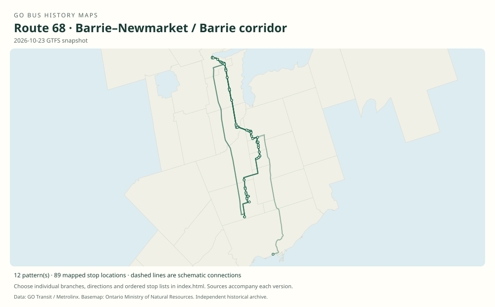

# GO route 68 — Barrie–Newmarket / Barrie corridor

Local and connecting bus services through Barrie, Stroud, Churchill, Bradford, Holland Landing, East Gwillimbury, Newmarket and Aurora. Express and rail-connection variants differ substantially by year.

**Status:** current. **Documented patterns:** 41. **Research date:** 23 October 2026.

[Download history PDF](route-68-history.pdf) · [Interactive map](index.html) · [All ordered stops (CSV)](stops.csv) · [All mapped versions (GeoJSON)](maps.geojson) · [History data](history.json) · [Timetable archive links](archive-sources.json)

The PDF includes the sourced history, dated maps, numbered stop lists and navigation bookmarks. Older versions retain the timetable timing-point or major-stop limits described below.

Open `index.html` through the repository's local web server to use the map. SVG maps below display directly on GitHub.

## History

### 2009-06-27

The original timetable shows Barrie Bus Terminal–Barrie South–Bradford–Holland Landing–Newmarket, including a Bradford short service.

[Source 1](https://go-schedule-archive.s3.us-east-1.amazonaws.com/barrie/2009-10-07-table-65-barrie.pdf)

### 2012-06-23

Allandale Waterfront appears in the route 68 timetable and corridor diagram.

[Source 1](https://go-schedule-archive.s3.us-east-1.amazonaws.com/barrie/2012-06-23-table-65-barrie.pdf)

### 2018-01-02

Barrie train expansion was accompanied by reworked connecting buses, including Aurora connections.

[Source 1](https://transittoronto.ca/archives/weblog/2017/12/29-go_revises.shtml)

### 2019-01-05

The timetable documents the Barrie–Aurora corridor through East Gwillimbury and Newmarket GO.

[Source 1](https://go-schedule-archive.s3.us-east-1.amazonaws.com/barrie/2019-01-05-table-65-barrie.pdf)

### 2023-01-07

Branches serving Barrie and its rail connection points remain in the original Barrie schedule.

[Source 1](https://go-schedule-archive.s3.us-east-1.amazonaws.com/barrie/2023-01-07-table-65-barrie.pdf)

## Maps by documented version

Feed maps combine the patterns present in that dated file. The interactive viewer separates every branch and direction. A feed snapshot can include future or temporary service; its filename is not a route-change date.

| Date / evidence | Map | Patterns |
|---|---|---:|
| 2016-01-11 GTFS snapshot | [SVG map](maps/2016-01-11.svg) | 8 |
| 2022-03-08 GTFS snapshot | [SVG map](maps/2022-03-08.svg) | 10 |
| 2023-05-05 GTFS snapshot | [SVG map](maps/2023-05-05.svg) | 8 |
| 2026-10-23 GTFS snapshot | [SVG map](maps/2026-10-23.svg) | 12 |
| 2009-06-27 | [SVG map](maps/history-68-2009-main.svg) | 1 |
| 2009-06-27 | [SVG map](maps/history-68-2009-a.svg) | 1 |
| 2019-01-05 | [SVG map](maps/history-68-2019-aurora.svg) | 1 |

## Historical major-stop sequences

These are timetable timing points / major stops, not necessarily every roadside stop. Full GTFS sequences are in `stops.csv` and the snapshot files.

### 2009-06-27 — 68: Barrie–Bradford–Newmarket

Barrie Bus Terminal — Maple Ave / Simcoe St → Barrie South GO — Mapleview Dr / Highway 11 → Yonge St / Victoria St — Stroud → Yonge St / Killarney Beach Rd — Churchill → Barrie St / John St — Bradford → Bradford GO — Bridge St / Dissette St → Yonge St / Mount Albert Rd — Holland Landing → Newmarket Bus Terminal

Schematic straight connections between established stop areas, not a street-by-street reconstruction. Bus rows bypass East Gwillimbury GO in this dated pattern; Barrie South is the station-area timing point stated in the timetable. 1 stop locations remain unestablished; the full ordered sequence is preserved in the list.

[Original source 1](https://go-schedule-archive.s3.us-east-1.amazonaws.com/barrie/2009-10-07-table-65-barrie.pdf)

### 2009-06-27 — 68A: Bradford–Newmarket short service

Barrie St / John St — Bradford → Bradford GO — Bridge St / Dissette St → Yonge St / Mount Albert Rd — Holland Landing → Newmarket Bus Terminal

Schematic straight connections between established stop areas, not a street-by-street reconstruction. Ordered major timetable timing points, not an exhaustive list of intermediate stops. Lines are schematic, not a surveyed road alignment. 1 stop locations remain unestablished; the full ordered sequence is preserved in the list.

[Original source 1](https://go-schedule-archive.s3.us-east-1.amazonaws.com/barrie/2009-10-07-table-65-barrie.pdf)

### 2019-01-05 — 68: Barrie–Aurora via rail connection points

Barrie Bus Terminal → Allandale Waterfront GO → Barrie South GO → Yonge St / Victoria St — Stroud → Yonge St / 4th Line — Churchill → Barrie St / Holland St W — Bradford → Bradford GO → Yonge St / Queen St — Holland Landing → East Gwillimbury GO → Newmarket GO → Aurora GO

Schematic straight connections between established stop areas, not a street-by-street reconstruction. Exact major timing-point order from the weekday 68 bus row. It bypasses Newmarket Bus Terminal. The Churchill and Holland Landing labels differ from the 2009 table.

[Original source 1](https://go-schedule-archive.s3.us-east-1.amazonaws.com/barrie/2019-01-05-table-65-barrie.pdf)

## Coverage and unresolved questions

- The historical road names Highway 11 and Yonge Street refer to the same older north–south corridor in several timetable labels.
- Branch suffixes have changed and been reused. Do not apply present-day 68A/68B meanings to the 2009 table.
- These are documented dated snapshots. Changes between snapshots, temporary diversions and every historical local stop have not all been recovered.
- GTFS dates identify captured feeds, not necessarily the first or last day of a route. Open a pattern to see its exact scheduled service dates. Temporary rail replacement and special-service patterns are included when present in the source.
- Manually reconstructed versions generally contain published timetable timing points / major stops. They must not be read as complete roadside stop inventories.

## Sources

- [GO Barrie Table 65, printed June 27, 2009; archive filename October 7](https://go-schedule-archive.s3.us-east-1.amazonaws.com/barrie/2009-10-07-table-65-barrie.pdf) — original-timetable
- [GO Barrie routes 63/65/68, effective June 23, 2012](https://go-schedule-archive.s3.us-east-1.amazonaws.com/barrie/2012-06-23-table-65-barrie.pdf) — original-timetable
- [GO revises routes and services, December 30, 2017 / January 2018 — Transit Toronto](https://transittoronto.ca/archives/weblog/2017/12/29-go_revises.shtml) — secondary
- [GO Barrie routes 63/65/68/69, effective January 5, 2019](https://go-schedule-archive.s3.us-east-1.amazonaws.com/barrie/2019-01-05-table-65-barrie.pdf) — original-timetable
- [GO Barrie routes 63/65/68, effective January 7, 2023](https://go-schedule-archive.s3.us-east-1.amazonaws.com/barrie/2023-01-07-table-65-barrie.pdf) — original-timetable
- [GO Transit original GTFS snapshot 2016-01-11](https://openmobilitydata-data.s3.us-west-1.amazonaws.com/public/feeds/go-transit/32/20160111/gtfs.zip) — original-gtfs
- [GO Transit original GTFS snapshot 2022-03-08](https://web.archive.org/web/20220308054107id_/https://www.gotransit.com/static_files/gotransit/assets/Files/GO_GTFS.zip) — original-gtfs
- [GO Transit original GTFS snapshot 2023-05-05](https://openmobilitydata-data.s3.us-west-1.amazonaws.com/public/feeds/go-transit/32/20230505/gtfs.zip) — original-gtfs
- [GO Transit original GTFS snapshot 2026-10-23](https://assets.metrolinx.com/raw/upload/Documents/Metrolinx/Open%20Data/GO-GTFS.zip) — original-gtfs

## Data attribution

Data used in this product or service is provided with the permission of Metrolinx. Metrolinx makes no representations or warranties of any kind, express or implied, with respect to the Data and assumes no responsibility for the accuracy or currency of the data used in this product or service.

Basemap: Ontario Ministry of Natural Resources, Open Government Licence – Ontario. See [methodology](../../docs/METHODOLOGY.md) for geometry and date limitations.
