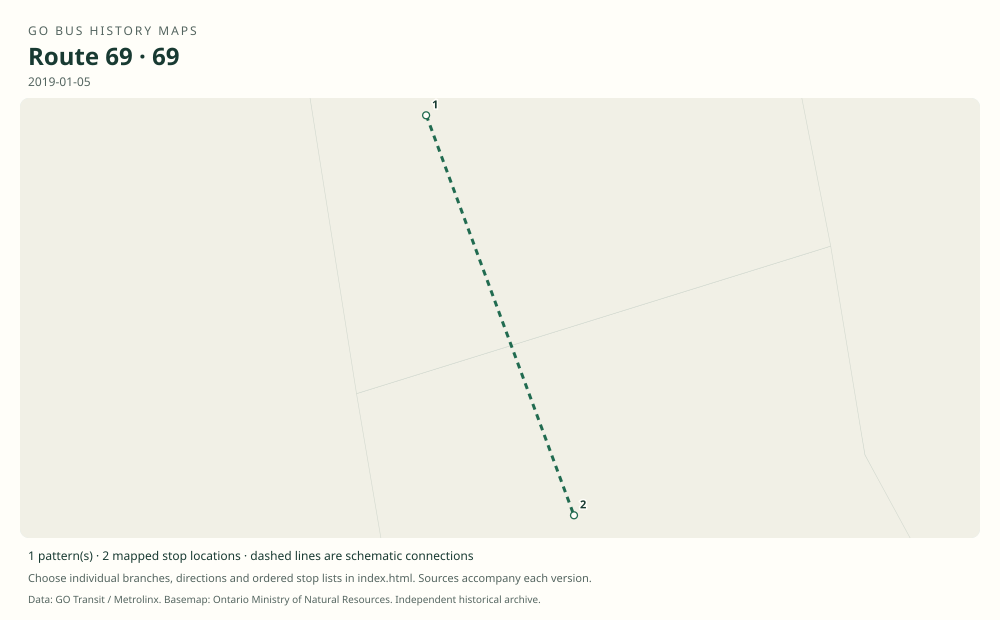

# GO route 69 — Sutton–Newmarket; later Aurora–Newmarket

Number 69 has two distinct documented uses: the former Lake Simcoe/Sutton rural service and a later local Newmarket–Aurora rail connector. The two eras must be mapped separately.

**Status:** discontinued. **Documented patterns:** 5. **Research date:** 23 October 2026.

[Download history PDF](route-69-history.pdf) · [Interactive map](index.html) · [All ordered stops (CSV)](stops.csv) · [All mapped versions (GeoJSON)](maps.geojson) · [History data](history.json) · [Timetable archive links](archive-sources.json)

The PDF includes the sourced history, dated maps, numbered stop lists and navigation bookmarks. Older versions retain the timetable timing-point or major-stop limits described below.

Open `index.html` through the repository's local web server to use the map. SVG maps below display directly on GitHub.

## History

### 2008-11-01

The Sutton timetable shows full Beaverton–Newmarket route 69, Sutton short branch 69A, Keswick short branch 69B, and Keswick–East Gwillimbury–Union 69C.

[Source 1](https://go-schedule-archive.s3.us-east-1.amazonaws.com/sutton/2009-02-19-table-69-sutton.pdf)

### 2011-12-31

The last recovered full Sutton-era timetable retains these branches.

[Source 1](https://go-schedule-archive.s3.us-east-1.amazonaws.com/sutton/2012-08-29-table-69-sutton.pdf)

### 2012-09-01

Final day of the Sutton-era route; its replacement network included YRT 50 and GO routes 67 and 80.

[Source 1](https://www.newswire.ca/news-releases/new-adjusted-go-bus-service-for-richmond-hill-keswick-barrie-riders-school-service-returns-510584921.html) · [Source 2](https://transittoronto.ca/archives/weblog/2012/08/13-go_canceli.shtml)

### 2018-01-02

Number 69 was reused for weekday Newmarket Bus Terminal–Aurora GO service formerly part of route 65.

[Source 1](https://transittoronto.ca/archives/weblog/2017/12/29-go_revises.shtml)

### 2019-01-05

The Barrie timetable explicitly lists the new Aurora–Newmarket route 69.

[Source 1](https://go-schedule-archive.s3.us-east-1.amazonaws.com/barrie/2019-01-05-table-65-barrie.pdf)

## Maps by documented version

Feed maps combine the patterns present in that dated file. The interactive viewer separates every branch and direction. A feed snapshot can include future or temporary service; its filename is not a route-change date.

| Date / evidence | Map | Patterns |
|---|---|---:|
| 2008-11-01 | [SVG map](maps/history-69-2008-main.svg) | 1 |
| 2008-11-01 | [SVG map](maps/history-69-2008-a.svg) | 1 |
| 2008-11-01 | [SVG map](maps/history-69-2008-b.svg) | 1 |
| 2008-11-01 | [SVG map](maps/history-69-2008-c.svg) | 1 |
| 2019-01-05 | [SVG map](maps/history-69-2019-reuse.svg) | 1 |

## Historical major-stop sequences

These are timetable timing points / major stops, not necessarily every roadside stop. Full GTFS sequences are in `stops.csv` and the snapshot files.

### 2008-11-01 — 69: Sutton era: Beaverton–Newmarket

Beaverton — Simcoe St / Mara Rd → Port Bolster — Lakeridge Rd / Highway 48 → Pefferlaw — Pefferlaw Rd / Station Rd → Sutton — High St / Burke St → Jackson’s Point — Dalton Rd / Metro Rd → Island Grove — Metro Rd / Woodbine Ave → Roches Point — Metro Rd / Raines St → Keswick — Simcoe Ave → Queensville — Leslie St / Queensville Sdrd → Sharon — Leslie St / Mount Albert Rd → Newmarket GO — Davis Dr / Superior St → Newmarket Bus Terminal

Schematic straight connections between established stop areas, not a street-by-street reconstruction. Major timing points. Main route 69 bypasses East Gwillimbury GO; the station belongs to branch 69C in this edition. 1 stop locations remain unestablished; the full ordered sequence is preserved in the list.

[Original source 1](https://go-schedule-archive.s3.us-east-1.amazonaws.com/sutton/2009-02-19-table-69-sutton.pdf)

### 2008-11-01 — 69A: Sutton era: Sutton–Newmarket

Sutton — High St / Burke St → Jackson’s Point — Dalton Rd / Metro Rd → Island Grove — Metro Rd / Woodbine Ave → Roches Point — Metro Rd / Raines St → Keswick — Simcoe Ave → Queensville — Leslie St / Queensville Sdrd → Sharon — Leslie St / Mount Albert Rd → Newmarket GO — Davis Dr / Superior St → Newmarket Bus Terminal

Schematic straight connections between established stop areas, not a street-by-street reconstruction. Ordered major timetable timing points, not an exhaustive list of intermediate stops. Lines are schematic, not a surveyed road alignment. 1 stop locations remain unestablished; the full ordered sequence is preserved in the list.

[Original source 1](https://go-schedule-archive.s3.us-east-1.amazonaws.com/sutton/2009-02-19-table-69-sutton.pdf)

### 2008-11-01 — 69B: Sutton era: Keswick–Newmarket

Keswick — Simcoe Ave → Queensville — Leslie St / Queensville Sdrd → Sharon — Leslie St / Mount Albert Rd → Newmarket GO — Davis Dr / Superior St → Newmarket Bus Terminal

Schematic straight connections between established stop areas, not a street-by-street reconstruction. Ordered major timetable timing points, not an exhaustive list of intermediate stops. Lines are schematic, not a surveyed road alignment. 1 stop locations remain unestablished; the full ordered sequence is preserved in the list.

[Original source 1](https://go-schedule-archive.s3.us-east-1.amazonaws.com/sutton/2009-02-19-table-69-sutton.pdf)

### 2008-11-01 — 69C: Sutton era: Keswick–Union express

Keswick — Simcoe Ave → Queensville — Leslie St / Queensville Sdrd → Sharon — Leslie St / Mount Albert Rd → East Gwillimbury GO → Union Station Bus Terminal

Schematic straight connections between established stop areas, not a street-by-street reconstruction. 69C bypasses Newmarket GO and Newmarket Bus Terminal. It is a through bus to Union, unlike the main 69. 1 stop locations remain unestablished; the full ordered sequence is preserved in the list.

[Original source 1](https://go-schedule-archive.s3.us-east-1.amazonaws.com/sutton/2009-02-19-table-69-sutton.pdf)

### 2019-01-05 — 69: Reused number: Newmarket–Aurora

Newmarket Bus Terminal → Aurora GO

Schematic straight connections between established stop areas, not a street-by-street reconstruction. Only principal timetable endpoints are shown. The contemporary 2018 notice describes Yonge Street and Wellington Street routing; this is not the former Sutton route.

[Original source 1](https://go-schedule-archive.s3.us-east-1.amazonaws.com/barrie/2019-01-05-table-65-barrie.pdf)

## Coverage and unresolved questions

- The exact final date of the second, Aurora–Newmarket use of number 69 has not been confirmed. It is absent from the later recovered 2022/2023 network snapshots.
- The two eras are separated by more than five years and are not a continuous route with a minor extension.
- These are documented dated snapshots. Changes between snapshots, temporary diversions and every historical local stop have not all been recovered.
- Manually reconstructed versions generally contain published timetable timing points / major stops. They must not be read as complete roadside stop inventories.

## Sources

- [GO Sutton Table 69, printed effective November 1, 2008; archive filename February 19, 2009](https://go-schedule-archive.s3.us-east-1.amazonaws.com/sutton/2009-02-19-table-69-sutton.pdf) — original-timetable
- [GO Sutton route 69, printed effective December 31, 2011; archive filename August 29, 2012](https://go-schedule-archive.s3.us-east-1.amazonaws.com/sutton/2012-08-29-table-69-sutton.pdf) — original-timetable
- [GO Transit: New, adjusted bus service for Richmond Hill, Keswick and Barrie; August 15, 2012](https://www.newswire.ca/news-releases/new-adjusted-go-bus-service-for-richmond-hill-keswick-barrie-riders-school-service-returns-510584921.html) — official
- [GO revises routes and services, December 30, 2017 / January 2018 — Transit Toronto](https://transittoronto.ca/archives/weblog/2017/12/29-go_revises.shtml) — secondary
- [GO Barrie routes 63/65/68/69, effective January 5, 2019](https://go-schedule-archive.s3.us-east-1.amazonaws.com/barrie/2019-01-05-table-65-barrie.pdf) — original-timetable
- [GO cancels Sutton service and introduces Keswick–North York buses, September 2012 — Transit Toronto](https://transittoronto.ca/archives/weblog/2012/08/13-go_canceli.shtml) — secondary

## Data attribution

Data used in this product or service is provided with the permission of Metrolinx. Metrolinx makes no representations or warranties of any kind, express or implied, with respect to the Data and assumes no responsibility for the accuracy or currency of the data used in this product or service.

Basemap: Ontario Ministry of Natural Resources, Open Government Licence – Ontario. See [methodology](../../docs/METHODOLOGY.md) for geometry and date limitations.
