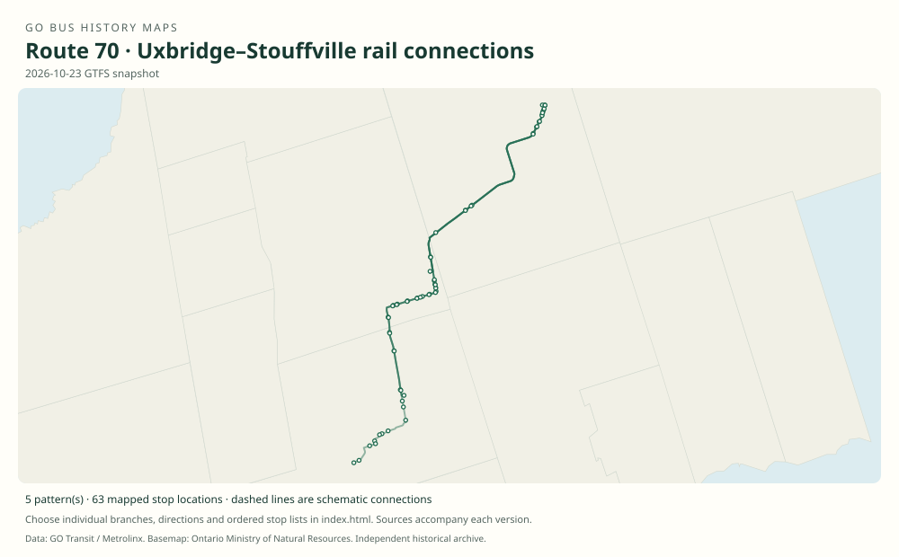

# GO route 70 — Uxbridge–Stouffville rail connections

Train-connecting services north of Unionville/Mount Joy, including Uxbridge, Goodwood, Stouffville and the station first called Lincolnville and then Old Elm. Route 71 contains the associated Union-bound bus service.

**Status:** current. **Documented patterns:** 32. **Research date:** 23 October 2026.

[Download history PDF](route-70-history.pdf) · [Interactive map](index.html) · [All ordered stops (CSV)](stops.csv) · [All mapped versions (GeoJSON)](maps.geojson) · [History data](history.json) · [Timetable archive links](archive-sources.json)

The PDF includes the sourced history, dated maps, numbered stop lists and navigation bookmarks. Older versions retain the timetable timing-point or major-stop limits described below.

Open `index.html` through the repository's local web server to use the map. SVG maps below display directly on GitHub.

## History

### by 2016-01

The original archived GTFS contains route 70 and branches 70A, 70B and 70E.

[Source 1](https://openmobilitydata-data.s3.us-west-1.amazonaws.com/public/feeds/go-transit/32/20160111/gtfs.zip)

### 2019-08-31

The original timetable documents 70 Uxbridge–Stouffville–Unionville and shorter branches including 70B and 70D.

[Source 1](https://go-schedule-archive.s3.us-east-1.amazonaws.com/stouffville/2019-08-31-table-71-stouffville.pdf)

### 2021-10-16

Lincolnville GO was renamed Old Elm GO; the name change preceded the physical station relocation.

[Source 1](https://www.townofws.ca/media/vfmhpfrw/stouffville_year-in-review_2021.pdf)

### 2023-01-07

The timetable uses the Old Elm name while serving the original Bethesda Road station site.

[Source 1](https://go-schedule-archive.s3.us-east-1.amazonaws.com/stouffville/2023-01-07-table-71-stouffville.pdf)

### 2023-10-17

Old Elm service moved to the replacement station southwest of the original site.

[Source 1](https://transittoronto.ca/archives/weblog/2023/10/16-go_relocat.shtml)

## Maps by documented version

Feed maps combine the patterns present in that dated file. The interactive viewer separates every branch and direction. A feed snapshot can include future or temporary service; its filename is not a route-change date.

| Date / evidence | Map | Patterns |
|---|---|---:|
| 2016-01-11 GTFS snapshot | [SVG map](maps/2016-01-11.svg) | 8 |
| 2022-03-08 GTFS snapshot | [SVG map](maps/2022-03-08.svg) | 10 |
| 2023-05-05 GTFS snapshot | [SVG map](maps/2023-05-05.svg) | 6 |
| 2026-10-23 GTFS snapshot | [SVG map](maps/2026-10-23.svg) | 5 |
| by 2016-01 | [SVG map](maps/history-70-2016-main.svg) | 1 |
| 2019-08-31 | [SVG map](maps/history-70-2019-b.svg) | 1 |
| 2019-08-31 | [SVG map](maps/history-70-2019-d.svg) | 1 |

## Historical major-stop sequences

These are timetable timing points / major stops, not necessarily every roadside stop. Full GTFS sequences are in `stops.csv` and the snapshot files.

### by 2016-01 — 70: Unionville–Uxbridge full northern connector

Unionville GO → Centennial GO → Markham GO → Mount Joy GO → Stouffville GO → Lincolnville GO — original Bethesda Rd site → Goodwood → Uxbridge — Railway St / Albert St

Schematic straight connections between established stop areas, not a street-by-street reconstruction. Major points selected from the original route_variant 70 GTFS stop sequence. The 2019 cover map still depicts this corridor, but the recovered weekday table mainly lists 70B/70D; this full trip is therefore dated to the earlier feed.

[Original source 1](https://openmobilitydata-data.s3.us-west-1.amazonaws.com/public/feeds/go-transit/32/20160111/gtfs.zip)

### 2019-08-31 — 70B: Uxbridge–Lincolnville connector

Uxbridge — Railway St / Albert St → Goodwood → Lincolnville GO — original Bethesda Rd site

Schematic straight connections between established stop areas, not a street-by-street reconstruction. Ordered major timetable timing points, not an exhaustive list of intermediate stops. Lines are schematic, not a surveyed road alignment.

[Original source 1](https://go-schedule-archive.s3.us-east-1.amazonaws.com/stouffville/2019-08-31-table-71-stouffville.pdf)

### 2019-08-31 — 70D: Uxbridge–Mount Joy connector

Uxbridge — Railway St / Albert St → Goodwood → Lincolnville GO — original Bethesda Rd site → Stouffville GO → Mount Joy GO

Schematic straight connections between established stop areas, not a street-by-street reconstruction. Ordered major timetable timing points, not an exhaustive list of intermediate stops. Lines are schematic, not a surveyed road alignment.

[Original source 1](https://go-schedule-archive.s3.us-east-1.amazonaws.com/stouffville/2019-08-31-table-71-stouffville.pdf)

## Coverage and unresolved questions

- The first date the separate route 70 number was introduced has not been located. Earlier Uxbridge connecting buses in Table 71 should not automatically be relabelled 70.
- The 2016 and later GTFS snapshots preserve additional exact branch and local-stop variants.
- These are documented dated snapshots. Changes between snapshots, temporary diversions and every historical local stop have not all been recovered.
- GTFS dates identify captured feeds, not necessarily the first or last day of a route. Open a pattern to see its exact scheduled service dates. Temporary rail replacement and special-service patterns are included when present in the source.
- Manually reconstructed versions generally contain published timetable timing points / major stops. They must not be read as complete roadside stop inventories.

## Sources

- [Original GO Transit GTFS archived January 11, 2016; use calendar validity, not retrieval date](https://openmobilitydata-data.s3.us-west-1.amazonaws.com/public/feeds/go-transit/32/20160111/gtfs.zip) — official
- [GO Stouffville routes 70/71, effective August 31, 2019](https://go-schedule-archive.s3.us-east-1.amazonaws.com/stouffville/2019-08-31-table-71-stouffville.pdf) — original-timetable
- [Town of Whitchurch-Stouffville 2021 Year in Review: Lincolnville renamed October 16, 2021](https://www.townofws.ca/media/vfmhpfrw/stouffville_year-in-review_2021.pdf) — official
- [GO Stouffville routes 70/71, effective January 7, 2023](https://go-schedule-archive.s3.us-east-1.amazonaws.com/stouffville/2023-01-07-table-71-stouffville.pdf) — original-timetable
- [GO relocates Old Elm station, October 17, 2023 — Transit Toronto](https://transittoronto.ca/archives/weblog/2023/10/16-go_relocat.shtml) — secondary
- [GO Transit original GTFS snapshot 2022-03-08](https://web.archive.org/web/20220308054107id_/https://www.gotransit.com/static_files/gotransit/assets/Files/GO_GTFS.zip) — original-gtfs
- [GO Transit original GTFS snapshot 2023-05-05](https://openmobilitydata-data.s3.us-west-1.amazonaws.com/public/feeds/go-transit/32/20230505/gtfs.zip) — original-gtfs
- [GO Transit original GTFS snapshot 2026-10-23](https://assets.metrolinx.com/raw/upload/Documents/Metrolinx/Open%20Data/GO-GTFS.zip) — original-gtfs

## Data attribution

Data used in this product or service is provided with the permission of Metrolinx. Metrolinx makes no representations or warranties of any kind, express or implied, with respect to the Data and assumes no responsibility for the accuracy or currency of the data used in this product or service.

Basemap: Ontario Ministry of Natural Resources, Open Government Licence – Ontario. See [methodology](../../docs/METHODOLOGY.md) for geometry and date limitations.
